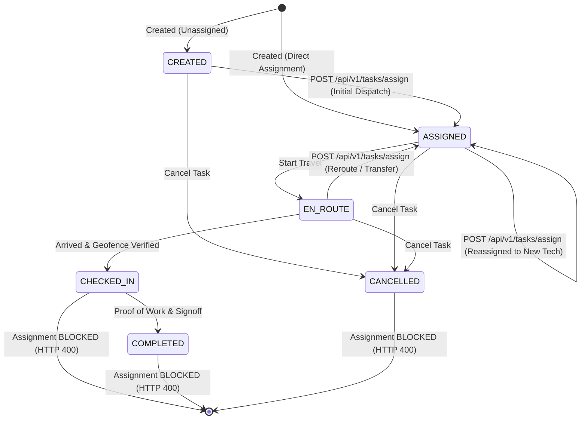

# Assign & Reassign Task Module Specification

## 1. Document Metadata

| Attribute | Detail |
| :--- | :--- |
| **Document Reference** | `FFM-SPEC-FLD-ASSIGN-TASK-V1.0` |
| **System** | Field Force Management (FFM) Platform |
| **Service** | Field Operations Service (`FFM.FieldOperations`) |
| **Module** | Module 2: Task Dispatch — Feature: Assign & Reassign Task |
| **Default Port** | `5030` |
| **Method & Route** | `POST /api/v1/tasks/assign` |
| **Compliance** | ISO/IEC/IEEE 29148, OpenAPI 3.1, RFC 7807 (ProblemDetails) |
| **Authentication** | Bearer JWT RS256 (issued by Identity & Access Service) |
| **Classification** | Tier‑1 Core Dispatch & Workforce Allocation |
| **Status** | Approved Formal Specification |
| **Parent Document** | `FFM_Field_Operations_Service_Spec.md`, Section 7.2 |

---

## 2. Objective & Functional Scope

The **Assign & Reassign Task** module enables dispatchers, supervisors, and operations managers to allocate or transfer field work orders to qualified technicians.

### Key Capabilities:
1. **Initial Task Dispatch:** Assigns an unassigned task (`Status: CREATED`) to a technician, transitioning its state to **`ASSIGNED`**.
2. **Dynamic Task Reassignment:** Transfers an already assigned task (e.g., technician on leave, emergency vehicle breakdown, or zone rebalancing) to a different technician without altering historical task identifiers or site links.
3. **Lifecycle State Protection:** Strictly prevents assignment or reassignment of tasks that have reached execution or terminal states (`CHECKED_IN`, `COMPLETED`, `CANCELLED`).
4. **Zero Path Parameters Standard:** All payload attributes (`taskId`, `assignedEmployeeId`) are delivered strictly via the JSON request body.
5. **Audit Traceability:** Automatically updates `UpdatedAt` timestamp and emits operational dispatch events for mobile push and WebSocket notification pipelines.

---

## 3. Authorization & RBAC Policy

| Role | Allowed? | Enforcement Rationale |
| :--- | :---: | :--- |
| `SYSTEM_ADMIN` | ✅ Yes | Global authority to assign or reassign any task across all tenants and regions. |
| `ADMIN` | ✅ Yes | Operational authority to dispatch tasks within their organization. |
| `MANAGER` | ✅ Yes | Zone and team dispatch authority for all technicians under supervision. |
| `SUPERVISOR` | ✅ Yes | Direct shift dispatch and rebalancing for their assigned team. |
| `EMPLOYEE` | ❌ No | Field technicians cannot self-assign or reassign tasks; strictly blocked (`HTTP 403 Forbidden`). |

* **Unauthenticated Requests:** Returns `401 Unauthorized`.
* **Insufficient Role (`EMPLOYEE`):** Returns `403 Forbidden`.

---

## 4. State Transition Matrix

The task lifecycle allows assignment only during pre-work phases:



| Current Status | Can Assign / Reassign? | Resulting Status | Notes |
| :--- | :---: | :---: | :--- |
| `CREATED` | ✅ **Yes** | `ASSIGNED` | Initial dispatch of queued/unassigned task. |
| `ASSIGNED` | ✅ **Yes** | `ASSIGNED` | Reassignment to a different technician. |
| `EN_ROUTE` | ✅ **Yes** | `ASSIGNED` | Technician recalled/redirected; new technician assigned. |
| `CHECKED_IN` | ❌ **No** | — | Technician already on-site performing work. Returns `400 Bad Request`. |
| `COMPLETED` | ❌ **No** | — | Terminal state. Work is finalized. Returns `400 Bad Request`. |
| `CANCELLED` | ❌ **No** | — | Terminal state. Task is aborted. Returns `400 Bad Request`. |

---

## 5. Business Rules & Validation Policies

| Rule ID | Rule Name | Business Constraint | Error Code | HTTP Status |
| :--- | :--- | :--- | :--- | :---: |
| **BR-ATSK-01** | Task Existence | `taskId` must reference an active, existing task in the database. | `TASK_NOT_FOUND` | `404 Not Found` |
| **BR-ATSK-02** | Terminal State Defense | Tasks in `CHECKED_IN`, `COMPLETED`, or `CANCELLED` status cannot be assigned or reassigned. | `INVALID_TASK_STATE` | `400 Bad Request` |
| **BR-ATSK-03** | Valid Employee ID | `assignedEmployeeId` must be a positive integer $> 0$. | `INVALID_EMPLOYEE_ID` | `400 Bad Request` |
| **BR-ATSK-04** | Redundant Assignment | If the task is already assigned to the same technician, return informative confirmation without duplicate writes. | `NO_CHANGE` | `200 OK` |
| **BR-ATSK-05** | Zero Path Parameter | Must use JSON body (`{ "taskId": ..., "assignedEmployeeId": ... }`). No URL path parameters permitted. | `BAD_REQUEST` | `400 Bad Request` |
| **BR-ATSK-06** | Creator / Dispatcher Audit | Records modification timestamp (`UpdatedAt = UtcNow`) and preserves original `CreatedByUserId`. | Automated Logic | `200 OK` |

---

## 6. API Contract: `POST /api/v1/tasks/assign`

### 6.1 Request Endpoint
* **HTTP Method:** `POST`
* **Route:** `/api/v1/tasks/assign`
* **Headers:**
  ```http
  Authorization: Bearer <jwt_access_token>
  Content-Type: application/json
  ```

### 6.2 Request Payload (`AssignTaskRequest`)

```json
{
  "taskId": 1,
  "assignedEmployeeId": 8
}
```

### 6.3 Request Schema Definition

| Attribute | Type | Mandatory? | Constraints | Description |
| :--- | :---: | :---: | :--- | :--- |
| `taskId` | `int` | **Yes** | Integer $> 0$; must exist | Unique primary identifier of the task |
| `assignedEmployeeId` | `int` | **Yes** | Integer $> 0$ | User ID of the technician being dispatched |

---

### 6.4 Success Response (`HTTP 200 OK`)

```json
{
  "success": true,
  "message": "Task assigned successfully.",
  "data": {
    "id": 1,
    "taskNumber": "TSK-202610-0001",
    "title": "Quarterly POS Hardware Maintenance",
    "description": "Inspect terminal, replace battery backup, run diagnostic pass.",
    "priority": "HIGH",
    "status": "ASSIGNED",
    "clientSiteId": 1,
    "clientSiteName": "HDFC Bank Regional Office",
    "clientSiteCode": "SITE-BLR-001",
    "address": "42 MG Road, Bengaluru, Karnataka 560001",
    "latitude": 12.9715987,
    "longitude": 77.5945627,
    "radiusMeters": 150,
    "assignedEmployeeId": 8,
    "scheduledStart": "2026-11-25T09:30:00Z",
    "scheduledEnd": "2026-11-25T12:00:00Z",
    "createdByUserId": 12,
    "createdAt": "2026-10-22T06:55:49.835778Z",
    "updatedAt": "2026-10-22T09:15:00.1234567Z"
  },
  "error": null,
  "timestamp": "2026-10-22T09:15:00.1250000Z"
}
```

---

### 6.5 Error Responses (RFC 7807 Standard)

#### 1. Task Not Found (`HTTP 404 Not Found`):
```json
{
  "success": false,
  "message": "Task with ID 999 was not found.",
  "data": null,
  "error": {
    "code": "TASK_NOT_FOUND",
    "details": "Validation error"
  },
  "timestamp": "2026-10-22T09:15:10.0000000Z"
}
```

#### 2. Invalid Task State (`HTTP 400 Bad Request`):
```json
{
  "success": false,
  "message": "Cannot reassign a task that is in 'COMPLETED' status.",
  "data": null,
  "error": {
    "code": "INVALID_TASK_STATE",
    "details": "Validation error"
  },
  "timestamp": "2026-10-22T09:15:15.0000000Z"
}
```

#### 3. Invalid Employee ID (`HTTP 400 Bad Request`):
```json
{
  "success": false,
  "message": "AssignedEmployeeId must be a positive integer greater than zero.",
  "data": null,
  "error": {
    "code": "VALIDATION_ERROR",
    "details": "Validation error"
  },
  "timestamp": "2026-10-22T09:15:20.0000000Z"
}
```

#### 4. Unauthorized Role (`HTTP 403 Forbidden`):
```json
{
  "success": false,
  "message": "You do not have permission to perform this action",
  "data": null,
  "error": {
    "code": "FORBIDDEN",
    "details": "Forbidden"
  },
  "timestamp": "2026-10-22T09:15:25.0000000Z"
}
```

---

## 7. Architecture & Implementation Blueprint

### 7.1 Layered Structure

```
FFM.FieldOperations
├── FFM.FieldOperations.Domain
│   └── Entities/TaskItem.cs              # Assign(int employeeId) domain method
├── FFM.FieldOperations.Application
│   ├── DTOs/TaskDto.cs                   # AssignTaskRequest DTO
│   ├── Commands/AssignTaskCommand.cs     # IRequest<TaskDto>
│   └── Handlers/AssignTaskCommandHandler.cs
├── FFM.FieldOperations.Infrastructure
│   └── Repositories/TaskRepository.cs   # GetByIdWithSiteAsync(int id)
└── FFM.FieldOperations.Api
    └── Controllers/TasksController.cs    # POST /api/v1/tasks/assign endpoint
```

### 7.2 Domain Method Invariant Guard (Already in `TaskItem.cs`)

```csharp
public void Assign(int employeeId)
{
    if (employeeId <= 0)
        throw new ArgumentException("Invalid Employee ID.", nameof(employeeId));

    if (Status == "CHECKED_IN" || Status == "COMPLETED" || Status == "CANCELLED")
        throw new InvalidOperationException($"Cannot reassign a task that is in '{Status}' status.");

    AssignedEmployeeId = employeeId;
    Status = "ASSIGNED";
    UpdatedAt = DateTime.UtcNow;
}
```

---

## 8. Test Cases & Acceptance Criteria

| TC ID | Test Scenario | Request Body | Expected HTTP | Expected Status Field |
| :---: | :--- | :--- | :---: | :---: |
| **TC-ATSK-01** | Assign unassigned task (`CREATED` $\rightarrow$ `ASSIGNED`) | `{"taskId": 2, "assignedEmployeeId": 8}` | `200 OK` | `"ASSIGNED"` |
| **TC-ATSK-02** | Reassign task to different technician | `{"taskId": 1, "assignedEmployeeId": 14}` | `200 OK` | `"ASSIGNED"` (`assignedEmployeeId = 14`) |
| **TC-ATSK-03** | Reassign task in `EN_ROUTE` status | `{"taskId": 3, "assignedEmployeeId": 14}` | `200 OK` | `"ASSIGNED"` |
| **TC-ATSK-04** | Block assignment on `CHECKED_IN` task | `{"taskId": 4, "assignedEmployeeId": 8}` | `400 Bad Request` | Error `INVALID_TASK_STATE` |
| **TC-ATSK-05** | Block assignment on `COMPLETED` task | `{"taskId": 5, "assignedEmployeeId": 8}` | `400 Bad Request` | Error `INVALID_TASK_STATE` |
| **TC-ATSK-06** | Block assignment on `CANCELLED` task | `{"taskId": 6, "assignedEmployeeId": 8}` | `400 Bad Request` | Error `INVALID_TASK_STATE` |
| **TC-ATSK-07** | Non-existent Task ID (`taskId = 99999`) | `{"taskId": 99999, "assignedEmployeeId": 8}` | `404 Not Found` | Error `TASK_NOT_FOUND` |
| **TC-ATSK-08** | Invalid Employee ID (`assignedEmployeeId = -1`) | `{"taskId": 1, "assignedEmployeeId": -1}` | `400 Bad Request` | Error `VALIDATION_ERROR` |
| **TC-ATSK-09** | Forbidden role (`EMPLOYEE`) | Valid payload with Employee token | `403 Forbidden` | Error `FORBIDDEN` |
| **TC-ATSK-10** | Missing Authentication token | Valid payload, no Authorization header | `401 Unauthorized` | Error `UNAUTHORIZED` |
