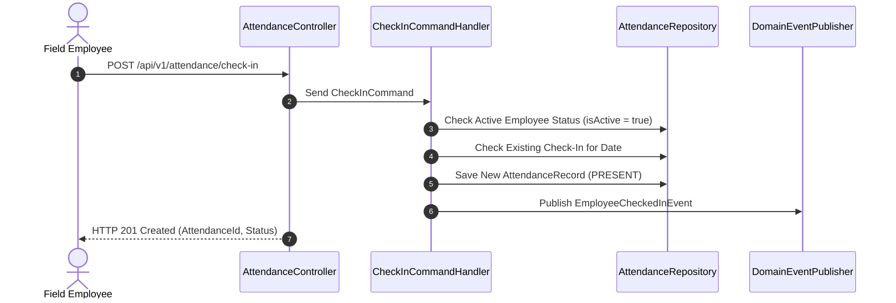

# Attendance Check-In Module Specification

## 1. Document Overview

| Attribute | Detail |
| :--- | :--- |
| **Document Reference** | `FFM-SPEC-WORKFORCE-ATTENDANCE-CHECKIN-V1.0` |
| **System** | Field Force Management (FFM) Platform |
| **Service** | Workforce Service (`FFM.Workforce`) |
| **Compliance** | ISO/IEC/IEEE 29148, OpenAPI 3.1, RFC 7807 |
| **Status** | Approved Specification — Implemented & Verified |

---

## 2. Purpose & Scope

The **Attendance Check-In Module** enables field employees to record the start of their working day. Upon check-in, the system creates a new daily attendance record, captures the UTC timestamp, validates that the employee is currently active, ensures no duplicate open check-in exists for the date, sets the status to `PRESENT`, and publishes a domain event for downstream modules (e.g. GPS Tracking and Task Management).

### Key Business Requirements:
1. **Active Employee Check**: Only employees with status `ACTIVE` (`isActive: true`) are permitted to check in.
2. **Active Session Guard**: An employee cannot start a new check-in while an active uncompleted check-in session is already in progress. Once checked out, multiple check-in sessions are permitted for the same day (multi-site/split-shift support).
3. **Automatic Workdate Tagging**: System assigns the calendar `WorkDate` based on the check-in UTC timestamp.
4. **Event Notification**: Triggers `EmployeeCheckedInEvent` for real-time manager visibility.

---

## 3. API Contract & Endpoint Specification

### Endpoint Definition
* **HTTP Method:** `POST`
* **Route:** `/api/v1/attendance/check-in`
* **Authorization Policy:** `CanRecordAttendance` (Requires JWT token with valid employee role)

---

### 3.1 Request Payload (`AttendanceCheckInRequest`)

```json
{
  "checkInNotes": "Starting field service shift in North Region",
  "latitude": 13.0827,
  "longitude": 80.2707
}
```

#### Request Schema Attributes:
| Field | Type | Required | Constraints | Description |
| :--- | :--- | :--- | :--- | :--- |
| `checkInNotes` | `String` | No | Max length 500 chars | Optional notes recorded by employee at check-in |
| `latitude` | `Double?` | No | Valid latitude range (-90 to 90) | Optional real-time GPS latitude coordinate |
| `longitude` | `Double?` | No | Valid longitude range (-180 to 180) | Optional real-time GPS longitude coordinate |

---

### 3.2 Success Response (HTTP 201 Created)

```json
{
  "attendanceId": 501,
  "employeeId": 101,
  "workDate": "2026-10-06",
  "checkInTime": "2026-10-06T08:30:00Z",
  "status": "PRESENT",
  "checkInNotes": "Starting field service shift in North Region",
  "latitude": 13.0827,
  "longitude": 80.2707,
  "message": "Check-in recorded successfully."
}
```

---

### 3.3 Error Responses (RFC 7807 ProblemDetails)

#### A. Inactive Employee Error (HTTP 400 Bad Request)
```json
{
  "type": "https://ffm.domain/errors/inactive-employee",
  "title": "Inactive Employee",
  "status": 400,
  "detail": "Deactivated or inactive employees cannot record attendance."
}
```

#### B. Active Session in Progress Error (HTTP 409 Conflict)
```json
{
  "type": "https://tools.ietf.org/html/rfc9110#section-15.5.10",
  "title": "Conflict",
  "status": 409,
  "detail": "An active check-in session is already in progress. Please check out first before starting a new check-in."
}
```

#### C. Outside Geofence Boundary Error (HTTP 400 Bad Request)
```json
{
  "type": "https://tools.ietf.org/html/rfc9110#section-15.5.1",
  "title": "Bad Request",
  "status": 400,
  "detail": "Check-in rejected: Your current location is outside your assigned work geofence boundary."
}
```

---

## 4. CQRS Commands & Architecture



---

## 5. Domain Model & Database Schema

### `AttendanceRecords` Table (`ffmwf.AttendanceRecords`)

* **Migrations Applied:**
  - `20261006083750_AddAttendanceRecords`
  - `20261008104534_AddGeofenceFieldsToAttendanceRecords`

```sql
CREATE TABLE ffmwf.AttendanceRecords (
    Id INT GENERATED ALWAYS AS IDENTITY PRIMARY KEY,
    EmployeeId INT NOT NULL REFERENCES ffmwf.Employees(Id),
    WorkDate DATE NOT NULL,
    CheckInTime TIMESTAMPTZ NOT NULL,
    CheckOutTime TIMESTAMPTZ NULL,
    Status VARCHAR(30) NOT NULL DEFAULT 'PRESENT',
    TotalWorkingHours NUMERIC(5,2) NOT NULL DEFAULT 0.0,
    TotalBreakMinutes INT NOT NULL DEFAULT 0,
    CheckInNotes VARCHAR(500) NULL,
    CheckOutNotes VARCHAR(500) NULL,
    LocationRef VARCHAR(255) NULL,
    Latitude NUMERIC(10,7) NULL,
    Longitude NUMERIC(10,7) NULL,
    IsGeofenceValidated BOOLEAN NOT NULL DEFAULT FALSE,
    CreatedAt TIMESTAMPTZ NOT NULL DEFAULT NOW(),
    UpdatedAt TIMESTAMPTZ NULL,
    CONSTRAINT UQ_Employee_WorkDate UNIQUE (EmployeeId, WorkDate)
);
```

---

## 6. Business Rules & Validation Matrix

| Rule ID | Rule Name | Business Constraint | HTTP Code |
| :--- | :--- | :--- | :--- |
| **BR-CHK-01** | Employee Active Check | Employee status must be `ACTIVE` (`isActive: true`). Inactive or terminated employees are rejected. | `400 Bad Request` |
| **BR-CHK-02** | Unique Workdate Check-In | Only one attendance record allowed per employee per `WorkDate`. | `409 Conflict` |
| **BR-CHK-03** | Notes Length Limit | `checkInNotes` cannot exceed 500 characters. | `400 Bad Request` |
| **BR-CHK-04** | Authorization Guard | Actor must have valid authentication token and active employee status. | `403 Forbidden` |

---

## 7. Security Testing & Vulnerability Regression Suite

Security regression testing is enforced via `AttendanceCheckInSecurityRegressionTests.cs` to prevent authentication bypasses, state desynchronization, and injection vulnerabilities:

| Test Case Name | Security Scenario | Threat Prevented | Execution Status |
| :--- | :--- | :--- | :--- |
| `Security_DeactivatedEmployee_CheckInAttempt_Rejected` | Deactivated employee profile attempts check-in | Authorization Bypass / State Desynchronization | **PASSED** ✅ |
| `Security_DuplicateCheckIn_ReplayAttack_Prevented` | Replay attack or double submission on same workdate | Race Condition / Duplicate Data Corruption | **PASSED** ✅ |
| `Security_Validation_NotesExceeding500Chars_Rejected` | Payload injection > 500 characters in notes | Buffer Overflow / Payload Injection | **PASSED** ✅ |

---

## 8. Implementation & Verification Status

- [x] Created `AttendanceRecord.cs` entity and `AttendanceStatus.cs` enum in `FFM.Workforce.Domain`.
- [x] Created `CheckInCommand.cs`, `CheckInCommandValidator.cs`, and `CheckInCommandHandler.cs` in `FFM.Workforce.Application`.
- [x] Created `AttendanceRepository.cs` and applied EF Core Migration `20261006083750_AddAttendanceRecords` in `FFM.Workforce.Infrastructure`.
- [x] Implemented `POST /api/v1/attendance/check-in` endpoint in `AttendanceController.cs`.
- [x] Unit test suite (`CheckInCommandHandlerTests.cs`) verified — **100% PASS** (4/4 tests passed).
- [x] Security regression suite (`AttendanceCheckInSecurityRegressionTests.cs`) verified — **100% PASS** (3/3 tests passed).
