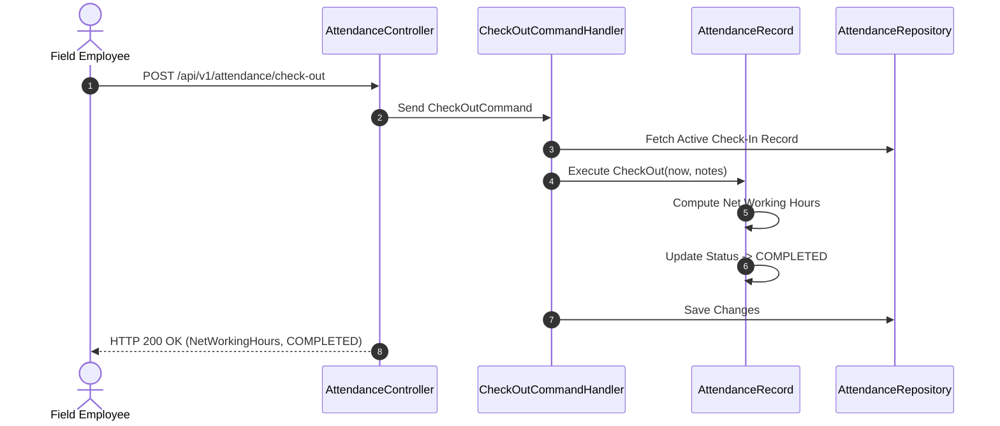

# Attendance Check-Out Module Specification

## 1. Document Overview

| Attribute | Detail |
| :--- | :--- |
| **Document Reference** | `FFM-SPEC-WORKFORCE-ATTENDANCE-CHECKOUT-V1.0` |
| **System** | Field Force Management (FFM) Platform |
| **Service** | Workforce Service (`FFM.Workforce`) |
| **Compliance** | ISO/IEC/IEEE 29148, OpenAPI 3.1, RFC 7807 |
| **Status** | Approved Specification — Implemented & Verified |

---

## 2. Purpose & Scope

The **Attendance Check-Out Module** enables field employees to record the end of their working day. Upon check-out, the system validates that an active check-in record exists for the date, confirms that no open break is active, captures the check-out timestamp, calculates the total break duration and net working hours, updates the record status to `COMPLETED`, and publishes a domain event (`EmployeeCheckedOutEvent`) for downstream modules (e.g. Task Management and Reporting).

### Key Business Requirements:
1. **Active Check-In Guard**: Check-out requires an existing active check-in record for the workday (`BR-ATT-03`).
2. **Unclosed Break Check**: Check-out is blocked if an active break is still open (`BR-ATT-04`).
3. **Net Working Hours Calculation**: Calculates net working duration using the formula:
   $$\text{Net Working Hours} = (\text{CheckOut Time} - \text{CheckIn Time}) - \left(\frac{\text{Total Break Minutes}}{60.0}\right)$$
4. **Status Completion**: Transitions attendance state from `PRESENT` $\rightarrow$ `COMPLETED`.

---

## 3. API Contract & Endpoint Specification

### Endpoint Definition
* **HTTP Method:** `POST`
* **Route:** `/api/v1/attendance/check-out`
* **Authorization Policy:** `CanRecordAttendance` (Requires JWT token with valid employee role)

---

### 3.1 Request Payload (`AttendanceCheckOutRequest`)

```json
{
  "checkOutNotes": "Completed 5 scheduled site visits",
  "latitude": 13.0827,
  "longitude": 80.2707
}
```

#### Request Schema Attributes:
| Field | Type | Required | Constraints | Description |
| :--- | :--- | :--- | :--- | :--- |
| `checkOutNotes` | `String` | No | Max length 500 chars | Optional notes recorded by employee at check-out |
| `latitude` | `Double?` | No | Valid latitude range (-90 to 90) | Optional real-time GPS latitude coordinate at check-out |
| `longitude` | `Double?` | No | Valid longitude range (-180 to 180) | Optional real-time GPS longitude coordinate at check-out |

---

### 3.2 Success Response (HTTP 200 OK)

```json
{
  "attendanceId": 501,
  "employeeId": 101,
  "workDate": "2026-10-06",
  "checkInTime": "2026-10-06T08:30:00Z",
  "checkOutTime": "2026-10-06T16:30:00Z",
  "totalBreakMinutes": 45,
  "netWorkingHours": 7.25,
  "status": "COMPLETED",
  "checkOutNotes": "Completed 5 scheduled site visits",
  "checkOutLatitude": 13.0827,
  "checkOutLongitude": 80.2707,
  "message": "Check-out recorded successfully."
}
```

---

### 3.3 Error Responses (RFC 7807 ProblemDetails)

#### A. Missing Active Check-In Error (HTTP 400 Bad Request)
```json
{
  "type": "https://ffm.domain/errors/missing-checkin",
  "title": "Missing Check-In",
  "status": 400,
  "detail": "No active check-in record found for checkout."
}
```

#### B. Active Break Open Error (HTTP 400 Bad Request)
```json
{
  "type": "https://ffm.domain/errors/active-break-open",
  "title": "Active Break Open",
  "status": 400,
  "detail": "Cannot check out while on an active break. Please end break first."
}
```

#### C. Outside Geofence Boundary Error (HTTP 400 Bad Request)
```json
{
  "type": "https://tools.ietf.org/html/rfc9110#section-15.5.1",
  "title": "Bad Request",
  "status": 400,
  "detail": "Check-out rejected: Your current location is outside your assigned work geofence boundary."
}
```

---

## 4. CQRS Commands & Architecture



---

## 5. Business Rules & Validation Matrix

| Rule ID | Rule Name | Business Constraint | HTTP Code |
| :--- | :--- | :--- | :--- |
| **BR-OUT-01** | Employee Active Check | Employee status must be `ACTIVE` (`isActive: true`). | `400 Bad Request` |
| **BR-OUT-02** | Active Check-In Guard | Must have an active check-in record for the work date. | `400 Bad Request` |
| **BR-OUT-03** | Active Break Guard | Cannot check out while a break is active. | `400 Bad Request` |
| **BR-OUT-04** | Chronological Check | Check-out timestamp cannot be earlier than check-in timestamp. | `400 Bad Request` |
| **BR-OUT-05** | Notes Length Limit | `checkOutNotes` cannot exceed 500 characters. | `400 Bad Request` |

---

## 6. Security Testing & Vulnerability Regression Suite

Security regression testing is enforced via `AttendanceCheckOutSecurityRegressionTests.cs`:

| Test Case Name | Security Scenario | Threat Prevented | Execution Status |
| :--- | :--- | :--- | :--- |
| `Security_UnauthenticatedOrMissingCheckIn_CheckOut_Rejected` | Unauthenticated or missing check-in record checkout attempt | State Desynchronization / Authorization Bypass | **PASSED** ✅ |
| `Security_Validation_NotesExceeding500Chars_Rejected` | Payload injection > 500 characters in notes | Buffer Overflow / Payload Injection | **PASSED** ✅ |

---

## 7. Implementation & Verification Status

- [x] Added `CheckOut` domain method to `AttendanceRecord.cs` in `FFM.Workforce.Domain`.
- [x] Created `CheckOutCommand.cs`, `CheckOutCommandValidator.cs`, and `CheckOutCommandHandler.cs` in `FFM.Workforce.Application`.
- [x] Added `POST /api/v1/attendance/check-out` endpoint in `AttendanceController.cs`.
- [x] Unit test suite (`CheckOutCommandHandlerTests.cs`) verified — **100% PASS** (4/4 tests passed).
- [x] Security regression suite (`AttendanceCheckOutSecurityRegressionTests.cs`) verified — **100% PASS** (2/2 tests passed).
