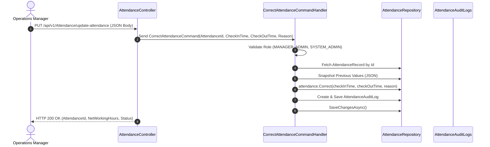

# Attendance Correction / Regularization Module Specification

## 1. Document Overview

| Attribute | Detail |
| :--- | :--- |
| **Document Reference** | `FFM-SPEC-WORKFORCE-ATTENDANCE-CORRECTION-V1.0` |
| **System** | Field Force Management (FFM) Platform |
| **Service** | Workforce Service (`FFM.Workforce`) |
| **Compliance** | ISO/IEC/IEEE 29148, OpenAPI 3.1, RFC 7807 |
| **Status** | Approved Specification — Implemented & Verified |

---

## 2. Purpose & Scope

The **Attendance Correction / Regularization Module** allows managers, admins, and system administrators to adjust an employee's check-in or check-out timestamps (e.g. if an employee forgot to punch out due to device failure). Every correction recalculates net working hours, sets the status to `CORRECTED` (mapped via foreign key to `AttendanceStatuses`), and generates an immutable record in `AttendanceAuditLogs` capturing the actor's user ID, previous values, new values, mandatory justification reason, and UTC timestamp.

### Key Business Requirements:
1. **Role-Based Permission Guard (`BR-ATT-07`)**: Corrections can only be performed by users with roles `MANAGER`, `ADMIN`, or `SYSTEM_ADMIN`. Field employees cannot self-correct attendance.
2. **Mandatory Reason (`BR-ATT-08`)**: A non-empty text reason justifying the correction is required.
3. **Timestamp Validation & Strict UTC (`BR-ATT-09`)**: Corrected check-out time cannot be earlier than check-in time. All timestamps must strictly follow ISO-8601 UTC format (`YYYY-MM-DDTHH:mm:ss.fffZ`).
4. **Immutable Audit Logging (`BR-ATT-10`)**: Every correction writes an audit trail to `AttendanceAuditLogs`.
5. **Consolidated Request Body**: Endpoint receives `attendanceId` inside the JSON body (`PUT /api/v1/Attendance/update-attendance`) instead of a URL path parameter.
6. **Normalized Status Table**: `AttendanceRecords.StatusId` references lookup table `AttendanceStatuses(Id, Code, Description)`.

---

## 3. API Contract & Endpoint Specification

### Endpoint Definition
* **HTTP Method:** `PUT`
* **Route:** `/api/v1/Attendance/update-attendance`
* **Authorization Policy:** `CanCorrectAttendance` (Requires JWT token with `MANAGER`, `ADMIN`, or `SYSTEM_ADMIN` role)

---

### 3.1 Request Payload (`CorrectAttendanceRequest`)

```json
{
  "attendanceId": 8,
  "checkInTime": "2026-10-06T08:30:00.000Z",
  "checkOutTime": "2026-10-06T17:00:00.000Z",
  "reason": "Employee forgot to punch out due to battery drain"
}
```

#### Request Schema Attributes:
| Field | Type | Required | Constraints | Description |
| :--- | :--- | :--- | :--- | :--- |
| `attendanceId` | `Integer` | Yes | Must be > 0 | ID of the attendance record to correct |
| `checkInTime` | `DateTime?` | No | Valid UTC ISO-8601 timestamp (`Z` suffix) | Optional updated check-in timestamp |
| `checkOutTime` | `DateTime?` | No | Valid UTC ISO-8601 timestamp (`Z` suffix) | Optional updated check-out timestamp |
| `reason` | `String` | Yes | Non-empty, max 500 chars | Mandatory justification reason for correction |

---

### 3.2 Success Response (HTTP 200 OK)

```json
{
  "attendanceId": 8,
  "correctedByUserId": 202,
  "status": "CORRECTED",
  "netWorkingHours": 7.75,
  "message": "Attendance record corrected successfully."
}
```

---

### 3.3 Error Responses (RFC 7807 ProblemDetails)

#### A. Missing Reason Error (HTTP 400 Bad Request)
```json
{
  "type": "https://ffm.domain/errors/validation-error",
  "title": "Validation Error",
  "status": 400,
  "detail": "Correction reason is required."
}
```

#### B. Unauthorized Role Error (HTTP 403 Forbidden)
```json
{
  "type": "https://ffm.domain/errors/forbidden",
  "title": "Forbidden",
  "status": 403,
  "detail": "Insufficient permissions to correct attendance records."
}
```

---

## 4. CQRS Commands & Architecture



---

## 5. Domain Model & Database Schema

### `AttendanceStatuses` Table (`ffmwf.AttendanceStatuses`)

```sql
CREATE TABLE ffmwf.AttendanceStatuses (
    Id INT PRIMARY KEY,
    Code VARCHAR(50) NOT NULL UNIQUE,
    Description VARCHAR(255)
);

INSERT INTO ffmwf.AttendanceStatuses (Id, Code, Description) VALUES
(1, 'PRESENT', 'Employee checked in'),
(2, 'ON_BREAK', 'Employee currently on break'),
(3, 'COMPLETED', 'Attendance completed for the day'),
(4, 'CORRECTED', 'Attendance record corrected by manager/admin'),
(5, 'INCOMPLETE', 'Attendance incomplete');
```

### `AttendanceRecords` Table (`ffmwf.AttendanceRecords`)

```sql
ALTER TABLE ffmwf.AttendanceRecords 
    ADD CONSTRAINT FK_AttendanceRecords_AttendanceStatuses_StatusId 
    FOREIGN KEY (StatusId) REFERENCES ffmwf.AttendanceStatuses(Id);
```

### `AttendanceAuditLogs` Table (`ffmwf.AttendanceAuditLogs`)

```sql
CREATE TABLE ffmwf.AttendanceAuditLogs (
    Id INT GENERATED ALWAYS AS IDENTITY PRIMARY KEY,
    AttendanceId INT NOT NULL REFERENCES ffmwf.AttendanceRecords(Id),
    ActorUserId INT NOT NULL,
    Action VARCHAR(50) NOT NULL,
    PreviousValues JSONB NOT NULL,
    NewValues JSONB NOT NULL,
    Reason VARCHAR(500) NOT NULL,
    Timestamp TIMESTAMPTZ NOT NULL DEFAULT NOW()
);
```

---

## 6. Business Rules & Validation Matrix

| Rule ID | Rule Name | Business Constraint | HTTP Code |
| :--- | :--- | :--- | :--- |
| **BR-ATT-07** | Permission Guard | Only `MANAGER`, `ADMIN`, or `SYSTEM_ADMIN` roles can correct attendance. | `403 Forbidden` |
| **BR-ATT-08** | Mandatory Reason | Reason field is required and cannot be whitespace. | `400 Bad Request` |
| **BR-ATT-09** | Timestamp & UTC | Check-out time cannot be earlier than check-in time. ISO-8601 UTC timestamps enforced. | `400 Bad Request` |
| **BR-ATT-10** | Immutable Audit | System MUST write a permanent audit log entry for every correction. | Internal Enforcement |

---

## 7. Security Testing & Vulnerability Regression Suite

Security regression testing is enforced via `AttendanceCorrectionSecurityRegressionTests.cs`:

| Test Case Name | Security Scenario | Threat Prevented | Execution Status |
| :--- | :--- | :--- | :--- |
| `Security_EmployeeRole_CorrectionAttempt_Forbidden` | Field employee attempts to correct attendance | Unauthorized Data Tampering | **PASSED** ✅ |
| `Security_MissingReason_CorrectionAttempt_Rejected` | Correction submitted without justification reason | Audit Bypass | **PASSED** ✅ |
| `Security_CheckOutBeforeCheckIn_Rejected` | Check-out timestamp specified earlier than check-in | Data Integrity Corruption | **PASSED** ✅ |

---

## 8. Implementation & Verification Status

- [x] Strict UTC format handling across all attendance entities and API endpoints.
- [x] Created `AttendanceStatusLookup.cs` entity and mapped `AttendanceStatuses` lookup table in EF Core with Foreign Key `StatusId`.
- [x] Updated `CorrectAttendanceRequest` DTO and `AttendanceController.cs` route to `PUT /api/v1/Attendance/update-attendance` (removing `{id}` path param, using body `attendanceId`).
- [x] Executed EF Core migration `20261007114917_AddAttendanceStatusesTableAndForeignKey` against PostgreSQL database `ffm_db`.
- [x] Preserved `GET /api/v1/Attendance/my-history` query parameters intact.
- [x] Ran unit test suite (`dotnet test`): 199/199 unit & security regression tests **PASSED**.

