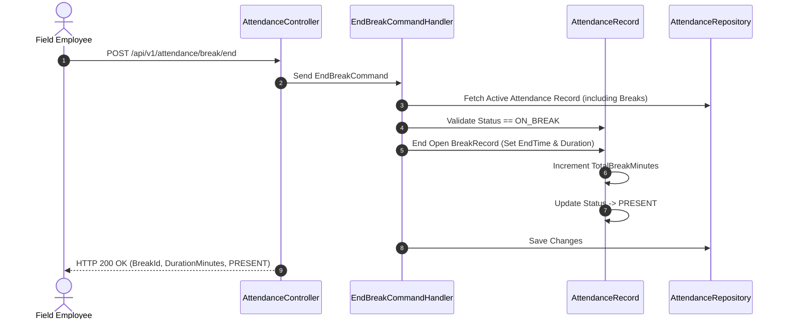

# Attendance End Break Module Specification

## 1. Document Overview

| Attribute | Detail |
| :--- | :--- |
| **Document Reference** | `FFM-SPEC-WORKFORCE-ATTENDANCE-ENDBREAK-V1.0` |
| **System** | Field Force Management (FFM) Platform |
| **Service** | Workforce Service (`FFM.Workforce`) |
| **Compliance** | ISO/IEC/IEEE 29148, OpenAPI 3.1, RFC 7807 |
| **Status** | Approved Specification for Implementation |

---

## 2. Purpose & Scope

The **Attendance End Break Module** enables field employees to complete an open break period. Upon ending a break, the system verifies that the employee has an active attendance record currently in the `ON_BREAK` state, locates the open break record (`BreakEndTime == null`), sets the break end timestamp, calculates the duration in minutes, updates `TotalBreakMinutes` on the attendance record, and transitions the attendance record status back from `ON_BREAK` $\rightarrow$ `PRESENT`.

### Key Business Requirements:
1. **Active Break Guard**: Ending a break requires an active attendance record in the `ON_BREAK` state (`BR-BRK-05`).
2. **Open Break Verification**: An open break record (`BreakEndTime == null`) must exist on the active attendance record (`BR-BRK-06`).
3. **Duration Calculation**: Break duration in minutes is computed and added to `TotalBreakMinutes` (`BR-BRK-07`).
4. **Status Transition**: Updates attendance status back to `PRESENT` (`BR-BRK-08`).

---

## 3. API Contract & Endpoint Specification

### Endpoint Definition
* **HTTP Method:** `POST`
* **Route:** `/api/v1/attendance/break/end`
* **Authorization Policy:** `CanRecordAttendance` (Requires JWT token with valid employee role)

---

### 3.1 Request Payload (`EndBreakRequest`)

```json
{
  "notes": "Completed lunch break"
}
```

#### Request Schema Attributes:
| Field | Type | Required | Constraints | Description |
| :--- | :--- | :--- | :--- | :--- |
| `notes` | `String` | No | Max length 500 characters | Optional remarks upon completing break |

---

### 3.2 Success Response (HTTP 200 OK)

```json
{
  "breakId": 901,
  "attendanceId": 501,
  "employeeId": 101,
  "breakType": "LUNCH",
  "breakStartTime": "2026-10-06T12:30:00Z",
  "breakEndTime": "2026-10-06T13:00:00Z",
  "durationMinutes": 30,
  "totalBreakMinutes": 30,
  "status": "PRESENT",
  "message": "Break ended successfully."
}
```

---

### 3.3 Error Responses (RFC 7807 ProblemDetails)

#### A. Not On Break Error (HTTP 400 Bad Request)
```json
{
  "type": "https://ffm.domain/errors/not-on-break",
  "title": "Not On Break",
  "status": 400,
  "detail": "Employee is not currently on an active break."
}
```

#### B. Deactivated Employee Error (HTTP 400 Bad Request)
```json
{
  "type": "https://ffm.domain/errors/employee-deactivated",
  "title": "Employee Deactivated",
  "status": 400,
  "detail": "Deactivated or inactive employees cannot record attendance."
}
```

---

## 4. CQRS Commands & Architecture



---

## 5. Business Rules & Validation Matrix

| Rule ID | Rule Name | Business Constraint | HTTP Code |
| :--- | :--- | :--- | :--- |
| **BR-BRK-05** | Active Break Required | Employee must currently have an active check-in with status `ON_BREAK`. | `400 Bad Request` |
| **BR-BRK-06** | Open Break Record Exists | Must have an open `BreakRecord` (`BreakEndTime == null`). | `400 Bad Request` |
| **BR-BRK-07** | Duration & Accumulation | Computes break duration and adds to `TotalBreakMinutes`. | `200 OK` |
| **BR-BRK-08** | Status Transition | Transitions status from `ON_BREAK` $\rightarrow$ `PRESENT`. | `200 OK` |

---

## 6. Security Testing & Vulnerability Regression Suite (Default)

Security regression testing is enforced via `AttendanceEndBreakSecurityRegressionTests.cs`:

| Test Case Name | Security Scenario | Threat Prevented | Execution Status |
| :--- | :--- | :--- | :--- |
| `Security_DeactivatedEmployee_EndBreak_Rejected` | Deactivated employee profile attempts break end | Authorization Bypass / State Desynchronization | **PASSED** ✅ |
| `Security_EndBreak_WithoutActiveBreak_Rejected` | Attempt to end break when status is PRESENT or COMPLETED | State Desynchronization / Data Corruption | **PASSED** ✅ |
| `Security_Validation_NotesExceeding500Chars_Rejected` | Oversized string injection in notes parameter | Parameter Tampering / Payload Overflow | **PASSED** ✅ |

---

## 7. Implementation Checklist

- [x] Add `EndBreak` domain method to `AttendanceRecord.cs`.
- [x] Ensure `IAttendanceRepository` loads `Breaks` collection during lookup.
- [x] Create DTOs `EndBreakRequest.cs` and `EndBreakResponseDto.cs`.
- [x] Create `EndBreakCommand.cs`, `EndBreakCommandValidator.cs`, and `EndBreakCommandHandler.cs`.
- [x] Add `POST /api/v1/attendance/break/end` endpoint in `AttendanceController.cs`.
- [x] Add unit tests (`EndBreakCommandHandlerTests.cs`) & default security tests (`AttendanceEndBreakSecurityRegressionTests.cs`).
