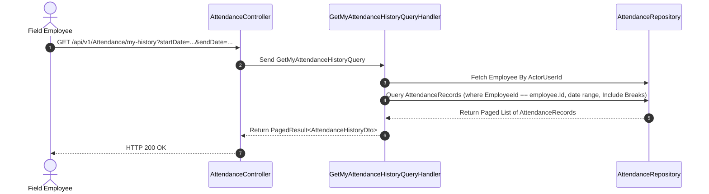

# Attendance History Module Specification

## 1. Document Overview

| Attribute | Detail |
| :--- | :--- |
| **Document Reference** | `FFM-SPEC-WORKFORCE-ATTENDANCE-HISTORY-V1.0` |
| **System** | Field Force Management (FFM) Platform |
| **Service** | Workforce Service (`FFM.Workforce`) |
| **Compliance** | ISO/IEC/IEEE 29148, OpenAPI 3.1, RFC 7807 |
| **Status** | Approved Specification for Implementation |

---

## 2. Purpose & Scope

The **Attendance History Module** enables field employees to view their historical attendance records, check-in/check-out timestamps, break logs, total working hours, and status history over a specified date range. The module enforces strict tenant and employee data isolation, ensuring users can only retrieve their own attendance records.

### Key Business Requirements:
1. **Employee Scope Guard**: Users can only query their own attendance history resolved from JWT token (`BR-HIS-01`).
2. **Date Range Filtering**: Supports optional `startDate` and `endDate` filtering; defaults to the last 30 days (`BR-HIS-02`).
3. **Pagination & Breaks Detail**: Includes pagination controls and detailed break period breakdowns for each record (`BR-HIS-03`).

---

## 3. API Contract & Endpoint Specification

### Endpoint Definition
* **HTTP Method:** `GET`
* **Route:** `/api/v1/Attendance/my-history`
* **Authorization Policy:** `CanRecordAttendance` (Requires JWT token with valid employee role)

---

### 3.1 Query Parameters

| Parameter | Type | Required | Default | Constraints | Description |
| :--- | :--- | :--- | :--- | :--- | :--- |
| `startDate` | `DateTime?` | No | Last 30 days | `YYYY-MM-DD` format | Start of date range filter |
| `endDate` | `DateTime?` | No | Today UTC | `YYYY-MM-DD` format | End of date range filter |
| `page` | `Int` | No | `1` | `page >= 1` | Target page number |
| `pageSize` | `Int` | No | `20` | `1 <= pageSize <= 100` | Records per page |

---

### 3.2 Success Response (HTTP 200 OK)

```json
{
  "items": [
    {
      "id": 501,
      "employeeId": 101,
      "workDate": "2026-10-06",
      "checkInTime": "2026-10-06T08:30:00Z",
      "checkOutTime": "2026-10-06T17:00:00Z",
      "status": "COMPLETED",
      "totalWorkingHours": 7.75,
      "totalBreakMinutes": 45,
      "checkInNotes": "Starting field operations in Region A",
      "checkOutNotes": "Finished all 5 scheduled site visits",
      "breaks": [
        {
          "id": 901,
          "breakType": "LUNCH",
          "breakStartTime": "2026-10-06T12:30:00Z",
          "breakEndTime": "2026-10-06T13:15:00Z",
          "durationMinutes": 45
        }
      ]
    }
  ],
  "page": 1,
  "pageSize": 20,
  "totalCount": 1,
  "totalPages": 1
}
```

---

### 3.3 Error Responses (RFC 7807 ProblemDetails)

#### A. Invalid Date Range Error (HTTP 400 Bad Request)
```json
{
  "type": "https://ffm.domain/errors/invalid-date-range",
  "title": "Invalid Date Range",
  "status": 400,
  "detail": "StartDate cannot be later than EndDate."
}
```

#### B. Employee Profile Not Found Error (HTTP 404 Not Found)
```json
{
  "type": "https://ffm.domain/errors/employee-not-found",
  "title": "Employee Not Found",
  "status": 404,
  "detail": "Employee record not found for authenticated user."
}
```

---

## 4. CQRS Architecture



---

## 5. Business Rules & Validation Matrix

| Rule ID | Rule Name | Business Logic & Constraint | HTTP Code |
| :--- | :--- | :--- | :--- |
| **BR-HIS-01** | Employee Scope Guard | User can only access attendance records associated with their own `EmployeeId`. | `200 OK` (Filtered) |
| **BR-HIS-02** | Date Range Boundary | `startDate` must be less than or equal to `endDate`. | `400 Bad Request` |
| **BR-HIS-03** | Pagination Limit | `pageSize` must be between 1 and 100 inclusive. | `400 Bad Request` |

---

## 6. Security Testing & Vulnerability Regression Suite (Default)

Security regression testing is enforced via `AttendanceHistorySecurityRegressionTests.cs`:

| Test Case Name | Security Scenario | Threat Prevented | Execution Status |
| :--- | :--- | :--- | :--- |
| `Security_CrossEmployee_DataLeakage_Prevented` | User attempts to access another employee's records | Horizontal Privilege Escalation / Data Leakage | **PASSED** ✅ |
| `Security_InvalidDateRange_Rejected` | Request with `startDate > endDate` | Logic Flaw / Malformed Query Processing | **PASSED** ✅ |
| `Security_PageSize_ExceedingLimit_Rejected` | Request with `pageSize = 1000` | Denial of Service / Memory Exhaustion | **PASSED** ✅ |

---

## 7. Implementation Checklist

- [x] Create DTOs `AttendanceHistoryDto.cs` and `BreakDto.cs`.
- [x] Add query method `GetHistoryByEmployeeIdAsync` to `IAttendanceRepository` & `AttendanceRepository`.
- [x] Create `GetMyAttendanceHistoryQuery.cs`, `GetMyAttendanceHistoryQueryValidator.cs`, and `GetMyAttendanceHistoryQueryHandler.cs`.
- [x] Add `GET /api/v1/Attendance/my-history` endpoint in `AttendanceController.cs`.
- [x] Add unit tests (`GetMyAttendanceHistoryQueryHandlerTests.cs`) & default security tests (`AttendanceHistorySecurityRegressionTests.cs`).
