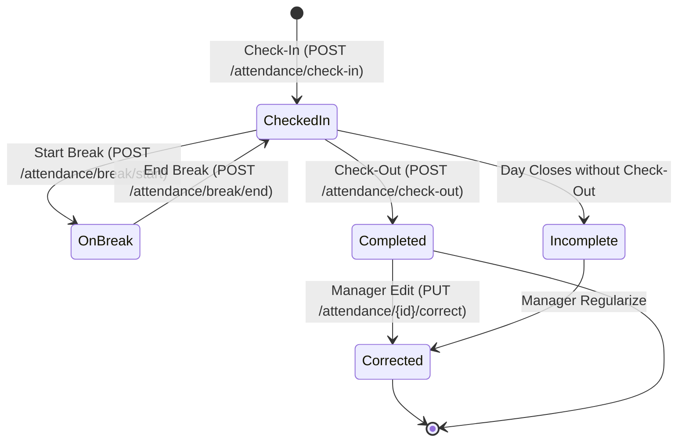

# Formal Technical Specification Document (Backend SDD)

## Module: Attendance Management
### Service: Workforce Service (`FFM.Workforce`)
### System: Field Force Management (FFM) Platform

| Document Attribute | Specification Detail |
| :--- | :--- |
| **Document Reference** | `FFM-SPEC-WORKFORCE-ATTENDANCE-V1.0` |
| **Standard Compliance** | ISO/IEC/IEEE 29148, OpenAPI 3.1, RFC 7807 (ProblemDetails) |
| **Module Classification** | Tier‑1 Core Business Service |
| **Status** | Formal Technical Specification — Approved |
| **Target Clients** | FFM Web Portal (Admin/Manager) & FFM Mobile App (Field Employee) |
| **Perspective** | **Backend / Server‑Side Only** |
| **Parent Document** | `FFM-Workforce_Service-Specification.md`, Section 4.2 |

---

## 1️⃣ Pre‑development Checklist

- [x] Solution builds cleanly with .NET 8 SDK (`dotnet build`).
- [x] Entity Framework Core migrations set up for `AttendanceRecords` and `BreakRecords`.
- [x] JWT Bearer authentication configured with claims (`sub`, `roles`, `orgUnitId`).
- [x] Redis connection configured for active session caching and shift lookup.
- [x] FluentValidation behaviors wired into MediatR pipeline.
- [x] Service running on default port `5010`.

---

## 2️⃣ Technical Glossary & Business Definitions

- **Attendance Record** – A daily entity capturing an employee's workday start (Check-in), workday end (Check-out), breaks, and total calculated working hours.
- **Check-In** – An attendance event recording the exact timestamp when an employee begins their field workday.
- **Check-Out** – An attendance event recording the timestamp when an employee finishes their field workday, triggering net working hours calculation.
- **Break Period** – A period during the workday (e.g. Lunch, Rest) where working time is paused.
- **Net Working Hours** – Total working duration computed as:
  $$\text{Net Working Hours} = (\text{CheckOut Time} - \text{CheckIn Time}) - \text{Total Break Duration}$$
- **Attendance Status** – The operational state of the record (`PRESENT`, `ON_BREAK`, `COMPLETED`, `CORRECTED`, `INCOMPLETE`, `LATE`).
- **Regularization / Correction** – A manager-approved manual adjustment of missing or incorrect check-in/check-out timestamps with mandatory audit logging.

---

## 3️⃣ Workday Lifecycle & State Machine

The Attendance record transitions through strict lifecycle states during a workday:



---

## 4️⃣ Data Dictionary & Database Schemas

### 4.1 `AttendanceRecords` Table (`ffmwf.AttendanceRecords`)

| Column Name | Data Type | Constraints | Description |
| :--- | :--- | :--- | :--- |
| `Id` | `INT` | `PK, IDENTITY` | Primary key identifier |
| `EmployeeId` | `INT` | `FK -> Employees(Id), NOT NULL` | Target employee identifier |
| `WorkDate` | `DATE` | `NOT NULL` | Calendar date of the workday |
| `CheckInTime` | `TIMESTAMPTZ` | `NOT NULL` | Workday check-in timestamp (UTC) |
| `CheckOutTime` | `TIMESTAMPTZ` | `NULL` | Workday check-out timestamp (UTC) |
| `Status` | `VARCHAR(30)` | `NOT NULL` | `PRESENT`, `ON_BREAK`, `COMPLETED`, `CORRECTED`, `INCOMPLETE` |
| `TotalWorkingHours` | `NUMERIC(5,2)`| `NOT NULL, DEFAULT 0.0` | Calculated net working hours |
| `TotalBreakMinutes` | `INT` | `NOT NULL, DEFAULT 0` | Total cumulative break duration in minutes |
| `CheckInNotes` | `VARCHAR(500)`| `NULL` | Notes recorded at check-in |
| `CheckOutNotes` | `VARCHAR(500)`| `NULL` | Notes recorded at check-out |
| `LocationRef` | `VARCHAR(255)`| `NULL` | Optional Geofence location token / site reference ID |
| `Latitude` | `NUMERIC(10,7)`| `NULL` | Optional real-time GPS latitude coordinate |
| `Longitude` | `NUMERIC(10,7)`| `NULL` | Optional real-time GPS longitude coordinate |
| `IsGeofenceValidated` | `BOOLEAN` | `NOT NULL, DEFAULT FALSE` | Flag indicating if GPS proximity was verified inside Geofence |
| `CreatedAt` | `TIMESTAMPTZ` | `NOT NULL, DEFAULT NOW()` | Record creation timestamp |
| `UpdatedAt` | `TIMESTAMPTZ` | `NULL` | Record last modification timestamp |

### 4.2 `BreakRecords` Table (`ffmwf.BreakRecords`)

| Column Name | Data Type | Constraints | Description |
| :--- | :--- | :--- | :--- |
| `Id` | `INT` | `PK, IDENTITY` | Primary key identifier |
| `AttendanceId` | `INT` | `FK -> AttendanceRecords(Id), NOT NULL` | Parent attendance record |
| `BreakType` | `VARCHAR(30)` | `NOT NULL` | `LUNCH`, `REST`, `PERSONAL` |
| `BreakStartTime` | `TIMESTAMPTZ` | `NOT NULL` | Break start timestamp (UTC) |
| `BreakEndTime` | `TIMESTAMPTZ` | `NULL` | Break end timestamp (UTC) |
| `DurationMinutes` | `INT` | `NULL` | Calculated break duration |

### 4.3 `AttendanceAuditLogs` Table (`ffmwf.AttendanceAuditLogs`)

| Column Name | Data Type | Constraints | Description |
| :--- | :--- | :--- | :--- |
| `Id` | `INT` | `PK, IDENTITY` | Audit log primary key |
| `AttendanceId` | `INT` | `FK -> AttendanceRecords(Id), NOT NULL` | Modified attendance record |
| `ActorUserId` | `INT` | `NOT NULL` | ID of manager/admin making correction |
| `Action` | `VARCHAR(50)` | `NOT NULL` | `CORRECT_CHECKIN`, `CORRECT_CHECKOUT`, `MANUAL_OVERRIDE` |
| `PreviousValues` | `JSONB` | `NOT NULL` | Snapshot of values before modification |
| `NewValues` | `JSONB` | `NOT NULL` | Snapshot of values after modification |
| `Reason` | `VARCHAR(500)`| `NOT NULL` | Mandatory justification reason |
| `Timestamp` | `TIMESTAMPTZ` | `NOT NULL, DEFAULT NOW()` | Change timestamp |

---

## 5️⃣ API Endpoints & Contracts Summary Table

| HTTP Method | Endpoint Path | Action | Request Payload | Authorization Policy |
| :--- | :--- | :--- | :--- | :--- |
| **`POST`** | `/api/v1/attendance/check-in` | Workday Check-In | `AttendanceCheckInRequest` | `CanRecordAttendance` |
| **`POST`** | `/api/v1/attendance/check-out` | Workday Check-Out | `AttendanceCheckOutRequest` | `CanRecordAttendance` |
| **`POST`** | `/api/v1/attendance/break/start` | Start Break Period | `StartBreakRequest` | `CanRecordAttendance` |
| **`POST`** | `/api/v1/attendance/break/end` | Resume Work | `EndBreakRequest` | `CanRecordAttendance` |
| **`GET`** | `/api/v1/attendance/my-history` | View Own History | Query (`startDate`, `endDate`) | `CanRecordAttendance` |
| **`GET`** | `/api/v1/attendance/team` | Monitor Team Attendance | Query (`orgUnitId`, `date`, `status`) | `CanViewTeamAttendance` |
| **`PUT`** | `/api/v1/attendance/{id}/correct` | Correct Attendance | `CorrectAttendanceRequest` | `CanCorrectAttendance` |

---

## 6️⃣ API Contracts & Request/Response Schemas

### 6.1 Check-In (`POST /api/v1/attendance/check-in`)

* **Headers**: `Authorization: Bearer <JWT>`
* **Request Body**:
  ```json
  {
    "checkInNotes": "Starting field operations in Region A"
  }
  ```
* **Response (HTTP 201 Created)**:
  ```json
  {
    "attendanceId": 501,
    "employeeId": 101,
    "workDate": "2026-10-06",
    "checkInTime": "2026-10-06T08:30:00Z",
    "status": "PRESENT",
    "message": "Check-in recorded successfully."
  }
  ```

---

### 6.2 Check-Out (`POST /api/v1/attendance/check-out`)

* **Headers**: `Authorization: Bearer <JWT>`
* **Request Body**:
  ```json
  {
    "checkOutNotes": "Finished all 5 scheduled site visits"
  }
  ```
* **Response (HTTP 200 OK)**:
  ```json
  {
    "attendanceId": 501,
    "employeeId": 101,
    "workDate": "2026-10-06",
    "checkInTime": "2026-10-06T08:30:00Z",
    "checkOutTime": "2026-10-06T17:00:00Z",
    "totalBreakMinutes": 45,
    "netWorkingHours": 7.75,
    "status": "COMPLETED",
    "message": "Check-out recorded successfully."
  }
  ```

---

### 6.3 Start Break (`POST /api/v1/attendance/break/start`)

* **Request Body**:
  ```json
  {
    "breakType": "LUNCH"
  }
  ```
* **Response (HTTP 200 OK)**:
  ```json
  {
    "breakId": 901,
    "attendanceId": 501,
    "breakStartTime": "2026-10-06T12:30:00Z",
    "status": "ON_BREAK"
  }
  ```

---

### 6.4 End Break (`POST /api/v1/attendance/break/end`)

* **Request Body**:
  ```json
  {
    "breakId": 901
  }
  ```
* **Response (HTTP 200 OK)**:
  ```json
  {
    "breakId": 901,
    "attendanceId": 501,
    "breakEndTime": "2026-10-06T13:15:00Z",
    "durationMinutes": 45,
    "status": "PRESENT"
  }
  ```

---

### 6.5 Attendance Correction (`PUT /api/v1/attendance/{id}/correct`)

* **Request Body**:
  ```json
  {
    "checkInTime": "2026-10-06T08:30:00Z",
    "checkOutTime": "2026-10-06T17:00:00Z",
    "reason": "Employee forgot to punch out due to battery drain"
  }
  ```
* **Response (HTTP 200 OK)**:
  ```json
  {
    "attendanceId": 501,
    "correctedByUserId": 202,
    "status": "CORRECTED",
    "netWorkingHours": 7.75,
    "message": "Attendance record corrected successfully."
  }
  ```

---

## 7️⃣ Business Rules & Validation Matrix

| Rule ID | Category | Business Logic & Constraint | RFC 7807 Error Response |
| :--- | :--- | :--- | :--- |
| **BR-ATT-01** | Check-In | Only employees with status `ACTIVE` can record check-in. | `400 Bad Request` ("Inactive employee cannot check in.") |
| **BR-ATT-02** | Check-In | An employee cannot check in if an active check-in record for the day is already open. | `409 Conflict` ("Employee is already checked in.") |
| **BR-ATT-03** | Check-Out | Check-out requires an active check-in record for the current workday. | `400 Bad Request` ("No active check-in found for checkout.") |
| **BR-ATT-04** | Check-Out | Cannot check out while an active break is open. Break must be closed first. | `400 Bad Request` ("Cannot check out while on an active break.") |
| **BR-ATT-05** | Break | Cannot start a break unless the employee is currently in `PRESENT` state. | `400 Bad Request` ("Employee must be checked in to start a break.") |
| **BR-ATT-06** | Break | Cannot start a new break if a break is already open and unclosed. | `409 Conflict` ("Active break already open.") |
| **BR-ATT-07** | Correction | Corrections can only be performed by `MANAGER`, `ADMIN`, or `SYSTEM_ADMIN`. | `403 Forbidden` ("Insufficient permissions to correct attendance.") |
| **BR-ATT-08** | Correction | Reason field is mandatory for all manual corrections. | `400 Bad Request` ("Correction reason is required.") |
| **BR-ATT-09** | Calculation | Check-out timestamp cannot be earlier than check-in timestamp. | `400 Bad Request` ("Check-out time must be after check-in time.") |
| **BR-ATT-10** | Audit | System must create a permanent audit log entry for every manual correction. | Internal Enforcement |

---

## 8️⃣ CQRS Application Architecture

The module follows CQRS architecture using MediatR:

* **Commands:**
  * `CheckInCommand` $\rightarrow$ `CheckInCommandHandler`
  * `CheckOutCommand` $\rightarrow$ `CheckOutCommandHandler`
  * `StartBreakCommand` $\rightarrow$ `StartBreakCommandHandler`
  * `EndBreakCommand` $\rightarrow$ `EndBreakCommandHandler`
  * `CorrectAttendanceCommand` $\rightarrow$ `CorrectAttendanceCommandHandler`
* **Queries:**
  * `GetMyAttendanceHistoryQuery` $\rightarrow$ `GetMyAttendanceHistoryQueryHandler`
  * `GetTeamAttendanceQuery` $\rightarrow$ `GetTeamAttendanceQueryHandler`
* **Domain Events Published:**
  * `EmployeeCheckedInEvent` (Notifies GPS & Task Management)
  * `EmployeeCheckedOutEvent` (Notifies Task & Reporting Services)

---

## 9️⃣ Security, RBAC & Audit Trail

1. **Authentication:** All requests require a valid JWT Access Token passed in the `Authorization` header (`Bearer <token>`).
2. **Role-Based Access Control (RBAC):**
   * **Field Employee:** Can execute own Check-In, Check-Out, Break Start/End, and View Own History.
   * **Manager:** Can view team attendance (`CanViewTeamAttendance`) and correct team attendance (`CanCorrectAttendance`).
   * **Admin / System Admin:** Full system-wide visibility and override capability.
3. **Immutable Audit Logging:** Every correction or manual override writes an immutable record to `AttendanceAuditLogs` capturing `ActorUserId`, `PreviousValues`, `NewValues`, `Reason`, and UTC timestamp.
