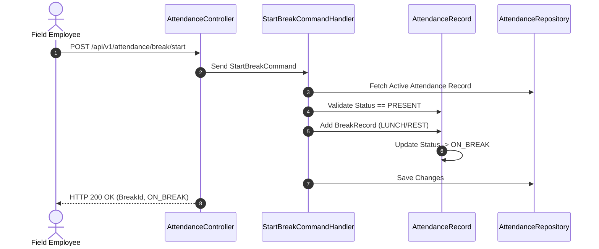

# Attendance Start Break Module Specification

## 1. Document Overview

| Attribute | Detail |
| :--- | :--- |
| **Document Reference** | `FFM-SPEC-WORKFORCE-ATTENDANCE-STARTBREAK-V1.0` |
| **System** | Field Force Management (FFM) Platform |
| **Service** | Workforce Service (`FFM.Workforce`) |
| **Compliance** | ISO/IEC/IEEE 29148, OpenAPI 3.1, RFC 7807 |
| **Status** | Approved Specification for Implementation |

---

## 2. Purpose & Scope

The **Attendance Start Break Module** enables field employees to pause their working day for a designated break period (e.g., `LUNCH`, `REST`, `PERSONAL`). Upon starting a break, the system verifies that the employee has an active check-in record for the workday, confirms that the employee is currently in the `PRESENT` state, captures the break start timestamp, creates a new `BreakRecord`, and transitions the attendance record status from `PRESENT` $\rightarrow$ `ON_BREAK`.

### Key Business Requirements:
1. **Active Check-In Guard**: Starting a break requires an existing active check-in record (`BR-ATT-04`).
2. **Single Open Break Rule**: An employee cannot start a new break if a break is already open and active (`BR-BRK-03`).
3. **Valid Break Types**: Supported break types are `LUNCH`, `REST`, and `PERSONAL`.
4. **Status Transition**: Updates attendance status to `ON_BREAK`.

---

## 3. API Contract & Endpoint Specification

### Endpoint Definition
* **HTTP Method:** `POST`
* **Route:** `/api/v1/attendance/break/start`
* **Authorization Policy:** `CanRecordAttendance` (Requires JWT token with valid employee role)

---

### 3.1 Request Payload (`StartBreakRequest`)

```json
{
  "breakType": "LUNCH"
}
```

#### Request Schema Attributes:
| Field | Type | Required | Constraints | Description |
| :--- | :--- | :--- | :--- | :--- |
| `breakType` | `String` | Yes | `LUNCH`, `REST`, `PERSONAL` | Category of the break period |

---

### 3.2 Success Response (HTTP 200 OK)

```json
{
  "breakId": 901,
  "attendanceId": 501,
  "employeeId": 101,
  "breakType": "LUNCH",
  "breakStartTime": "2026-10-06T12:30:00Z",
  "status": "ON_BREAK",
  "message": "Break started successfully."
}
```

---

### 3.3 Error Responses (RFC 7807 ProblemDetails)

#### A. Missing Active Check-In Error (HTTP 400 Bad Request)
```json
{
  "type": "https://ffm.domain/errors/missing-checkin",
  "title": "Missing Check-In",
  "status": 400,
  "detail": "Employee must be checked in to start a break."
}
```

#### B. Active Break Already Open Error (HTTP 409 Conflict)
```json
{
  "type": "https://ffm.domain/errors/active-break-open",
  "title": "Active Break Open",
  "status": 409,
  "detail": "Cannot start a new break while a break is already open."
}
```

#### C. Invalid Break Type Error (HTTP 400 Bad Request)
```json
{
  "type": "https://ffm.domain/errors/invalid-break-type",
  "title": "Invalid Break Type",
  "status": 400,
  "detail": "BreakType must be 'LUNCH', 'REST', or 'PERSONAL'."
}
```

---

## 4. CQRS Commands & Architecture



---

## 5. Domain Model & Database Schema

### `BreakRecords` Table (`ffmwf.BreakRecords`)

```sql
CREATE TABLE ffmwf.BreakRecords (
    Id INT GENERATED ALWAYS AS IDENTITY PRIMARY KEY,
    AttendanceId INT NOT NULL REFERENCES ffmwf.AttendanceRecords(Id),
    BreakType VARCHAR(30) NOT NULL,
    BreakStartTime TIMESTAMPTZ NOT NULL,
    BreakEndTime TIMESTAMPTZ NULL,
    DurationMinutes INT NULL,
    CreatedAt TIMESTAMPTZ NOT NULL DEFAULT NOW()
);
```

---

## 6. Business Rules & Validation Matrix

| Rule ID | Rule Name | Business Constraint | HTTP Code |
| :--- | :--- | :--- | :--- |
| **BR-BRK-01** | Employee Active Check | Employee status must be `ACTIVE` (`isActive: true`). | `400 Bad Request` |
| **BR-BRK-02** | Check-In Required | Must have an active check-in record for the work date. | `400 Bad Request` |
| **BR-BRK-03** | Single Open Break | Cannot start a break if status is already `ON_BREAK` or `COMPLETED`. | `409 Conflict` |
| **BR-BRK-04** | Valid Break Type | `breakType` must be one of: `LUNCH`, `REST`, `PERSONAL`. | `400 Bad Request` |

---

## 7. Security Testing & Vulnerability Regression Suite (Default)

Security regression testing is enforced via `AttendanceStartBreakSecurityRegressionTests.cs`:

| Test Case Name | Security Scenario | Threat Prevented | Execution Status |
| :--- | :--- | :--- | :--- |
| `Security_DeactivatedEmployee_StartBreak_Rejected` | Deactivated employee profile attempts break start | Authorization Bypass / State Desynchronization | **PASSED** ✅ |
| `Security_MultipleOpenBreaks_ReplayAttack_Prevented` | Replay attack or double submission starting 2 breaks | Double Break Replay / Data Corruption | **PASSED** ✅ |
| `Security_InvalidBreakType_Injection_Rejected` | SQL/Payload string injection in breakType | Parameter Tampering / Payload Injection | **PASSED** ✅ |

---

## 8. Implementation Checklist

- [x] Create `BreakRecord.cs` entity in `FFM.Workforce.Domain`.
- [x] Add `StartBreak` domain method to `AttendanceRecord.cs`.
- [x] Create `StartBreakCommand.cs`, `StartBreakCommandValidator.cs`, and `StartBreakCommandHandler.cs`.
- [x] Add EF Core `DbSet<BreakRecord>` in `WorkforceDbContext.cs` & generate migration.
- [x] Add `POST /api/v1/attendance/break/start` endpoint in `AttendanceController.cs`.
- [x] Add unit tests (`StartBreakCommandHandlerTests.cs`) & default security tests (`AttendanceStartBreakSecurityRegressionTests.cs`).
