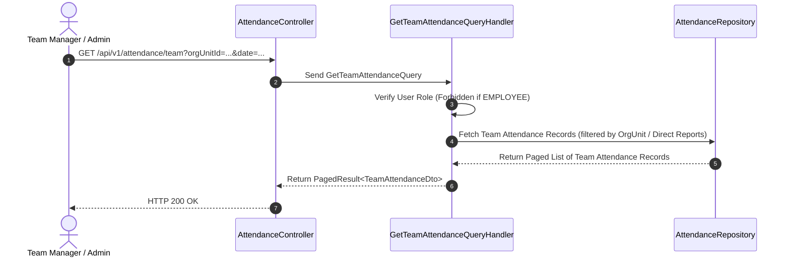

# Team Attendance Monitoring Module Specification

## 1. Document Overview

| Attribute | Detail |
| :--- | :--- |
| **Document Reference** | `FFM-SPEC-WORKFORCE-ATTENDANCE-TEAM-V1.0` |
| **System** | Field Force Management (FFM) Platform |
| **Service** | Workforce Service (`FFM.Workforce`) |
| **Compliance** | ISO/IEC/IEEE 29148, OpenAPI 3.1, RFC 7807 |
| **Status** | Approved Specification for Implementation |

---

## 2. Purpose & Scope

The **Team Attendance Monitoring Module** enables managers and administrators to view real-time workday attendance state (`PRESENT`, `ON_BREAK`, `COMPLETED`, `INCOMPLETE`) for employees within their organization unit or team. The module enforces strict Role-Based Access Control (RBAC) and Organization Unit tenant boundary filtering.

### Key Business Requirements:
1. **Manager OrgUnit Isolation Guard**: Managers can only view team attendance for employees in their designated `OrgUnitId` or direct reports (`BR-TEM-01`).
2. **Role-Based Authorization**: Restricted to `MANAGER`, `ADMIN`, and `SYSTEM_ADMIN` roles. Field employees are denied access (`BR-TEM-03`).
3. **Real-time Status Filtering**: Supports optional filtering by `orgUnitId`, `date`, `status`, and pagination (`BR-TEM-02`).

---

## 3. API Contract & Endpoint Specification

### Endpoint Definition
* **HTTP Method:** `GET`
* **Route:** `/api/v1/attendance/team`
* **Authorization Policy:** `CanViewTeamAttendance` (Requires `MANAGER`, `ADMIN`, or `SYSTEM_ADMIN` role)

---

### 3.1 Query Parameters

| Parameter | Type | Required | Default | Constraints | Description |
| :--- | :--- | :--- | :--- | :--- | :--- |
| `orgUnitId` | `Guid?` | No | Manager's OrgUnit | Valid GUID | Organization unit scope filter |
| `date` | `DateTime?` | No | Today UTC | `YYYY-MM-DD` | Calendar date for attendance lookup |
| `status` | `String?` | No | All statuses | `PRESENT`, `ON_BREAK`, `COMPLETED`, `INCOMPLETE` | Filter by operational status |
| `page` | `Int` | No | `1` | `page >= 1` | Target page number |
| `pageSize` | `Int` | No | `20` | `1 <= pageSize <= 100` | Records per page |

---

### 3.2 Success Response (HTTP 200 OK)

```json
{
  "items": [
    {
      "id": 501,
      "employeeId": 101,
      "employeeCode": "EMP-101",
      "employeeName": "Kayathri",
      "orgUnitId": "a1b2c3d4-e5f6-7890-abcd-ef1234567890",
      "workDate": "2026-10-06",
      "checkInTime": "2026-10-06T08:30:00Z",
      "checkOutTime": "2026-10-06T17:00:00Z",
      "status": "COMPLETED",
      "totalWorkingHours": 7.75,
      "totalBreakMinutes": 45,
      "breaks": [
        {
          "id": 901,
          "breakType": "LUNCH",
          "breakStartTime": "2026-10-06T12:30:00Z",
          "breakEndTime": "2026-10-06T13:15:00Z",
          "durationMinutes": 45
        }
      ]
    }
  ],
  "page": 1,
  "pageSize": 20,
  "totalCount": 1,
  "totalPages": 1
}
```

---

### 3.3 Error Responses (RFC 7807 ProblemDetails)

#### A. Insufficient Role Permissions (HTTP 403 Forbidden)
```json
{
  "type": "https://ffm.domain/errors/forbidden",
  "title": "Forbidden",
  "status": 403,
  "detail": "Field employees do not have permission to view team attendance."
}
```

---

## 4. CQRS Architecture



---

## 5. Business Rules & Validation Matrix

| Rule ID | Rule Name | Business Logic & Constraint | HTTP Code |
| :--- | :--- | :--- | :--- |
| **BR-TEM-01** | OrgUnit Isolation | Managers can only query attendance for employees in their assigned `OrgUnitId` or direct reports. | `200 OK` (Filtered) |
| **BR-TEM-02** | Status Validation | Optional `status` filter must be one of: `PRESENT`, `ON_BREAK`, `COMPLETED`, `INCOMPLETE`, `CORRECTED`. | `400 Bad Request` |
| **BR-TEM-03** | RBAC Authorization | Only users with roles `MANAGER`, `ADMIN`, or `SYSTEM_ADMIN` can access team attendance. | `403 Forbidden` |

---

## 6. Security Testing & Vulnerability Regression Suite (Default)

Security regression testing is enforced via `AttendanceTeamSecurityRegressionTests.cs`:

| Test Case Name | Security Scenario | Threat Prevented | Execution Status |
| :--- | :--- | :--- | :--- |
| `Security_FieldEmployee_AccessTeamAttendance_Forbidden` | Field employee attempts to query team attendance | Privilege Escalation / Unauthenticated Data Access | **PLANNED** 🔒 |
| `Security_Manager_CrossOrgUnit_Attendance_Prevented` | Manager attempts to query team attendance outside their assigned OrgUnit | Cross-Tenant / Multi-Org Data Leakage | **PLANNED** 🔒 |
| `Security_InvalidStatus_Filter_Rejected` | Injection or invalid value in status parameter | Parameter Tampering / SQL Injection | **PLANNED** 🔒 |

---

## 7. Implementation Checklist

- [ ] Create DTO `TeamAttendanceDto.cs`.
- [ ] Add `GetTeamAttendanceAsync` query method in `IAttendanceRepository` & `AttendanceRepository`.
- [ ] Create `GetTeamAttendanceQuery.cs`, `GetTeamAttendanceQueryValidator.cs`, and `GetTeamAttendanceQueryHandler.cs`.
- [ ] Add `GET /api/v1/attendance/team` endpoint in `AttendanceController.cs`.
- [ ] Add unit tests (`GetTeamAttendanceQueryHandlerTests.cs`) & default security tests (`AttendanceTeamSecurityRegressionTests.cs`).
