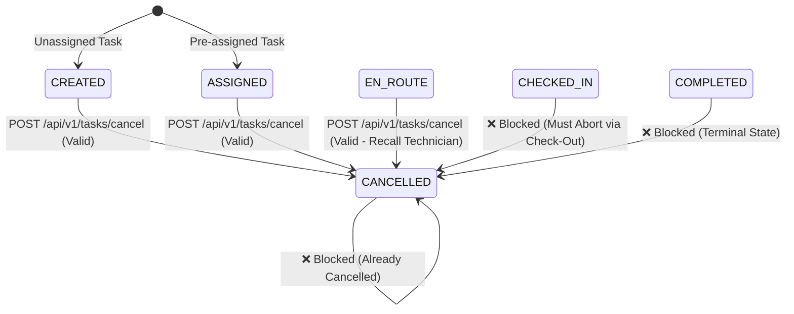

# Cancel Task Module Specification

## 1. Document Metadata

| Attribute | Detail |
| :--- | :--- |
| **Document Reference** | `FFM-SPEC-FLD-CANCEL-TASK-V1.0` |
| **System** | Field Force Management (FFM) Platform |
| **Service** | Field Operations Service (`FFM.FieldOperations`) |
| **Module** | Module 2: Task Dispatch & Lifecycle — Feature: Cancel Task |
| **Default Port** | `5030` |
| **Method & Route** | `POST /api/v1/tasks/cancel` |
| **Compliance** | ISO/IEC/IEEE 29148, OpenAPI 3.1, RFC 7807 (ProblemDetails) |
| **Authentication** | Bearer JWT RS256 (issued by Identity & Access Service) |
| **Classification** | Tier‑1 Core Dispatch & Operational Lifecycle |
| **Status** | Approved Formal Specification |
| **Parent Document** | `FFM_Field_Operations_Service_Spec.md`, Section 7.8 |

---

## 2. Objective & Functional Scope

The **Cancel Task** module enables operations managers, dispatchers, and supervisors to formally cancel an active or pending field work order before on-site work commences.

### Key Capabilities:
1. **Formal Work Order Cancellation:** Transitions eligible tasks to the terminal state **`CANCELLED`**.
2. **Mandatory Cancellation Reason:** Enforces accountability by requiring a clear, auditable business explanation (e.g., customer postponement, duplicate work order, severe weather hazard, parts unavailability).
3. **Execution State Guard:** Protects active field work by strictly forbidding the cancellation of tasks where a technician has already checked in on-site (`CHECKED_IN`) or where work is finished (`COMPLETED`).
4. **Zero Path Parameters Standard:** In compliance with platform architecture standards, `taskId` and `reason` are delivered exclusively within the **JSON request body** (`POST /api/v1/tasks/cancel`).
5. **Real-Time Notification & Audit Trail:** Emits a `TaskCancelledIntegrationEvent` over the event bus to notify the assigned technician on their mobile device and unblocks the technician's daily schedule.

---

## 3. Authorization & RBAC Policy

| Role | Allowed? | Enforcement Rationale |
| :--- | :---: | :--- |
| `SYSTEM_ADMIN` | ✅ Yes | Global authority to cancel tasks across all tenants and regional zones. |
| `ADMIN` | ✅ Yes | Operational authority to cancel any work order within the organization. |
| `MANAGER` | ✅ Yes | Authority to cancel work orders for their managed teams and zones. |
| `SUPERVISOR` | ✅ Yes | Authority to cancel scheduled tasks for their direct subordinates. |
| `EMPLOYEE` | ❌ No | Field technicians cannot cancel work orders; cancellation is restricted to management (`HTTP 403 Forbidden`). |

* **Unauthenticated Requests:** Returns `401 Unauthorized`.
* **Insufficient Role (`EMPLOYEE`):** Returns `403 Forbidden`.
* **Actor Audit:** The user initiating the cancellation is captured from the authenticated JWT token claim (`sub` / `userId`) and stored as `CancelledByUserId`.

---

## 4. State Transition Matrix & Lifecycle Rules

The task entity enforces a strict domain state machine. A task may only be cancelled prior to physical on-site check-in:



### State Evaluation Rules:
* **`CREATED` ➔ `CANCELLED`:** Allowed. The unassigned work order is voided.
* **`ASSIGNED` ➔ `CANCELLED`:** Allowed. The assigned technician is notified that the scheduled work is cancelled.
* **`EN_ROUTE` ➔ `CANCELLED`:** Allowed. The technician traveling to the customer site is recalled.
* **`CHECKED_IN` ➔ `CANCELLED`:** **Rejected (`HTTP 400 Bad Request`)**. When work is physically underway, the technician must check out with an incomplete status and remarks rather than administrative cancellation.
* **`COMPLETED` ➔ `CANCELLED`:** **Rejected (`HTTP 400 Bad Request`)**. Finalized work orders cannot be voided retrospectively.
* **`CANCELLED` ➔ `CANCELLED`:** **Rejected (`HTTP 400 Bad Request`)**. Cannot re-cancel an already cancelled task (idempotency guard).

---

## 5. Business Rules & Validation Policies

| Rule ID | Title | Rule Description | Error Code | HTTP Status |
| :--- | :--- | :--- | :--- | :---: |
| **BR-CAN-01** | Task Existence | The referenced `taskId` must exist in the database. | `TASK_NOT_FOUND` | `404 Not Found` |
| **BR-CAN-02** | Valid Lifecycle State | Task status must be `CREATED`, `ASSIGNED`, or `EN_ROUTE`. Cancellation of `CHECKED_IN`, `COMPLETED`, or `CANCELLED` tasks is rejected. | `INVALID_TASK_STATE` | `400 Bad Request` |
| **BR-CAN-03** | Mandatory Reason | The `reason` field is mandatory and must contain between 5 and 500 characters. Blank or whitespace-only strings are rejected. | `VALIDATION_ERROR` | `400 Bad Request` |
| **BR-CAN-04** | Zero Path Parameter | The API route must be `POST /api/v1/tasks/cancel`. Path parameters (e.g. `/tasks/{id}/cancel`) are strictly prohibited. | `ROUTING_MISMATCH` | `404 Not Found` |
| **BR-CAN-05** | Schedule Unblocking | Upon cancellation, the assigned technician's calendar window is automatically released for subsequent task assignments. | Automated Domain Behavior | `200 OK` |
| **BR-CAN-06** | Audit Preservation | Cancellation records `CancelledByUserId`, `CancellationReason`, and `CancelledAt` timestamp without hard-deleting the record. | Automated Audit Stamp | `200 OK` |

---

## 6. API Contract & Interface Specification

### 6.1 Request Details
* **HTTP Method:** `POST`
* **Route:** `/api/v1/tasks/cancel`
* **Headers:**
  - `Authorization: Bearer <JWT_TOKEN>` (Mandatory)
  - `Content-Type: application/json`

### 6.2 Request Payload (`CancelTaskRequest`)

```json
{
  "taskId": 101,
  "reason": "Client requested postponement due to facility renovation."
}
```

#### Field Specifications:

| Field Name | Type | Mandatory? | Constraints | Description |
| :--- | :---: | :---: | :--- | :--- |
| `taskId` | `integer` | Yes | Positive integer `> 0`, valid 32-bit signed int. | Primary key identifier of the task to be cancelled. |
| `reason` | `string` | Yes | Min: `5` characters, Max: `500` characters. Leading/trailing whitespace trimmed. | Business explanation for work order cancellation. |

---

### 6.3 Response Contracts

#### Success Response (HTTP 200 OK):
```json
{
  "success": true,
  "message": "Task cancelled successfully.",
  "data": {
    "id": 101,
    "taskNumber": "TSK-202611-0001",
    "title": "Quarterly POS Hardware Maintenance",
    "status": "CANCELLED",
    "cancellationReason": "Client requested postponement due to facility renovation.",
    "cancelledAt": "2026-10-26T15:10:00Z",
    "cancelledByUserId": 5,
    "updatedAt": "2026-10-26T15:10:00Z"
  },
  "errorCode": null,
  "errors": null
}
```

#### Task Not Found (HTTP 404 Not Found):
```json
{
  "success": false,
  "message": "Task with ID 999999 not found.",
  "data": null,
  "errorCode": "TASK_NOT_FOUND",
  "errors": [
    "Task with ID 999999 not found."
  ]
}
```

#### Invalid Lifecycle State (HTTP 400 Bad Request):
```json
{
  "success": false,
  "message": "Task cannot be cancelled because technician is currently checked in on-site.",
  "data": null,
  "errorCode": "INVALID_TASK_STATE",
  "errors": [
    "Task status is CHECKED_IN. Active on-site visits cannot be cancelled; complete or abort via check-out."
  ]
}
```

#### Validation Error — Reason Too Short (HTTP 400 Bad Request):
```json
{
  "success": false,
  "message": "Validation failed for CancelTaskRequest.",
  "data": null,
  "errorCode": "VALIDATION_ERROR",
  "errors": [
    "Cancellation reason must be at least 5 characters long."
  ]
}
```

#### Unauthorized Access (HTTP 403 Forbidden):
```json
{
  "success": false,
  "message": "Access denied: Field technicians are not authorized to cancel work orders.",
  "data": null,
  "errorCode": "FORBIDDEN",
  "errors": null
}
```

---

## 7. Security & Hardening Controls
1. **Broken Object Level Authorization (BOLA):** Managers can only cancel tasks within their permitted branches or teams.
2. **Input Sanitization:** The `reason` text is sanitized against HTML and script injection payloads (`<script>`) before database persistence.
3. **Optimistic Concurrency:** Concurrent cancellation and check-in attempts are resolved using entity concurrency tokens (`RowVersion` or `UpdatedAt` checks) to ensure state integrity.
4. **Zero Path Parameter Integrity:** Protects against URL parameter tampering attacks by requiring all parameters in the cryptographic TLS-protected request body.
