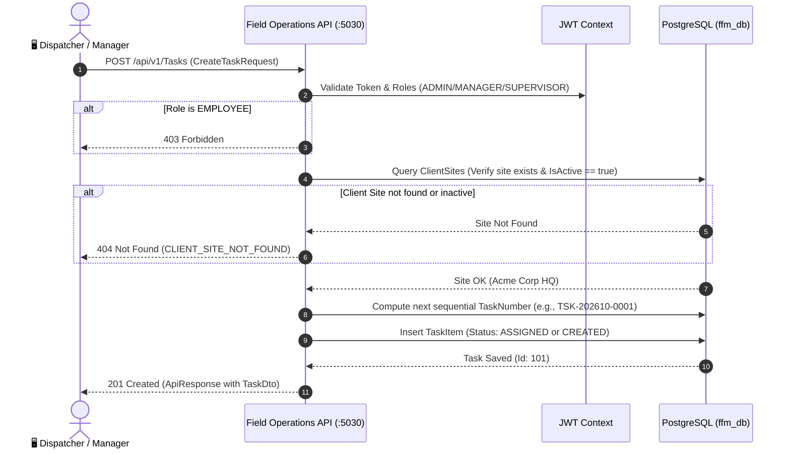

# Create & Schedule Task Module Specification

## 1. Document Metadata

| Attribute | Detail |
| :--- | :--- |
| **Document Reference** | `FFM-SPEC-FLD-CREATE-TASK-V1.0` |
| **System** | Field Force Management (FFM) Platform |
| **Service** | Field Operations Service (`FFM.FieldOperations`) |
| **Module** | Module 2: Task Dispatch — Feature: Create & Schedule Task |
| **Default Port** | `5030` |
| **Method & Route** | `POST /api/v1/Tasks` |
| **Compliance** | ISO/IEC/IEEE 29148, OpenAPI 3.1, RFC 7807 (ProblemDetails) |
| **Authentication** | Bearer JWT RS256 (issued by Identity & Access Service) |
| **Classification** | Tier‑1 Core Dispatch & Work Order Inception |
| **Status** | Approved Formal Specification |
| **Parent Document** | `FFM_Field_Operations_Service_Spec.md`, Section 7.2 |

---

## 2. Objective & Functional Scope

The **Create & Schedule Task** module enables dispatchers, supervisors, and administrators to create actionable field work orders (equipment maintenance, inspections, deliveries, audits) anchored to a verified **Client Site**.

Every task is allocated a scheduled time window (`ScheduledStart` to `ScheduledEnd`) and can optionally be assigned to an available field technician immediately upon creation.

### Key Capabilities:
1. **Work Order Inception:** Captures task metadata: `Title`, `Description`, `Priority` (`LOW`, `MEDIUM`, `HIGH`, `URGENT`), and scheduled execution window.
2. **Client Site Verification:** Strictly validates that the specified `clientSiteId` exists and is currently active (`IsActive = true`).
3. **Automatic Sequential Business Key:** Generates a human-readable, unique sequential business identifier (`TaskNumber`) formatted as:
   $$\text{TSK-YYYYMM-XXXX} \quad (\text{e.g. } \text{TSK-202610-0001})$$
4. **Conditional Initial State Assignment:**
   * If `assignedEmployeeId` is provided (> 0): Initial status is set to **`ASSIGNED`**.
   * If `assignedEmployeeId` is omitted (`null`): Initial status is set to **`CREATED`**.
5. **Secure Creator Audit Trail:** Derives `CreatedByUserId` securely from the authenticated JWT claims (`sub` or `userId`), never trusting client-submitted values.
6. **Zero Path Parameters Standard:** Adheres strictly to platform architecture standards—all payload data is accepted through the JSON request body.

---

## 3. Authorization & RBAC Policy

| Role | Allowed? | Enforcement Rationale |
| :--- | :---: | :--- |
| `SYSTEM_ADMIN` | ✅ Yes | Full operational control across all tenants and sites. |
| `ADMIN` | ✅ Yes | Can create and schedule tasks within their organization. |
| `MANAGER` | ✅ Yes | Can create work orders for all teams and zones under their management. |
| `SUPERVISOR` | ✅ Yes | Can schedule and dispatch tasks to technicians in their assigned team. |
| `EMPLOYEE` | ❌ No | Field technicians cannot create work orders; strictly restricted (`HTTP 403 Forbidden`). |

* **Unauthenticated Requests:** Returns `401 Unauthorized`.
* **Insufficient Role (`EMPLOYEE`):** Returns `403 Forbidden`.

---

## 4. Business Rules & Validation Policies

| Rule ID | Rule Name | Business Constraint | Error Code | HTTP Status |
| :--- | :--- | :--- | :--- | :---: |
| **BR-CTSK-01** | Mandatory Title | `title` must be non-blank, between `5` and `200` characters. | `INVALID_TITLE` | `400 Bad Request` |
| **BR-CTSK-02** | Description Limit | `description` is optional; if provided, must not exceed `2000` characters. | `DESCRIPTION_TOO_LONG` | `400 Bad Request` |
| **BR-CTSK-03** | Priority Validation | `priority` must be one of: `LOW`, `MEDIUM`, `HIGH`, `URGENT` (case-insensitive). Defaults to `MEDIUM` if omitted. | `INVALID_PRIORITY` | `400 Bad Request` |
| **BR-CTSK-04** | Client Site Existence | `clientSiteId` must reference an existing and active (`IsActive = true`) record in `ClientSites`. | `CLIENT_SITE_NOT_FOUND` | `404 Not Found` |
| **BR-CTSK-05** | Inactive Site Defense | If the referenced client site is deactivated (`IsActive = false`), task creation is blocked. | `CLIENT_SITE_INACTIVE` | `400 Bad Request` |
| **BR-CTSK-06** | Schedule Chronology | `scheduledEnd` must be strictly greater than `scheduledStart`. | `INVALID_SCHEDULE_RANGE` | `400 Bad Request` |
| **BR-CTSK-07** | Past Schedule Limit | `scheduledStart` cannot be set more than 24 hours in the past. | `SCHEDULE_CANNOT_BE_PAST` | `400 Bad Request` |
| **BR-CTSK-08** | Task Number Generation | System must atomically generate a unique `TaskNumber` formatted as `TSK-YYYYMM-XXXX`. Must never collide or duplicate. | `TASK_NUMBER_GENERATION_FAILED` | `500 Internal Error` |
| **BR-CTSK-09** | Conditional Status | If `assignedEmployeeId` is provided, initial status is `ASSIGNED`. If `null`, initial status is `CREATED`. | Automated Logic | `201 Created` |
| **BR-CTSK-10** | Employee ID Sanity | If `assignedEmployeeId` is supplied, it must be an integer $> 0$. | `INVALID_EMPLOYEE_ID` | `400 Bad Request` |

---

## 5. Domain Model & Database Architecture

### 5.1 Domain Entity: `TaskItem`

```csharp
namespace FFM.FieldOperations.Domain.Entities
{
    public class TaskItem
    {
        public int Id { get; private set; }
        public string TaskNumber { get; private set; } = string.Empty;
        public string Title { get; private set; } = string.Empty;
        public string? Description { get; private set; }
        public string Priority { get; private set; } = "MEDIUM"; // LOW, MEDIUM, HIGH, URGENT
        public string Status { get; private set; } = "CREATED"; // CREATED, ASSIGNED
        public int ClientSiteId { get; private set; }
        public int? AssignedEmployeeId { get; private set; }
        public DateTime ScheduledStart { get; private set; }
        public DateTime ScheduledEnd { get; private set; }
        public int CreatedByUserId { get; private set; }
        public DateTime CreatedAt { get; private set; }
        public DateTime UpdatedAt { get; private set; }

        public ClientSite? ClientSite { get; private set; }

        private TaskItem() { }

        public TaskItem(
            string taskNumber,
            string title,
            string? description,
            string priority,
            int clientSiteId,
            int? assignedEmployeeId,
            DateTime scheduledStart,
            DateTime scheduledEnd,
            int createdByUserId)
        {
            if (string.IsNullOrWhiteSpace(taskNumber))
                throw new ArgumentException("TaskNumber cannot be empty.", nameof(taskNumber));

            if (string.IsNullOrWhiteSpace(title) || title.Trim().Length < 5)
                throw new ArgumentException("Title must be at least 5 characters.", nameof(title));

            if (clientSiteId <= 0)
                throw new ArgumentException("Invalid ClientSiteId.", nameof(clientSiteId));

            if (scheduledEnd <= scheduledStart)
                throw new ArgumentException("ScheduledEnd must be after ScheduledStart.", nameof(scheduledEnd));

            TaskNumber = taskNumber;
            Title = title.Trim();
            Description = description?.Trim();
            Priority = string.IsNullOrWhiteSpace(priority) ? "MEDIUM" : priority.ToUpperInvariant();
            ClientSiteId = clientSiteId;
            AssignedEmployeeId = (assignedEmployeeId.HasValue && assignedEmployeeId.Value > 0) ? assignedEmployeeId.Value : null;
            Status = AssignedEmployeeId.HasValue ? "ASSIGNED" : "CREATED";
            ScheduledStart = scheduledStart;
            ScheduledEnd = scheduledEnd;
            CreatedByUserId = createdByUserId;
            CreatedAt = DateTime.UtcNow;
            UpdatedAt = DateTime.UtcNow;
        }
    }
}
```

### 5.2 PostgreSQL Table Definition (`Tasks`)

```sql
CREATE TABLE IF NOT EXISTS public."Tasks" (
    "Id" SERIAL PRIMARY KEY,
    "TaskNumber" VARCHAR(50) NOT NULL,
    "Title" VARCHAR(200) NOT NULL,
    "Description" TEXT NULL,
    "Priority" VARCHAR(20) NOT NULL DEFAULT 'MEDIUM',
    "Status" VARCHAR(30) NOT NULL DEFAULT 'CREATED',
    "ClientSiteId" INT NOT NULL REFERENCES public."ClientSites" ("Id") ON DELETE RESTRICT,
    "AssignedEmployeeId" INT NULL,
    "ScheduledStart" TIMESTAMPTZ NOT NULL,
    "ScheduledEnd" TIMESTAMPTZ NOT NULL,
    "CreatedByUserId" INT NOT NULL,
    "CancellationReason" VARCHAR(500) NULL,
    "CancelledAt" TIMESTAMPTZ NULL,
    "CreatedAt" TIMESTAMPTZ NOT NULL DEFAULT NOW(),
    "UpdatedAt" TIMESTAMPTZ NOT NULL DEFAULT NOW()
);

-- Performance Indices
CREATE UNIQUE INDEX IF NOT EXISTS "IX_Tasks_TaskNumber" ON public."Tasks" ("TaskNumber");
CREATE INDEX IF NOT EXISTS "IX_Tasks_ClientSiteId" ON public."Tasks" ("ClientSiteId");
CREATE INDEX IF NOT EXISTS "IX_Tasks_AssignedEmployeeId_Status" ON public."Tasks" ("AssignedEmployeeId", "Status");
CREATE INDEX IF NOT EXISTS "IX_Tasks_Schedule" ON public."Tasks" ("ScheduledStart", "ScheduledEnd");
CREATE INDEX IF NOT EXISTS "IX_Tasks_Status" ON public."Tasks" ("Status");
```

---

## 6. API Contract: `POST /api/v1/Tasks`

### 6.1 Request Endpoint
* **HTTP Method:** `POST`
* **Route:** `/api/v1/Tasks`
* **Headers:**
  ```http
  Authorization: Bearer <jwt_access_token>
  Content-Type: application/json
  ```

### 6.2 Request Payload (`CreateTaskRequest`)

```json
{
  "title": "Quarterly POS Hardware Maintenance",
  "description": "Inspect terminal, replace battery backup, run diagnostic pass.",
  "priority": "HIGH",
  "clientSiteId": 1,
  "assignedEmployeeId": 519,
  "scheduledStart": "2026-11-25T09:30:00Z",
  "scheduledEnd": "2026-11-25T12:00:00Z"
}
```

### 6.3 Request Schema Definition

| Attribute | Type | Mandatory? | Constraints | Description |
| :--- | :---: | :---: | :--- | :--- |
| `title` | `string` | **Yes** | 5 – 200 characters | Name of the task or service assignment |
| `description` | `string` | No | Max 2000 characters | Scope of work details or special customer instructions |
| `priority` | `string` | No | `LOW`, `MEDIUM`, `HIGH`, `URGENT` *(Default: `MEDIUM`)* | Operational priority |
| `clientSiteId` | `int` | **Yes** | Must exist in `ClientSites` and be active | Target physical client location |
| `assignedEmployeeId` | `int` | No | $> 0$ if provided; optional | ID of field technician to dispatch |
| `scheduledStart` | `DateTime` | **Yes** | ISO-8601 UTC; cannot be $>24$h in past | Start of scheduled service window |
| `scheduledEnd` | `DateTime` | **Yes** | ISO-8601 UTC; must be $> scheduledStart$ | End of scheduled service window |

---

### 6.4 Success Response (`HTTP 201 Created`)

```json
{
  "success": true,
  "message": "Task created and scheduled successfully.",
  "data": {
    "id": 101,
    "taskNumber": "TSK-202610-0001",
    "title": "Quarterly POS Hardware Maintenance",
    "description": "Inspect terminal, replace battery backup, run diagnostic pass.",
    "priority": "HIGH",
    "status": "ASSIGNED",
    "clientSiteId": 1,
    "clientSiteName": "Acme Corp Headquarters",
    "clientSiteCode": "SITE-BLR-01",
    "address": "42 MG Road, Bengaluru, Karnataka 560001",
    "latitude": 12.9715987,
    "longitude": 77.5945627,
    "radiusMeters": 150,
    "assignedEmployeeId": 519,
    "scheduledStart": "2026-11-25T09:30:00Z",
    "scheduledEnd": "2026-11-25T12:00:00Z",
    "createdByUserId": 1,
    "createdAt": "2026-10-22T10:45:00Z"
  },
  "error": null,
  "timestamp": "2026-10-22T10:45:00.1234567Z"
}
```

---

### 6.5 Error Responses (RFC 7807 Standard)

#### 1. Client Site Not Found (`HTTP 404 Not Found`):
```json
{
  "success": false,
  "message": "Validation error",
  "data": null,
  "error": {
    "code": "CLIENT_SITE_NOT_FOUND",
    "details": "Client site with ID 999 does not exist."
  },
  "timestamp": "2026-10-22T10:45:10.0000000Z"
}
```

#### 2. Invalid Schedule Window (`HTTP 400 Bad Request`):
```json
{
  "success": false,
  "message": "Validation error",
  "data": null,
  "error": {
    "code": "INVALID_SCHEDULE_RANGE",
    "details": "ScheduledEnd must be strictly later than ScheduledStart."
  },
  "timestamp": "2026-10-22T10:45:15.0000000Z"
}
```

#### 3. Unauthorized Employee Role (`HTTP 403 Forbidden`):
```json
{
  "success": false,
  "message": "Access denied",
  "data": null,
  "error": {
    "code": "FORBIDDEN",
    "details": "You do not have permission to create tasks. Required role: ADMIN, MANAGER, or SUPERVISOR."
  },
  "timestamp": "2026-10-22T10:45:20.0000000Z"
}
```

---

## 7. Sequential Task Number Generation Algorithm

To guarantee atomic, clean, sequential business numbers (`TSK-YYYYMM-XXXX`) without race conditions:

```csharp
// Example: In month 2026-10
// 1st task: TSK-202610-0001
// 2nd task: TSK-202610-0002
// ...
// 9999th task: TSK-202610-9999
var yearMonth = DateTime.UtcNow.ToString("yyyyMM");
var prefix = $"TSK-{yearMonth}-";
var countForMonth = await _context.Tasks
    .CountAsync(t => t.TaskNumber.StartsWith(prefix), cancellationToken);

var sequenceNumber = countForMonth + 1;
var taskNumber = $"{prefix}{sequenceNumber:D4}";
```

---

## 8. Sequence Diagram



---

## 9. Acceptance Criteria & Test Scenarios

| Test Case | Scenario | Expected Behavior |
| :--- | :--- | :--- |
| **TC-CTSK-01** | Create task with valid parameters and assigned employee | Returns `201 Created`, status is `ASSIGNED`, task details include site metadata. |
| **TC-CTSK-02** | Create task with valid parameters and NO assigned employee (`null`) | Returns `201 Created`, status is `CREATED`, `assignedEmployeeId` is `null`. |
| **TC-CTSK-03** | Create task referencing non-existent `clientSiteId` | Returns `404 Not Found` with code `CLIENT_SITE_NOT_FOUND`. |
| **TC-CTSK-04** | Create task referencing inactive client site (`IsActive = false`) | Returns `400 Bad Request` with code `CLIENT_SITE_INACTIVE`. |
| **TC-CTSK-05** | Create task where `scheduledEnd <= scheduledStart` | Returns `400 Bad Request` with code `INVALID_SCHEDULE_RANGE`. |
| **TC-CTSK-06** | Create task where `scheduledStart` is $>24$ hours in the past | Returns `400 Bad Request` with code `SCHEDULE_CANNOT_BE_PAST`. |
| **TC-CTSK-07** | Create task with blank title or title $<5$ characters | Returns `400 Bad Request` with code `INVALID_TITLE`. |
| **TC-CTSK-08** | Create task with invalid priority (e.g. `"SUPER_URGENT"`) | Returns `400 Bad Request` with code `INVALID_PRIORITY`. |
| **TC-CTSK-09** | Call endpoint with `EMPLOYEE` role JWT | Returns `403 Forbidden` with code `FORBIDDEN`. |
| **TC-CTSK-10** | Call endpoint without Authorization header | Returns `401 Unauthorized`. |
| **TC-CTSK-11** | Verify `TaskNumber` generation format | Generates sequential pattern `TSK-YYYYMM-XXXX`. |
