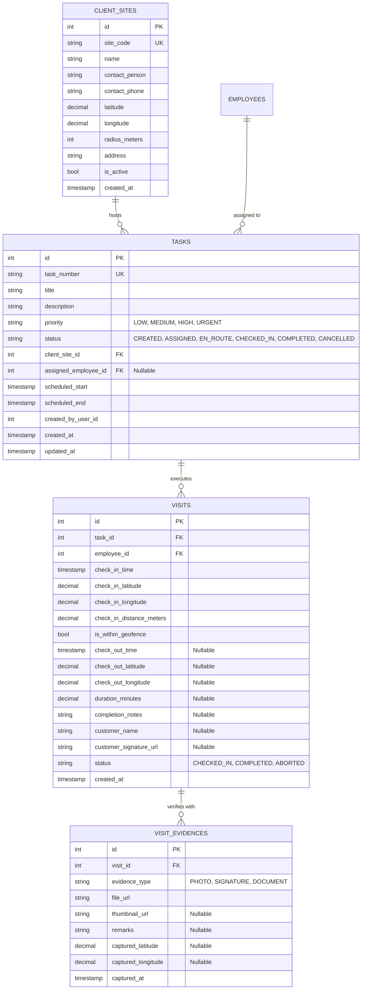
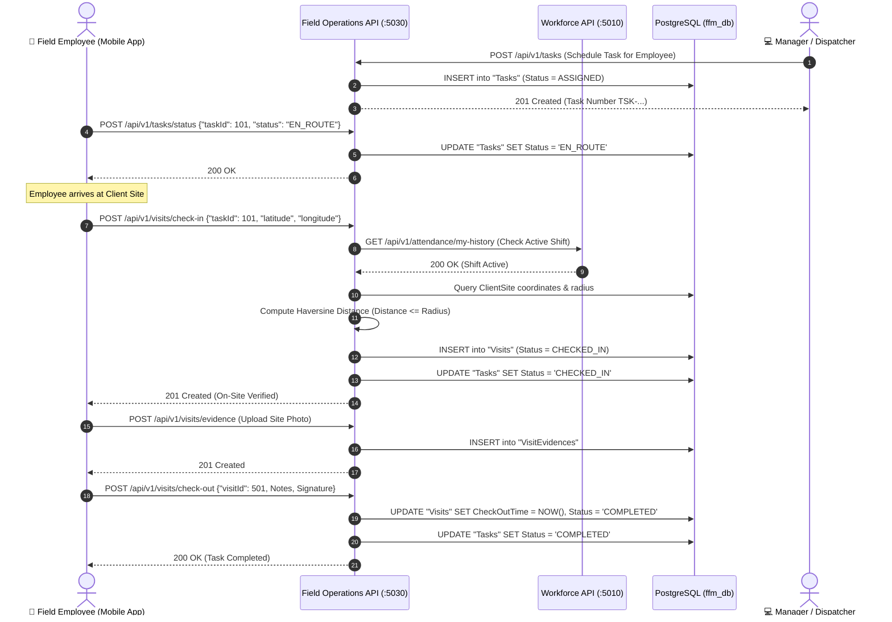

# Field Operations & Task/Visit Management Service Specification

## 1. Document Overview

| Attribute | Detail |
| :--- | :--- |
| **Document Reference** | `FFM-SPEC-FIELD-OPERATIONS-V1.0` |
| **System** | Field Force Management (FFM) Platform |
| **Service** | Field Operations Service (`FFM.FieldOperations`) |
| **Default Port** | `5030` |
| **Compliance** | ISO/IEC/IEEE 29148, OpenAPI 3.1, RFC 7807 (ProblemDetails) |
| **Classification** | Tier‑1 Core Revenue & Operations Service |
| **Status** | Approved Formal Specification |
| **Target Clients** | FFM Mobile App (Field Employees) & FFM Web Portal (Managers/Dispatchers) |
| **Perspective** | **Backend / Server‑Side Architecture & Contracts** |
| **Parent Document** | `FFM_System_Specification.md`, Sections 2, 9, 11 & 12 |

---

## 2. Purpose & Business Scope

The **Field Operations Service** orchestrates the core operational field workflow of the FFM Platform. It bridges task planning, dispatching, field travel, client site visit execution, automated GPS location verification, proof of visit capture, and task completion.

```
+---------------+     Assign Task     +------------------+     Travel / GPS     +-------------------+
|    Manager    |  ────────────────>  |  Field Employee  |  ─────────────────>  |  Client Site /    |
| (Dispatcher)  |                     |   (Mobile App)   |                      | Geofence Boundary |
+---------------+                     +------------------+                      +-------------------+
        ▲                                       │                                         │
        │ Review & Reports                      │ On-Site Check-In                        │ Validates
        │                                       ▼                                         ▼
+───────────────────────────────────────────────────────────────────────────────────────────+
|                                  Field Operations Service                                 |
|  - Task Scheduling & Lifecycle Management       - Geofence Proximity Verification         |
|  - Real-Time Site Check-in & Check-out         - Photo, Signature & Note Evidence Capture|
+───────────────────────────────────────────────────────────────────────────────────────────+
```

### Core Capabilities:
1. **Client Site / Geofence Directory**: Management of customer locations, branches, target GPS coordinates (Latitude/Longitude), and boundary radii for on-site validation.
2. **Task Creation & Smart Dispatching**: Assignment of tasks/work orders with priority (`LOW`, `MEDIUM`, `HIGH`, `URGENT`), scheduled start/end windows, and targeted client sites.
3. **Field Visit Lifecycle**: End-to-end execution states (`CREATED`, `ASSIGNED`, `EN_ROUTE`, `CHECKED_IN`, `COMPLETED`, `CANCELLED`, `RESCHEDULED`).
4. **Automated On-Site GPS Verification**: Real-time validation that the employee is physically within the client site geofence radius upon site check-in.
5. **Tamper-Resistant Proof of Visit**: Capture and validation of digital signatures, photo evidence, customer feedback, and completion remarks.
6. **Integration with Workforce & GPS Services**: Correlates employee active shifts (from `WorkforceService`) and GPS breadcrumbs (from `GpsTrackingService`).

---

## 3. Technical Glossary

- **Client Site** – A designated physical location (office, customer site, warehouse, kiosk) with verified GPS coordinates and an allowable tolerance radius (meters).
- **Task** – A work order or assignment allocated to a field employee, bound to a client site and a scheduled time window.
- **Visit** – The physical occurrence where a field employee reaches the client site, checks in with live GPS telemetry, executes the work, and checks out.
- **On-Site Proximity Tolerance** – The maximum distance (in meters, default 150m) an employee's GPS coordinates can be from the site center point to qualify as an on-site visit.
- **Proof of Visit (Evidence)** – Multimedia artifacts (site photos, customer signature, invoice/meter readings) uploaded as verifiable proof of completed work.
- **Anti-Mock Location Guard** – Detection and rejection of simulated/spoofed GPS coordinates reported by compromised mobile operating systems.

---

## 4. Business Rules & Validation Policies

| Rule ID | Title | Rule Description | Enforcement |
| :--- | :--- | :--- | :--- |
| **BR-FLD-01** | Active Shift Dependency | An employee can only check in to a task/visit if they have an active, checked-in attendance session in `WorkforceService`. | Verified via service call/claim validation prior to visit check-in. |
| **BR-FLD-02** | Geofence Proximity Validation | Upon visit check-in, the employee's GPS distance from the client site must not exceed `SiteRadiusMeters + BufferTolerance` (default 150m). Off-site check-in requires explicit manager override flag. | Haversine distance formula computed on server against authoritative site coordinates. |
| **BR-FLD-03** | Task State Machine Guard | Status transitions must follow strict lifecycle order: `CREATED` ➔ `ASSIGNED` ➔ `EN_ROUTE` ➔ `CHECKED_IN` ➔ `COMPLETED`. Direct transitions from `CREATED` to `COMPLETED` are rejected. | Enforced by the Domain Entity State Machine. |
| **BR-FLD-04** | Single Active Visit Constraint | An employee cannot be checked in to more than one client site visit concurrently. Checking in to a new site requires checking out of the previous one. | Unique partial index on database table where `CheckOutTime IS NULL`. |
| **BR-FLD-05** | Mandatory Completion Evidence | A task visit cannot be marked `COMPLETED` without at least one valid proof of visit (e.g. photo artifact, customer signature, or mandatory inspection checklist). | Checked in the `CompleteVisitCommandHandler`. |
| **BR-FLD-06** | Task Ownership Guard | Only the assigned employee or an authorized `MANAGER`/`ADMIN` can initiate check-in, update progress, or complete a task. | Verified against caller's authenticated `UserId`. |
| **BR-FLD-07** | Non-Retrospective Check-In | Visit check-in timestamps cannot be backdated or submitted from past dates without supervisor regularization. | Server timestamp `DateTime.UtcNow` is authoritative. |
| **BR-FLD-08** | Task Reassignment Policy | Reassigning a task to another employee resets the state to `ASSIGNED` and logs an audit log entry. Cannot reassign a task that is currently in `CHECKED_IN` status. | Verified before reassigning in `AssignTaskCommandHandler`. |
| **BR-FLD-09** | Cancellation Constraints | A task can only be cancelled if it is in `CREATED`, `ASSIGNED`, or `EN_ROUTE` status. A task that is already `CHECKED_IN` must be aborted through an explicit checkout with an incomplete reason. | Domain guard method `task.Cancel(reason)`. |
| **BR-FLD-10** | Request Body Convention | All mutation and decision endpoints (assign, status update, check-in, check-out, cancel) must receive identifiers and parameters exclusively in the **JSON request body** (no path/query parameters). | Enforced across all API route and controller contracts. |

---

## 5. Domain Model & Entity Definitions

### 5.1 Entity Relationship Diagram



---

## 6. Database Schema & Indexes (PostgreSQL)

### 6.1 `ClientSites` Table
```sql
CREATE TABLE "ClientSites" (
    "Id" SERIAL PRIMARY KEY,
    "SiteCode" VARCHAR(50) NOT NULL,
    "Name" VARCHAR(150) NOT NULL,
    "ContactPerson" VARCHAR(100),
    "ContactPhone" VARCHAR(30),
    "Latitude" DECIMAL(10, 7) NOT NULL,
    "Longitude" DECIMAL(10, 7) NOT NULL,
    "RadiusMeters" INT NOT NULL DEFAULT 150,
    "Address" VARCHAR(300) NOT NULL,
    "IsActive" BOOLEAN NOT NULL DEFAULT TRUE,
    "CreatedAt" TIMESTAMP WITH TIME ZONE NOT NULL DEFAULT NOW()
);

CREATE UNIQUE INDEX "IX_ClientSites_SiteCode" ON "ClientSites" ("SiteCode");
CREATE INDEX "IX_ClientSites_Coordinates" ON "ClientSites" ("Latitude", "Longitude");
```

### 6.2 `Tasks` Table
```sql
CREATE TABLE "Tasks" (
    "Id" SERIAL PRIMARY KEY,
    "TaskNumber" VARCHAR(50) NOT NULL,
    "Title" VARCHAR(200) NOT NULL,
    "Description" TEXT,
    "Priority" VARCHAR(20) NOT NULL DEFAULT 'MEDIUM',
    "Status" VARCHAR(30) NOT NULL DEFAULT 'CREATED',
    "ClientSiteId" INT NOT NULL REFERENCES "ClientSites" ("Id") ON DELETE RESTRICT,
    "AssignedEmployeeId" INT NULL,
    "ScheduledStart" TIMESTAMP WITH TIME ZONE NOT NULL,
    "ScheduledEnd" TIMESTAMP WITH TIME ZONE NOT NULL,
    "CreatedByUserId" INT NOT NULL,
    "CreatedAt" TIMESTAMP WITH TIME ZONE NOT NULL DEFAULT NOW(),
    "UpdatedAt" TIMESTAMP WITH TIME ZONE NOT NULL DEFAULT NOW()
);

CREATE UNIQUE INDEX "IX_Tasks_TaskNumber" ON "Tasks" ("TaskNumber");
CREATE INDEX "IX_Tasks_Employee_Status" ON "Tasks" ("AssignedEmployeeId", "Status");
CREATE INDEX "IX_Tasks_Schedule" ON "Tasks" ("ScheduledStart", "ScheduledEnd");
```

### 6.3 `Visits` Table
```sql
CREATE TABLE "Visits" (
    "Id" SERIAL PRIMARY KEY,
    "TaskId" INT NOT NULL REFERENCES "Tasks" ("Id") ON DELETE CASCADE,
    "EmployeeId" INT NOT NULL,
    "CheckInTime" TIMESTAMP WITH TIME ZONE NOT NULL,
    "CheckInLatitude" DECIMAL(10, 7) NOT NULL,
    "CheckInLongitude" DECIMAL(10, 7) NOT NULL,
    "CheckInDistanceMeters" DECIMAL(8, 2) NOT NULL,
    "IsWithinGeofence" BOOLEAN NOT NULL DEFAULT TRUE,
    "CheckOutTime" TIMESTAMP WITH TIME ZONE NULL,
    "CheckOutLatitude" DECIMAL(10, 7) NULL,
    "CheckOutLongitude" DECIMAL(10, 7) NULL,
    "DurationMinutes" DECIMAL(6, 2) NULL,
    "CompletionNotes" TEXT NULL,
    "CustomerName" VARCHAR(100) NULL,
    "CustomerSignatureUrl" VARCHAR(500) NULL,
    "Status" VARCHAR(30) NOT NULL DEFAULT 'CHECKED_IN',
    "CreatedAt" TIMESTAMP WITH TIME ZONE NOT NULL DEFAULT NOW()
);

CREATE UNIQUE INDEX "IX_Visits_ActiveEmployeeVisit" ON "Visits" ("EmployeeId") WHERE "CheckOutTime" IS NULL;
CREATE INDEX "IX_Visits_TaskId" ON "Visits" ("TaskId");
CREATE INDEX "IX_Visits_CheckInTime" ON "Visits" ("CheckInTime");
```

### 6.4 `VisitEvidences` Table
```sql
CREATE TABLE "VisitEvidences" (
    "Id" SERIAL PRIMARY KEY,
    "VisitId" INT NOT NULL REFERENCES "Visits" ("Id") ON DELETE CASCADE,
    "EvidenceType" VARCHAR(30) NOT NULL,
    "FileUrl" VARCHAR(500) NOT NULL,
    "ThumbnailUrl" VARCHAR(500) NULL,
    "Remarks" VARCHAR(300) NULL,
    "CapturedLatitude" DECIMAL(10, 7) NULL,
    "CapturedLongitude" DECIMAL(10, 7) NULL,
    "CapturedAt" TIMESTAMP WITH TIME ZONE NOT NULL DEFAULT NOW()
);

CREATE INDEX "IX_VisitEvidences_VisitId" ON "VisitEvidences" ("VisitId");
```

---

## 7. API Contracts & Endpoint Specifications

> [!IMPORTANT]
> In alignment with platform standards, all endpoints that accept an ID for actions (`assign`, `status`, `check-in`, `check-out`, `evidence`, `cancel`) accept the identifier in the **JSON request body** (`taskId`, `visitId`, or alias `id`). No route/path parameters (`{id}`) are used.

### 7.1 Create Client Site
* **Method & Route:** `POST /api/v1/client-sites`
* **Authorization:** `MANAGER`, `ADMIN`, `SYSTEM_ADMIN`
* **Request Payload (`CreateClientSiteRequest`):**
```json
{
  "siteCode": "SITE-BLR-01",
  "name": "Acme Corp Headquarters",
  "contactPerson": "Ramesh Kumar",
  "contactPhone": "+919876543210",
  "latitude": 12.9715987,
  "longitude": 77.5945627,
  "radiusMeters": 150,
  "address": "42 MG Road, Bengaluru, Karnataka 560001"
}
```
* **Success Response (HTTP 201 Created):**
```json
{
  "success": true,
  "message": "Client site created successfully.",
  "data": {
    "id": 1,
    "siteCode": "SITE-BLR-01",
    "name": "Acme Corp Headquarters",
    "latitude": 12.9715987,
    "longitude": 77.5945627,
    "radiusMeters": 150,
    "address": "42 MG Road, Bengaluru, Karnataka 560001",
    "isActive": true
  }
}
```

---

### 7.2 Create & Schedule Task
* **Method & Route:** `POST /api/v1/tasks`
* **Authorization:** `MANAGER`, `ADMIN`, `SUPERVISOR`
* **Request Payload (`CreateTaskRequest`):**
```json
{
  "title": "Quarterly POS Hardware Maintenance",
  "description": "Inspect terminal, replace battery backup, run diagnostic pass.",
  "priority": "HIGH",
  "clientSiteId": 1,
  "assignedEmployeeId": 519,
  "scheduledStart": "2026-11-25T09:30:00Z",
  "scheduledEnd": "2026-11-25T12:00:00Z"
}
```
* **Success Response (HTTP 201 Created):**
```json
{
  "success": true,
  "message": "Task created and assigned successfully.",
  "data": {
    "id": 101,
    "taskNumber": "TSK-202611-0001",
    "title": "Quarterly POS Hardware Maintenance",
    "priority": "HIGH",
    "status": "ASSIGNED",
    "clientSiteId": 1,
    "clientSiteName": "Acme Corp Headquarters",
    "assignedEmployeeId": 519,
    "scheduledStart": "2026-11-25T09:30:00Z",
    "scheduledEnd": "2026-11-25T12:00:00Z",
    "createdAt": "2026-10-21T15:00:00Z"
  }
}
```

---

### 7.3 Query Tasks (Filtered & Paginated)
* **Method & Route:** `GET /api/v1/tasks?employeeId=519&status=ASSIGNED&page=1&pageSize=20`
* **Authorization:** `EMPLOYEE` (can view own), `MANAGER`/`ADMIN` (can view team/all)
* **Response (HTTP 200 OK):**
```json
{
  "success": true,
  "message": "Tasks retrieved successfully",
  "data": {
    "items": [
      {
        "id": 101,
        "taskNumber": "TSK-202611-0001",
        "title": "Quarterly POS Hardware Maintenance",
        "priority": "HIGH",
        "status": "ASSIGNED",
        "clientSiteName": "Acme Corp Headquarters",
        "address": "42 MG Road, Bengaluru",
        "latitude": 12.9715987,
        "longitude": 77.5945627,
        "scheduledStart": "2026-11-25T09:30:00Z",
        "scheduledEnd": "2026-11-25T12:00:00Z"
      }
    ],
    "totalCount": 1,
    "pageNumber": 1,
    "pageSize": 20,
    "totalPages": 1,
    "hasNextPage": false,
    "hasPreviousPage": false
  }
}
```

---

### 7.4 Update Task Status (e.g. Start Travel `EN_ROUTE`)
* **Method & Route:** `POST /api/v1/tasks/status`
* **Authorization:** `EMPLOYEE`, `MANAGER`, `ADMIN`
* **Request Payload (`UpdateTaskStatusRequest`):**
```json
{
  "taskId": 101,
  "status": "EN_ROUTE"
}
```
* **Success Response (HTTP 200 OK):**
```json
{
  "success": true,
  "message": "Task status updated to EN_ROUTE.",
  "data": {
    "taskId": 101,
    "status": "EN_ROUTE",
    "updatedAt": "2026-11-25T09:00:00Z"
  }
}
```

---

### 7.5 Site Visit Check-In (with GPS Telemetry)
* **Method & Route:** `POST /api/v1/visits/check-in`
* **Authorization:** `EMPLOYEE`
* **Request Payload (`VisitCheckInRequest`):**
```json
{
  "taskId": 101,
  "latitude": 12.9716100,
  "longitude": 77.5945700
}
```
* **Success Response (HTTP 201 Created):**
```json
{
  "success": true,
  "message": "Visit checked in successfully. Employee verified on-site.",
  "data": {
    "visitId": 501,
    "taskId": 101,
    "checkInTime": "2026-11-25T09:28:15Z",
    "distanceMeters": 1.5,
    "isWithinGeofence": true,
    "status": "CHECKED_IN"
  }
}
```
* **Error Response (HTTP 400 Bad Request - Outside Geofence):**
```json
{
  "success": false,
  "error": {
    "code": "OUTSIDE_GEOFENCE_BOUNDARY",
    "details": "You are 1,450 meters away from the client site. Check-in must be within 150 meters."
  }
}
```

---

### 7.6 Site Visit Check-Out (Complete Task)
* **Method & Route:** `POST /api/v1/visits/check-out`
* **Authorization:** `EMPLOYEE`
* **Request Payload (`VisitCheckOutRequest`):**
```json
{
  "visitId": 501,
  "latitude": 12.9716050,
  "longitude": 77.5945650,
  "completionNotes": "All terminal tests passed. Replaced battery backup module.",
  "customerName": "Ramesh Kumar",
  "customerSignatureUrl": "https://storage.ffm.example.com/signatures/sig_501.png"
}
```
* **Success Response (HTTP 200 OK):**
```json
{
  "success": true,
  "message": "Visit checked out and task marked COMPLETED.",
  "data": {
    "visitId": 501,
    "taskId": 101,
    "checkOutTime": "2026-11-25T11:45:00Z",
    "durationMinutes": 136.75,
    "taskStatus": "COMPLETED"
  }
}
```

---

### 7.7 Upload Visit Proof / Evidence
* **Method & Route:** `POST /api/v1/visits/evidence`
* **Authorization:** `EMPLOYEE`
* **Request Payload (`AddVisitEvidenceRequest`):**
```json
{
  "visitId": 501,
  "evidenceType": "PHOTO",
  "fileUrl": "https://storage.ffm.example.com/evidence/pos_terminal_photo_501.jpg",
  "thumbnailUrl": "https://storage.ffm.example.com/evidence/thumb_pos_501.jpg",
  "remarks": "Replaced motherboard & power casing",
  "latitude": 12.9716100,
  "longitude": 77.5945700
}
```
* **Success Response (HTTP 201 Created):**
```json
{
  "success": true,
  "message": "Proof of visit uploaded successfully.",
  "data": {
    "id": 1001,
    "visitId": 501,
    "evidenceType": "PHOTO",
    "fileUrl": "https://storage.ffm.example.com/evidence/pos_terminal_photo_501.jpg",
    "capturedAt": "2026-11-25T10:15:00Z"
  }
}
```

---

### 7.8 Cancel Task
* **Method & Route:** `POST /api/v1/tasks/cancel`
* **Authorization:** `MANAGER`, `ADMIN`
* **Request Payload (`CancelTaskRequest`):**
```json
{
  "taskId": 101,
  "reason": "Client requested postponement due to site renovation."
}
```
* **Success Response (HTTP 200 OK):**
```json
{
  "success": true,
  "message": "Task cancelled successfully.",
  "data": {
    "taskId": 101,
    "status": "CANCELLED"
  }
}
```

---

## 8. Sequence Diagrams

### 8.1 Field Visit Execution & Geofence Verification



---

## 9. Security & Role-Based Access Control (RBAC)

| Endpoint | Method | Required Roles | Description |
| :--- | :---: | :--- | :--- |
| `/api/v1/client-sites` | `POST` | `ADMIN`, `MANAGER`, `SYSTEM_ADMIN` | Register new customer/site location. |
| `/api/v1/client-sites` | `GET` | Authenticated Users | Browse active client sites for task creation. |
| `/api/v1/tasks` | `POST` | `ADMIN`, `MANAGER`, `SUPERVISOR` | Create and assign a field task. |
| `/api/v1/tasks` | `GET` | `EMPLOYEE`, `MANAGER`, `ADMIN` | List tasks (Employees view assigned only). |
| `/api/v1/tasks/status` | `POST` | `EMPLOYEE`, `MANAGER`, `ADMIN` | Transition task state (`EN_ROUTE`, etc.). |
| `/api/v1/visits/check-in` | `POST` | `EMPLOYEE` | On-site check-in with GPS verification. |
| `/api/v1/visits/check-out` | `POST` | `EMPLOYEE` | On-site checkout, notes, customer signature. |
| `/api/v1/visits/evidence` | `POST` | `EMPLOYEE` | Upload photo proof of work. |
| `/api/v1/tasks/cancel` | `POST` | `MANAGER`, `ADMIN` | Abort or cancel scheduled task. |

---

## 10. Event-Driven Messaging (RabbitMQ)

When field operations state transitions occur, the service emits domain events via the Outbox Pattern to RabbitMQ:

1. **`TaskAssignedIntegrationEvent`**:
   - Emitted when a task is dispatched to an employee.
   - Consumed by: `NotificationService` (dispatches mobile push notification to employee).
2. **`VisitCheckInIntegrationEvent`**:
   - Emitted when an employee checks in on-site.
   - Consumed by: `DashboardService` (updates live dispatcher map).
3. **`TaskCompletedIntegrationEvent`**:
   - Emitted when visit check-out succeeds with proof of visit.
   - Consumed by: `ReportingService` & `BillingService` (triggers customer invoice/receipt generation).

---

## 11. Acceptance Criteria & Test Scenarios

1. **Distance Calculation Verification**:
   - Given a client site at `(12.9715987, 77.5945627)` with radius `150m`.
   - When an employee submits coordinates at `(12.9716100, 77.5945700)` (~1.5m away), check-in MUST succeed (`isWithinGeofence = true`).
   - When an employee submits coordinates 2 km away, check-in MUST fail with `400 Bad Request` (`OUTSIDE_GEOFENCE_BOUNDARY`).
2. **Active Shift Check**:
   - Employee with no active attendance session attempting visit check-in MUST be rejected with `403 Forbidden` (`ATTENDANCE_SESSION_REQUIRED`).
3. **Concurrent Visit Guard**:
   - Employee attempting to check in to Task B while still checked in to Task A MUST be rejected with `409 Conflict` (`ACTIVE_VISIT_ALREADY_EXISTS`).
4. **Evidence Upload Verification**:
   - Successfully records file URL, thumbnail URL, and timestamp linked to the target visit.
5. **No Path Parameter Policy**:
   - All update, check-in, checkout, and cancellation routes MUST consume IDs from JSON request body exclusively.
