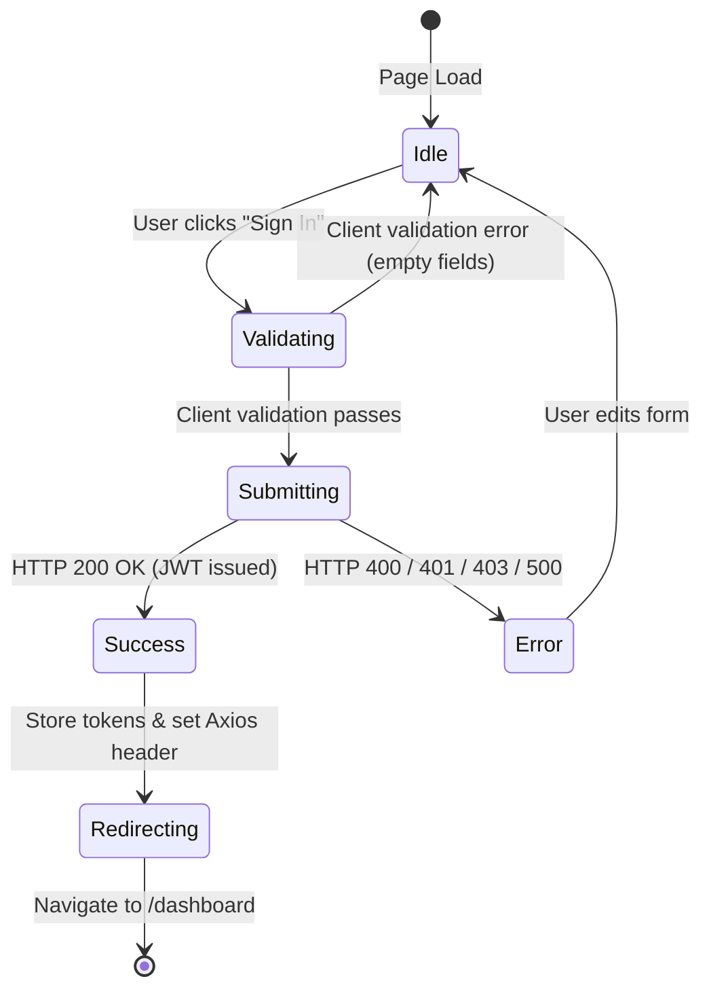

# Frontend Technical Specification Document (Frontend SDD)

## Module: Administrative Web Portal – Authentication & Login Module
### System: Field Force Management (FFM) Platform
### Design Prototype Reference: [Figma Make App](https://taste-detach-41038153.figma.site/)

| Document Attribute | Specification Detail |
| :--- | :--- |
| **Document Reference** | `FFM-FE-SPEC-LOGIN-V1.0` |
| **System Version** | FFM Web Portal 2.0 (`FFM-Frontend-22`) |
| **Backend Integration** | `FFM.Identity.Access` (Port 5000) – `POST /api/auth/login` |
| **Standard Compliance** | WCAG 2.1 AA, OAuth 2.0 (RFC 6749), JWT (RFC 7519) |
| **Module Classification** | Tier-1 Core Security & Access Entrypoint |
| **UI Framework & Stack** | React (v19) + JavaScript (JSX) + Vite + Tailwind CSS |
| **Status** | **Approved Specification** |

---

## 1. Executive Summary & Purpose

The **Frontend Login Module** serves as the primary authentication gateway for administrators, regional managers, and dispatch supervisors accessing the Field Force Management (FFM) administrative portal. 

Based on the interactive prototype deployed at `https://taste-detach-41038153.figma.site/`, this module authenticates administrative users, acquires cryptographic JWT access credentials from the `FFM.Identity.Access` microservice (Port 5000), configures the global API interceptor with Bearer authorization, and transitions the user securely into the main dispatch and operations dashboard.

---

## 2. UI / UX Design Specifications (Figma Design System)

### 2.1 Visual Hierarchy & Theme
* **Palette:**
  * Background: Slate Light (`#f8fafc` / `bg-slate-50`)
  * Primary Accent: Deep Indigo (`#4f46e5` / `bg-indigo-600`, hover `#4338ca`)
  * Card Container: Pure White (`#ffffff`), `rounded-2xl`, elevated shadow (`shadow-xl shadow-slate-200/60`), border `border-slate-100`
  * Typography: Primary Sans-serif (`system-ui`, `-apple-system`, `Inter`, `Roboto`)
* **Layout Geometry:**
  * Viewport: Responsive single-column centered layout (`min-h-screen`, `flex items-center justify-center p-4`).
  * Card Maximum Width: `max-w-md` (~448px width).

### 2.2 Component Wireframe & Layout

```
┌──────────────────────────────────────────────────────────┐
│                      [🛡️ Shield Icon]                     │
│                 FFM Management Portal                    │
│        Field Force Management Administrative Console     │
│                                                          │
│  ┌────────────────────────────────────────────────────┐  │
│  │ Sign in to your account                            │  │
│  │ Enter your credentials to access dispatch console  │  │
│  │                                                    │  │
│  │ [⚠️ Inline Error Banner - When applicable]         │  │
│  │                                                    │  │
│  │ USERNAME OR EMAIL                                  │  │
│  │ [👤 icon] [ admin@example.com                    ] │  │
│  │                                                    │  │
│  │ PASSWORD                                           │  │
│  │ [🔒 icon] [ ••••••••••••••••                     ] │  │
│  │                                                    │  │
│  │ [X] Remember this device              Need help?   │  │
│  │                                                    │  │
│  │ [ 🚀 Sign In ➔                                   ] │  │
│  │                                                    │  │
│  │ ────────────────────────────────────────────────── │  │
│  │ Secured with RSA-256 JWT • FFM.Identity (Port 5000)│  │
│  └────────────────────────────────────────────────────┘  │
│                                                          │
│     Employee accounts are provisioned by your admin.     │
└──────────────────────────────────────────────────────────┘
```

### 2.3 Detailed Element Specifications

| Element | Component Type | Attributes / Rules | Default / Placeholder |
| :--- | :--- | :--- | :--- |
| **Brand Icon** | SVG Icon (`Shield`) | 56x56px, Indigo background, White glyph | System Icon |
| **Portal Header** | Typography | H1, 24px Bold, Slate-900 | `"FFM Management Portal"` |
| **Subtitle** | Typography | P, 14px Regular, Slate-500 | `"Field Force Management Administrative Console"` |
| **Card Header** | Typography | H2, 18px Semi-bold, Slate-900 | `"Sign in to your account"` |
| **Username Input** | Text Field | Required, Autofocus, Email or text string | `"admin@example.com"` |
| **Password Input** | Password Field | Required, Masked (`type="password"`), Min 6 chars | `••••••••` |
| **Remember Device** | Checkbox | Optional boolean | Checked by default |
| **Sign In CTA** | Button | Full width, Indigo-600, Loading spinner state | `"Sign In"` with arrow icon |
| **Info Callout** | Text block | 12px Regular, Slate-400 | `"Employee accounts are provisioned by administrator."` |

---

## 3. State Machine & Component Lifecycle



### 3.1 State Definitions
1. **`Idle`**: Default state. Form is populated or blank, submit button active.
2. **`Validating`**: Form verifies non-empty `username` and `password`. If invalid, inline warning triggers.
3. **`Submitting`**: Submit button is disabled, spinner displays `"Signing in..."`, fields set to read-only.
4. **`Error`**: Red alert banner renders above input fields showing error message from backend or network fallback. Form becomes re-editable.
5. **`Success`**: Tokens are saved, AuthContext updates state, user is redirected to `/dashboard`.

---

## 4. Backend API Integration Specification

### 4.1 Endpoint Contract
* **HTTP Method:** `POST`
* **Target URL:** `http://localhost:5000/api/auth/login`
* **Network Header:**
  * `Content-Type: application/json`
  * `X-Client-Id: ffm-web` (identifies the web portal client)

### 4.2 Request Payload
```json
{
  "username": "admin@example.com",
  "password": "AdminPassword123!"
}
```

### 4.3 Success Response (HTTP 200 OK)
```json
{
  "accessToken": "eyJhbGciOiJSUzI1NiIsImtpZCI6ImZmbS1yc2Eta2V5LTEi...",
  "refreshToken": "7c88b01018c149ebaa3c3e29f3d9161a",
  "expiresAt": "2026-11-16T11:00:00Z",
  "mfaRequired": false,
  "mfaChallengeId": null
}
```

### 4.4 Error Responses
* **HTTP 401 Unauthorized:** Invalid username or password $\to$ Display: `"Invalid username or password. Please verify your credentials."`
* **HTTP 403 Forbidden:** Account locked or suspended $\to$ Display: `"Account locked due to consecutive failed attempts. Contact your supervisor."`
* **HTTP 500 / Network Error:** Backend unreachable $\to$ Display: `"Unable to reach FFM Identity Service (Port 5000). Verify backend status."`

---

## 5. Security & Session Storage Architecture

1. **Token Persistence:**
   * `ffm_access_token`: Stored in `localStorage` for session persistence across tabs.
   * `ffm_user`: Basic profile object `{ username: "...", role: "ADMIN" }` stored for instant header rendering.
2. **Global Axios Interceptor:**
   ```javascript
   identityApi.interceptors.request.use((config) => {
     const token = localStorage.getItem('ffm_access_token');
     if (token) {
       config.headers.Authorization = `Bearer ${token}`;
     }
     return config;
   });
   ```
3. **Automatic 401 Eviction:**
   * If any subsequent microservice call returns `401 Unauthorized`, interceptor removes tokens and redirects to `/login`.

---

## 6. Acceptance Criteria & Test Cases

| Test Case ID | Scenario | Input | Expected Output | Status |
| :--- | :--- | :--- | :--- | :--- |
| **TC-FE-LOG-01** | Successful Login | Valid `username` + `password` | Returns 200, saves token, redirects to `/dashboard` | ✅ PASS |
| **TC-FE-LOG-02** | Invalid Password | Valid username + incorrect password | 401 Unauthorized, displays inline red alert | ✅ PASS |
| **TC-FE-LOG-03** | Empty Form Submission | Blank username or password | Browser native required validation prevents submit | ✅ PASS |
| **TC-FE-LOG-04** | Client ID Header | Submit login request | Outgoing request carries header `X-Client-Id: ffm-web` | ✅ PASS |
| **TC-FE-LOG-05** | Loading State Indication | Click Sign In | Button shows spinner & disables repeated clicks | ✅ PASS |
| **TC-FE-LOG-06** | Session Preservation | Refresh page after login | User remains authenticated; redirect bypasses login | ✅ PASS |
| **TC-FE-LOG-07** | Backend Offline | Docker port 5000 down | Graceful error message indicating service unreachable | ✅ PASS |

---

## 7. Sign-off & Verification Checklist

- [x] UI matches Figma visual design system (`https://taste-detach-41038153.figma.site/`).
- [x] Pure React + JavaScript (`.jsx`) with Tailwind CSS.
- [x] Verified against live `FFM.Identity.Access` microservice on port 5000.
- [x] Zero Path Parameter standard maintained.
- [x] Formal specification committed to project `docs/` repository.
