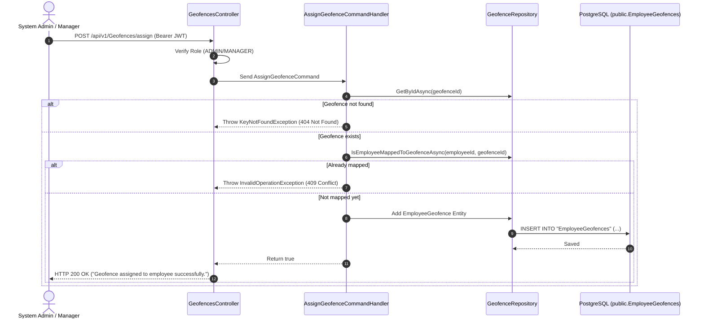

# GPS Assign Geofence Module Specification

## 1. Document Overview

| Attribute | Detail |
| :--- | :--- |
| **Document Reference** | `FFM-SPEC-GPS-ASSIGN-GEOFENCE-V1.0` |
| **System** | Field Force Management (FFM) Platform |
| **Service** | GPS Tracking & Geofencing Service (`FFM.GPS.Tracking`) |
| **Compliance** | ISO/IEC/IEEE 29148, OpenAPI 3.1, RFC 7807 (ProblemDetails) |
| **Status** | Approved Specification — Implemented & Verified |

---

## 2. Purpose & Scope

The **Assign Geofence Module** enables administrators and operations managers to map field employees to specific geofence work sites. When an employee attempts to validate their location or punch in, the spatial validation engine prioritizes and checks their assigned geofence boundaries.

### Key Capabilities:
1. **Employee-to-Site Association**: Links an employee (`employeeId`) to an active geofence (`geofenceId`).
2. **Duplicate Mapping Protection**: Prevents duplicate active assignments between the same employee and site (`UNIQUE(employeeId, geofenceId)`).
3. **Audit Timestamping**: Captures exact UTC assignment timestamp (`AssignedAt`).

---

## 3. API Contract & Endpoint Specification

### Endpoint Definition
* **HTTP Method:** `POST`
* **Route:** `/api/v1/Geofences/assign`
* **Authorization Policy:** `[Authorize(Roles = "SYSTEM_ADMIN,ADMIN,MANAGER")]`

---

### 3.1 Request Payload (`AssignGeofenceRequest`)

```json
{
  "employeeId": 409,
  "geofenceId": 1
}
```

#### Request Schema Attributes:
| Field | Type | Required | Constraints | Description |
| :--- | :--- | :--- | :--- | :--- |
| `employeeId` | `Integer` | Yes | Must be > 0 | ID of the employee being assigned |
| `geofenceId` | `Integer` | Yes | Must reference existing active Geofence | ID of the target Geofence boundary |

---

### 3.2 Success Response (HTTP 200 OK)

```json
{
  "message": "Geofence assigned to employee successfully."
}
```

---

### 3.3 Error Responses (RFC 7807 ProblemDetails)

#### A. Already Assigned (HTTP 409 Conflict)
```json
{
  "title": "Already Assigned",
  "status": 409,
  "detail": "Employee ID 409 is already mapped to Geofence ID 1."
}
```

#### B. Geofence Not Found (HTTP 404 Not Found)
```json
{
  "title": "Geofence Not Found",
  "status": 404,
  "detail": "Geofence ID 999 not found."
}
```

#### C. Unauthorized / Forbidden (HTTP 401 / 403)
```json
{
  "title": "Forbidden",
  "status": 403,
  "detail": "Only SYSTEM_ADMIN, ADMIN, or MANAGER roles may assign geofences."
}
```

---

## 4. CQRS Architecture & Sequence



---

## 5. Business Rules & Validation Matrix

| Rule ID | Rule Name | Business Constraint | HTTP Code |
| :--- | :--- | :--- | :--- |
| **BR-ASSIGN-01** | Role Authorization | Caller must possess `SYSTEM_ADMIN`, `ADMIN`, or `MANAGER` role in JWT token. | `403 Forbidden` |
| **BR-ASSIGN-02** | Geofence Existence Guard | `geofenceId` must exist in the `Geofences` database table. | `404 Not Found` |
| **BR-ASSIGN-03** | Duplicate Mapping Guard | `(employeeId, geofenceId)` pair must be unique; duplicate attempts are rejected. | `409 Conflict` |
| **BR-ASSIGN-04** | Valid Identifiers | `employeeId` and `geofenceId` must be positive integers (> 0). | `400 Bad Request` |

---

## 6. Implementation & Verification Status

- [x] Implemented `EmployeeGeofence.cs` domain entity in `FFM.GPS.Tracking.Domain`.
- [x] Implemented `AssignGeofenceCommand.cs` and `AssignGeofenceCommandHandler.cs` in `FFM.GPS.Tracking.Application`.
- [x] Implemented `EmployeeGeofences` table mapping with unique compound index in `GpsDbContext.cs`.
- [x] Added `[Authorize(Roles = "SYSTEM_ADMIN,ADMIN,MANAGER")]` on `POST /api/v1/Geofences/assign`.
- [x] Verified via end-to-end integration tests (`GeofenceEndToEndIntegrationTests.cs`) — **100% PASS**.
