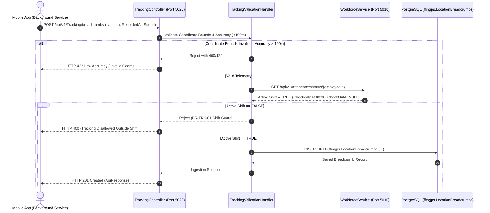

# GPS Breadcrumb Tracking Module Specification

## 1. Document Overview

| Attribute | Detail |
| :--- | :--- |
| **Document Reference** | `FFM-SPEC-GPS-BREADCRUMB-TRACKING-V1.0` |
| **System** | Field Force Management (FFM) Platform |
| **Service** | GPS Tracking & Geofencing Service (`FFM.GPS.Tracking`) |
| **Compliance** | ISO/IEC/IEEE 29148, OpenAPI 3.1, RFC 7807 (ProblemDetails), GDPR Employee Privacy Guidelines |
| **Status** | Approved Specification — Ready for Implementation |
| **Target Clients** | FFM Mobile Application (Android/iOS background tracking service) & FFM Web Portal |
| **Perspective** | **Backend / Server-Side Architecture** |

---

## 2. Purpose & Business Scope

The **Breadcrumb Tracking Module** provides real-time telemetry ingestion of high-precision GPS coordinates, device velocity, heading, and hardware vitals from field workers' mobile devices at configurable intervals (e.g., every 5 to 10 minutes) during their active work shifts.

### Key Capabilities:
1. **Periodic Telemetry Ingestion (`POST /api/v1/Tracking/breadcrumbs`)**: Ingests single real-time location pings dispatched by the mobile background service.
2. **Offline Batch Ingestion (`POST /api/v1/Tracking/breadcrumbs/batch`)**: Accommodates network dead zones (basements, remote rural sites) by allowing mobile devices to queue pings locally and sync in bulk upon reconnection.
3. **Active Shift Guard (Privacy Compliance)**: GPS telemetry is strictly accepted only while an employee is actively checked in (`CheckOutTime == NULL`). Telemetry received outside an active shift is rejected to ensure employee privacy and labor regulatory compliance.
4. **Latest Location Snapshot (`GET /api/v1/Tracking/latest/{employeeId}`)**: Provides supervisors with instant access to an employee's most recent known position, speed, and battery health.
5. **Noise & Jitter Filtering**: Validates horizontal GPS accuracy; discards degraded pings (e.g., accuracy radius $> 100$ meters caused by urban canyons or indoor multipath).

---

## 3. API Contract & Endpoint Specifications

### 3.1 Ingest Single Breadcrumb (`POST /api/v1/Tracking/breadcrumbs`)

* **HTTP Method:** `POST`
* **Route:** `/api/v1/Tracking/breadcrumbs`
* **Authorization Policy:** `[Authorize(Roles = "EMPLOYEE,SUPERVISOR,ADMIN")]`
* **Description:** Records a real-time GPS coordinate ping from the field worker's mobile application.

#### Request Payload (`CreateBreadcrumbRequest`):
```json
{
  "employeeId": 202,
  "latitude": 13.0827450,
  "longitude": 80.2707180,
  "accuracyMeters": 6.5,
  "speedKmh": 28.4,
  "headingDegrees": 185.0,
  "altitudeMeters": 14.2,
  "batteryPercentage": 82,
  "activityType": "DRIVING",
  "recordedAt": "2026-10-12T10:15:00Z"
}
```

#### Request Schema Attributes:
| Field | Type | Required | Constraints | Description |
| :--- | :--- | :--- | :--- | :--- |
| `employeeId` | `Integer` | Yes | Must match JWT `sub`/claim unless ADMIN | ID of the reporting employee |
| `latitude` | `Double` | Yes | Range: `[-90.0, +90.0]` | Geographic latitude coordinate |
| `longitude` | `Double` | Yes | Range: `[-180.0, +180.0]` | Geographic longitude coordinate |
| `accuracyMeters` | `Double` | Yes | Range: `[0.0, 500.0]` | Mobile GPS accuracy confidence radius in meters |
| `speedKmh` | `Double?` | No | Min: `0.0`, Max: `250.0` | Device ground speed in km/h |
| `headingDegrees` | `Double?` | No | Range: `[0.0, 360.0]` | Compass bearing in degrees from true North |
| `altitudeMeters` | `Double?` | No | Height above sea level in meters | Mobile GPS reported altitude |
| `batteryPercentage`| `Integer?`| No | Range: `[0, 100]` | Smartphone battery charge remaining |
| `activityType` | `String?` | No | Enum: `STILL`, `WALKING`, `RUNNING`, `DRIVING`, `UNKNOWN` | Motion activity detected by device sensors |
| `recordedAt` | `DateTime` | Yes | ISO 8601 UTC; cannot be $> 5$ mins in future | Timestamp when GPS hardware acquired coordinates |

#### Success Response (`HTTP 201 Created`):
```json
{
  "success": true,
  "message": "Breadcrumb recorded successfully.",
  "data": {
    "breadcrumbId": 10452,
    "employeeId": 202,
    "recordedAt": "2026-10-12T10:15:00Z",
    "receivedAt": "2026-10-12T10:15:02Z"
  },
  "error": null,
  "timestamp": "2026-10-12T10:15:02.145Z"
}
```

---

### 3.2 Ingest Batch Breadcrumbs (`POST /api/v1/Tracking/breadcrumbs/batch`)

* **HTTP Method:** `POST`
* **Route:** `/api/v1/Tracking/breadcrumbs/batch`
* **Authorization Policy:** `[Authorize(Roles = "EMPLOYEE,SUPERVISOR,ADMIN")]`
* **Description:** Ingests an ordered batch of breadcrumbs queued locally on the mobile device during offline periods.

#### Request Payload (`BatchBreadcrumbsRequest`):
```json
{
  "employeeId": 202,
  "breadcrumbs": [
    {
      "latitude": 13.0815200,
      "longitude": 80.2691000,
      "accuracyMeters": 8.0,
      "speedKmh": 15.2,
      "headingDegrees": 180.0,
      "altitudeMeters": 12.0,
      "batteryPercentage": 85,
      "activityType": "DRIVING",
      "recordedAt": "2026-10-12T09:45:00Z"
    },
    {
      "latitude": 13.0827450,
      "longitude": 80.2707180,
      "accuracyMeters": 6.5,
      "speedKmh": 28.4,
      "headingDegrees": 185.0,
      "altitudeMeters": 14.2,
      "batteryPercentage": 82,
      "activityType": "DRIVING",
      "recordedAt": "2026-10-12T10:15:00Z"
    }
  ]
}
```

#### Request Schema Attributes:
| Field | Type | Required | Constraints | Description |
| :--- | :--- | :--- | :--- | :--- |
| `employeeId` | `Integer` | Yes | Must match authenticated caller | Employee ID |
| `breadcrumbs` | `Array<CreateBreadcrumbItem>` | Yes | Array size: `1` to `500` items | Chronologically ordered breadcrumb points |

#### Success Response (`HTTP 200 OK`):
```json
{
  "success": true,
  "message": "Batch of 2 breadcrumbs recorded successfully.",
  "data": {
    "totalIngested": 2,
    "firstRecordedAt": "2026-10-12T09:45:00Z",
    "lastRecordedAt": "2026-10-12T10:15:00Z"
  },
  "error": null,
  "timestamp": "2026-10-12T10:15:05.120Z"
}
```

---

### 3.3 Get Latest Employee Location (`GET /api/v1/Tracking/latest/{employeeId}`)

* **HTTP Method:** `GET`
* **Route:** `/api/v1/Tracking/latest/{employeeId}`
* **Authorization Policy:** `[Authorize(Roles = "EMPLOYEE,SUPERVISOR,ADMIN,MANAGER")]`
* **Description:** Retrieves the most recent breadcrumb recorded for the specified employee.

#### Success Response (`HTTP 200 OK`):
```json
{
  "success": true,
  "message": "Latest location retrieved successfully.",
  "data": {
    "breadcrumbId": 10452,
    "employeeId": 202,
    "latitude": 13.0827450,
    "longitude": 80.2707180,
    "accuracyMeters": 6.5,
    "speedKmh": 28.4,
    "headingDegrees": 185.0,
    "altitudeMeters": 14.2,
    "batteryPercentage": 82,
    "activityType": "DRIVING",
    "recordedAt": "2026-10-12T10:15:00Z",
    "receivedAt": "2026-10-12T10:15:02Z",
    "isStale": false
  },
  "error": null,
  "timestamp": "2026-10-12T10:16:00.000Z"
}
```

---

### 3.4 Error Responses (RFC 7807 ProblemDetails / ApiResponse Envelope)

#### A. Outside Active Shift / Not Checked In (`HTTP 400 Bad Request`)
```json
{
  "success": false,
  "message": "Breadcrumb tracking is rejected: Employee has no active checked-in shift.",
  "data": null,
  "error": {
    "code": "INACTIVE_SHIFT_TRACKING_DISALLOWED",
    "message": "Employee 202 is currently checked out. GPS tracking is forbidden outside active duty hours."
  },
  "timestamp": "2026-10-12T10:15:02.150Z"
}
```

#### B. Coordinate Out of Range (`HTTP 400 Bad Request`)
```json
{
  "success": false,
  "message": "Invalid coordinates.",
  "data": null,
  "error": {
    "code": "INVALID_COORDINATES",
    "message": "Latitude must be between -90.0 and +90.0; Longitude between -180.0 and +180.0."
  },
  "timestamp": "2026-10-12T10:15:02.155Z"
}
```

#### C. Inaccurate GPS Ping Discarded (`HTTP 422 Unprocessable Entity`)
```json
{
  "success": false,
  "message": "GPS ping discarded due to poor accuracy.",
  "data": null,
  "error": {
    "code": "GPS_ACCURACY_TOO_LOW",
    "message": "Accuracy radius of 145.0m exceeds acceptable threshold (100.0m)."
  },
  "timestamp": "2026-10-12T10:15:02.160Z"
}
```

---

## 4. Architectural Sequence Diagram



---

## 5. Database Schema (`ffmgps.LocationBreadcrumbs`)

```sql
CREATE SCHEMA IF NOT EXISTS ffmgps;

CREATE TABLE ffmgps.LocationBreadcrumbs (
    Id BIGINT GENERATED ALWAYS AS IDENTITY PRIMARY KEY,
    EmployeeId INT NOT NULL,
    Latitude NUMERIC(10, 7) NOT NULL,
    Longitude NUMERIC(10, 7) NOT NULL,
    AccuracyMeters NUMERIC(6, 2) NOT NULL,
    SpeedKmh NUMERIC(6, 2) NULL,
    HeadingDegrees NUMERIC(5, 2) NULL,
    AltitudeMeters NUMERIC(7, 2) NULL,
    BatteryPercentage INT NULL,
    ActivityType VARCHAR(50) NULL DEFAULT 'UNKNOWN',
    RecordedAt TIMESTAMPTZ NOT NULL,
    CreatedAt TIMESTAMPTZ NOT NULL DEFAULT NOW()
);

-- Compound Index for fast range queries on date/time per employee
CREATE INDEX IX_LocationBreadcrumbs_Employee_RecordedAt 
ON ffmgps.LocationBreadcrumbs (EmployeeId, RecordedAt DESC);

-- Index for spatial proximity analysis
CREATE INDEX IX_LocationBreadcrumbs_RecordedAt 
ON ffmgps.LocationBreadcrumbs (RecordedAt);
```

---

## 6. Business Rules Matrix

| Rule ID | Rule Name | Business Constraint | Action / HTTP Status |
| :--- | :--- | :--- | :--- |
| **BR-TRK-01** | **Active Shift Guard** | Breadcrumb tracking is accepted only if the worker has an open attendance session (`CheckedIn` and not `CheckedOut`). | `400 Bad Request` (`INACTIVE_SHIFT_TRACKING_DISALLOWED`) |
| **BR-TRK-02** | **Coordinate Bounds** | Latitude must be between $-90.0$ and $+90.0$; Longitude between $-180.0$ and $+180.0$. | `400 Bad Request` (`INVALID_COORDINATES`) |
| **BR-TRK-03** | **Accuracy Threshold** | Hardware horizontal accuracy radius must be $\le 100.0$ meters to avoid satellite multipath noise. | `422 Unprocessable Entity` (`GPS_ACCURACY_TOO_LOW`) |
| **BR-TRK-04** | **Temporal Validation** | `RecordedAt` timestamp cannot be $> 5$ minutes into the future (server clock drift guard). | `400 Bad Request` (`INVALID_TIMESTAMP`) |
| **BR-TRK-05** | **Batch Capacity Limit** | Batch upload payloads must not exceed $500$ breadcrumb objects per HTTP request. | `400 Bad Request` (`BATCH_SIZE_EXCEEDED`) |
| **BR-TRK-06** | **Idempotency** | Identical coordinate + timestamp pings within $2$ seconds for the same employee are de-duplicated. | Silently merged / acknowledged |
