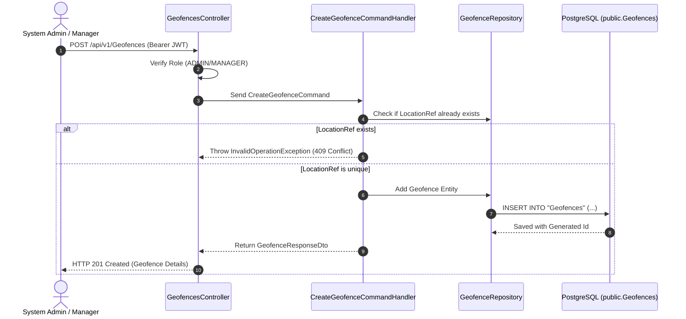

# GPS Create Geofence Module Specification

## 1. Document Overview

| Attribute | Detail |
| :--- | :--- |
| **Document Reference** | `FFM-SPEC-GPS-CREATE-GEOFENCE-V1.0` |
| **System** | Field Force Management (FFM) Platform |
| **Service** | GPS Tracking & Geofencing Service (`FFM.GPS.Tracking`) |
| **Compliance** | ISO/IEC/IEEE 29148, OpenAPI 3.1, RFC 7807 (ProblemDetails) |
| **Status** | Approved Specification — Implemented & Verified |

---

## 2. Purpose & Scope

The **Create Geofence Module** allows system administrators and managers to configure virtual geographic perimeters (Circular or Polygon) representing authorized work locations, client offices, manufacturing facilities, or construction sites.

### Key Capabilities:
1. **Circular Geofences**: Defined by center coordinates `(Latitude, Longitude)` and radius in meters.
2. **Polygon Geofences**: Defined by an ordered set of 3 or more coordinate vertices in JSON format.
3. **Buffer Zone Support**: Configurable boundary buffer (default: 15 meters) to accommodate GPS hardware drift.
4. **Unique Location Reference**: Assigns or enforces unique alphanumeric `LocationRef` identifiers for cross-service linking.

---

## 3. API Contract & Endpoint Specification

### Endpoint Definition
* **HTTP Method:** `POST`
* **Route:** `/api/v1/Geofences`
* **Authorization Policy:** `[Authorize(Roles = "SYSTEM_ADMIN,ADMIN,MANAGER")]`

---

### 3.1 Request Payload (`CreateGeofenceRequest`)

#### Circular Geofence Example (1 Coordinate + Radius):
```json
{
  "locationRef": "GEOFENCE_SITE_102",
  "name": "Chennai Headquarters Office",
  "type": "CIRCULAR",
  "coordinates": [
    { "latitude": 13.0827, "longitude": 80.2707 }
  ],
  "radiusMeters": 100.0
}
```

#### Polygon Geofence Example (3+ Coordinates, No Radius):
```json
{
  "locationRef": "CHN_FACTORY_ESTATE",
  "name": "Guindy Industrial Plant Complex",
  "type": "POLYGON",
  "coordinates": [
    { "latitude": 13.0102, "longitude": 80.2104 },
    { "latitude": 13.0125, "longitude": 80.2150 },
    { "latitude": 13.0080, "longitude": 80.2175 },
    { "latitude": 13.0060, "longitude": 80.2120 }
  ]
}
```

#### Request Schema Attributes:
| Field | Type | Required | Constraints | Description |
| :--- | :--- | :--- | :--- | :--- |
| `locationRef` | `String` | Yes | Max length 255 chars, Unique | Business site identifier (e.g., `GEOFENCE_SITE_102`) |
| `name` | `String` | Yes | Max length 255 chars | Descriptive name of the site boundary |
| `type` | `String` | Yes | Enum: `CIRCULAR`, `POLYGON` | Shape type of the geofence perimeter |
| `coordinates` | `Array<CoordinatePoint>` | Yes | Min 1 for CIRCULAR; Min 3 for POLYGON | List of GPS coordinates `{latitude, longitude}` |
| `radiusMeters` | `Double?` | Conditional | Min: `1.0` | Required for `CIRCULAR` geofences (in meters) |

---

### 3.2 Success Response (HTTP 201 Created)

```json
{
  "id": 1,
  "locationRef": "GEOFENCE_SITE_102",
  "name": "Chennai Headquarters Office",
  "type": "CIRCULAR",
  "coordinates": [
    { "latitude": 13.0827, "longitude": 80.2707 }
  ],
  "radiusMeters": 100.0,
  "isActive": true,
  "createdAt": "2026-10-09T05:00:00Z"
}
```

---

### 3.3 Error Responses (RFC 7807 ProblemDetails)

#### A. Duplicate LocationRef (HTTP 409 Conflict)
```json
{
  "title": "Geofence Conflict",
  "status": 409,
  "detail": "Geofence with LocationRef 'GEOFENCE_SITE_102' already exists."
}
```

#### B. Validation Error / Invalid Coordinates (HTTP 400 Bad Request)
```json
{
  "title": "Invalid Parameters",
  "status": 400,
  "detail": "Circular geofences require CenterLatitude, CenterLongitude, and positive RadiusMeters."
}
```

#### C. Unauthorized / Forbidden (HTTP 401 / 403)
```json
{
  "title": "Forbidden",
  "status": 403,
  "detail": "Only SYSTEM_ADMIN, ADMIN, or MANAGER roles may create geofences."
}
```

---

## 4. CQRS Architecture & Sequence



---

## 5. Business Rules & Validation Matrix

| Rule ID | Rule Name | Business Constraint | HTTP Code |
| :--- | :--- | :--- | :--- |
| **BR-GEO-01** | Role Authorization | Must possess `SYSTEM_ADMIN`, `ADMIN`, or `MANAGER` role in JWT token. | `403 Forbidden` |
| **BR-GEO-02** | Unique LocationRef | `locationRef` must be unique across all active and inactive geofences. | `409 Conflict` |
| **BR-GEO-03** | Circular Geometry Constraint | If `type == CIRCULAR`, `centerLatitude`, `centerLongitude`, and `radiusMeters` (> 0) must be provided. | `400 Bad Request` |
| **BR-GEO-04** | Polygon Geometry Constraint | If `type == POLYGON`, `polygonCoordinatesJson` must contain at least 3 valid coordinate vertices. | `400 Bad Request` |
| **BR-GEO-05** | Coordinate Bounds | Latitudes must be between `-90.0` and `+90.0`; Longitudes between `-180.0` and `+180.0`. | `400 Bad Request` |

---

## 6. Implementation & Verification Status

- [x] Implemented `Geofence.cs` domain entity in `FFM.GPS.Tracking.Domain`.
- [x] Implemented `CreateGeofenceCommand.cs` and `CreateGeofenceCommandHandler.cs` in `FFM.GPS.Tracking.Application`.
- [x] Implemented `GpsDbContext.cs` mapping `Geofences` table in `public` PostgreSQL schema.
- [x] Added `[Authorize(Roles = "SYSTEM_ADMIN,ADMIN,MANAGER")]` on `POST /api/v1/Geofences`.
- [x] Verified via unit and integration tests (`GeofenceEndToEndIntegrationTests.cs`) — **100% PASS**.
