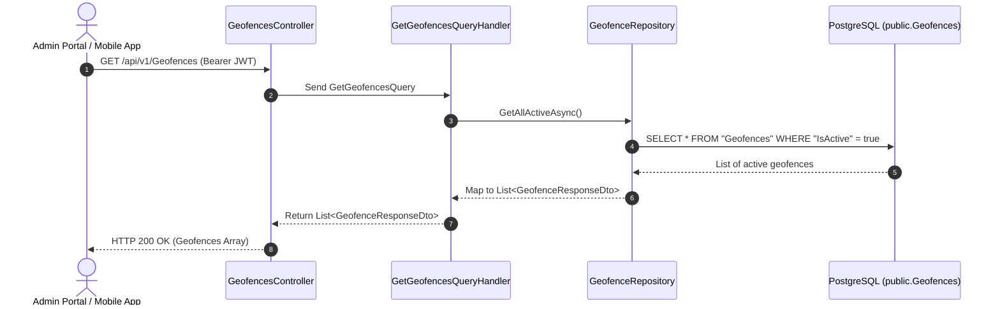

# GPS Get Geofences Module Specification

## 1. Document Overview

| Attribute | Detail |
| :--- | :--- |
| **Document Reference** | `FFM-SPEC-GPS-GET-GEOFENCES-V1.0` |
| **System** | Field Force Management (FFM) Platform |
| **Service** | GPS Tracking & Geofencing Service (`FFM.GPS.Tracking`) |
| **Compliance** | ISO/IEC/IEEE 29148, OpenAPI 3.1, RFC 7807 (ProblemDetails) |
| **Status** | Approved Specification — Implemented & Verified |

---

## 2. Purpose & Scope

The **Get Geofences Module** provides read access to all active geographic boundaries configured across the FFM platform. This endpoint is consumed by the Web Admin Portal (to render site boundaries and pins on maps) and the Mobile Application (to cache offline geofence boundaries for offline-first check-ins).

### Key Capabilities:
1. **Active Boundary Filtering**: Retrieves all geofences where `IsActive == true`.
2. **Dual Shape Geometry Retrieval**: Returns coordinates and radii for Circular boundaries and serialized vertex arrays for Polygon boundaries.
3. **Immutable Audit Timestamps**: Exposes `CreatedAt` timestamps for caching and synchronization.

---

## 3. API Contract & Endpoint Specification

### Endpoint Definition
* **HTTP Method:** `GET`
* **Route:** `/api/v1/Geofences`
* **Authorization Policy:** `[Authorize]` (Requires authenticated user JWT token)

---

### 3.1 Request Query Parameters
*None (Returns all active geofences).*

---

### 3.2 Success Response (HTTP 200 OK)

```json
[
  {
    "id": 1,
    "locationRef": "GEOFENCE_SITE_102",
    "name": "Chennai Headquarters Office",
    "type": "CIRCULAR",
    "radiusMeters": 100.0,
    "coordinates": [
      { "latitude": 13.0827, "longitude": 80.2707 }
    ],
    "isActive": true,
    "createdAt": "2026-10-09T05:00:00Z"
  },
  {
    "id": 2,
    "locationRef": "CHN_FACTORY_ESTATE",
    "name": "Guindy Industrial Plant Complex",
    "type": "POLYGON",
    "radiusMeters": null,
    "coordinates": [
      { "latitude": 13.0102, "longitude": 80.2104 },
      { "latitude": 13.0125, "longitude": 80.2150 },
      { "latitude": 13.0080, "longitude": 80.2175 },
      { "latitude": 13.0060, "longitude": 80.2120 }
    ],
    "isActive": true,
    "createdAt": "2026-10-09T05:10:00Z"
  }
]
```

---

### 3.3 Error Responses (RFC 7807 ProblemDetails)

#### Unauthenticated (HTTP 401 Unauthorized)
```json
{
  "title": "Unauthorized",
  "status": 401,
  "detail": "Missing or invalid Bearer token."
}
```

---

## 4. CQRS Architecture & Sequence



---

## 5. Business Rules & Validation Matrix

| Rule ID | Rule Name | Business Constraint | HTTP Code |
| :--- | :--- | :--- | :--- |
| **BR-LIST-01** | Active Filter | Only records with `IsActive == true` are returned. | `200 OK` |
| **BR-LIST-02** | Authentication Guard | Endpoint requires a valid JWT token. | `401 Unauthorized` |

---

## 6. Implementation & Verification Status

- [x] Implemented `GetGeofencesQuery.cs` and `GetGeofencesQueryHandler.cs` in `FFM.GPS.Tracking.Application`.
- [x] Implemented `GetAllActiveAsync()` in `GeofenceRepository.cs`.
- [x] Added `[Authorize]` protection on `GET /api/v1/Geofences`.
- [x] Verified via end-to-end integration tests (`GeofenceEndToEndIntegrationTests.cs`) — **100% PASS**.
