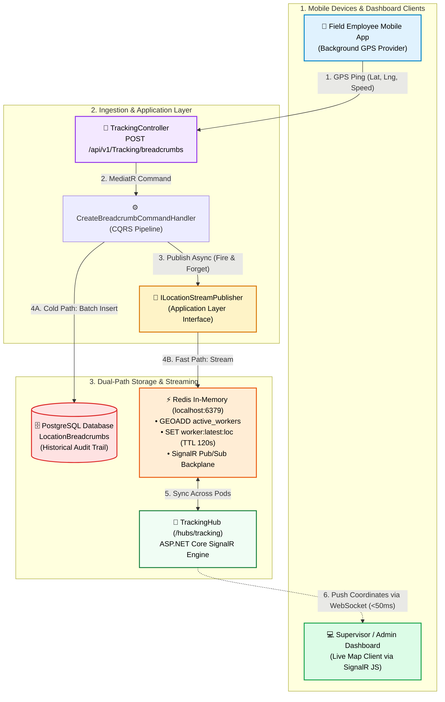

# Real-Time GPS Data Streaming Specification (SignalR + Redis)

## 1. Document Overview

| Attribute | Detail |
| :--- | :--- |
| **Document Reference** | `FFM-SPEC-GPS-STREAMING-SIGNALR-REDIS-V1.0` |
| **System** | Field Force Management (FFM) Platform |
| **Service** | GPS Tracking & Geofencing Service (`FFM.GPS.Tracking`) |
| **Architecture Pattern** | Dual-Path Real-Time Event Streaming (WebSockets + In-Memory Redis Backplane) |
| **Compliance** | ISO/IEC/IEEE 29148, W3C WebSocket RFC 6455, RFC 7519 (JWT), OWASP API Security |
| **Status** | **Approved Specification — Ready for Implementation** |
| **Target Clients** | FFM Web Supervisor/Admin Portal & FFM Mobile Dispatcher App |
| **Perspective** | **Backend / Distributed Architecture** |

---

## 2. Purpose & Business Scope

The **Real-Time GPS Data Streaming Module** enables low-latency, bi-directional, push-based telemetry distribution of field workers' physical movements to administrative dashboards, dispatcher maps, and supervisor consoles without client-side polling.

### Key Capabilities:
1. **Sub-50ms Map Updates:** Instantly pushes driver/worker location coordinates, velocity, battery status, and activity to live web maps as soon as an ingestion ping is validated.
2. **Horizontal Multi-Server Scalability (Redis Backplane):** Allows the backend to scale across multiple Kubernetes pods or Docker containers. A client connected to Server A receives telemetry emitted by a device connected to Server B seamlessly.
3. **In-Memory Latest Position Cache:** Stores the most recent coordinate of every active worker in Redis with native `GEOADD` geospatial indexing, answering *"Where is worker X right now?"* in $<1\text{ ms}$.
4. **Targeted Channel Routing:** Segregates location streaming into granular channels (`tenant_{id}`, `team_{id}`, `user_{id}`) preventing unauthorized data leaks and unnecessary network egress.
5. **Zero-Impact Architecture:** Implemented behind an `ILocationStreamPublisher` interface, completely decoupled from database writes and HTTP controller lifecycles.

---

## 3. End-to-End Architectural Flow



---

## 4. SignalR Hub Specification (`TrackingHub`)

### 4.1 Endpoint & Protocol Binding
* **Hub URL:** `/hubs/tracking`
* **Transport Protocols (Negotiated in order):**
  1. `WebSockets` (Strictly preferred, $<10\text{ ms}$ overhead)
  2. `Server-Sent Events (SSE)` (Fallback for restricted corporate firewalls)
  3. `Long Polling` (Last-resort fallback)
* **Message Protocol:** `JSON` (Version 1) with migration path to `MessagePack` for binary compaction.

### 4.2 Group & Channel Topology
Clients join specific broadcast groups upon authentication to avoid global message flooding:

| Group Name Pattern | Authorized Roles | Purpose |
| :--- | :--- | :--- |
| `tenant_{tenantId}` | `SYSTEM_ADMIN`, `TENANT_ADMIN` | Streams all field workers belonging to the company. |
| `team_{teamId}` | `SUPERVISOR`, `DISPATCHER` | Streams workers assigned to a specific regional branch or field team. |
| `user_{userId}` | `EMPLOYEE` (Self only), `ADMIN` | Streams only an individual worker's own location or direct 1-to-1 tracking. |

### 4.3 Client-to-Server Hub Methods

```csharp
public interface ITrackingHubMethods
{
    Task JoinTeamStream(int teamId);
    Task LeaveTeamStream(int teamId);
    Task TrackUser(int targetUserId);
    Task UntrackUser(int targetUserId);
}
```

* **`JoinTeamStream(int teamId)`**: Validates that the caller's JWT token has supervisor permissions over `teamId`, then adds connection to group `$"team_{teamId}"`.
* **`LeaveTeamStream(int teamId)`**: Removes connection from group `$"team_{teamId}"`.
* **`TrackUser(int targetUserId)`**: Enforces security rules; allows caller to subscribe to high-frequency updates of a single worker.

### 4.4 Server-to-Client Broadcast Events

The hub emits strongly-typed events to connected clients:

#### Event 1: `ReceiveLocationUpdate`
Dispatched every time a field worker records a valid breadcrumb.

```json
{
  "userId": 210,
  "latitude": 13.0827450,
  "longitude": 80.2707180,
  "accuracyMeters": 5.2,
  "speedKmh": 32.5,
  "headingDegrees": 184.2,
  "batteryPercentage": 86,
  "activityType": "DRIVING",
  "recordedAt": "2026-10-14T11:20:00Z",
  "transmittedAt": "2026-10-14T11:20:00.045Z"
}
```

#### Event 2: `UserWentOffline`
Dispatched when Redis detects no GPS telemetry from a device for more than 120 seconds.

```json
{
  "userId": 210,
  "lastKnownLatitude": 13.0827450,
  "lastKnownLongitude": 80.2707180,
  "wentOfflineAt": "2026-10-14T11:22:00Z",
  "reason": "SIGNAL_TIMEOUT"
}
```

---

## 5. Redis Layer Specification

Redis operates in a dual capacity: as an **in-memory spatial cache** and as the **SignalR multi-server backplane**.

### 5.1 In-Memory Latest Coordinates Cache

| Key Pattern | Data Type | TTL | Description |
| :--- | :--- | :--- | :--- |
| `tracking:user:{userId}:latest` | `Hash` | $120\text{ seconds}$ | Contains latest telemetry snapshot (`lat`, `lng`, `speed`, `heading`, `battery`, `recordedAt`). Refreshed on every ping. |
| `tracking:tenant:{tenantId}:geo` | `Sorted Set (GEO)` | $300\text{ seconds}$ | Member: `userId`, Coordinates: `(lon, lat)`. Enables native radius queries via `GEOSEARCH`. |

#### Redis Hash Structure for `tracking:user:{userId}:latest`:
```redis
HSET tracking:user:210:latest lat "13.0827450" lng "80.2707180" speed "32.5" heading "184.2" battery "86" recordedAt "1728904800"
EXPIRE tracking:user:210:latest 120
```

### 5.2 Redis Geospatial Indexing
```redis
GEOADD tracking:tenant:1:geo 80.2707180 13.0827450 "210"
```
* **Instant Radius Search:** Finds all active workers within 5km of a delivery point in $O(N + \log(M))$:
```redis
GEOSEARCH tracking:tenant:1:geo FROMLONLAT 80.2700 13.0800 BYRADIUS 5 km WITHDIST WITHCOORD
```

### 5.3 SignalR Multi-Server Backplane
* Implemented via `Microsoft.AspNetCore.SignalR.StackExchangeRedis`.
* When Server A executes `Clients.Group("team_5").SendAsync(...)`, it writes the message to Redis Pub/Sub channel `ffm:tracking:signalr`.
* Server B and Server C (which have active WebSocket connections to supervisors of team 5) receive the Pub/Sub event from Redis and push it directly down their respective client WebSockets.

---

## 6. End-to-End Security & Access Control

### 6.1 Authentication via JWT Query String Handshake
Because standard browser WebSocket APIs do not allow custom HTTP request headers, the JWT access token is passed during the initial HTTP upgrade handshake via query string:

$$\text{Client Upgrade URL: } \texttt{wss://api.ffm.example.com/hubs/tracking?access\_token=\{JWT\_TOKEN\}}$$

#### Security Handler in `Program.cs`:
```csharp
builder.Services.AddAuthentication(JwtBearerDefaults.AuthenticationScheme)
    .AddJwtBearer(options =>
    {
        options.Events = new JwtBearerEvents
        {
            OnMessageReceived = context =>
            {
                var accessToken = context.Request.Query["access_token"];
                var path = context.HttpContext.Request.Path;
                if (!string.IsNullOrEmpty(accessToken) && path.StartsWithSegments("/hubs/tracking"))
                {
                    context.Token = accessToken;
                }
                return Task.CompletedTask;
            }
        };
    });
```

### 6.2 Authorization & IDOR Security Matrix

| Role | Channel Permitted | Security Constraint |
| :--- | :--- | :--- |
| `EMPLOYEE` | `user_{callerUserId}` | **IDOR Guard:** Employees can **only** listen to their own user channel. Attempting to join other user streams or team streams throws `403 Forbidden`. |
| `SUPERVISOR` | `team_{teamId}`, `user_{teamMemberId}` | Allowed to stream workers who belong to the supervisor's assigned teams. |
| `ADMIN` / `SYSTEM_ADMIN`| `tenant_{tenantId}`, `team_{teamId}`, `user_{all}` | Full access across all tenant groups. |

### 6.3 Cross-Origin Resource Sharing (CORS) Policy
* SignalR requires explicit credential allowance (`AllowCredentials()`).
* Wildcard origin (`*`) is **strictly forbidden** with credentials.
* The API enforces trusted origins configured via `Cors:AllowedOrigins` in `appsettings.json` (e.g., `https://portal.ffm.example.com`, `http://localhost:3000`).

---

## 7. Application Code Contracts

### 7.1 Publisher Interface (`FFM.GPS.Tracking.Application`)
Location: `FFM.GPS.Tracking.Application/Interfaces/ILocationStreamPublisher.cs`

```csharp
namespace FFM.GPS.Tracking.Application.Interfaces;

public interface ILocationStreamPublisher
{
    Task PublishLocationAsync(LocationBreadcrumbDto breadcrumb, CancellationToken cancellationToken = default);
}
```

### 7.2 Infrastructure Implementation (`FFM.GPS.Tracking.Infrastructure`)
Location: `FFM.GPS.Tracking.Infrastructure/Services/SignalRRedisLocationPublisher.cs`

```csharp
public class SignalRRedisLocationPublisher : ILocationStreamPublisher
{
    private readonly IHubContext<TrackingHub, ITrackingClient> _hubContext;
    private readonly IDatabase _redisDb;
    private readonly ILogger<SignalRRedisLocationPublisher> _logger;

    public SignalRRedisLocationPublisher(
        IHubContext<TrackingHub, ITrackingClient> hubContext,
        IConnectionMultiplexer redisMultiplexer,
        ILogger<SignalRRedisLocationPublisher> logger)
    {
        _hubContext = hubContext;
        _redisDb = redisMultiplexer.GetDatabase();
        _logger = logger;
    }

    public async Task PublishLocationAsync(LocationBreadcrumbDto breadcrumb, CancellationToken cancellationToken = default)
    {
        // 1. Fast Path: Cache in Redis with 120s TTL
        var redisKey = $"tracking:user:{breadcrumb.UserId}:latest";
        await _redisDb.HashSetAsync(redisKey, new HashEntry[]
        {
            new("lat", (double)breadcrumb.Latitude),
            new("lng", (double)breadcrumb.Longitude),
            new("speed", (double)(breadcrumb.SpeedKmh ?? 0)),
            new("heading", (double)(breadcrumb.HeadingDegrees ?? 0)),
            new("battery", breadcrumb.BatteryPercentage ?? 0),
            new("recordedAt", breadcrumb.RecordedAt.ToString("O"))
        });
        await _redisDb.KeyExpireAsync(redisKey, TimeSpan.FromSeconds(120));

        // 2. Broadcast to specific user channel and team channel via SignalR Hub
        await _hubContext.Clients.Group($"user_{breadcrumb.UserId}")
            .ReceiveLocationUpdate(breadcrumb);
    }
}
```

---

## 8. Failure Modes & Resilience Engineering

| Failure Scenario | Impact | System Handling & Recovery Strategy |
| :--- | :--- | :--- |
| **Redis Server Down** | Live streaming across pods fails; latest position cache temporarily unavailable. | **Graceful Degradation:** Circuit breaker falls back to in-memory local hub broadcasting. Database persistence continues uninterrupted. Error logged with `CRITICAL` alert. |
| **Mobile Network Disconnect** | Telemetry pings paused while worker passes through tunnels/elevators. | Mobile app buffers coordinates locally. On reconnection, calls `POST /breadcrumbs/batch`. Streamer detects catch-up timestamps and emits latest point. |
| **Stale Device / Battery Die** | Worker stops emitting GPS pings without explicit sign-off. | Redis key TTL ($120\text{s}$) expires naturally. Background heartbeat service detects expired key and emits `UserWentOffline` event to supervisor map. |
| **WebSocket Connection Drops** | Browser client disconnects during page navigation. | Client utilizes SignalR automatic reconnect with exponential backoff: `[0, 2000, 10000, 30000]` milliseconds. Re-joins previous groups on reconnection. |

---

## 9. Comprehensive Testing & Verification Plan

### 9.1 Unit Testing Strategy
* **Project:** `FFM.GPS.Tracking.Tests`
* **Test Cases:**
  1. `PublishLocationAsync_ValidBreadcrumb_CachesInRedisWithCorrectTTL`: Verifies `HashSetAsync` and `KeyExpireAsync(120s)` are invoked.
  2. `PublishLocationAsync_ValidBreadcrumb_BroadcastsToUserGroup`: Verifies `IHubContext.Clients.Group("user_210")` receives the event.
  3. `TrackingHub_Employee_CannotJoinUnauthorizedTeamStream`: Asserts `HubException` or forbidden response when an employee attempts to listen to team channels.

### 9.2 Integration Testing Strategy
* Utilizes `Microsoft.AspNetCore.TestHost` and `Microsoft.AspNetCore.SignalR.Client.HubConnectionBuilder`.
* Authenticates with test JWT bearer tokens.
* Connects via WebSocket, triggers `POST /api/v1/Tracking/breadcrumbs`, and asserts receipt of `ReceiveLocationUpdate` within $< 100\text{ ms}$.

### 9.3 Performance & Load SLA Targets

| Metric | Target SLA |
| :--- | :--- |
| **Concurrent Active Workers Streaming Pings** | **500 - 1,000 devices** |
| **Ingestion Throughput** | $200\text{ pings / second}$ |
| **End-to-End Delivery Latency (Ping Ingest } \rightarrow \text{ Browser Map)** | **$< 50\text{ milliseconds (p95)}$** |
| **Redis CPU Utilization under 1,000 devices** | **$< 5\%$** |
| **Backend API Server RAM Footprint increase** | **$< 60\text{ MB}$** |

---

## 10. Deployment & Infrastructure Setup

### 10.1 Docker Compose Environment
* Reuses existing, healthy `redis:7-alpine` container (`ffm-identity-access-redis`) running on port `6379`.
* Network: `ffm-backend-network`.

### 10.2 NuGet Package Requirements
1. `Microsoft.AspNetCore.SignalR.StackExchangeRedis` (Version 8.0.x)
2. `StackExchange.Redis` (Version 2.7.x)

### 10.3 Configuration Keys (`appsettings.json`)
```json
{
  "ConnectionStrings": {
    "Redis": "localhost:6379,abortConnect=false,connectTimeout=5000"
  },
  "SignalR": {
    "KeepAliveIntervalSeconds": 15,
    "ClientTimeoutIntervalSeconds": 30
  }
}
```
