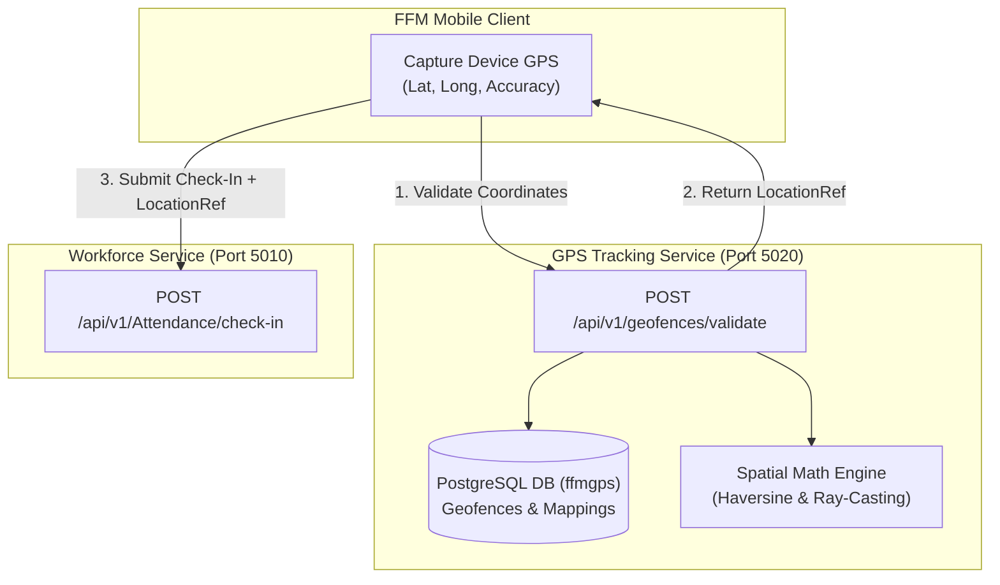

# Formal Technical Specification Document (Backend SDD)

## Module: GPS Tracking & Geofencing Service
### System: Field Force Management (FFM) Platform

| Document Attribute | Specification Detail |
| :--- | :--- |
| **Document Reference** | `FFM-SPEC-GPS-GEOFENCE-V1.0` |
| **Standard Compliance** | ISO/IEC/IEEE 29148, OpenAPI 3.1, RFC 7807 (ProblemDetails) |
| **Module Classification** | Tier‑1 Core Infrastructure & Spatial Service |
| **Status** | Approved Formal Specification — Implemented & Verified |
| **Target Clients** | FFM Mobile App (Field Employee) & FFM Web Portal (Admin/Supervisor) |
| **Perspective** | **Backend / Server‑Side Only** |
| **Parent Document** | `FFM_System_Specification.md`, Section 8 |

---

## 1️⃣ Pre‑development Checklist

- [x] Solution builds cleanly with .NET 8 SDK (`dotnet build`).
- [x] Entity Framework Core migrations configured for PostgreSQL `ffmgps` schema.
- [x] Spatial math algorithms implemented for Circular (Haversine) and Polygon (Ray-Casting) geofence validation.
- [x] JWT Bearer authentication configured with claims (`sub`, `roles`, `orgUnitId`).
- [x] Service running on port `5020`.

---

## 2️⃣ Technical Glossary & Business Definitions

- **Geofence** – A virtual, invisible geographic boundary defined by GPS coordinates (center + radius for circular, or a set of polygon vertices).
- **Circular Geofence** – A geofence defined by a single center point `(Latitude, Longitude)` and a radius `R` in meters.
- **Polygon Geofence** – An irregular, multi-point geofence defined by an ordered list of 2D coordinates `[(Lat1, Long1), (Lat2, Long2), ...]`.
- **Haversine Formula** – The trigonometric formula used to compute the great-circle distance between two points on a sphere given their longitudes and latitudes.
- **Ray-Casting Algorithm** – The Point-in-Polygon (PIP) algorithm used to evaluate whether a point lies inside a non-convex polygon.
- **LocationRef** – A unique, immutable token returned upon successful geofence validation, referencing the matched physical site.
- **Boundary Buffer** – A configurable margin of error (e.g. 15 meters) added to geofence radiuses to account for smartphone GPS hardware drift.

---

## 3️⃣ Architectural Overview & Service Scope

The **GPS Tracking & Geofencing Service** (`FFM.GPS.Tracking`) owns all spatial geometry, geofence definitions, employee-to-site assignments, and location validation algorithms.



---

## 4️⃣ Spatial Algorithms & Validation Logic

### 4.1 Circular Geofence Validation (Haversine Formula)

For a circular geofence with center $(\phi_1, \lambda_1)$, radius $R$, and buffer $B$, given a worker coordinate $(\phi_2, \lambda_2)$:

$$d = 2r \arcsin\left(\sqrt{\sin^2\left(\frac{\Delta \phi}{2}\right) + \cos(\phi_1)\cos(\phi_2)\sin^2\left(\frac{\Delta \lambda}{2}\right)}\right)$$

Where:
- $r = 6371000$ meters (Earth mean radius)
- $\Delta \phi = \phi_2 - \phi_1$
- $\Delta \lambda = \lambda_2 - \lambda_1$

**Validation Condition**: $d \le (R + B) \implies \text{VALID}$

---

### 4.2 Polygon Geofence Validation (Ray-Casting Algorithm)

For an $N$-vertex polygon $[P_0, P_1, \dots, P_{N-1}]$ and point $P$:
- Cast a horizontal ray from $P$ extending to $+\infty$ along the X-axis.
- Count the number of intersections $K$ between the ray and the polygon's edges.
- If $K \bmod 2 = 1 \implies \text{INSIDE (VALID)}$.
- If $K \bmod 2 = 0 \implies \text{OUTSIDE (INVALID)}$.

---

## 5️⃣ API Specifications & Endpoints

### 5.1 Validate Geofence (`POST /api/v1/geofences/validate`)

#### Request Payload (`ValidateGeofenceRequest`):
```json
{
  "employeeId": 364,
  "latitude": 13.0827,
  "longitude": 80.2707,
  "gpsAccuracyMeters": 5.2
}
```

#### Success Response (`HTTP 200 OK`):
```json
{
  "isValidGeofence": true,
  "locationRef": "GEOFENCE_SITE_102",
  "siteName": "Main Municipal Facility - Comptech Office",
  "distanceFromCenterMeters": 18.5,
  "message": "Location verified inside authorized geofence."
}
```

#### Outside Geofence Response (`HTTP 200 OK`):
```json
{
  "isValidGeofence": false,
  "locationRef": null,
  "siteName": null,
  "distanceFromCenterMeters": 2150.0,
  "message": "User location is outside all assigned geofences."
}
```

---

### 5.2 Create Geofence (`POST /api/v1/geofences`)

#### Request Payload (`CreateGeofenceRequest`):
```json
{
  "name": "Comptech Main Office",
  "type": "CIRCULAR",
  "centerLatitude": 13.0827,
  "centerLongitude": 80.2707,
  "radiusMeters": 100.0,
  "bufferMeters": 15.0,
  "polygonCoordinatesJson": null
}
```

#### Success Response (`HTTP 201 Created`):
```json
{
  "geofenceId": 102,
  "locationRef": "GEOFENCE_SITE_102",
  "name": "Comptech Main Office",
  "type": "CIRCULAR",
  "radiusMeters": 100.0,
  "message": "Geofence created successfully."
}
```

---

### 5.3 Assign Geofence to Employee (`POST /api/v1/geofences/assign`)

#### Request Payload (`AssignGeofenceRequest`):
```json
{
  "employeeId": 364,
  "geofenceId": 102
}
```

#### Success Response (`HTTP 200 OK`):
```json
{
  "employeeId": 364,
  "geofenceId": 102,
  "message": "Geofence assigned to employee successfully."
}
```

---

### 5.4 List Geofences (`GET /api/v1/geofences`)

#### Success Response (`HTTP 200 OK`):
```json
[
  {
    "id": 102,
    "locationRef": "GEOFENCE_SITE_102",
    "name": "Comptech Main Office",
    "type": "CIRCULAR",
    "centerLatitude": 13.0827,
    "centerLongitude": 80.2707,
    "radiusMeters": 100.0,
    "bufferMeters": 15.0,
    "isActive": true
  }
]
```

---

## 6️⃣ Database Schema (`ffmgps` Schema)

```sql
CREATE SCHEMA IF NOT EXISTS ffmgps;

CREATE TABLE ffmgps.Geofences (
    Id INT GENERATED ALWAYS AS IDENTITY PRIMARY KEY,
    LocationRef VARCHAR(255) NOT NULL UNIQUE,
    Name VARCHAR(255) NOT NULL,
    Type VARCHAR(50) NOT NULL DEFAULT 'CIRCULAR', -- CIRCULAR | POLYGON
    CenterLatitude NUMERIC(10,7) NULL,
    CenterLongitude NUMERIC(10,7) NULL,
    RadiusMeters NUMERIC(8,2) NULL,
    BufferMeters NUMERIC(8,2) NOT NULL DEFAULT 15.0,
    PolygonCoordinatesJson JSONB NULL,
    IsActive BOOLEAN NOT NULL DEFAULT TRUE,
    CreatedAt TIMESTAMPTZ NOT NULL DEFAULT NOW(),
    UpdatedAt TIMESTAMPTZ NULL
);

CREATE TABLE ffmgps.EmployeeGeofences (
    Id INT GENERATED ALWAYS AS IDENTITY PRIMARY KEY,
    EmployeeId INT NOT NULL,
    GeofenceId INT NOT NULL REFERENCES ffmgps.Geofences(Id),
    AssignedAt TIMESTAMPTZ NOT NULL DEFAULT NOW(),
    CONSTRAINT UQ_Employee_Geofence UNIQUE (EmployeeId, GeofenceId)
);
```

---

## 7️⃣ Business Rules Matrix

| Rule ID | Rule Name | Business Constraint | HTTP Code |
| :--- | :--- | :--- | :--- |
| **BR-GPS-01** | Valid Coordinates | Latitude must be between $-90$ and $+90$; Longitude between $-180$ and $+180$. | `400 Bad Request` |
| **BR-GPS-02** | Positive Radius | Circular geofence radius must be $> 0$ meters. | `400 Bad Request` |
| **BR-GPS-03** | Polygon Vertices | Polygon geofences must have at least 3 valid coordinate vertices. | `400 Bad Request` |
| **BR-GPS-04** | Unique Mapping | Employee cannot be mapped to the same geofence multiple times. | `409 Conflict` |
| **BR-GPS-05** | Active Geofence | Validation skips inactive (`IsActive = false`) geofences. | Internal Filter |

---

---

## 8️⃣ Implementation & Verification Plan

- [x] Draft formal specification document `FFM_GPS_Tracking_Service_Specification.md`.
- [x] Create solution structure `FFM.GPS.Tracking` (`Domain`, `Application`, `Infrastructure`, `Api`, `Tests`).
- [x] Implement Haversine and Ray-Casting spatial math services.
- [x] Implement EF Core DbContext `GpsDbContext` and PostgreSQL migrations for `ffmgps` schema.
- [x] Implement `GeofencesController.cs` with validation, creation, mapping, and list endpoints.
- [x] Write spatial unit tests and security regression tests (`dotnet test`).
- [x] Draft detailed module specification for **Breadcrumb Live Path Tracking Module** (`FFM_GPS_Breadcrumb_Tracking_Module_Spec.md`).
- [x] Draft detailed module specification for **Travel Route History Module** (`FFM_GPS_Travel_Route_History_Module_Spec.md`).
- [ ] Implement Breadcrumb Tracking & Travel Route History domain models, queries, commands, and controller endpoints.

---

## 9️⃣ Sub-Module Detailed Specifications

1. [GPS Validate Geofence Module Spec](file:///c:/Users/NambuKamali.AzureAD/Desktop/Nambu%20Kamali/FFM-Backend-22/docs/FFM_GPS_Validate_Geofence_Module_Spec.md)
2. [GPS Create Geofence Module Spec](file:///c:/Users/NambuKamali.AzureAD/Desktop/Nambu%20Kamali/FFM-Backend-22/docs/FFM_GPS_Create_Geofence_Module_Spec.md)
3. [GPS Assign Geofence Module Spec](file:///c:/Users/NambuKamali.AzureAD/Desktop/Nambu%20Kamali/FFM-Backend-22/docs/FFM_GPS_Assign_Geofence_Module_Spec.md)
4. [GPS Get Geofences Module Spec](file:///c:/Users/NambuKamali.AzureAD/Desktop/Nambu%20Kamali/FFM-Backend-22/docs/FFM_GPS_Get_Geofences_Module_Spec.md)
5. [GPS Breadcrumb Live Path Tracking Module Spec](file:///c:/Users/NambuKamali.AzureAD/Desktop/Nambu%20Kamali/FFM-Backend-22/docs/FFM_GPS_Breadcrumb_Tracking_Module_Spec.md)
6. [GPS Travel Route History Module Spec](file:///c:/Users/NambuKamali.AzureAD/Desktop/Nambu%20Kamali/FFM-Backend-22/docs/FFM_GPS_Travel_Route_History_Module_Spec.md)

