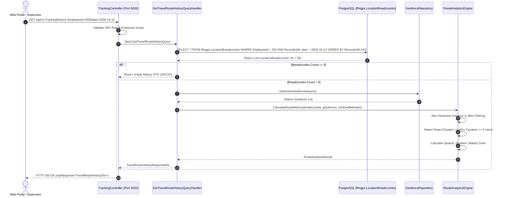

# GPS Travel Route History Module Specification

## 1. Document Overview

| Attribute | Detail |
| :--- | :--- |
| **Document Reference** | `FFM-SPEC-GPS-ROUTE-HISTORY-V1.0` |
| **System** | Field Force Management (FFM) Platform |
| **Service** | GPS Tracking & Geofencing Service (`FFM.GPS.Tracking`) |
| **Compliance** | ISO/IEC/IEEE 29148, OpenAPI 3.1, RFC 7807 (ProblemDetails) |
| **Status** | Approved Specification — Ready for Implementation |
| **Target Clients** | FFM Web Portal (Supervisor Route Replay & Analytics) & FFM Mobile App |
| **Perspective** | **Backend / Server-Side Architecture & Analytics Engine** |

---

## 2. Purpose & Business Scope

The **Travel Route History Module** reconstructs an employee's full day travel journey by processing chronologically recorded GPS breadcrumbs. It transforms raw coordinate pings into actionable operational intelligence for supervisors, including map polylines, stops/dwell time analysis, total kilometers traveled, and transit velocity profiles.

### Key Capabilities:
1. **Daily Route Querying (`GET /api/v1/Tracking/history`)**: Fetches full route analytics for a given employee and calendar date.
2. **Haversine Distance Summation**: Computes accurate cumulative kilometers traveled across sequential breadcrumbs.
3. **Stationary Jitter Suppression**: Discards micro-movements ($< 15$ meters) while stationary to prevent "phantom mileage" inflation.
4. **Stop & Dwell Time Detection**: Automatically clusters stationary points (dwelling in a radius $\le 40$ meters for $\ge 5$ minutes) into distinct visited stops with arrival, departure, and duration timestamps.
5. **Map Polyline Generation**: Produces an ordered coordinate trail ready for immediate rendering on Web/Mobile maps (Google Maps, Leaflet, Mapbox).
6. **Velocity & Battery Metrics**: Analyzes top speed, average moving speed, and battery consumption throughout the work shift.

---

## 3. API Contract & Endpoint Specification

### 3.1 Query Daily Travel History (`GET /api/v1/Tracking/history`)

* **HTTP Method:** `GET`
* **Route:** `/api/v1/Tracking/history`
* **Authorization Policy:** `[Authorize(Roles = "EMPLOYEE,SUPERVISOR,ADMIN,MANAGER")]`
* **Query Parameters:**
  | Parameter | Type | Required | Constraints | Description |
  | :--- | :--- | :--- | :--- | :--- |
  | `employeeId` | `Integer` | Yes | Must be $> 0$ | ID of the employee whose route is queried |
  | `date` | `String` | Yes | Format: `YYYY-MM-DD` | Date of the route to inspect |
  | `includePolyline` | `Boolean` | No | Default: `true` | When `false`, omits full raw coordinate array to minimize payload size |
  | `minDwellMinutes` | `Integer` | No | Default: `5`, Min: `2` | Minimum stationary duration to register as a designated "Stop" |

---

### 3.2 Success Response Payload (`HTTP 200 OK`)

```json
{
  "success": true,
  "message": "Travel route history retrieved successfully.",
  "data": {
    "employeeId": 202,
    "date": "2026-10-12",
    "metrics": {
      "totalDistanceKilometers": 42.65,
      "totalBreadcrumbsCount": 78,
      "shiftStartTime": "2026-10-12T08:30:15Z",
      "shiftEndTime": "2026-10-12T17:15:40Z",
      "totalDurationMinutes": 525,
      "movingDurationMinutes": 185,
      "stationaryDurationMinutes": 340,
      "averageMovingSpeedKmh": 28.5,
      "maxSpeedKmh": 58.2,
      "batteryDrainPercentage": 34
    },
    "stops": [
      {
        "stopIndex": 1,
        "siteName": "Chennai Headquarters Depot",
        "latitude": 13.0827450,
        "longitude": 80.2707180,
        "arrivedAt": "2026-10-12T08:30:15Z",
        "departedAt": "2026-10-12T09:15:00Z",
        "dwellDurationMinutes": 45,
        "stopType": "ORIGIN_DEPOT"
      },
      {
        "stopIndex": 2,
        "siteName": "Guindy Industrial Client Facility",
        "latitude": 13.0102500,
        "longitude": 80.2104000,
        "arrivedAt": "2026-10-12T10:05:00Z",
        "departedAt": "2026-10-12T12:30:00Z",
        "dwellDurationMinutes": 145,
        "stopType": "CLIENT_VISIT"
      },
      {
        "stopIndex": 3,
        "siteName": "Tambaram Field Sector B",
        "latitude": 12.9249000,
        "longitude": 80.1265000,
        "arrivedAt": "2026-10-12T13:45:00Z",
        "departedAt": "2026-10-12T16:20:00Z",
        "dwellDurationMinutes": 155,
        "stopType": "SITE_INSPECTION"
      }
    ],
    "polyline": [
      {
        "latitude": 13.0827450,
        "longitude": 80.2707180,
        "speedKmh": 0.0,
        "recordedAt": "2026-10-12T08:30:15Z"
      },
      {
        "latitude": 13.0754000,
        "longitude": 80.2612000,
        "speedKmh": 32.1,
        "recordedAt": "2026-10-12T09:25:00Z"
      },
      {
        "latitude": 13.0102500,
        "longitude": 80.2104000,
        "speedKmh": 0.0,
        "recordedAt": "2026-10-12T10:05:00Z"
      }
    ]
  },
  "error": null,
  "timestamp": "2026-10-12T18:00:00.120Z"
}
```

---

### 3.3 No Data Recorded (`HTTP 200 OK — Empty Route`)

When an employee was on leave or had no recorded breadcrumbs for the requested date:

```json
{
  "success": true,
  "message": "No travel route breadcrumbs found for employee 202 on 2026-10-12.",
  "data": {
    "employeeId": 202,
    "date": "2026-10-12",
    "metrics": {
      "totalDistanceKilometers": 0.0,
      "totalBreadcrumbsCount": 0,
      "shiftStartTime": null,
      "shiftEndTime": null,
      "totalDurationMinutes": 0,
      "movingDurationMinutes": 0,
      "stationaryDurationMinutes": 0,
      "averageMovingSpeedKmh": 0.0,
      "maxSpeedKmh": 0.0,
      "batteryDrainPercentage": 0
    },
    "stops": [],
    "polyline": []
  },
  "error": null,
  "timestamp": "2026-10-12T18:00:00.120Z"
}
```

---

### 3.4 Error Responses (RFC 7807 / Unified Envelope)

#### A. Invalid Date Format (`HTTP 400 Bad Request`)
```json
{
  "success": false,
  "message": "Invalid date parameter.",
  "data": null,
  "error": {
    "code": "INVALID_DATE_FORMAT",
    "message": "The date must be supplied in ISO format 'YYYY-MM-DD'."
  },
  "timestamp": "2026-10-12T18:00:00.125Z"
}
```

#### B. Unauthorized Employee Access (`HTTP 403 Forbidden`)
When an `EMPLOYEE` attempts to view another employee's travel history:
```json
{
  "success": false,
  "message": "Access denied.",
  "data": null,
  "error": {
    "code": "FORBIDDEN_EMPLOYEE_ACCESS",
    "message": "Employees are only permitted to view their own travel route history."
  },
  "timestamp": "2026-10-12T18:00:00.130Z"
}
```

---

## 4. Mathematical Algorithms & Analytics Processing

### 4.1 Total Distance Traveled (Sequential Haversine with Jitter Suppressor)

For each consecutive pair of points $P_i(\phi_i, \lambda_i)$ and $P_{i+1}(\phi_{i+1}, \lambda_{i+1})$:

$$\Delta\phi = \phi_{i+1} - \phi_i, \quad \Delta\lambda = \lambda_{i+1} - \lambda_i$$

$$a = \sin^2\left(\frac{\Delta\phi}{2}\right) + \cos(\phi_i)\cos(\phi_{i+1})\sin^2\left(\frac{\Delta\lambda}{2}\right)$$
$$d_i = 2 R \cdot \text{atan2}\left(\sqrt{a}, \sqrt{1-a}\right) \quad (\text{where } R = 6,371,000 \text{ m})$$

#### Stationary Jitter Filter:
$$\text{Effective Distance } \delta d_i = \begin{cases} 
0, & \text{if } d_i < 15.0 \text{ meters} \text{ and } \text{Speed}_{i+1} < 2.0 \text{ km/h} \\
d_i, & \text{otherwise}
\end{cases}$$

$$D_{\text{total}} = \frac{1}{1000} \sum_{i=1}^{N-1} \delta d_i \quad (\text{kilometers})$$

---

### 4.2 Stop & Dwell Time Detection Algorithm

The engine detects when a field agent has arrived at a client site or depot:
1. **Cluster Detection**: Group sequential points $[P_k, P_{k+1}, \dots, P_m]$ where each point is within $R_{\text{stop}} = 40$ meters of the initial stop anchor point $P_k$.
2. **Duration Evaluation**: 
   $$\Delta t = \text{RecordedAt}(P_m) - \text{RecordedAt}(P_k)$$
3. **Threshold Check**: If $\Delta t \ge \text{minDwellMinutes}$ (default $5$ minutes), the sequence forms an active **Stop**:
   - `Latitude` = centroid $\frac{1}{m - k + 1} \sum_{j=k}^{m} \phi_j$
   - `Longitude` = centroid $\frac{1}{m - k + 1} \sum_{j=k}^{m} \lambda_j$
   - `DwellDurationMinutes` = $\frac{\Delta t}{60}$
4. **Site Correlation**: Compares centroid with geofences in `ffmgps.Geofences` to match named facilities (e.g. "Chennai Headquarters Depot"). If unmatched, labelled as "Field Stop / Client Site".

---

## 5. Architectural Sequence Diagram



---

## 6. Business Rules Matrix

| Rule ID | Rule Name | Business Constraint | Action / HTTP Status |
| :--- | :--- | :--- | :--- |
| **BR-HIS-01** | **Scope Authorization** | `EMPLOYEE` role can only view their own history. `SUPERVISOR`, `MANAGER`, and `ADMIN` can view any assigned employee. | `403 Forbidden` (`FORBIDDEN_EMPLOYEE_ACCESS`) |
| **BR-HIS-02** | **Valid Calendar Date** | The `date` parameter must be a valid ISO 8601 calendar date (`YYYY-MM-DD`) and cannot be in the future. | `400 Bad Request` (`INVALID_DATE_FORMAT`) |
| **BR-HIS-03** | **Jitter Suppression** | Coordinate increments $< 15$ meters with speed $< 2$ km/h are omitted from distance summation. | Filtered in calculation engine |
| **BR-HIS-04** | **Minimum Dwell Cutoff**| Stationary periods below `minDwellMinutes` (e.g. traffic signal stops $< 3$ mins) are not listed as client stops. | Retained in polyline, excluded from stops list |
| **BR-HIS-05** | **Polyline Compression**| When `includePolyline=false`, polyline coordinate array is omitted to support ultra-fast bandwidth-efficient summary loading. | Polyline returned as empty array |
| **BR-HIS-06** | **Unified Envelope** | Response must strictly adhere to platform standard `ApiResponse<T>` envelope format. | Standardized JSON serialization |
