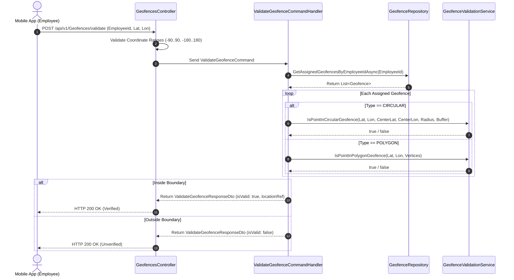

# GPS Validate Geofence Module Specification

## 1. Document Overview

| Attribute | Detail |
| :--- | :--- |
| **Document Reference** | `FFM-SPEC-GPS-VALIDATE-GEOFENCE-V1.0` |
| **System** | Field Force Management (FFM) Platform |
| **Service** | GPS Tracking & Geofencing Service (`FFM.GPS.Tracking`) |
| **Compliance** | ISO/IEC/IEEE 29148, OpenAPI 3.1, RFC 7807 (ProblemDetails) |
| **Status** | Approved Specification — Implemented & Verified |

---

## 2. Purpose & Scope

The **Validate Geofence Module** is the real-time spatial computation engine of the FFM platform. When an employee attempts to punch in, punch out, or perform a field task, the mobile app submits the smartphone's live GPS coordinates. The service runs trigonometry (Haversine) and Point-in-Polygon (Ray-Casting) algorithms against the employee's assigned geofence boundaries to confirm physical presence.

### Key Capabilities:
1. **Haversine Distance (Circular)**: Calculates great-circle distance between mobile coordinates and circle center point.
2. **Ray-Casting PIP (Polygon)**: Evaluates multi-vertex irregular polygon perimeters by counting horizontal edge crossings.
3. **Buffer Distance Application**: Accounts for temporary GPS hardware inaccuracies (e.g. $+15$ meters buffer).
4. **Assigned Site Filtering**: Prioritizes geofences assigned to `employeeId`; falls back to active geofences if unassigned.
5. **Location Token Issuance**: Returns verified `locationRef` and calculated `distanceFromCenterMeters`.

---

## 3. API Contract & Endpoint Specification

### Endpoint Definition
* **HTTP Method:** `POST`
* **Route:** `/api/v1/Geofences/validate`
* **Authorization Policy:** `[Authorize]` (Requires authenticated field employee JWT token)

---

### 3.1 Request Payload (`ValidateGeofenceRequest`)

```json
{
  "employeeId": 409,
  "latitude": 12.92795,
  "longitude": 77.68482,
  "gpsAccuracyMeters": 5.0
}
```

#### Request Schema Attributes:
| Field | Type | Required | Constraints | Description |
| :--- | :--- | :--- | :--- | :--- |
| `employeeId` | `Integer` | Yes | Must be > 0 | ID of the employee validating location |
| `latitude` | `Double` | Yes | Range: `-90.0` to `+90.0` | Live GPS latitude coordinate from mobile device |
| `longitude` | `Double` | Yes | Range: `-180.0` to `+180.0` | Live GPS longitude coordinate from mobile device |
| `gpsAccuracyMeters` | `Double` | No | Default: `0.0` | Hardware estimated GPS accuracy radius (meters) |

---

### 3.2 Success Responses

#### A. Inside Geofence (HTTP 200 OK — Verified)
```json
{
  "isValidGeofence": true,
  "locationRef": "KVS_Tech_Park",
  "siteName": "Bangalore EcoSpace Tech Park",
  "distanceFromCenterMeters": 6.0,
  "message": "Location verified inside authorized geofence."
}
```

#### B. Outside Geofence (HTTP 200 OK — Unverified)
```json
{
  "isValidGeofence": false,
  "locationRef": null,
  "siteName": null,
  "distanceFromCenterMeters": null,
  "message": "User location is outside all assigned geofence boundaries."
}
```

---

### 3.3 Error Responses (RFC 7807 ProblemDetails)

#### A. Invalid Coordinates (HTTP 400 Bad Request)
```json
{
  "title": "Invalid Coordinates",
  "status": 400,
  "detail": "Latitude must be between -90 and +90, Longitude between -180 and +180."
}
```

#### B. Unauthenticated (HTTP 401 Unauthorized)
```json
{
  "title": "Unauthorized",
  "status": 401,
  "detail": "Missing or invalid Bearer token."
}
```

---

## 4. Mathematical Algorithms & Spatial Logic

### 4.1 Circular Geofences (Haversine Formula)

$$a = \sin^2\left(\frac{\Delta\phi}{2}\right) + \cos(\phi_1)\cos(\phi_2)\sin^2\left(\frac{\Delta\lambda}{2}\right)$$
$$c = 2 \cdot \text{atan2}\left(\sqrt{a}, \sqrt{1-a}\right)$$
$$d = R \cdot c \quad (R = 6,371,000 \text{ meters})$$

$$\text{Condition: } d \le (\text{RadiusMeters} + \text{BufferMeters})$$

### 4.2 Polygon Geofences (Ray-Casting Algorithm)

Casts a horizontal ray from point $P(x, y)$ towards $+x$ axis $(\infty, y)$ and counts intersections with polygon edges:

$$\text{Edge intersects ray if: } (y_i > y) \ne (y_j > y) \text{ and } x < \left(\frac{x_j - x_i}{y_j - y_i}\right)(y - y_i) + x_i$$

$$\text{Point is inside if: } \text{Total Intersections} \pmod 2 = 1 \text{ (Odd)}$$

---

## 5. CQRS Sequence Diagram



---

## 6. Implementation & Verification Status

- [x] Implemented `IGeofenceValidationService.cs` and `GeofenceValidationService.cs` with Haversine and Ray-Casting math.
- [x] Implemented `ValidateGeofenceCommand.cs` and `ValidateGeofenceCommandHandler.cs`.
- [x] Implemented `CoordinateVertex.cs` entity for robust JSON polygon array deserialization.
- [x] Added `[Authorize]` protection on `POST /api/v1/Geofences/validate`.
- [x] Verified via spatial unit test suite (`GeofenceValidationServiceTests.cs` and `GeofenceEndToEndIntegrationTests.cs`) — **100% PASS**.
