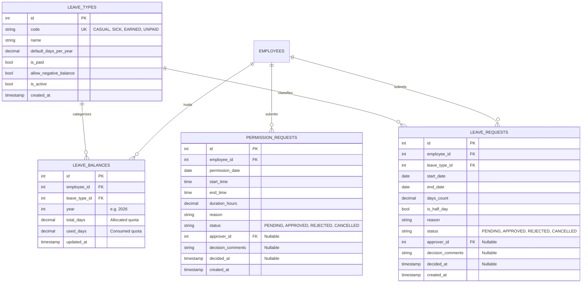
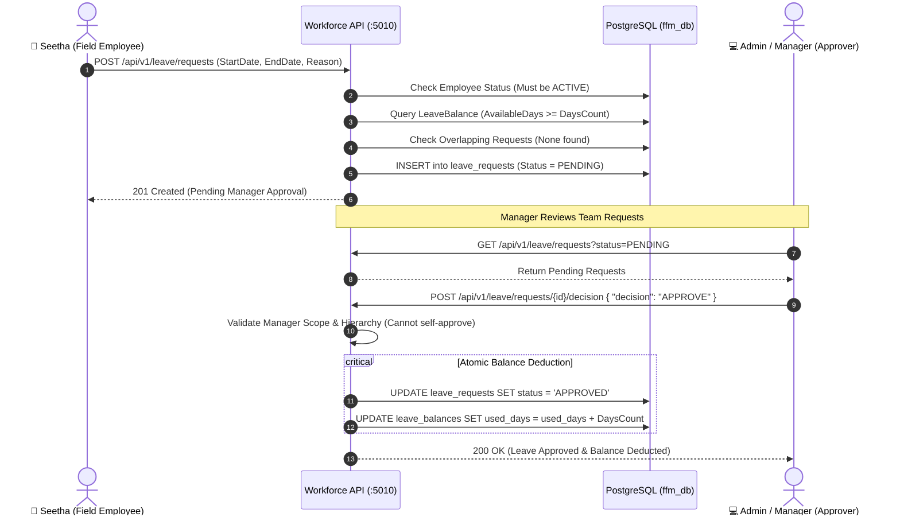

# Leave and Permission Management Module Specification

## 1. Document Overview

| Attribute | Detail |
| :--- | :--- |
| **Document Reference** | `FFM-SPEC-WORKFORCE-LEAVE-PERMISSION-V1.0` |
| **System** | Field Force Management (FFM) Platform |
| **Service** | Workforce Service (`FFM.Workforce`) |
| **Compliance** | ISO/IEC/IEEE 29148, OpenAPI 3.1, RFC 7807 (ProblemDetails) |
| **Classification** | Tier‑1 Core Business & HR Service |
| **Status** | Approved Formal Specification |
| **Target Clients** | FFM Mobile App (Field Employee) & FFM Web Portal (Manager/Admin) |
| **Perspective** | **Backend / Server‑Side Only** |
| **Parent Document** | `FFM-Workforce_Service-Specification.md`, Sections 5, 6, 7 & 8.5 |

---

## 2. Purpose & Business Scope

The **Leave and Permission Management Module** governs all planned and unplanned absences for field personnel. It ensures that field employees can transparently view their leave quotas, request time off, and apply for short-duration permissions, while providing managers with a structured approval chain that enforces organizational hierarchy, tenant boundaries, and balance integrity.

### Core Capabilities:
1. **Leave Quota & Balance Tracking**: Multi-tier leave accounting (Casual, Sick, Earned/Annual, and Unpaid) with yearly allocation, usage tracking, and remaining balance calculation.
2. **Leave Request Workflow**: Multi-day or half-day absence submission with automated conflict detection, balance validation, and status transitions (`PENDING`, `APPROVED`, `REJECTED`, `CANCELLED`).
3. **Short-Duration Permission Workflow**: Intra-day, hour-based absence requests (e.g., 1 to 4 hours for medical appointments or personal errands) that do not decrement full-day leave quotas.
4. **Approval Hierarchy & Anti-Spoofing**: Enforces strict manager reporting lines. An employee cannot approve their own request, and managers cannot review requests outside their team/organization unit.
5. **Atomic Balance Deductions & Restorations**: Thread-safe balance decrement upon approval, and automatic balance restoration if an approved future leave is cancelled.

---

## 3. Technical Glossary

- **Leave Type** – A categorized absence policy (e.g., Casual Leave, Sick Leave, Earned Leave, Unpaid Leave).
- **Leave Balance** – The active quota allocated to an employee for a specific leave type in a calendar year.
- **Half-Day Leave** – An absence spanning half of a standard workday (0.5 days count).
- **Permission** – A short, intra-day time off request (typically 0.5 to 4 hours) during a scheduled shift.
- **Approver** – The designated manager or supervisor responsible for reviewing absence requests for their direct or departmental reports.
- **Overlapping Request** – Two or more absence requests whose calendar dates or time windows collide for the same employee.

---

## 4. Business Rules & Validation Policies

| Rule ID | Title | Rule Description | Enforcement |
| :--- | :--- | :--- | :--- |
| **BR-LEV-01** | Active Employee Guard | Only employees with status `ACTIVE` (`isActive: true`) are permitted to submit leave or permission requests. | Verified at the entry point of every submission command. |
| **BR-LEV-02** | Balance Sufficiency Guard | A leave request cannot exceed the employee's current `AvailableDays` unless the leave type explicitly sets `AllowNegativeBalance = true` (e.g., Unpaid Leave). | Checked before request insertion. |
| **BR-LEV-03** | Overlap Prevention Guard | An employee cannot submit a leave request that collides with an existing `PENDING` or `APPROVED` leave request. | Date range overlap query executed in the database. |
| **BR-LEV-04** | Chronological Validity | `EndDate` must be greater than or equal to `StartDate`. Past dates cannot be requested without explicit manager regularization. | Request DTO validator (`StartDate <= EndDate`). |
| **BR-LEV-05** | Half-Day Constraint | If `IsHalfDay` is `true`, `StartDate` and `EndDate` must be identical, and `DaysCount` is strictly evaluated as `0.5`. | Validated prior to persistence. |
| **BR-LEV-06** | Permission Duration Cap | A permission request must be same-day, with a minimum duration of 30 minutes (0.5 hours) and a maximum of 4 hours. | Validated in command handler (`0.5 <= DurationHours <= 4.0`). |
| **BR-LEV-07** | Leave/Permission Collision | A permission request cannot be filed on a day where the employee already has an `APPROVED` full-day leave. | Cross-domain check against leave records. |
| **BR-LEV-08** | Approver Hierarchy Guard | Only the direct reporting manager, department head, or a user with `ADMIN`/`SYSTEM_ADMIN` role may approve or reject a request. Self-approval is strictly forbidden. | Authorization handler check (`ActorId != EmployeeId`). |
| **BR-LEV-09** | Atomic Balance Deduction | Leave balances are decremented if and only if a request transitions from `PENDING` to `APPROVED`. Rejections result in zero balance deduction. | Database transaction lock during approval. |
| **BR-LEV-10** | Cancellation & Refund | An employee may cancel a `PENDING` request anytime. If a future `APPROVED` leave is cancelled before its start date, the consumed days are automatically refunded to `AvailableDays`. | Handled in `CancelLeaveRequestCommand`. |

---

## 5. Architectural Data Model (PostgreSQL)



---

## 6. API Contracts & Endpoint Specifications

### 6.1 Get Configured Leave Types
* **Method & Route:** `GET /api/v1/leave/types`
* **Authorization:** Authenticated user (`EMPLOYEE`, `MANAGER`, `ADMIN`)
* **Response (HTTP 200 OK):**
```json
{
  "success": true,
  "message": "Leave types retrieved successfully",
  "data": [
    {
      "id": 1,
      "code": "CASUAL",
      "name": "Casual Leave",
      "defaultDaysPerYear": 12.0,
      "isPaid": true,
      "allowNegativeBalance": false
    },
    {
      "id": 2,
      "code": "SICK",
      "name": "Sick Leave",
      "defaultDaysPerYear": 10.0,
      "isPaid": true,
      "allowNegativeBalance": false
    },
    {
      "id": 3,
      "code": "EARNED",
      "name": "Earned / Annual Leave",
      "defaultDaysPerYear": 15.0,
      "isPaid": true,
      "allowNegativeBalance": false
    },
    {
      "id": 4,
      "code": "UNPAID",
      "name": "Loss of Pay / Unpaid Leave",
      "defaultDaysPerYear": 0.0,
      "isPaid": false,
      "allowNegativeBalance": true
    }
  ]
}
```

---

### 6.2 Get Leave Balances
* **Method & Route:** `GET /api/v1/leave/balances`
* **Query Parameters:** `employeeId` (Optional; defaults to caller. Managers/Admins can pass target ID).
* **Response (HTTP 200 OK):**
```json
{
  "success": true,
  "message": "Leave balances retrieved successfully",
  "data": [
    {
      "leaveTypeId": 1,
      "leaveTypeCode": "CASUAL",
      "leaveTypeName": "Casual Leave",
      "year": 2026,
      "totalDays": 12.0,
      "usedDays": 2.0,
      "availableDays": 10.0
    },
    {
      "leaveTypeId": 2,
      "leaveTypeCode": "SICK",
      "leaveTypeName": "Sick Leave",
      "year": 2026,
      "totalDays": 10.0,
      "usedDays": 1.0,
      "availableDays": 9.0
    }
  ]
}
```

---

### 6.3 Submit Leave Request
* **Method & Route:** `POST /api/v1/leave/requests`
* **Authorization:** `EMPLOYEE`, `MANAGER`, `ADMIN`
* **Request Payload (`SubmitLeaveRequest`):**
```json
{
  "leaveTypeId": 1,
  "startDate": "2026-11-05",
  "endDate": "2026-11-06",
  "isHalfDay": false,
  "reason": "Family function attending out of station"
}
```
* **Success Response (HTTP 201 Created):**
```json
{
  "success": true,
  "message": "Leave request submitted successfully and is pending approval.",
  "data": {
    "requestId": 101,
    "employeeId": 217,
    "leaveTypeId": 1,
    "leaveTypeName": "Casual Leave",
    "startDate": "2026-11-05",
    "endDate": "2026-11-06",
    "daysCount": 2.0,
    "isHalfDay": false,
    "status": "PENDING",
    "createdAt": "2026-10-21T11:45:00Z"
  }
}
```
* **Error Response (HTTP 400 Bad Request - Insufficient Balance):**
```json
{
  "success": false,
  "error": {
    "code": "INSUFFICIENT_LEAVE_BALANCE",
    "details": "Requested 3.0 days exceeds available balance of 1.0 day(s) for Sick Leave."
  }
}
```
* **Error Response (HTTP 409 Conflict - Overlapping Request):**
```json
{
  "success": false,
  "error": {
    "code": "LEAVE_OVERLAP_CONFLICT",
    "details": "An active leave request already exists covering the requested dates."
  }
}
```

---

### 6.4 Manager Decision on Leave Request
* **Method & Route:** `PUT /api/v1/leave/requests/decision` *(Also accepts `/api/v1/leave/requests/{id}/decision`)*
* **Authorization:** `MANAGER`, `ADMIN`, `SYSTEM_ADMIN`
* **Request Payload (`LeaveDecisionRequest`):**
```json
{
  "requestId": 101,
  "decision": "APPROVED",
  "comments": "Approved. Please ensure hand-over of active tickets."
}
```
*(Options: `APPROVED` or `REJECTED`)*
* **Success Response (HTTP 200 OK):**
```json
{
  "success": true,
  "message": "Leave request has been APPROVED.",
  "data": {
    "requestId": 101,
    "status": "APPROVED",
    "approverId": 17,
    "approverName": "Regional Manager",
    "decisionComments": "Approved. Please ensure hand-over of active tickets.",
    "decidedAt": "2026-10-21T12:00:00Z",
    "remainingBalance": 8.0
  }
}
```

---

### 6.5 Submit Short-Duration Permission Request
* **Method & Route:** `POST /api/v1/permissions/requests`
* **Authorization:** `EMPLOYEE`, `MANAGER`, `ADMIN`
* **Request Payload (`SubmitPermissionRequest`):**
```json
{
  "permissionDate": "2026-10-25",
  "startTime": "14:00:00",
  "endTime": "16:00:00",
  "reason": "Personal medical appointment"
}
```
* **Success Response (HTTP 201 Created):**
```json
{
  "success": true,
  "message": "Permission request submitted successfully.",
  "data": {
    "requestId": 201,
    "employeeId": 217,
    "permissionDate": "2026-10-25",
    "startTime": "14:00:00",
    "endTime": "16:00:00",
    "durationHours": 2.0,
    "status": "PENDING",
    "createdAt": "2026-10-21T11:50:00Z"
  }
}
```
* **Error Response (HTTP 400 Bad Request - Exceeds Max Hours):**
```json
{
  "success": false,
  "error": {
    "code": "MAX_PERMISSION_HOURS_EXCEEDED",
    "details": "Permission duration cannot exceed 4.0 hours. Please apply for half-day leave instead."
  }
}
```

---

### 6.6 Manager Decision on Permission Request
* **Method & Route:** `POST /api/v1/permissions/requests/{id}/decision`
* **Authorization:** `MANAGER`, `ADMIN`, `SYSTEM_ADMIN`
* **Request Payload:**
```json
{
  "decision": "APPROVE",
  "comments": "Approved. Ensure coverage for afternoon shift."
}
```
* **Success Response (HTTP 200 OK):**
```json
{
  "success": true,
  "message": "Permission request has been APPROVED.",
  "data": {
    "requestId": 201,
    "status": "APPROVED",
    "approverId": 17,
    "decidedAt": "2026-10-21T12:05:00Z"
  }
}
```

---

## 7. Sequence Diagrams

### 7.1 Leave Request & Approval Lifecycle



---

## 8. Acceptance Criteria (Traceability Matrix)

| ID | Verification Criteria | Expected Outcome |
| :--- | :--- | :--- |
| **AC-LEV-01** | Employee applies for leave within available balance | Record created with status `PENDING`, HTTP `201 Created`. |
| **AC-LEV-02** | Employee applies for leave exceeding available balance | Rejected with HTTP `400 Bad Request` (`INSUFFICIENT_LEAVE_BALANCE`). |
| **AC-LEV-03** | Employee submits overlapping leave dates | Rejected with HTTP `409 Conflict` (`LEAVE_OVERLAP_CONFLICT`). |
| **AC-LEV-04** | Half-day leave requested with `isHalfDay: true` | StartDate must equal EndDate; exact 0.5 days counted. |
| **AC-LEV-05** | Manager approves leave request | Status updated to `APPROVED`, balance decremented atomically. |
| **AC-LEV-06** | Manager rejects leave request | Status updated to `REJECTED`, balance remains unchanged. |
| **AC-LEV-07** | Field employee attempts to self-approve own leave | Rejected with HTTP `403 Forbidden`. |
| **AC-LEV-08** | Employee applies for permission > 4 hours | Rejected with HTTP `400 Bad Request` (`MAX_PERMISSION_HOURS_EXCEEDED`). |
| **AC-LEV-09** | Permission requested on a date with approved full-day leave | Rejected with HTTP `409 Conflict`. |
| **AC-LEV-10** | Employee cancels future approved leave | Consumed days refunded back to available leave balance. |
