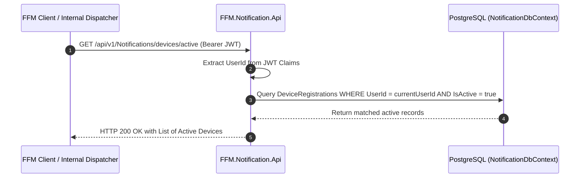

# Active Devices Query Endpoint Specification

## 1. Document Metadata

| Attribute | Detail |
| :--- | :--- |
| **Document Reference** | `FFM-SPEC-NOTIF-DEV-ACTIVE-V1.0` |
| **System** | Field Force Management (FFM) Platform |
| **Service** | Notification Service (`FFM.Notification`) |
| **Endpoint** | `GET /api/v1/Notifications/devices/active` |
| **Port** | `5040` (Docker Container: `ffm-notification-api`) |
| **Compliance** | ISO/IEC/IEEE 29148, OpenAPI 3.1, RFC 7807 (ProblemDetails) |
| **Authentication** | Bearer JWT RS256 (issued by Identity & Access Service) |
| **Classification** | Tier‑1 Client Query & Dispatch Target Resolution |
| **Status** | Approved Formal Specification |

---

## 2. Executive Purpose & Business Scope

A field technician or supervisor may carry more than one active hardware client (for example: an Android company smartphone for outdoor GPS tracking and an iPad tablet inside their maintenance vehicle for detailed form filling).

The **Active Devices** endpoint retrieves all currently active registered devices (`IsActive == true`) belonging to the authenticated user.

### Core Business Rules:
1. **User Identity Isolation:** The endpoint extracts `UserId` strictly from the JWT token. Users can never view active devices belonging to other technicians.
2. **Zero URL Path Parameters:** No `/active/{userId}` parameter is accepted. Identity is bound directly to the authenticated session.
3. **Dispatch Resolution:** Used by the Dispatch Engine and internal diagnostic diagnostics to resolve all valid push endpoints for the employee before fanning out notifications.

---

## 3. Authorization & RBAC Policy

| Role | Allowed? | Rationale |
| :--- | :---: | :--- |
| `EMPLOYEE` | ✅ Yes | Inspects active registered handsets and tablets linked to their account. |
| `SUPERVISOR` | ✅ Yes | Views their active mobile and workstation sessions. |
| `MANAGER` | ✅ Yes | Views active devices linked to their manager account. |
| `ADMIN` / `SYSTEM_ADMIN` | ✅ Yes | Administrative and diagnostic inspection. |
| `Anonymous` | ❌ No | Rejects unauthenticated requests with `401 Unauthorized`. |

---

## 4. Request Schema & Field Definitions

### Route
`GET /api/v1/Notifications/devices/active`

### Request Headers
| Header | Type | Required | Description |
| :--- | :--- | :---: | :--- |
| `Authorization` | String | Yes | `Bearer <JWT_TOKEN>` |

### Request Body
* **None** (`HTTP GET` method with no body payload).

---

## 5. Response Schema & HTTP Status Codes

### Success Response (`200 OK`)
```json
{
  "success": true,
  "message": null,
  "data": [
    {
      "deviceRegistrationId": 142,
      "deviceToken": "fcm_token_samsung_galaxy_9876543210_alpha_beta_gamma",
      "platform": "ANDROID",
      "deviceModel": "Samsung Galaxy S23 Ultra",
      "osVersion": "14.0",
      "appVersion": "2.4.1",
      "isActive": true,
      "registeredAt": "2026-11-12T09:30:00Z",
      "lastActiveAt": "2026-11-12T10:15:00Z"
    },
    {
      "deviceRegistrationId": 145,
      "deviceToken": "apns_token_ipad_pro_11_inch_apple_push_feed",
      "platform": "IOS",
      "deviceModel": "iPad Pro 11-inch (4th Gen)",
      "osVersion": "17.4",
      "appVersion": "2.4.1",
      "isActive": true,
      "registeredAt": "2026-11-10T08:00:00Z",
      "lastActiveAt": "2026-11-12T09:45:00Z"
    }
  ]
}
```

### Empty List Response (`200 OK`)
If the employee has logged out of all devices, the endpoint returns an empty array:
```json
{
  "success": true,
  "data": []
}
```

### Error Responses:
* **`401 Unauthorized`**: Missing, expired, or invalid JWT Bearer token.

---

## 6. End-to-End Sequence Diagram



