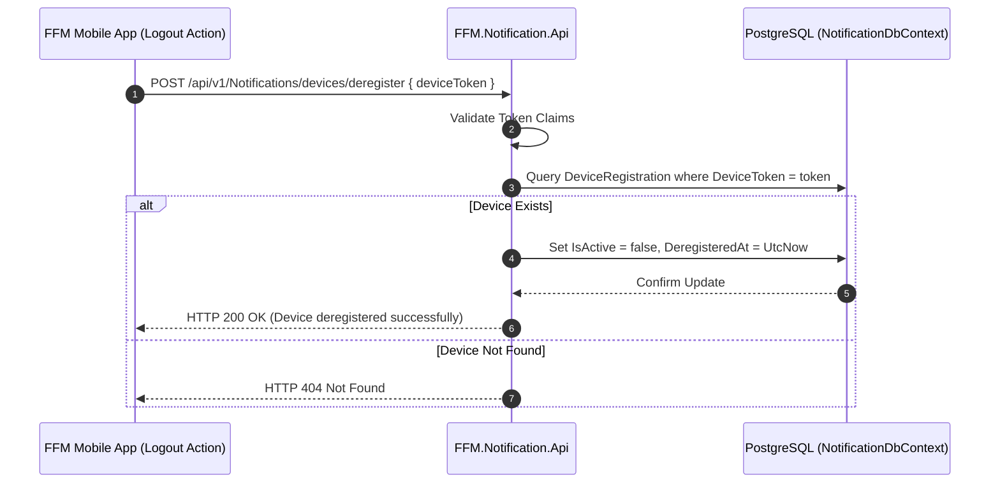

# Device De-registration Endpoint Specification

## 1. Document Metadata

| Attribute | Detail |
| :--- | :--- |
| **Document Reference** | `FFM-SPEC-NOTIF-DEV-DEREG-V1.0` |
| **System** | Field Force Management (FFM) Platform |
| **Service** | Notification Service (`FFM.Notification`) |
| **Endpoint** | `POST /api/v1/Notifications/devices/deregister` |
| **Port** | `5040` (Docker Container: `ffm-notification-api`) |
| **Compliance** | ISO/IEC/IEEE 29148, OpenAPI 3.1, RFC 7807 (ProblemDetails) |
| **Authentication** | Bearer JWT RS256 (issued by Identity & Access Service) |
| **Classification** | Tier‑1 Client Lifecycle & Push Suppression |
| **Status** | Approved Formal Specification |

---

## 2. Executive Purpose & Business Scope

When a field technician signs out from the FFM Mobile Application, changes duty shifts, uninstalls the client, or surrenders an organization-owned mobile handset, push notifications must **not** continue to arrive on that physical handset.

The **Device De-register** endpoint performs a **soft de-activation** of the specified device token by setting `IsActive = false` and recording the `DeregisteredAt` timestamp.

### Core Business Rules:
1. **Zero Path Parameters Standard:** The target `deviceToken` is supplied in the JSON request body.
2. **Soft De-activation:** The device record is **never hard deleted** from the database. Soft de-activation preserves historical audit trails (e.g. tracking when a technician was logged out during an incident investigation).
3. **Suppression in Dispatch Engine:** All subsequent notification dispatch routines filter by `IsActive == true`. De-registered devices immediately cease receiving push notifications.
4. **Graceful Idempotency:** If a client submits a de-registration request for a token that is already de-registered, the service gracefully returns `200 OK` without error.

---

## 3. Authorization & RBAC Policy

| Role | Allowed? | Rationale |
| :--- | :---: | :--- |
| `EMPLOYEE` | ✅ Yes | Field technicians de-registering their mobile handset upon app logout. |
| `SUPERVISOR` | ✅ Yes | Supervisors logging out of tablet or mobile devices. |
| `MANAGER` | ✅ Yes | Managers de-registering their mobile sessions. |
| `ADMIN` / `SYSTEM_ADMIN` | ✅ Yes | Admins de-registering test tokens or managing corporate pool devices. |
| `Anonymous` | ❌ No | Unauthenticated requests are rejected with `401 Unauthorized`. |

---

## 4. Request Schema & Field Definitions

### Route
`POST /api/v1/Notifications/devices/deregister`

### Request Headers
| Header | Type | Required | Description |
| :--- | :--- | :---: | :--- |
| `Authorization` | String | Yes | `Bearer <JWT_TOKEN>` |
| `Content-Type` | String | Yes | `application/json` |

### Request Body (`DeregisterDeviceRequest`)
```json
{
  "deviceToken": "fcm_token_samsung_galaxy_9876543210_alpha_beta_gamma"
}
```

### Field Definitions:
| Field | Type | Required | Constraints | Real-World Description |
| :--- | :--- | :---: | :--- | :--- |
| **`deviceToken`** | String | Yes | Min 10, Max 512 chars, Non-empty | The Firebase/APNs token of the device being logged out. |

---

## 5. Response Schema & HTTP Status Codes

### Success Response (`200 OK`)
```json
{
  "success": true,
  "message": "Device deregistered successfully",
  "data": {
    "deviceToken": "fcm_token_samsung_galaxy_9876543210_alpha_beta_gamma",
    "isActive": false,
    "deregisteredAt": "2026-11-12T17:45:00Z"
  }
}
```

### Error Responses:
* **`400 Bad Request`**: Missing `deviceToken` in payload.
  ```json
  {
    "success": false,
    "errorCode": "VALIDATION_ERROR",
    "message": "DeviceToken is required."
  }
  ```
* **`404 Not Found`**: Device token was never registered in the platform.
  ```json
  {
    "success": false,
    "errorCode": "DEVICE_NOT_FOUND",
    "message": "Device token not found in registration database."
  }
  ```
* **`401 Unauthorized`**: Missing or invalid JWT authorization header.

---

## 6. End-to-End Sequence Diagram



