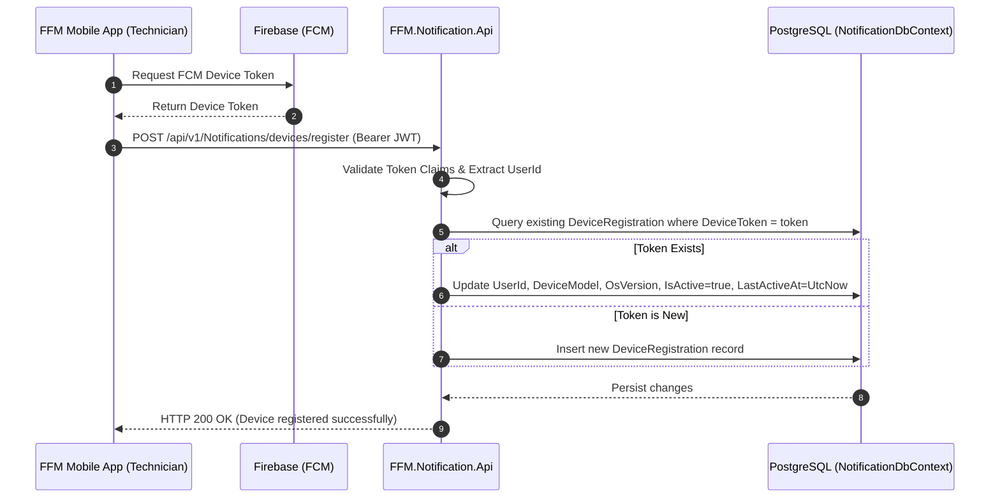

# Device Registration Endpoint Specification

## 1. Document Metadata

| Attribute | Detail |
| :--- | :--- |
| **Document Reference** | `FFM-SPEC-NOTIF-DEV-REG-V1.0` |
| **System** | Field Force Management (FFM) Platform |
| **Service** | Notification Service (`FFM.Notification`) |
| **Endpoint** | `POST /api/v1/Notifications/devices/register` |
| **Port** | `5040` (Docker Container: `ffm-notification-api`) |
| **Compliance** | ISO/IEC/IEEE 29148, OpenAPI 3.1, RFC 7807 (ProblemDetails) |
| **Authentication** | Bearer JWT RS256 (issued by Identity & Access Service) |
| **Classification** | Tier‑1 Client Lifecycle & Push Routing |
| **Status** | Approved Formal Specification |

---

## 2. Executive Purpose & Business Scope

When a field technician (or supervisor) logs into the FFM Mobile Application (Android/iOS), the client application obtains a fresh Push Notification Registration Token from Firebase Cloud Messaging (FCM) or Apple Push Notification Service (APNs). 

The **Device Register** endpoint records and binds this device token to the authenticated user's profile in the Notification database. This ensures that subsequent task assignments, emergency geofence alerts, schedule updates, and check-in reminders dispatched by the platform are routed directly to the technician's physical device.

### Core Business Rules:
1. **Zero Path Parameters:** All payload parameters are sent exclusively inside the JSON body.
2. **Actor Authentication:** The technician's identity (`UserId`) is securely resolved from the authenticated JWT token claim (`sub` / `userId`), preventing identity spoofing.
3. **Idempotency & Re-registration:** If the same physical device token is submitted again, the system performs an **in-place upsert**: updating device metadata (`AppVersion`, `OsVersion`, `LastActiveAt`) and activating the token (`IsActive = true`) without duplicating records.
4. **Device Reassignment:** If a shared company phone is passed to a new employee who logs in, the endpoint automatically reassigns the existing device token to the new `UserId` and refreshes the timestamp.

---

## 3. Authorization & RBAC Policy

| Role | Allowed? | Rationale |
| :--- | :---: | :--- |
| `EMPLOYEE` | ✅ Yes | Field technicians register their active mobile handsets upon login. |
| `SUPERVISOR` | ✅ Yes | Supervisors registering mobile devices or tablets for field monitoring. |
| `MANAGER` | ✅ Yes | Managers using mobile apps for approval workflows. |
| `ADMIN` / `SYSTEM_ADMIN` | ✅ Yes | Administrative users testing device alerts. |
| `Anonymous` | ❌ No | Unauthenticated requests are rejected with `401 Unauthorized`. |

---

## 4. Request Schema & Field Definitions

### Route
`POST /api/v1/Notifications/devices/register`

### Request Headers
| Header | Type | Required | Description |
| :--- | :--- | :---: | :--- |
| `Authorization` | String | Yes | `Bearer <JWT_TOKEN>` |
| `Content-Type` | String | Yes | `application/json` |

### Request Body (`CreateOrUpdateDeviceRegistrationRequest`)
```json
{
  "deviceToken": "fcm_token_samsung_galaxy_9876543210_alpha_beta_gamma",
  "platform": "ANDROID",
  "deviceModel": "Samsung Galaxy S23 Ultra",
  "osVersion": "14.0",
  "appVersion": "2.4.1"
}
```

### Field Definitions:
| Field | Type | Required | Constraints | Real-World Description |
| :--- | :--- | :---: | :--- | :--- |
| **`deviceToken`** | String | Yes | Min 10, Max 512 chars, Non-empty | Unique registration token issued by FCM/APNs. Serves as the device network address. |
| **`platform`** | String | Yes | Allowed: `ANDROID`, `IOS` | Operating system ecosystem. Directs payload formatting in Firebase dispatchers. |
| **`deviceModel`** | String | No | Max 100 chars | Hardware model name (e.g. `Samsung Galaxy S23`, `iPhone 15 Pro`). |
| **`osVersion`** | String | No | Max 50 chars | Mobile operating system version (e.g. `14.0`, `17.4.1`). |
| **`appVersion`** | String | No | Max 50 chars | Installed FFM mobile application release version (e.g. `2.4.1`). |

---

## 5. Response Schema & HTTP Status Codes

### Success Response (`200 OK`)
```json
{
  "success": true,
  "message": "Device registered successfully",
  "data": {
    "deviceRegistrationId": 142,
    "userId": 12,
    "platform": "ANDROID",
    "deviceModel": "Samsung Galaxy S23 Ultra",
    "isActive": true,
    "registeredAt": "2026-11-12T09:30:00Z"
  }
}
```

### Error Responses:
* **`400 Bad Request`**: Validation failure (missing token or invalid platform enum).
  ```json
  {
    "success": false,
    "errorCode": "VALIDATION_ERROR",
    "message": "DeviceToken is required; Platform must be ANDROID or IOS."
  }
  ```
* **`401 Unauthorized`**: Missing, expired, or malformed JWT Bearer token.

---

## 6. End-to-End Sequence Diagram



