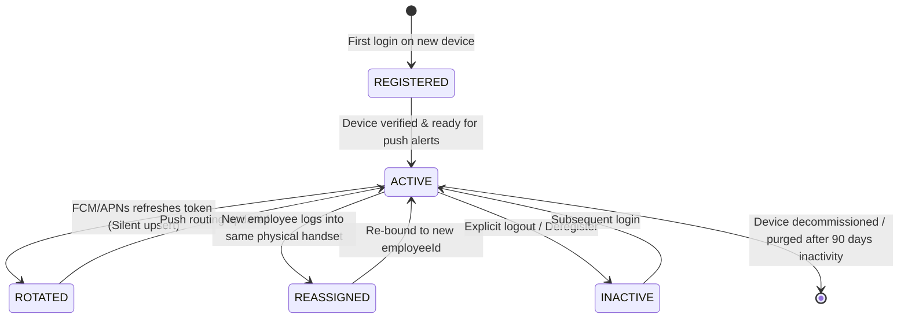
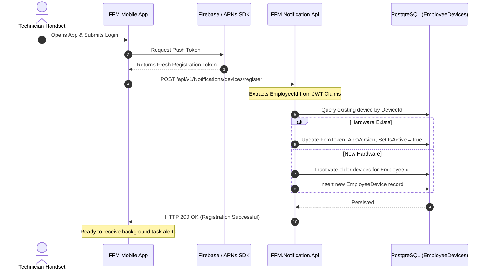

# Mobile Device Registration & Token Management Module Specification

## 1. Document Metadata

| Attribute | Detail |
| :--- | :--- |
| **Document Reference** | `FFM-SPEC-NOTIF-DEVICE-REG-V1.0` |
| **System** | Field Force Management (FFM) Platform |
| **Service** | Notification Service (`FFM.Notification`) |
| **Module** | Module 1: Device Registry & Push Token Management |
| **Default Port** | `5040` (or routed via Gateway `:8080`) |
| **Methods & Routes** | `POST /api/v1/Notifications/devices/register`<br>`POST /api/v1/Notifications/devices/deregister`<br>`GET /api/v1/Notifications/devices/active` |
| **Compliance** | ISO/IEC/IEEE 29148, OpenAPI 3.1, RFC 7807 (ProblemDetails), RFC 7519 (JWT) |
| **Authentication** | Bearer JWT RS256 (issued by Identity & Access Service) |
| **Classification** | Tier‑1 Real-Time Alerting Prerequisite & Device Telemetry Registry |
| **Status** | Approved Formal Specification |
| **Target Clients** | FFM Mobile App (Android / iOS) & FFM Web Browser Portal |

---

## 2. Executive Purpose & Business Scope

The **Mobile Device Registration & Token Management Module** is the foundational registry linking authenticated human workers to their physical mobile hardware. 

In a field operations platform, field technicians, inspection engineers, and delivery drivers are constantly moving across customer sites. When work orders are dispatched, rescheduled, or cancelled by central dispatchers, the system must trigger real-time, high-priority push notifications directly to the worker's physical handset.

```
       [Field Technician Launches FFM Mobile App & Logs In]
                               │
                               ▼
┌──────────────────────────────────────────────────────────────┐
│  OBTAIN FCM / APNs PUSH TOKEN (Google / Apple Client SDK)   │
│  - Android: FirebaseMessaging.getInstance().getToken()      │
│  - iOS:     UNUserNotificationCenter / APNs Device Token     │
└──────────────────────────────────────────────────────────────┘
                               │
                               ▼
┌──────────────────────────────────────────────────────────────┐
│  REGISTER DEVICE (POST /api/v1/Notifications/devices/register)│
│  - Body: { deviceId, platform, model, osVersion, fcmToken }  │
│  - Extracts authenticated EmployeeId strictly from JWT Claim  │
│  - Atomically registers or upserts device token              │
│  - Enforces Single-Active-Device policy per user             │
│  - Invalidates stale or orphaned session tokens              │
└──────────────────────────────────────────────────────────────┘
                               │
                               ▼
┌──────────────────────────────────────────────────────────────┐
│  DOWNSTREAM NOTIFICATION DISPATCH READY                      │
│  - Task Assigned Alerts                                      │
│  - Geofence Breach & Check-in Reminders                      │
│  - Emergency SOS & Manager Priority Reassignments            │
└──────────────────────────────────────────────────────────────┘
```

### Key Business Goals:
1. **Guaranteed Alert Delivery Routing:** Eliminates communication delays between dispatchers and field personnel by maintaining an up-to-date registry of active hardware push tokens.
2. **Zero-Trust Identity Binding:** Device registration prevents identity spoofing—the target `EmployeeId` is cryptographically extracted from the validated RS256 JWT claims, strictly rejecting client-supplied user identifiers.
3. **Single-Active-Device Enforcement:** If an employee logs in on a new replacement handset, any older handset registered to that employee is marked `INACTIVE`, preventing duplicate or ghost alerts on old hardware.
4. **Hardware Handover Protection:** When multiple workers share a single corporate company device across shifts, logging in seamlessly re-binds the device to the incoming employee and de-links the previous shift worker.
5. **Clean Logout Deregistration:** Explicit de-registration on user logout instantly suspends push notification delivery, preserving privacy and confidential customer ticket data on shared phones.

---

## 3. Authorization & RBAC Policy

| Endpoint | Role: `EMPLOYEE` (Technician) | Role: `SUPERVISOR` | Role: `MANAGER` | Role: `ADMIN` / `SYSTEM_ADMIN` |
| :--- | :---: | :---: | :---: | :---: |
| `POST /api/v1/Notifications/devices/register` | ✅ Allowed (Own Device) | ✅ Allowed (Own Device) | ✅ Allowed (Own Device) | ✅ Full Access |
| `POST /api/v1/Notifications/devices/deregister` | ✅ Allowed (Own Device) | ✅ Allowed (Own Device) | ✅ Allowed (Own Device) | ✅ Full Access |
| `GET /api/v1/Notifications/devices/active` | ✅ View Own Active Device | ✅ View Own Active Device | ✅ View Own Active Device | ✅ Platform-wide Audit |

### Security Policies:
* **Token Authentication:** Requests without an `Authorization: Bearer <JWT>` header or with an expired/tampered signature are rejected with `HTTP 401 Unauthorized` (`INVALID_OR_EXPIRED_TOKEN`).
* **Broken Object Level Authorization (BOLA) Defense:** An employee cannot deregister or inspect devices belonging to another employee.

---

## 4. Device Lifecycle & State Transitions



---

## 5. Business Rules & Validation Policies

| Rule ID | Rule Title | Detailed Specification | Error Code & Status |
| :--- | :--- | :--- | :--- |
| **BR-NOTIF-01** | Mandatory Push Token | `FcmToken` must be non-empty and between `50` and `500` characters. Whitespace-only strings are rejected. | `INVALID_FCM_TOKEN` (HTTP 400) |
| **BR-NOTIF-02** | Valid Platform Identifier | `Platform` must be strictly one of: `ANDROID`, `IOS`, or `WEB` (case-insensitive, normalized to UPPERCASE). | `UNSUPPORTED_PLATFORM` (HTTP 400) |
| **BR-NOTIF-03** | Mandatory Hardware ID | `DeviceId` (e.g. Android SSAID or iOS identifierForVendor) is mandatory, non-empty, and up to `100` characters. | `DEVICE_ID_REQUIRED` (HTTP 400) |
| **BR-NOTIF-04** | Atomic Token Upsert | If a device with identical `DeviceId` and `EmployeeId` already exists, atomically update `FcmToken`, `AppVersion`, `OsVersion`, and set `IsActive = true`, updating `LastActiveAt`. | Automated Upsert (HTTP 200) |
| **BR-NOTIF-05** | Device Reassignment | If a physical `DeviceId` already exists in the registry but belongs to a different `EmployeeId` (e.g. shift handover), reassign the hardware to the new `EmployeeId` and set `IsActive = true`. | Automated Handover (HTTP 200) |
| **BR-NOTIF-06** | Single-Active Policy | An employee may only have **one primary active phone** per platform. Registering a new device deactivates all other active devices registered for that `EmployeeId` on the same platform. | Automated Invalidation |
| **BR-NOTIF-07** | Deregister Idempotency | De-registering an already inactive or non-existent device returns `HTTP 200 OK` (idempotent operation). | Idempotent Success (HTTP 200) |
| **BR-NOTIF-08** | Zero Path Parameter Standard | All mutations (`register`, `deregister`) accept parameters exclusively through the **JSON Request Body**. No path variables (`/devices/{id}`) are used. | Architectural Standard |

---

## 6. API Contracts

### 6.1 Register Mobile Device Endpoint
* **HTTP Method:** `POST`
* **Route:** `/api/v1/Notifications/devices/register`
* **Headers:**
  * `Authorization: Bearer <JWT_TOKEN>`
  * `Content-Type: application/json`

#### Request Payload:
```json
{
  "deviceId": "a8f9b2c3-4d5e-6f7a-8b9c-0d1e2f3a4b5c",
  "platform": "ANDROID",
  "deviceModel": "Samsung Galaxy S23",
  "osVersion": "Android 14",
  "appVersion": "1.4.2",
  "fcmToken": "f7dE9aBC_xY:APA91bF8h_jK3lmNoPqRsTuVwXyZ1234567890abcdefghijklmnopqrstuvwxyz_ExampleTokenString"
}
```

#### Response (HTTP 200 OK / HTTP 201 Created):
```json
{
  "success": true,
  "message": "Device registered successfully for push notifications",
  "data": {
    "deviceRegistrationId": 42,
    "employeeId": 12,
    "deviceId": "a8f9b2c3-4d5e-6f7a-8b9c-0d1e2f3a4b5c",
    "platform": "ANDROID",
    "deviceModel": "Samsung Galaxy S23",
    "isActive": true,
    "registeredAt": "2026-11-10T12:00:00Z",
    "lastActiveAt": "2026-11-10T12:00:00Z"
  }
}
```

#### Error Response (HTTP 400 Bad Request):
```json
{
  "type": "https://tools.ietf.org/html/rfc7807",
  "title": "Validation Error",
  "status": 400,
  "detail": "Platform 'WINDOWS_PHONE' is not supported. Supported values: ANDROID, IOS, WEB.",
  "errorCode": "UNSUPPORTED_PLATFORM"
}
```

---

### 6.2 De-register Device Endpoint (Logout)
* **HTTP Method:** `POST`
* **Route:** `/api/v1/Notifications/devices/deregister`
* **Headers:**
  * `Authorization: Bearer <JWT_TOKEN>`
  * `Content-Type: application/json`

#### Request Payload:
```json
{
  "deviceId": "a8f9b2c3-4d5e-6f7a-8b9c-0d1e2f3a4b5c"
}
```

#### Response (HTTP 200 OK):
```json
{
  "success": true,
  "message": "Device de-registered successfully. Push notifications suspended."
}
```

---

### 6.3 Query Active Device Endpoint
* **HTTP Method:** `GET`
* **Route:** `/api/v1/Notifications/devices/active`
* **Headers:**
  * `Authorization: Bearer <JWT_TOKEN>`

#### Response (HTTP 200 OK):
```json
{
  "success": true,
  "data": {
    "deviceRegistrationId": 42,
    "employeeId": 12,
    "deviceId": "a8f9b2c3-4d5e-6f7a-8b9c-0d1e2f3a4b5c",
    "platform": "ANDROID",
    "deviceModel": "Samsung Galaxy S23",
    "osVersion": "Android 14",
    "appVersion": "1.4.2",
    "isActive": true,
    "lastActiveAt": "2026-11-10T12:00:00Z"
  }
}
```

---

## 7. Domain Model & Database Schema

### 7.1 Entity Class: `EmployeeDevice`
```csharp
namespace FFM.Notification.Domain.Entities;

public class EmployeeDevice
{
    public int Id { get; private set; }
    public int EmployeeId { get; private set; }
    public string DeviceId { get; private set; } = default!;
    public string Platform { get; private set; } = default!; // "ANDROID", "IOS", "WEB"
    public string DeviceModel { get; private set; } = default!;
    public string OsVersion { get; private set; } = default!;
    public string AppVersion { get; private set; } = default!;
    public string FcmToken { get; private set; } = default!;
    public bool IsActive { get; private set; }
    public DateTime RegisteredAt { get; private set; }
    public DateTime LastActiveAt { get; private set; }

    // Domain Behaviors
    public void UpdateToken(string newToken, string model, string osVersion, string appVersion)
    {
        FcmToken = newToken;
        DeviceModel = model;
        OsVersion = osVersion;
        AppVersion = appVersion;
        IsActive = true;
        LastActiveAt = DateTime.UtcNow;
    }

    public void ReassignEmployee(int newEmployeeId, string newToken, string appVersion)
    {
        EmployeeId = newEmployeeId;
        FcmToken = newToken;
        AppVersion = appVersion;
        IsActive = true;
        LastActiveAt = DateTime.UtcNow;
    }

    public void Deactivate()
    {
        IsActive = false;
        LastActiveAt = DateTime.UtcNow;
    }
}
```

### 7.2 PostgreSQL Table Definition (`EmployeeDevices`)
```sql
CREATE TABLE "EmployeeDevices" (
    "Id" SERIAL PRIMARY KEY,
    "EmployeeId" INT NOT NULL,
    "DeviceId" VARCHAR(100) NOT NULL,
    "Platform" VARCHAR(20) NOT NULL,
    "DeviceModel" VARCHAR(100) NOT NULL,
    "OsVersion" VARCHAR(50) NOT NULL,
    "AppVersion" VARCHAR(30) NOT NULL,
    "FcmToken" VARCHAR(500) NOT NULL,
    "IsActive" BOOLEAN NOT NULL DEFAULT TRUE,
    "RegisteredAt" TIMESTAMPTZ NOT NULL DEFAULT CURRENT_TIMESTAMP,
    "LastActiveAt" TIMESTAMPTZ NOT NULL DEFAULT CURRENT_TIMESTAMP,
    CONSTRAINT "UQ_EmployeeDevices_DeviceId" UNIQUE ("DeviceId")
);

-- Fast lookup index for active employee push routing
CREATE INDEX "IX_EmployeeDevices_EmployeeId_IsActive" 
ON "EmployeeDevices" ("EmployeeId", "IsActive");
```

---

## 8. High-Performance Sequence Diagram



---

## 9. Clean Architecture & CQRS Blueprint

```
FFM.Notification
│
├── FFM.Notification.Domain
│   ├── Entities/EmployeeDevice.cs
│   └── Repositories/IEmployeeDeviceRepository.cs
│
├── FFM.Notification.Application
│   ├── Commands/RegisterDeviceCommand.cs
│   ├── Commands/DeregisterDeviceCommand.cs
│   ├── Queries/GetActiveDeviceQuery.cs
│   ├── Validators/RegisterDeviceCommandValidator.cs
│   └── Handlers/RegisterDeviceCommandHandler.cs
│
├── FFM.Notification.Infrastructure
│   ├── Persistence/NotificationDbContext.cs
│   └── Repositories/EmployeeDeviceRepository.cs
│
└── FFM.Notification.Api
    ├── Controllers/DevicesController.cs
    └── Program.cs
```

---

## 10. Test Case Matrix (Automated Verification)

| Test ID | Test Scenario | Expected Result |
| :--- | :--- | :--- |
| **TC-DEV-01** | Valid registration payload with Android FCM token | HTTP 200/201, Record saved in `EmployeeDevices`, `IsActive = true` |
| **TC-DEV-02** | Valid registration payload with iOS APNs token | HTTP 200/201, `Platform = "IOS"`, `IsActive = true` |
| **TC-DEV-03** | Missing or whitespace `DeviceId` | HTTP 400 Bad Request (`DEVICE_ID_REQUIRED`) |
| **TC-DEV-04** | Invalid platform code (e.g. `WINDOWS`) | HTTP 400 Bad Request (`UNSUPPORTED_PLATFORM`) |
| **TC-DEV-05** | Empty or truncated `FcmToken` | HTTP 400 Bad Request (`INVALID_FCM_TOKEN`) |
| **TC-DEV-06** | Same device registers again with updated token | HTTP 200 OK, Updates token and `LastActiveAt` without duplicating rows |
| **TC-DEV-07** | Handset reassigned to different employee login | HTTP 200 OK, `EmployeeId` updated on device record |
| **TC-DEV-08** | De-register call on user logout | HTTP 200 OK, `IsActive` flipped to `false` |
| **TC-DEV-09** | Missing Bearer JWT Authorization header | HTTP 401 Unauthorized |
| **TC-DEV-10** | High-concurrency upsert benchmark (500 simultaneous logins) | 100% success rate, 0 duplicate key violations (atomic PostgreSQL upsert) |
