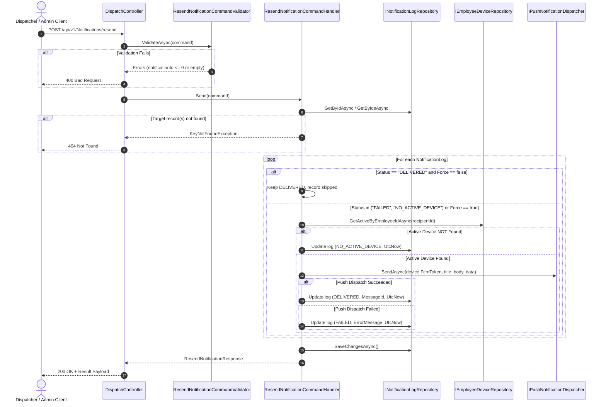

# FFM Notification Service — Resend Notification & Retry Mechanism Specification

## 1. Document Overview
* **Document Reference:** `FFM-SPEC-NOTIF-RESEND-V1.0`
* **Service:** `FFM.Notification` (Port 5040)
* **Module:** Push Notification Dispatch & Retry Mechanism Governance
* **HTTP Method & Route:** `POST /api/v1/Notifications/resend`
* **Architectural Standard:** Strictly Zero Path Parameters. All parameters and payload options are encapsulated in the JSON Request Body.
* **Authentication:** Bearer JWT (RS256) / Development Bypass Mode.

---

## 2. Business Scope & Purpose
The `POST /api/v1/Notifications/resend` endpoint empowers municipal dispatchers, portal supervisors, and automated reliability jobs to retry previously failed or un-delivered push notifications:
1. **Dynamic Device Token Resolution:** When an initial dispatch failed due to no active registered device (`NO_ACTIVE_DEVICE`) or an expired FCM token, the retry mechanism resolves the employee's **latest active device registration** in real-time.
2. **Transient Network Fault Recovery:** Retries dispatches that failed due to temporary network timeouts, Google Firebase FCM throttling, or downstream connectivity drops (`FAILED`).
3. **Single & Batch Processing:** Supports single notification retry (`notificationId`) or batch resends (`notificationIds`) up to 50 records in a single transactional request.
4. **Safety & Force Overrides:** By default, only alerts in `FAILED` or `NO_ACTIVE_DEVICE` status are resent. Passing `"force": true` permits supervisors to intentionally re-broadcast an already `DELIVERED` alert (e.g. re-alerting field inspectors for urgent safety warnings).
5. **Auditing & State Updates:** Updates the existing `NotificationLog` record in place (`Status`, `FcmMessageId`, `ErrorMessage`, `DispatchedAt`) to maintain a clean, accurate log history.

---

## 3. API Contract

### Request: `POST /api/v1/Notifications/resend`
**Headers:**
* `Content-Type: application/json`
* `Authorization: Bearer <TOKEN>` *(Required in Production; Optional in DevBypass)*

**Request Payload Schema (`ResendNotificationRequest`):**
```json
{
  "notificationId": 12,
  "notificationIds": [12, 13, 14],
  "force": false
}
```

#### Field Specifications:
| Field Name | Type | Required? | Validation Rules | Description |
| :--- | :---: | :---: | :--- | :--- |
| `notificationId` | `int?` | Optional* | Must be $> 0$ if provided. | ID of a single notification log to retry. |
| `notificationIds` | `List<int>?` | Optional* | Each item $> 0$; Max 50 items per batch. | Array of notification IDs to retry in batch. |
| `force` | `bool` | Optional | Defaults to `false`. | When `false`, skips already `DELIVERED` alerts. When `true`, forces re-dispatch. |

*\*Note: At least one targeting mechanism must be provided (`notificationId` or a non-empty `notificationIds` list).*

---

### Response Payloads

#### 1. Single Notification Retry Success (`HTTP 200 OK`):
```json
{
  "success": true,
  "message": "Notification resend processed successfully.",
  "data": {
    "totalProcessed": 1,
    "successCount": 1,
    "failureCount": 0,
    "results": [
      {
        "notificationId": 12,
        "recipientEmployeeId": 1,
        "previousStatus": "FAILED",
        "currentStatus": "DELIVERED",
        "fcmMessageId": "projects/ffm-notification-api/messages/1794895012",
        "success": true,
        "errorMessage": null,
        "dispatchedAt": "2026-11-18T05:42:00.1234567Z"
      }
    ]
  },
  "error": null,
  "timestamp": "2026-11-18T05:42:00.2000000Z"
}
```

#### 2. Batch Notification Retry Mixed Result (`HTTP 200 OK`):
```json
{
  "success": true,
  "message": "Batch notification resend completed.",
  "data": {
    "totalProcessed": 2,
    "successCount": 1,
    "failureCount": 1,
    "results": [
      {
        "notificationId": 12,
        "recipientEmployeeId": 1,
        "previousStatus": "FAILED",
        "currentStatus": "DELIVERED",
        "fcmMessageId": "projects/ffm-notification-api/messages/1794895012",
        "success": true,
        "errorMessage": null,
        "dispatchedAt": "2026-11-18T05:42:00.1234567Z"
      },
      {
        "notificationId": 13,
        "recipientEmployeeId": 2,
        "previousStatus": "NO_ACTIVE_DEVICE",
        "currentStatus": "NO_ACTIVE_DEVICE",
        "fcmMessageId": null,
        "success": false,
        "errorMessage": "Recipient employee has no active registered device.",
        "dispatchedAt": "2026-11-18T05:42:00.1542100Z"
      }
    ]
  },
  "error": null,
  "timestamp": "2026-11-18T05:42:00.2000000Z"
}
```

#### 3. Already Delivered — Skipped Without Force (`HTTP 200 OK`):
```json
{
  "success": true,
  "message": "Notification was already delivered. Resend skipped (pass force=true to override).",
  "data": {
    "totalProcessed": 1,
    "successCount": 1,
    "failureCount": 0,
    "results": [
      {
        "notificationId": 10,
        "recipientEmployeeId": 1,
        "previousStatus": "DELIVERED",
        "currentStatus": "DELIVERED",
        "fcmMessageId": "projects/ffm-notification-api/messages/1794888000",
        "success": true,
        "errorMessage": "Notification already delivered. Skipped re-dispatch.",
        "dispatchedAt": "2026-11-18T04:15:00Z"
      }
    ]
  },
  "error": null,
  "timestamp": "2026-11-18T05:42:00.2000000Z"
}
```

#### 4. Notification Not Found (`HTTP 404 Not Found`):
```json
{
  "success": false,
  "message": "Notification with ID 9999 was not found.",
  "data": null,
  "error": {
    "code": "NOTIFICATION_NOT_FOUND",
    "details": "Notification log #9999 does not exist in the database."
  },
  "timestamp": "2026-11-18T05:42:00.2000000Z"
}
```

#### 5. Validation Failure (`HTTP 400 Bad Request`):
```json
{
  "success": false,
  "message": "Validation error",
  "data": null,
  "error": {
    "code": "VALIDATION_ERROR",
    "details": "At least one valid notificationId or non-empty notificationIds list must be provided."
  },
  "timestamp": "2026-11-18T05:42:00.2000000Z"
}
```

---

## 4. Processing & Execution Pipeline



---

## 5. Security & Authorization
* **Roles Allowed:** `ADMIN`, `SYSTEM_ADMIN`, `DISPATCHER`, `SUPERVISOR`.
* **Zero Path Parameter Standard:** No route parameters (`/api/v1/Notifications/{id}/resend` is forbidden). Pure body-driven contract.
* **Audit Trail:** Modifies `DispatchedAt` to indicate the latest retry timestamp, while recording the exact result in `Status` and `ErrorMessage`.
