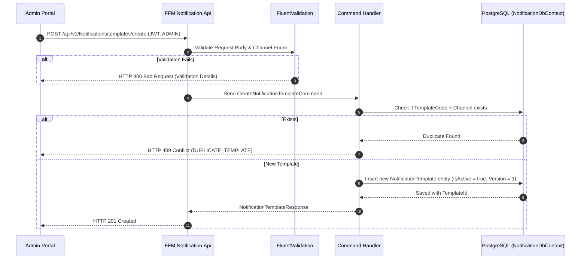

# Notification Template Creation Endpoint Specification

## 1. Document Metadata

| Attribute | Detail |
| :--- | :--- |
| **Document Reference** | `FFM-SPEC-NOTIF-TMPL-CREATE-V1.0` |
| **System** | Field Force Management (FFM) Platform |
| **Service** | Notification Service (`FFM.Notification`) |
| **Endpoint** | `POST /api/v1/Notifications/templates/create` |
| **Port** | `5040` (Docker Container: `ffm-notification-api`) |
| **Compliance** | ISO/IEC/IEEE 29148, OpenAPI 3.1, RFC 7807 (ProblemDetails) |
| **Authentication** | Bearer JWT RS256 (issued by Identity & Access Service) |
| **Classification** | Tier‑1 Content Definition & Template Management |
| **Status** | Approved Formal Specification |

---

## 2. Executive Purpose & Business Scope

In a modern enterprise Field Force Management architecture, notification messages, emails, and push alerts should **never be hardcoded** inside C# business logic. Hardcoding makes message localization, tone adjustments, branding updates, and legal disclaimers expensive and prone to service deployments.

The **Create Template** endpoint allows administrators and operations leadership to define parameterized notification templates stored within the database. Dynamic placeholders (e.g. `{{EmployeeName}}`, `{{TaskNumber}}`, `{{SiteName}}`) can be embedded into both Title and Body.

### Core Business Rules:
1. **Zero Path Parameters Standard:** All template attributes are supplied in the JSON request body.
2. **Strict Administrative Control:** Restricted exclusively to `ADMIN` and `SYSTEM_ADMIN` roles (`[Authorize(Roles = "ADMIN,SYSTEM_ADMIN")]`).
3. **Compound Uniqueness:** A combination of `TemplateCode` and `Channel` must be unique across the platform. Attempting to insert an existing code/channel pair results in `409 Conflict`.
4. **Placeholder Syntax Validation:** Placeholders must follow double curly brace syntax: `{{[a-zA-Z0-9_]+}}`. Invalid braces trigger validation errors.
5. **Default State:** Newly created templates are initialized with `IsActive = true` and `Version = 1`.

---

## 3. Authorization & RBAC Policy

| Role | Allowed? | Rationale |
| :--- | :---: | :--- |
| `SYSTEM_ADMIN` | ✅ Yes | Global authority to define templates for all notification channels. |
| `ADMIN` | ✅ Yes | Organization authority to create communication templates. |
| `MANAGER` | ❌ No | Managers cannot alter system notification templates (`403 Forbidden`). |
| `SUPERVISOR` | ❌ No | Supervisors cannot alter system notification templates (`403 Forbidden`). |
| `EMPLOYEE` | ❌ No | Regular employees cannot create templates (`403 Forbidden`). |
| `Anonymous` | ❌ No | Unauthenticated requests are rejected with `401 Unauthorized`. |

---

## 4. Request Schema & Field Definitions

### Route
`POST /api/v1/Notifications/templates/create`

### Request Headers
| Header | Type | Required | Description |
| :--- | :--- | :---: | :--- |
| `Authorization` | String | Yes | `Bearer <JWT_TOKEN>` (Must contain `ADMIN` or `SYSTEM_ADMIN` role) |
| `Content-Type` | String | Yes | `application/json` |

### Request Body (`CreateNotificationTemplateRequest`)
```json
{
  "templateCode": "TASK_URGENT_DISPATCH",
  "channel": "PUSH",
  "title": "🚨 Urgent Task: {{TaskNumber}}",
  "bodyTemplate": "Hi {{EmployeeName}}, proceed immediately to {{SiteName}} for urgent equipment repair.",
  "description": "Triggered when a task priority is escalated to Critical"
}
```

### Field Definitions:
| Field | Type | Required | Constraints | Real-World Description |
| :--- | :--- | :---: | :--- | :--- |
| **`templateCode`** | String | Yes | Min 3, Max 64 chars, Uppercase alphanumeric + underscores | Unique business event code identifying the notification trigger (e.g. `TASK_ASSIGNED`, `GEOFENCE_BREACH`). |
| **`channel`** | String | Yes | Allowed: `PUSH`, `SMS`, `EMAIL`, `IN_APP` | Communication medium used to deliver the notification. |
| **`title`** | String | Yes | Min 2, Max 200 chars | Notification header or subject line. Supports dynamic variables (e.g. `{{TaskNumber}}`). |
| **`bodyTemplate`** | String | Yes | Min 5, Max 4000 chars | Core message text containing Mustache/Handlebars placeholders `{{variable}}`. |
| **`description`** | String | No | Max 500 chars | Administrative documentation explaining when and why this template is triggered. |

---

## 5. Response Schema & HTTP Status Codes

### Success Response (`201 Created`)
```json
{
  "success": true,
  "message": "Notification template created successfully",
  "data": {
    "templateId": 5,
    "templateCode": "TASK_URGENT_DISPATCH",
    "channel": "PUSH",
    "title": "🚨 Urgent Task: {{TaskNumber}}",
    "bodyTemplate": "Hi {{EmployeeName}}, proceed immediately to {{SiteName}} for urgent equipment repair.",
    "description": "Triggered when a task priority is escalated to Critical",
    "isActive": true,
    "createdAt": "2026-11-12T10:00:00Z"
  }
}
```

### Error Responses:
* **`400 Bad Request`**: Validation error (e.g. empty `templateCode`, invalid `channel`, missing body template).
  ```json
  {
    "success": false,
    "errorCode": "VALIDATION_ERROR",
    "message": "TemplateCode and BodyTemplate are required; Channel must be PUSH, SMS, EMAIL, or IN_APP."
  }
  ```
* **`409 Conflict`**: Duplicate template code and channel already exists.
  ```json
  {
    "success": false,
    "errorCode": "DUPLICATE_TEMPLATE",
    "message": "A template with code 'TASK_URGENT_DISPATCH' and channel 'PUSH' already exists."
  }
  ```
* **`401 Unauthorized`**: Request missing valid JWT Bearer credentials.
* **`403 Forbidden`**: Request performed by user lacking `ADMIN` or `SYSTEM_ADMIN` role.

---

## 6. End-to-End Sequence Diagram



