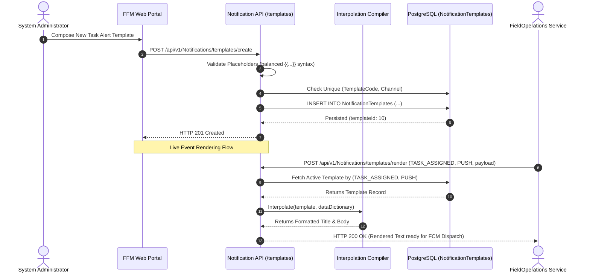

# Notification Template Management Module Specification

## 1. Document Metadata

| Attribute | Detail |
| :--- | :--- |
| **Document Reference** | `FFM-SPEC-NOTIF-TEMPLATE-V1.0` |
| **System** | Field Force Management (FFM) Platform |
| **Service** | Notification Service (`FFM.Notification`) |
| **Module** | Module 2: Dynamic Notification Template Management & Interpolation Engine |
| **Default Port** | `5040` (or routed via Gateway `:8080`) |
| **Methods & Routes** | `POST /api/v1/Notifications/templates/create`<br>`POST /api/v1/Notifications/templates/update`<br>`POST /api/v1/Notifications/templates/render`<br>`GET /api/v1/Notifications/templates/list`<br>`GET /api/v1/Notifications/templates/by-code` |
| **Compliance** | ISO/IEC/IEEE 29148, OpenAPI 3.1, RFC 7807 (ProblemDetails), Mustache/Handlebars standard |
| **Authentication** | Bearer JWT RS256 (issued by Identity & Access Service) |
| **Classification** | Tier‑1 Reusable Communications & Content Rendering Engine |
| **Status** | Approved Formal Specification |
| **Target Clients** | FFM Web Portal (Administrators/Managers) & Internal FFM Microservices |

---

## 2. Executive Purpose & Business Scope

The **Notification Template Management Module** is the centralized content, formatting, and dynamic variable interpolation engine for all communications across the FFM platform.

In a large-scale field force organization, message texts and email/push layouts should **never be hardcoded** inside C# business logic. Hardcoding makes localized text changes, legal disclaimer updates, branding changes, and multi-channel adaptations expensive and prone to downtime.

This module decouples notification message definitions from operational code by persisting structured, parameterized templates with dynamic placeholders (e.g. `{{EmployeeName}}`, `{{TaskNumber}}`, `{{SiteName}}`).

```
    [Event Occurs in FFM System (e.g. Task #101 Assigned to Employee #12)]
                                     │
                                     ▼
┌────────────────────────────────────────────────────────────────────────┐
│  FETCH TEMPLATE BY CODE & CHANNEL (e.g. "TASK_ASSIGNED", "PUSH")       │
│  - Template Title: "New Task Assigned: {{TaskNumber}}"                 │
│  - Template Body:  "Hi {{EmployeeName}}, task at {{SiteName}} is ready"│
└────────────────────────────────────────────────────────────────────────┘
                                     │
                                     ▼
┌────────────────────────────────────────────────────────────────────────┐
│  DYNAMIC INTERPOLATION ENGINE (POST /templates/render)                 │
│  - Ingests Runtime Data Dictionary:                                    │
│      { "EmployeeName": "Ramesh", "TaskNumber": "TK-101", ... }         │
│  - Evaluates & Substitutes all {{variables}} cleanly                   │
│  - Sanitizes XSS, handles missing placeholders with fallback rules     │
└────────────────────────────────────────────────────────────────────────┘
                                     │
                                     ▼
┌────────────────────────────────────────────────────────────────────────┐
│  DISPATCH READY TO TARGET CHANNEL                                      │
│  - Mobile Push: Firebase Cloud Messaging (FCM) payload                 │
│  - In-App Bell: Technician Notification Inbox item                     │
│  - SMS / Email: Formatted plain-text / HTML body                       │
└────────────────────────────────────────────────────────────────────────┘
```

### Key Business Goals:
1. **Zero Hardcoded Copy:** Centralizes all customer-facing and employee-facing notification copy in the database, allowing admins to modify messaging without code redeployments.
2. **Multi-Channel Harmonization:** A single event code (e.g. `TASK_ASSIGNED`) can maintain tailored formats for each delivery channel:
   * **Push Notification:** Short, punchy headline + 120-char preview.
   * **SMS:** 160-character GSM-safe message without HTML.
   * **Email:** Full HTML formatted email with header banner and action links.
   * **In-App:** Compact structured text for the mobile Notification Bell.
3. **Safe Variable Interpolation:** Built-in template compiler securely parses placeholders, warns against unresolved tags, and neutralizes injection vectors.
4. **Zero Path Parameter Standard:** Strictly complies with platform architectural conventions—all resource mutations and template lookups use JSON bodies and query parameters without URL path variables.

---

## 3. Authorization & RBAC Policy

| Endpoint | Role: `ADMIN` / `SYSTEM_ADMIN` | Role: `MANAGER` | Role: `SUPERVISOR` | Role: `EMPLOYEE` |
| :--- | :---: | :---: | :---: | :---: |
| `POST /api/v1/Notifications/templates/create` | ✅ Full Access | ❌ Forbidden (403) | ❌ Forbidden (403) | ❌ Forbidden (403) |
| `POST /api/v1/Notifications/templates/update` | ✅ Full Access | ❌ Forbidden (403) | ❌ Forbidden (403) | ❌ Forbidden (403) |
| `POST /api/v1/Notifications/templates/render` | ✅ Full Access | ✅ Allowed (Preview) | ✅ Allowed (Preview) | ❌ Forbidden (403) |
| `GET /api/v1/Notifications/templates/list` | ✅ Full Access | ✅ Read-Only | ✅ Read-Only | ❌ Forbidden (403) |
| `GET /api/v1/Notifications/templates/by-code` | ✅ Full Access | ✅ Read-Only | ✅ Read-Only | ✅ Read-Only (Internal) |

### Security Policies:
* **Administrative Guard:** Creating and modifying templates requires administrative authorization (`ADMIN` or `SYSTEM_ADMIN`).
* **Unauthenticated Requests:** Returns `HTTP 401 Unauthorized`.
* **Audit Trail:** `CreatedByUserId` and `UpdatedByUserId` are automatically captured from validated JWT claims.

---

## 4. Supported Event Types & Standard Placeholders

| Event Code | Intended Trigger | Supported Channels | Standard Variable Placeholders |
| :--- | :--- | :--- | :--- |
| `TASK_ASSIGNED` | Manager assigns task to technician | `PUSH`, `IN_APP`, `SMS` | `{{EmployeeName}}`, `{{TaskNumber}}`, `{{SiteName}}`, `{{Priority}}`, `{{ScheduledTime}}` |
| `TASK_CANCELLED` | Manager cancels an existing work order | `PUSH`, `IN_APP`, `SMS` | `{{EmployeeName}}`, `{{TaskNumber}}`, `{{CancelReason}}`, `{{CancelledBy}}` |
| `TASK_REASSIGNED` | Task transferred to another technician | `PUSH`, `IN_APP` | `{{EmployeeName}}`, `{{TaskNumber}}`, `{{NewAssignee}}`, `{{SiteName}}` |
| `CHECKIN_REMINDER` | Proximity / Schedule prompt | `PUSH`, `IN_APP` | `{{EmployeeName}}`, `{{SiteName}}`, `{{RemainingMinutes}}` |
| `GEOFENCE_BREACH` | Technician leaves perimeter during active visit | `PUSH`, `IN_APP`, `SMS` | `{{EmployeeName}}`, `{{SiteName}}`, `{{BreachDistanceMeters}}` |
| `LEAVE_APPROVED` | Manager approves leave application | `PUSH`, `IN_APP`, `EMAIL` | `{{EmployeeName}}`, `{{LeaveType}}`, `{{StartDate}}`, `{{EndDate}}` |
| `LEAVE_REJECTED` | Manager rejects leave application | `PUSH`, `IN_APP`, `EMAIL` | `{{EmployeeName}}`, `{{LeaveType}}`, `{{RejectReason}}` |
| `ATTENDANCE_MISSED` | Shift start elapsed without check-in | `PUSH`, `SMS` | `{{EmployeeName}}`, `{{ShiftName}}`, `{{GracePeriodMinutes}}` |

---

## 5. Business Rules & Validation Policies

| Rule ID | Rule Title | Detailed Specification | Error Code & Status |
| :--- | :--- | :--- | :--- |
| **BR-TMPL-01** | Unique Template Code & Channel | The combination of `TemplateCode` and `Channel` must be unique across the tenant. | `DUPLICATE_TEMPLATE` (HTTP 409) |
| **BR-TMPL-02** | Valid Channel Enumeration | `Channel` must be strictly one of: `PUSH`, `IN_APP`, `SMS`, or `EMAIL` (case-insensitive, normalized to UPPERCASE). | `UNSUPPORTED_CHANNEL` (HTTP 400) |
| **BR-TMPL-03** | Mandatory Title / Subject | For `PUSH` and `EMAIL`, `Title` (or Subject) is mandatory and between `3` and `150` characters. For `SMS`, title is optional. | `TITLE_REQUIRED` (HTTP 400) |
| **BR-TMPL-04** | Body Content Constraints | `BodyTemplate` is mandatory and must not exceed: `500` characters for `PUSH`, `160` characters for `SMS`, and `10,000` characters for `EMAIL` HTML. | `BODY_TOO_LONG` (HTTP 400) |
| **BR-TMPL-05** | Balanced Variable Syntax | Placeholders must follow double-curly brace format: `{{VariableName}}`. Unbalanced braces (e.g. `{{Name`) are rejected. | `MALFORMED_PLACEHOLDER` (HTTP 400) |
| **BR-TMPL-06** | Placeholder Character Whitelist | Variable names must be alphanumeric only `[a-zA-Z0-9_]`. Whitespace or code syntax inside braces is rejected. | `INVALID_VARIABLE_SYNTAX` (HTTP 400) |
| **BR-TMPL-07** | Safe Fallback Rendering | If a runtime data dictionary does not provide a value for a placeholder, the engine replaces it with a blank string or configurable default rather than crashing. | Graceful Rendering |
| **BR-TMPL-08** | Active Status Toggle | Newly created templates default to `IsActive = true`. Setting `IsActive = false` soft-disables the template without deleting historical logs. | Architectural Standard |
| **BR-TMPL-09** | Zero Path Parameter Standard | All mutations and queries adhere strictly to the JSON request body / query string standard without path variables. | Platform Convention |

---

## 6. API Contracts

### 6.1 Create Notification Template Endpoint
* **HTTP Method:** `POST`
* **Route:** `/api/v1/Notifications/templates/create`
* **Headers:**
  * `Authorization: Bearer <JWT_TOKEN>` (Admin / System Admin)
  * `Content-Type: application/json`

#### Request Payload:
```json
{
  "templateCode": "TASK_ASSIGNED",
  "channel": "PUSH",
  "title": "New Task Assigned: {{TaskNumber}}",
  "bodyTemplate": "Hi {{EmployeeName}}, you have been assigned to task {{TaskNumber}} at {{SiteName}}. Priority: {{Priority}}.",
  "description": "Triggered when a dispatcher schedules a field task for an employee."
}
```

#### Response (HTTP 201 Created):
```json
{
  "success": true,
  "message": "Notification template created successfully",
  "data": {
    "templateId": 10,
    "templateCode": "TASK_ASSIGNED",
    "channel": "PUSH",
    "title": "New Task Assigned: {{TaskNumber}}",
    "bodyTemplate": "Hi {{EmployeeName}}, you have been assigned to task {{TaskNumber}} at {{SiteName}}. Priority: {{Priority}}.",
    "isActive": true,
    "createdAt": "2026-11-11T10:00:00Z"
  }
}
```

---

### 6.2 Update Notification Template Endpoint
* **HTTP Method:** `POST`
* **Route:** `/api/v1/Notifications/templates/update`
* **Headers:**
  * `Authorization: Bearer <JWT_TOKEN>` (Admin / System Admin)
  * `Content-Type: application/json`

#### Request Payload:
```json
{
  "templateId": 10,
  "title": "⚡ Urgent Task: {{TaskNumber}}",
  "bodyTemplate": "Hi {{EmployeeName}}, visit {{SiteName}} immediately for {{TaskNumber}}.",
  "isActive": true
}
```

#### Response (HTTP 200 OK):
```json
{
  "success": true,
  "message": "Notification template updated successfully",
  "data": {
    "templateId": 10,
    "templateCode": "TASK_ASSIGNED",
    "channel": "PUSH",
    "title": "⚡ Urgent Task: {{TaskNumber}}",
    "bodyTemplate": "Hi {{EmployeeName}}, visit {{SiteName}} immediately for {{TaskNumber}}.",
    "isActive": true,
    "updatedAt": "2026-11-11T10:05:00Z"
  }
}
```

---

### 6.3 Render / Preview Template Endpoint
* **HTTP Method:** `POST`
* **Route:** `/api/v1/Notifications/templates/render`
* **Headers:**
  * `Authorization: Bearer <JWT_TOKEN>`
  * `Content-Type: application/json`

#### Request Payload:
```json
{
  "templateCode": "TASK_ASSIGNED",
  "channel": "PUSH",
  "placeholders": {
    "EmployeeName": "Ramesh Kumar",
    "TaskNumber": "TK-2026-991",
    "SiteName": "Metro Bank ATM #4",
    "Priority": "HIGH"
  }
}
```

#### Response (HTTP 200 OK):
```json
{
  "success": true,
  "data": {
    "templateCode": "TASK_ASSIGNED",
    "channel": "PUSH",
    "renderedTitle": "New Task Assigned: TK-2026-991",
    "renderedBody": "Hi Ramesh Kumar, you have been assigned to task TK-2026-991 at Metro Bank ATM #4. Priority: HIGH."
  }
}
```

---

### 6.4 Query Template by Code & Channel Endpoint
* **HTTP Method:** `GET`
* **Route:** `/api/v1/Notifications/templates/by-code?code=TASK_ASSIGNED&channel=PUSH`
* **Headers:**
  * `Authorization: Bearer <JWT_TOKEN>`

#### Response (HTTP 200 OK):
```json
{
  "success": true,
  "data": {
    "templateId": 10,
    "templateCode": "TASK_ASSIGNED",
    "channel": "PUSH",
    "title": "New Task Assigned: {{TaskNumber}}",
    "bodyTemplate": "Hi {{EmployeeName}}, you have been assigned to task {{TaskNumber}} at {{SiteName}}.",
    "isActive": true
  }
}
```

---

## 7. Domain Model & Database Schema

### 7.1 Entity Class: `NotificationTemplate`
```csharp
namespace FFM.Notification.Domain.Entities;

public class NotificationTemplate
{
    public int Id { get; private set; }
    public string TemplateCode { get; private set; } = default!;
    public string Channel { get; private set; } = default!; // PUSH, IN_APP, SMS, EMAIL
    public string? Title { get; private set; }
    public string BodyTemplate { get; private set; } = default!;
    public string? Description { get; private set; }
    public bool IsActive { get; private set; }
    public int CreatedByUserId { get; private set; }
    public DateTime CreatedAt { get; private set; }
    public DateTime? UpdatedAt { get; private set; }

    public void Update(string? title, string bodyTemplate, bool isActive, int updatedByUserId)
    {
        Title = title;
        BodyTemplate = bodyTemplate;
        IsActive = isActive;
        UpdatedAt = DateTime.UtcNow;
    }
}
```

### 7.2 PostgreSQL Table Definition (`NotificationTemplates`)
```sql
CREATE TABLE "NotificationTemplates" (
    "Id" SERIAL PRIMARY KEY,
    "TemplateCode" VARCHAR(50) NOT NULL,
    "Channel" VARCHAR(20) NOT NULL,
    "Title" VARCHAR(200) NULL,
    "BodyTemplate" TEXT NOT NULL,
    "Description" VARCHAR(300) NULL,
    "IsActive" BOOLEAN NOT NULL DEFAULT TRUE,
    "CreatedByUserId" INT NOT NULL,
    "CreatedAt" TIMESTAMPTZ NOT NULL DEFAULT CURRENT_TIMESTAMP,
    "UpdatedAt" TIMESTAMPTZ NULL,
    CONSTRAINT "UQ_NotificationTemplates_Code_Channel" UNIQUE ("TemplateCode", "Channel")
);

-- Index for instant lookup during event dispatch
CREATE INDEX "IX_NotificationTemplates_Lookup" 
ON "NotificationTemplates" ("TemplateCode", "Channel", "IsActive");
```

---

## 8. High-Performance Sequence Diagram



---

## 9. Clean Architecture & CQRS Blueprint

```
FFM.Notification
│
├── FFM.Notification.Domain
│   ├── Entities/NotificationTemplate.cs
│   └── Repositories/INotificationTemplateRepository.cs
│
├── FFM.Notification.Application
│   ├── Commands/CreateNotificationTemplateCommand.cs
│   ├── Commands/UpdateNotificationTemplateCommand.cs
│   ├── Queries/GetTemplateByCodeQuery.cs
│   ├── Queries/RenderTemplateQuery.cs
│   ├── Services/ITemplateInterpolationEngine.cs
│   ├── Services/TemplateInterpolationEngine.cs
│   └── Validators/NotificationTemplateValidators.cs
│
├── FFM.Notification.Infrastructure
│   ├── Data/NotificationDbContext.cs (DbSet<NotificationTemplate>)
│   └── Repositories/NotificationTemplateRepository.cs
│
└── FFM.Notification.Api
    └── Controllers/TemplatesController.cs
```

---

## 10. Test Case Matrix (Automated Verification)

| Test ID | Test Scenario | Expected Result |
| :--- | :--- | :--- |
| **TC-TMPL-01** | Create valid PUSH template with standard placeholders | HTTP 201 Created, record saved |
| **TC-TMPL-02** | Create valid SMS template within 160 characters | HTTP 201 Created, record saved |
| **TC-TMPL-03** | Create valid HTML EMAIL template | HTTP 201 Created, HTML body stored |
| **TC-TMPL-04** | Duplicate `(TemplateCode, Channel)` rejection | HTTP 409 Conflict (`DUPLICATE_TEMPLATE`) |
| **TC-TMPL-05** | Unsupported channel (e.g. `WHATSAPP` when not supported) | HTTP 400 Bad Request (`UNSUPPORTED_CHANNEL`) |
| **TC-TMPL-06** | Malformed unbalanced placeholder (e.g. `{{EmployeeName`) | HTTP 400 Bad Request (`MALFORMED_PLACEHOLDER`) |
| **TC-TMPL-07** | Render template with complete dictionary | HTTP 200 OK, all placeholders substituted correctly |
| **TC-TMPL-08** | Render template with missing dictionary keys | HTTP 200 OK, missing keys replaced by empty strings (graceful) |
| **TC-TMPL-09** | Non-admin user attempts template creation | HTTP 403 Forbidden |
| **TC-TMPL-10** | High-concurrency template rendering benchmark | 100% pass, sub-2ms interpolation execution |

