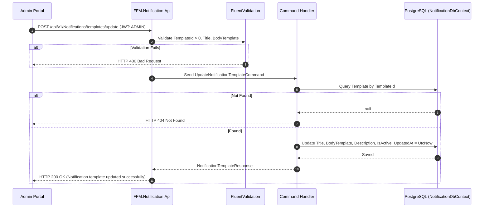

# Notification Template Update Endpoint Specification

## 1. Document Metadata

| Attribute | Detail |
| :--- | :--- |
| **Document Reference** | `FFM-SPEC-NOTIF-TMPL-UPDATE-V1.0` |
| **System** | Field Force Management (FFM) Platform |
| **Service** | Notification Service (`FFM.Notification`) |
| **Endpoint** | `POST /api/v1/Notifications/templates/update` |
| **Port** | `5040` (Docker Container: `ffm-notification-api`) |
| **Compliance** | ISO/IEC/IEEE 29148, OpenAPI 3.1, RFC 7807 (ProblemDetails) |
| **Authentication** | Bearer JWT RS256 (issued by Identity & Access Service) |
| **Classification** | Tier‑1 Content Mutation & Lifecycle Management |
| **Status** | Approved Formal Specification |

---

## 2. Executive Purpose & Business Scope

As operational processes evolve, enterprise administrators need to modify notification copy, adjust urgent wording, change brand formatting, or temporarily disable/re-enable specific notification types without restarting microservices or redeploying code.

The **Update Template** endpoint allows administrators to modify the title, body template, description, and active status (`isActive`) of an existing notification template.

### Core Business Rules:
1. **Zero Path Parameters Standard:** In strict compliance with platform architectural guidelines, the target `templateId` is passed within the **JSON request body** (`POST /api/v1/Notifications/templates/update`), never as a URL path segment.
2. **Immutable Keys:** The identifying business keys `TemplateCode` and `DeliveryChannel` are **immutable**. Once created, they cannot be modified to prevent breaking integration contracts with event producers (such as Task Assignment or Geofence Breaches).
3. **Auditing & Timestamps:** Any update updates `UpdatedAt` timestamp and records the administrative user ID (`UpdatedByUserId`) from the JWT claims.
4. **Active State Toggle:** Setting `isActive: false` immediately pauses notification rendering and dispatches for that event code, providing an instant operational kill-switch.

---

## 3. Authorization & RBAC Policy

| Role | Allowed? | Rationale |
| :--- | :---: | :--- |
| `SYSTEM_ADMIN` | ✅ Yes | Global authority to modify and deactivate templates. |
| `ADMIN` | ✅ Yes | Organization authority to update template wording and status. |
| `MANAGER` | ❌ No | Managers cannot modify communication templates (`403 Forbidden`). |
| `SUPERVISOR` | ❌ No | Supervisors cannot modify communication templates (`403 Forbidden`). |
| `EMPLOYEE` | ❌ No | Field technicians cannot modify templates (`403 Forbidden`). |
| `Anonymous` | ❌ No | Unauthenticated requests are rejected with `401 Unauthorized`. |

---

## 4. Request Schema & Field Definitions

### Route
`POST /api/v1/Notifications/templates/update`

### Request Headers
| Header | Type | Required | Description |
| :--- | :--- | :---: | :--- |
| `Authorization` | String | Yes | `Bearer <JWT_TOKEN>` (Must contain `ADMIN` or `SYSTEM_ADMIN` role) |
| `Content-Type` | String | Yes | `application/json` |

### Request Body (`UpdateNotificationTemplateRequest`)
```json
{
  "templateId": 1,
  "title": "⚡ Priority Task Assigned: {{TaskNumber}}",
  "bodyTemplate": "Hi {{EmployeeName}}, please report to {{SiteName}} immediately. Task #{{TaskNumber}} has been assigned.",
  "description": "Updated high-priority urgent wording",
  "isActive": true
}
```

### Field Definitions:
| Field | Type | Required | Constraints | Real-World Description |
| :--- | :--- | :---: | :--- | :--- |
| **`templateId`** | Integer | Yes | Positive Integer (`> 0`) | Primary key identifier of the template to be updated. |
| **`title`** | String | Yes | Min 2, Max 200 chars | Revised title or subject line with Mustache placeholders. |
| **`bodyTemplate`** | String | Yes | Min 5, Max 4000 chars | Revised message body containing dynamic variable placeholders. |
| **`description`** | String | No | Max 500 chars | Updated administrative notes or change log explanation. |
| **`isActive`** | Boolean | Yes | `true` or `false` | Status flag. Set `false` to disable notifications for this event. |

---

## 5. Response Schema & HTTP Status Codes

### Success Response (`200 OK`)
```json
{
  "success": true,
  "message": "Notification template updated successfully",
  "data": {
    "templateId": 1,
    "templateCode": "TASK_ASSIGNED",
    "channel": "PUSH",
    "title": "⚡ Priority Task Assigned: {{TaskNumber}}",
    "bodyTemplate": "Hi {{EmployeeName}}, please report to {{SiteName}} immediately. Task #{{TaskNumber}} has been assigned.",
    "description": "Updated high-priority urgent wording",
    "isActive": true,
    "updatedAt": "2026-11-12T10:05:00Z"
  }
}
```

### Error Responses:
* **`400 Bad Request`**: Validation failure (e.g. `templateId <= 0`, empty title/body).
  ```json
  {
    "success": false,
    "errorCode": "VALIDATION_ERROR",
    "message": "Valid TemplateId, Title, and BodyTemplate are required."
  }
  ```
* **`404 Not Found`**: Template with given ID does not exist in the database.
  ```json
  {
    "success": false,
    "errorCode": "NOT_FOUND",
    "message": "Notification template with ID 999 was not found."
  }
  ```
* **`401 Unauthorized`**: Missing or invalid JWT credentials.
* **`403 Forbidden`**: Authenticated caller is not an `ADMIN` or `SYSTEM_ADMIN`.

---

## 6. End-to-End Sequence Diagram



