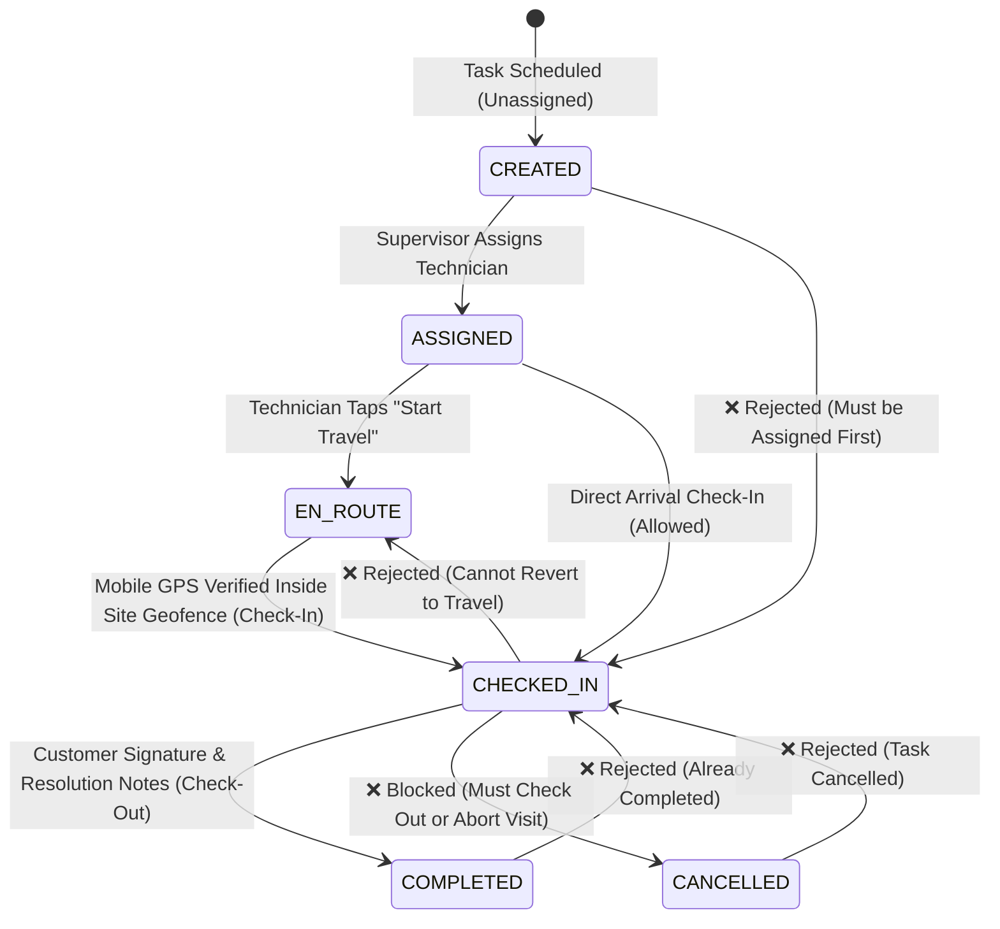
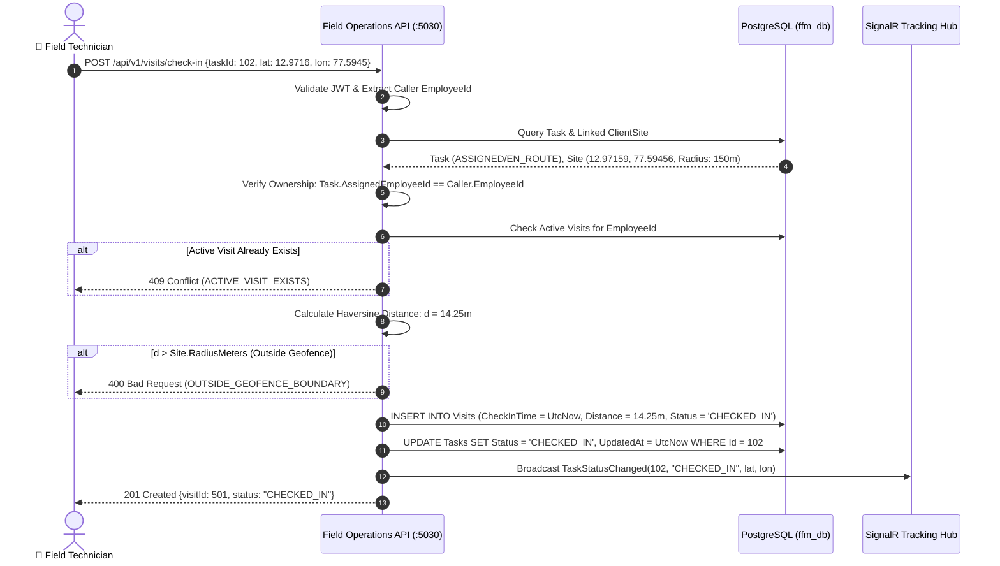
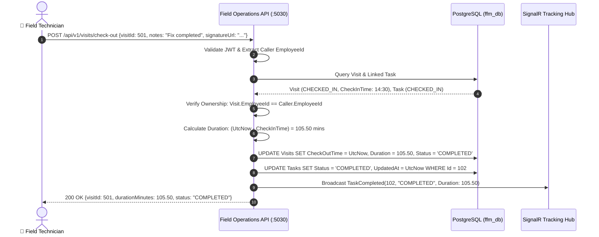

# On-Site Visit Check-In & Check-Out Module Specification

## 1. Document Metadata

| Attribute | Detail |
| :--- | :--- |
| **Document Reference** | `FFM-SPEC-FLD-VISIT-LIFECYCLE-V1.0` |
| **System** | Field Force Management (FFM) Platform |
| **Service** | Field Operations Service (`FFM.FieldOperations`) |
| **Module** | Module 3: Field Visit Execution & Geofence Verification |
| **Default Port** | `5030` |
| **Compliance** | ISO/IEC/IEEE 29148, OpenAPI 3.1, RFC 7807 (ProblemDetails), WGS-84 (GPS Standard) |
| **Authentication** | Bearer JWT RS256 (Asymmetric key issued by Identity & Access Service) |
| **Classification** | Tier‑1 Core Operational & Billing Verification Engine |
| **Status** | Approved Formal Specification |
| **Target Clients** | FFM Mobile App (Field Technicians) & FFM Web Portal (Supervisors/Managers) |
| **Parent Document** | `FFM_Field_Operations_Service_Spec.md`, Sections 4, 6.3, 7.5, 7.6 & 8.1 |

---

## 2. Executive Purpose & Business Scope

The **On-Site Visit Check-In & Check-Out Module** governs the physical execution phase of field work orders. It bridges dispatching and billing by verifying through **cryptographic GPS telemetry** that a field technician is physically present inside the designated customer premises before permitting work to begin, and captures tamper-proof proof of work upon task completion.

```
       [Dispatched Task] (ASSIGNED / EN_ROUTE)
                │
                ▼
┌────────────────────────────────────────────────────────┐
│   ON-SITE VISIT CHECK-IN (POST /api/v1/visits/check-in)│
│  - Captures Mobile Lat/Long & Accuracy                 │
│  - Calculates Haversine Distance to Client Site        │
│  - Enforces Geofence Radius (Default: 150m)            │
│  - Single Active Visit Constraint per Technician       │
│  - State Transition: EN_ROUTE ➔ CHECKED_IN             │
└────────────────────────────────────────────────────────┘
                │
                ▼
       [Physical Work Execution on Customer Site]
       [Optional Evidence / Photo Uploads]
                │
                ▼
┌────────────────────────────────────────────────────────┐
│  ON-SITE VISIT CHECK-OUT (POST /api/v1/visits/check-out│
│  - Captures Departure Telemetry & Resolution Notes     │
│  - Captures Customer Representative Name & Signature   │
│  - Calculates Exact Billable Duration in Minutes       │
│  - State Transition: CHECKED_IN ➔ COMPLETED            │
└────────────────────────────────────────────────────────┘
```

### Key Business Goals:
1. **Zero-Fraud Field Presence:** Permanently eliminates phantom visits and false arrival claims by calculating the exact physical distance between the technician's device and the client site coordinates.
2. **Accurate SLA & Billable Time Tracking:** Calculates precise on-site dwell time (in minutes) based exclusively on server-authoritative UTC timestamps (`CheckInTime` to `CheckOutTime`).
3. **BOLA Ownership Defense:** Guarantees that only the technician assigned to the job can execute check-in and check-out, with administrative override capability for dispatchers.
4. **Single Active Visit Policy:** Prevents a technician from checking in to multiple tasks concurrently.
5. **Zero Path Parameter Standard:** Strictly complies with platform architectural conventions—all identifiers (`taskId`, `visitId`) are transmitted exclusively via the **JSON request body**.

---

## 3. Authorization & RBAC Matrix

| Endpoint | Role: `EMPLOYEE` (Technician) | Role: `SUPERVISOR` | Role: `MANAGER` | Role: `ADMIN` / `SYSTEM_ADMIN` |
| :--- | :---: | :---: | :---: | :---: |
| `POST /api/v1/visits/check-in` | ✅ Allowed (Assigned Self-Only) | ✅ Allowed (Team Override) | ✅ Allowed (Branch Override) | ✅ Full Platform Access |
| `POST /api/v1/visits/check-out` | ✅ Allowed (Active Visit Owner) | ✅ Allowed (Team Override) | ✅ Allowed (Branch Override) | ✅ Full Platform Access |
| `GET /api/v1/visits/{taskId}` | 🔒 Own Visit Only | ✅ Team Visits | ✅ Branch Visits | ✅ Full Platform Access |

### Authorization & Security Policies:
* **Unauthenticated Requests:** Returns `HTTP 401 Unauthorized` (`MISSING_TOKEN` or `INVALID_TOKEN`).
* **Broken Object Level Authorization (BOLA):** If the caller has role `EMPLOYEE`, the system validates that `task.AssignedEmployeeId == Caller.EmployeeId`. If caller attempts to check in/out of another technician's task, the request is rejected with `HTTP 403 Forbidden` (`TASK_ACCESS_DENIED`).
* **Supervisory Authority:** Users with `SUPERVISOR`, `MANAGER`, `ADMIN`, or `SYSTEM_ADMIN` roles may execute emergency check-in or checkout on behalf of field technicians (e.g., if technician mobile device battery dies on site). The audit log preserves both `TechnicianEmployeeId` and `ActorUserId`.

---

## 4. State Transition Matrix & Lifecycle Rules

The Field Operations state machine enforces strict, non-reversible lifecycle progression:



### Lifecycle Progression Rules:
* **`EN_ROUTE` ➔ `CHECKED_IN`:** Standard operational path. Permitted when technician GPS is within `radiusMeters`.
* **`ASSIGNED` ➔ `CHECKED_IN`:** Permitted if technician arrived directly on-site without explicitly tapping "Start Travel" (auto-transitions through travel state).
* **`CREATED` ➔ `CHECKED_IN`:** **Rejected (`HTTP 400 Bad Request`)**. An unassigned task has no designated technician; assignment is mandatory.
* **`CHECKED_IN` ➔ `CHECKED_IN`:** **Idempotent (`HTTP 200 OK`)**. If network drop causes mobile retry on an already checked-in visit, returns the existing visit record without duplicate record generation.
* **`CHECKED_IN` ➔ `COMPLETED`:** Standard completion path upon check-out.
* **`COMPLETED` ➔ `COMPLETED`:** **Rejected (`HTTP 400 Bad Request`)**. Completed visits cannot be re-completed.

---

## 5. Geofence Distance Calculation Algorithm

Distance calculation between the technician's mobile coordinates and the client site coordinates MUST be computed using the **Haversine Formula**, operating on the WGS-84 reference sphere:

### Mathematical Definition:
$$\Delta\phi = \frac{(\text{lat}_2 - \text{lat}_1) \cdot \pi}{180}, \quad \Delta\lambda = \frac{(\text{lon}_2 - \text{lon}_1) \cdot \pi}{180}$$

$$a = \sin^2\left(\frac{\Delta\phi}{2}\right) + \cos\left(\frac{\text{lat}_1 \cdot \pi}{180}\right) \cdot \cos\left(\frac{\text{lat}_2 \cdot \pi}{180}\right) \cdot \sin^2\left(\frac{\Delta\lambda}{2}\right)$$

$$c = 2 \cdot \text{atan2}\left(\sqrt{a}, \sqrt{1 - a}\right)$$

$$d = R \cdot c$$

Where:
* $R = 6,371,000 \text{ meters}$ (Mean Earth radius)
* $\text{lat}_1, \text{lon}_1$ = Client Site target coordinates
* $\text{lat}_2, \text{lon}_2$ = Mobile device GPS coordinates
* $d$ = Shortest geodesic distance in meters

### Geofence Decision Boundary:
$$\text{IsWithinGeofence} = 
\begin{cases} 
\text{TRUE}, & \text{if } d \le \text{Site.RadiusMeters} \\
\text{FALSE}, & \text{if } d > \text{Site.RadiusMeters}
\end{cases}$$

If $\text{IsWithinGeofence} = \text{FALSE}$, check-in is rejected with `HTTP 400 Bad Request` (`OUTSIDE_GEOFENCE_BOUNDARY`), including the exact calculated distance and allowed threshold in the error payload.

---

## 6. Business Rules & Validation Policies

| Rule ID | Title | Rule Description | Error Code | HTTP Status |
| :--- | :--- | :--- | :--- | :---: |
| **BR-VIS-01** | Task Existence | The target `taskId` must exist in the database. | `TASK_NOT_FOUND` | `404 Not Found` |
| **BR-VIS-02** | Active Site Guard | The task's linked `ClientSite` must exist and be active (`IsActive = true`). | `CLIENT_SITE_INACTIVE` | `400 Bad Request` |
| **BR-VIS-03** | BOLA Ownership | If caller has role `EMPLOYEE`, `task.AssignedEmployeeId` must equal caller's employee profile ID. | `TASK_ACCESS_DENIED` | `403 Forbidden` |
| **BR-VIS-04** | Valid State For Check-In | Task must be in `ASSIGNED` or `EN_ROUTE` status to execute check-in. | `INVALID_TASK_STATE` | `400 Bad Request` |
| **BR-VIS-05** | Geofence Boundary Check | Mobile coordinates must fall within `site.RadiusMeters` (default 150m, tolerance max 5000m). | `OUTSIDE_GEOFENCE_BOUNDARY` | `400 Bad Request` |
| **BR-VIS-06** | Single Active Visit Guard | A technician cannot check in if they have another visit currently open (`CheckOutTime IS NULL`). | `ACTIVE_VISIT_EXISTS` | `409 Conflict` |
| **BR-VIS-07** | Coordinate Range Bounds | Latitude must be in $[-90.0, +90.0]$ and Longitude in $[-180.0, +180.0]$. | `INVALID_COORDINATES` | `400 Bad Request` |
| **BR-VIS-08** | Anti-Mock Location Guard | If device telemetry flags `isMockLocation = true`, check-in is rejected. | `MOCK_LOCATION_DETECTED` | `400 Bad Request` |
| **BR-VIS-09** | Visit Existence on Checkout | On checkout, the referenced `visitId` or `taskId` must exist. | `VISIT_NOT_FOUND` | `404 Not Found` |
| **BR-VIS-10** | Visit State on Checkout | Check-out can only be performed on a visit currently in `CHECKED_IN` status. | `VISIT_ALREADY_CLOSED` | `400 Bad Request` |
| **BR-VIS-11** | Mandatory Checkout Notes | Field resolution notes must be provided (minimum 5 characters, maximum 1000 characters). | `COMPLETION_NOTES_REQUIRED` | `400 Bad Request` |
| **BR-VIS-12** | Customer Sign-off Length | `customerName` cannot exceed 100 characters; `customerSignatureUrl` must be a valid URL if provided. | `VALIDATION_ERROR` | `400 Bad Request` |
| **BR-VIS-13** | Minimum Dwell Time | Server computes `DurationMinutes`. Negative durations (clock skew) are prevented by server-authoritative UTC. | `INVALID_DURATION` | `400 Bad Request` |
| **BR-VIS-14** | Zero Path Parameters | All endpoints accept identifiers exclusively within the JSON body (`POST`). | `ROUTING_MISMATCH` | `404 Not Found` |

---

## 7. API Contracts & Endpoint Specifications

### 7.1 On-Site Visit Check-In API
* **Route:** `POST /api/v1/visits/check-in`
* **Method:** `POST`
* **Authorized Roles:** `EMPLOYEE` (Assigned technician), `SUPERVISOR`, `MANAGER`, `ADMIN`, `SYSTEM_ADMIN`
* **Headers:**
  - `Authorization: Bearer <jwt_token>`
  - `Content-Type: application/json`

#### Request Body (`VisitCheckInRequest`):
```json
{
  "taskId": 102,
  "latitude": 12.9716100,
  "longitude": 77.5945700,
  "accuracyMeters": 8.5,
  "isMockLocation": false
}
```

#### Request Field Specifications:
| Field | Type | Mandatory? | Validation Rules | Description |
|---|:---:|:---:|---|---|
| `taskId` | Integer | **Yes** | `> 0` | Target work order identifier |
| `latitude` | Decimal | **Yes** | `-90.0` to `+90.0` | Mobile device current GPS latitude |
| `longitude` | Decimal | **Yes** | `-180.0` to `+180.0` | Mobile device current GPS longitude |
| `accuracyMeters` | Decimal | No | `>= 0` | GPS horizontal accuracy reported by OS |
| `isMockLocation` | Boolean | No | Must be `false` | Hardware flag detecting developer/mock GPS |

#### Success Response (`HTTP 201 Created`):
```json
{
  "success": true,
  "message": "Visit checked in successfully. Technician verified on-site.",
  "data": {
    "visitId": 501,
    "taskId": 102,
    "taskNumber": "TSK-TEST-0102",
    "employeeId": 12,
    "checkInTime": "2026-10-28T14:30:00Z",
    "checkInLatitude": 12.9716100,
    "checkInLongitude": 77.5945700,
    "distanceMeters": 14.25,
    "allowedRadiusMeters": 150,
    "isWithinGeofence": true,
    "status": "CHECKED_IN"
  }
}
```

#### Error Responses:
* **HTTP 400 Bad Request — Outside Geofence:**
```json
{
  "success": false,
  "error": {
    "code": "OUTSIDE_GEOFENCE_BOUNDARY",
    "message": "Check-in rejected: You are 1,450.50 meters away from the client site. Maximum allowable radius is 150 meters.",
    "details": {
      "distanceMeters": 1450.50,
      "allowedRadiusMeters": 150,
      "siteName": "HDFC Bank Regional Office"
    }
  }
}
```

* **HTTP 403 Forbidden — BOLA Violation:**
```json
{
  "success": false,
  "error": {
    "code": "TASK_ACCESS_DENIED",
    "message": "You are not authorized to check in to this task. The task is assigned to another technician."
  }
}
```

* **HTTP 409 Conflict — Existing Active Visit:**
```json
{
  "success": false,
  "error": {
    "code": "ACTIVE_VISIT_EXISTS",
    "message": "Technician already has an active checked-in visit (Visit ID: 489, Task: TSK-TEST-0098). Please complete or checkout the current visit before starting a new one."
  }
}
```

---

### 7.2 On-Site Visit Check-Out API
* **Route:** `POST /api/v1/visits/check-out`
* **Method:** `POST`
* **Authorized Roles:** `EMPLOYEE` (Assigned technician), `SUPERVISOR`, `MANAGER`, `ADMIN`, `SYSTEM_ADMIN`
* **Headers:**
  - `Authorization: Bearer <jwt_token>`
  - `Content-Type: application/json`

#### Request Body (`VisitCheckOutRequest`):
```json
{
  "visitId": 501,
  "latitude": 12.9716050,
  "longitude": 77.5945650,
  "completionNotes": "Replaced faulty biometric scanner module and tested terminal connectivity with central switch. All diagnostics passed green.",
  "customerName": "Ramesh Kumar",
  "customerSignatureUrl": "https://storage.ffm.example.com/signatures/sig_501.png",
  "customerRating": 5
}
```

#### Request Field Specifications:
| Field | Type | Mandatory? | Validation Rules | Description |
|---|:---:|:---:|---|---|
| `visitId` | Integer | **Yes** | `> 0` | ID of the active visit record |
| `latitude` | Decimal | **Yes** | `-90.0` to `+90.0` | Mobile device current GPS latitude at departure |
| `longitude` | Decimal | **Yes** | `-180.0` to `+180.0` | Mobile device current GPS longitude at departure |
| `completionNotes` | String | **Yes** | `5` to `1000` chars | Work resolution and diagnostic remarks |
| `customerName` | String | No | Max `100` chars | On-site client representative sign-off name |
| `customerSignatureUrl` | String | No | Max `500` chars, URL | Cloud storage URL of digital signature capture |
| `customerRating` | Integer | No | `1` to `5` | Optional on-site customer satisfaction rating |

#### Success Response (`HTTP 200 OK`):
```json
{
  "success": true,
  "message": "Visit checked out successfully. Task marked COMPLETED.",
  "data": {
    "visitId": 501,
    "taskId": 102,
    "taskNumber": "TSK-TEST-0102",
    "checkInTime": "2026-10-28T14:30:00Z",
    "checkOutTime": "2026-10-28T16:15:30Z",
    "durationMinutes": 105.50,
    "taskStatus": "COMPLETED",
    "customerName": "Ramesh Kumar",
    "customerSignatureUrl": "https://storage.ffm.example.com/signatures/sig_501.png",
    "updatedAt": "2026-10-28T16:15:30Z"
  }
}
```

#### Error Responses:
* **HTTP 400 Bad Request — Visit Already Closed:**
```json
{
  "success": false,
  "error": {
    "code": "VISIT_ALREADY_CLOSED",
    "message": "This visit has already been checked out at 2026-10-28T16:15:30Z."
  }
}
```

* **HTTP 400 Bad Request — Validation Error:**
```json
{
  "type": "https://tools.ietf.org/html/rfc9110#section-15.5.1",
  "title": "One or more validation errors occurred.",
  "status": 400,
  "errors": {
    "CompletionNotes": ["Completion notes must be at least 5 characters long."]
  }
}
```

---

## 8. Database Schema & Migration Script

The `Visits` table stores all physical on-site telemetry, audit records, and duration calculations:

```sql
-- Migration: Create Visits Table
CREATE TABLE IF NOT EXISTS "Visits" (
    "Id" SERIAL PRIMARY KEY,
    "TaskId" INT NOT NULL REFERENCES "Tasks" ("Id") ON DELETE RESTRICT,
    "EmployeeId" INT NOT NULL,
    "CheckInTime" TIMESTAMP WITH TIME ZONE NOT NULL DEFAULT NOW(),
    "CheckInLatitude" DECIMAL(10, 7) NOT NULL,
    "CheckInLongitude" DECIMAL(10, 7) NOT NULL,
    "CheckInDistanceMeters" DECIMAL(10, 2) NOT NULL,
    "IsWithinGeofence" BOOLEAN NOT NULL DEFAULT TRUE,
    "CheckOutTime" TIMESTAMP WITH TIME ZONE NULL,
    "CheckOutLatitude" DECIMAL(10, 7) NULL,
    "CheckOutLongitude" DECIMAL(10, 7) NULL,
    "DurationMinutes" DECIMAL(8, 2) NULL,
    "CompletionNotes" TEXT NULL,
    "CustomerName" VARCHAR(100) NULL,
    "CustomerSignatureUrl" VARCHAR(500) NULL,
    "CustomerRating" INT NULL CHECK ("CustomerRating" BETWEEN 1 AND 5),
    "Status" VARCHAR(30) NOT NULL DEFAULT 'CHECKED_IN',
    "CreatedByUserId" INT NOT NULL,
    "CreatedAt" TIMESTAMP WITH TIME ZONE NOT NULL DEFAULT NOW(),
    "UpdatedAt" TIMESTAMP WITH TIME ZONE NOT NULL DEFAULT NOW()
);

-- Unique index enforcing single active visit per technician
CREATE UNIQUE INDEX IF NOT EXISTS "IX_Visits_ActiveEmployeeVisit" 
ON "Visits" ("EmployeeId") 
WHERE "CheckOutTime" IS NULL;

-- Relational and query optimization indexes
CREATE INDEX IF NOT EXISTS "IX_Visits_TaskId" ON "Visits" ("TaskId");
CREATE INDEX IF NOT EXISTS "IX_Visits_CheckInTime" ON "Visits" ("CheckInTime");
CREATE INDEX IF NOT EXISTS "IX_Visits_Status" ON "Visits" ("Status");
```

---

## 9. Sequence Diagrams

### 9.1 On-Site Check-In with Geofence Verification



---

### 9.2 On-Site Check-Out & Completion



---

## 10. Test Scenarios Matrix (Summary)

| Test ID | Category | Scenario | Expected Result |
|:---:|---|---|:---:|
| **TC-VIS-001** | Positive | Technician checks in within 20m of site coordinates | 201 Created, `isWithinGeofence: true` |
| **TC-VIS-002** | Positive | Technician checks in at exact boundary (e.g. 149m of 150m) | 201 Created |
| **TC-VIS-003** | Positive | Idempotent check-in retry returns existing visit | 200 OK / 201 Created |
| **TC-VIS-004** | Positive | Valid check-out with 150-char resolution notes | 200 OK, Task `COMPLETED` |
| **TC-VIS-005** | Positive | Check-out with customer signature URL and name | 200 OK, signature saved |
| **TC-VIS-006** | Geofence | Check-in 200m away on 150m radius site | 400 Bad Request (`OUTSIDE_GEOFENCE_BOUNDARY`) |
| **TC-VIS-007** | Geofence | Check-in 5 km away from client site | 400 Bad Request (`OUTSIDE_GEOFENCE_BOUNDARY`) |
| **TC-VIS-008** | BOLA | Technician A attempts to check in to Technician B's task | 403 Forbidden (`TASK_ACCESS_DENIED`) |
| **TC-VIS-009** | Concurrency | Technician attempts concurrent check-in while visit active | 409 Conflict (`ACTIVE_VISIT_EXISTS`) |
| **TC-VIS-010** | Validation | Check-out with empty resolution notes | 400 Bad Request (`COMPLETION_NOTES_REQUIRED`) |
| **TC-VIS-011** | Routing | Invocations with path params (`POST /api/v1/visits/102/check-in`) | 404 Not Found (Zero Path Param standard) |
| **TC-VIS-012** | Lifecycle | Check-in on task already `COMPLETED` or `CANCELLED` | 400 Bad Request (`INVALID_TASK_STATE`) |
