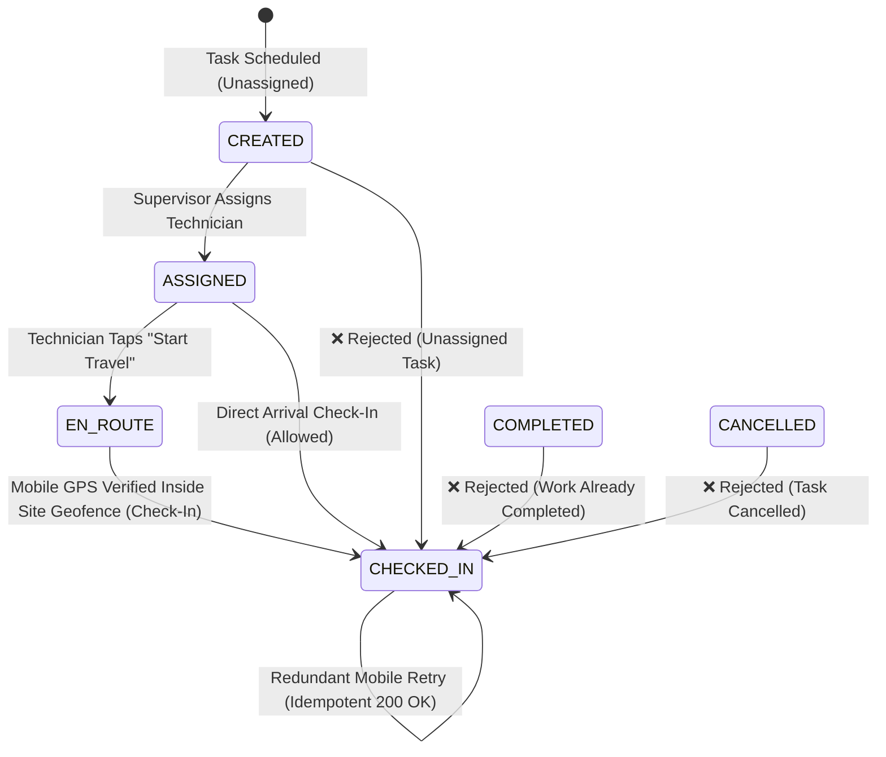
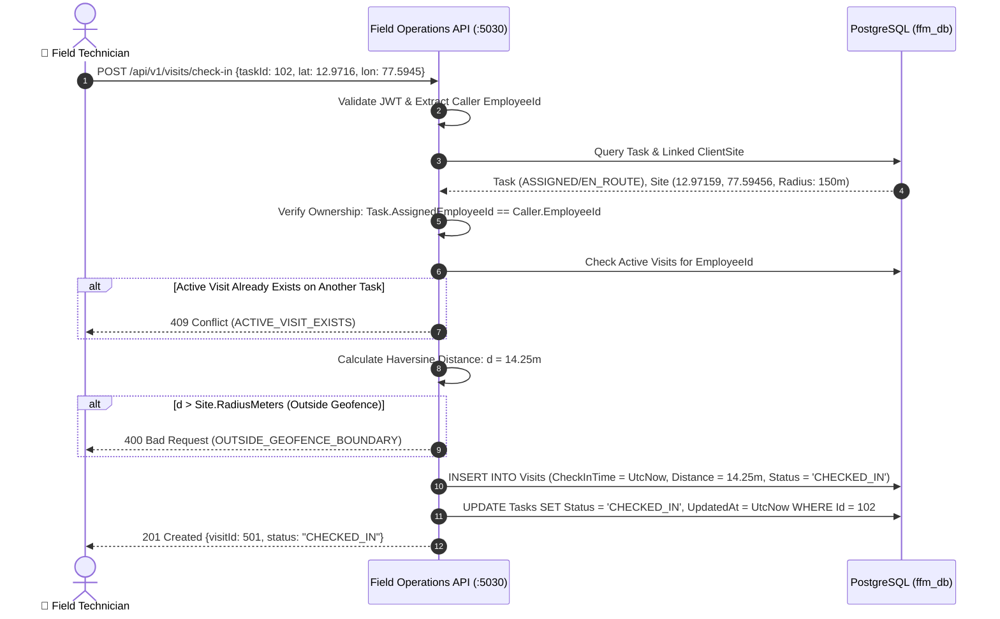

# On-Site Visit Check-In Module Specification (End-to-End Enterprise Standard)

## 1. Document Metadata

| Attribute | Detail |
| :--- | :--- |
| **Document Reference** | `FFM-SPEC-FLD-VISIT-CHECKIN-V1.0` |
| **System** | Field Force Management (FFM) Platform |
| **Service** | Field Operations Service (`FFM.FieldOperations`) |
| **Module** | Module 3: Field Visit Execution — Feature: On-Site Visit Check-In |
| **Default Port** | `5030` |
| **Method & Route** | `POST /api/v1/visits/check-in` |
| **Compliance** | ISO/IEC/IEEE 29148, OpenAPI 3.1, RFC 7807 (ProblemDetails), WGS-84 Standard |
| **Authentication** | Bearer JWT RS256 (issued by Identity & Access Service) |
| **Classification** | Tier‑1 Core Geofence Verification & Physical Presence Engine |
| **Status** | Approved Formal Specification |
| **Target Clients** | FFM Mobile App (Field Technicians) & FFM Web Portal (Supervisors/Managers) |
| **Parent Document** | `FFM_Field_Operations_Service_Spec.md`, Sections 4, 6.3, 7.5 & 8.1 |

---

## 2. Objective & Functional Scope

The **On-Site Visit Check-In** module verifies and records the physical arrival of a field technician at a client facility or work location. By comparing the mobile device's live WGS-84 GPS telemetry against the registered customer site coordinates, the system cryptographically proves on-site presence within the defined geofence boundary before permitting work execution.

```
       [Dispatched Task] (ASSIGNED / EN_ROUTE)
                │
                ▼
┌────────────────────────────────────────────────────────┐
│   ON-SITE VISIT CHECK-IN (POST /api/v1/visits/check-in)│
│  - Captures Mobile Lat/Long, Accuracy & Mock-GPS Flag  │
│  - Computes Haversine Distance to Client Site          │
│  - Enforces Geofence Radius Threshold (Default: 150m)  │
│  - Enforces Single Active Visit per Technician Guard   │
│  - Transitions Task State: EN_ROUTE ➔ CHECKED_IN       │
│  - Creates Audit-Ready Visits Record                   │
└────────────────────────────────────────────────────────┘
                │
                ▼
      [Physical On-Site Work Commences]
```

### Key Business Goals:
1. **Elimination of Phantom Visits:** Permanently stops fraudulent visit reporting by validating physical coordinates against the client site's geofence radius.
2. **Strict BOLA Defense:** Enforces that only the technician assigned to the task can execute check-in.
3. **Single Active Visit Policy:** Prevents technicians from checking in to multiple customer locations simultaneously.
4. **Zero Path Parameters Standard:** All payload inputs (`taskId`, `latitude`, `longitude`, `accuracyMeters`) are delivered strictly in the **JSON request body**.

---

## 3. Authorization & RBAC Policy

| Role | Allowed? | Enforcement & BOLA Policy |
| :--- | :---: | :--- |
| `EMPLOYEE` | ✅ Yes (Self-Only) | Technicians can check in **only** to tasks where `task.AssignedEmployeeId == Caller.EmployeeId`. Cross-technician check-in attempts return `HTTP 403 Forbidden` (`TASK_ACCESS_DENIED`). |
| `SUPERVISOR` | ✅ Yes | Authorized to execute on-site check-in on behalf of team technicians in operational exceptions (e.g., technician phone battery exhausted). |
| `MANAGER` | ✅ Yes | Authorized across all technicians in their operational branch. |
| `ADMIN` | ✅ Yes | Full global access across all organization work orders. |
| `SYSTEM_ADMIN` | ✅ Yes | Platform-wide override and administrative authority. |

* **Unauthenticated Requests:** Returns `HTTP 401 Unauthorized` (`MISSING_TOKEN` or `INVALID_TOKEN`).
* **BOLA Access Rejection:** Returns `HTTP 403 Forbidden` (`TASK_ACCESS_DENIED`).
* **Audit Trail:** Stores `EmployeeId`, `CreatedByUserId`, `CheckInTime` (UTC), `CheckInDistanceMeters`, and `IsWithinGeofence`.

---

## 4. State Transition Matrix & Lifecycle Rules

The Field Operations state machine enforces strict, non-reversible lifecycle progression:



### Lifecycle Progression Rules:
* **`EN_ROUTE` ➔ `CHECKED_IN`:** Standard operational progression. Permitted when technician GPS is within `Site.RadiusMeters`.
* **`ASSIGNED` ➔ `CHECKED_IN`:** Permitted if technician arrived directly on-site without explicitly tapping "Start Travel" (auto-advances through travel state).
* **`CREATED` ➔ `CHECKED_IN`:** **Rejected (`HTTP 400 Bad Request`)**. An unassigned task has no designated technician; assignment is mandatory.
* **`CHECKED_IN` ➔ `CHECKED_IN`:** **Idempotent (`HTTP 200 OK`)**. If network drop causes mobile retry on an already checked-in visit, returns existing visit details without creating duplicates.
* **`COMPLETED` ➔ `CHECKED_IN`:** **Rejected (`HTTP 400 Bad Request`)**. Completed work cannot re-enter active on-site status.
* **`CANCELLED` ➔ `CHECKED_IN`:** **Rejected (`HTTP 400 Bad Request`)**. Cancelled work orders cannot be checked in.

---

## 5. Geofence Verification Algorithm (Haversine Formula)

Distance calculation between the technician's mobile coordinates and the client site coordinates MUST be computed using the **Haversine Formula**, operating on the WGS-84 reference sphere:

### Mathematical Definition:
$$\Delta\phi = \frac{(\text{lat}_{\text{user}} - \text{lat}_{\text{site}}) \cdot \pi}{180}, \quad \Delta\lambda = \frac{(\text{lon}_{\text{user}} - \text{lon}_{\text{site}}) \cdot \pi}{180}$$

$$a = \sin^2\left(\frac{\Delta\phi}{2}\right) + \cos\left(\frac{\text{lat}_{\text{site}} \cdot \pi}{180}\right) \cdot \cos\left(\frac{\text{lat}_{\text{user}} \cdot \pi}{180}\right) \cdot \sin^2\left(\frac{\Delta\lambda}{2}\right)$$

$$c = 2 \cdot \text{atan2}\left(\sqrt{a}, \sqrt{1 - a}\right)$$

$$d = R \cdot c$$

Where:
* $R = 6,371,000 \text{ meters}$ (Mean Earth radius)
* $\text{lat}_{\text{site}}, \text{lon}_{\text{site}}$ = Client Site target coordinates
* $\text{lat}_{\text{user}}, \text{lon}_{\text{user}}$ = Mobile device GPS coordinates
* $d$ = Shortest geodesic distance in meters

### Decision Boundary:
$$\text{IsWithinGeofence} = 
\begin{cases} 
\text{TRUE}, & \text{if } d \le \text{Site.RadiusMeters} \\
\text{FALSE}, & \text{if } d > \text{Site.RadiusMeters}
\end{cases}$$

If $\text{IsWithinGeofence} = \text{FALSE}$, check-in is rejected with `HTTP 400 Bad Request` (`OUTSIDE_GEOFENCE_BOUNDARY`), reporting the exact distance and threshold in the response.

---

## 6. Business Rules & Validation Policies

| Rule ID | Title | Rule Description | Error Code | HTTP Status |
| :--- | :--- | :--- | :--- | :---: |
| **BR-CHK-01** | Task Existence | The target `taskId` must exist in the database. | `TASK_NOT_FOUND` | `404 Not Found` |
| **BR-CHK-02** | Active Site Guard | The task's linked `ClientSite` must exist and be active (`IsActive = true`). | `CLIENT_SITE_INACTIVE` | `400 Bad Request` |
| **BR-CHK-03** | Ownership Guard (BOLA) | If caller has role `EMPLOYEE`, `task.AssignedEmployeeId` must equal caller's employee profile ID. | `TASK_ACCESS_DENIED` | `403 Forbidden` |
| **BR-CHK-04** | Valid State For Check-In | Task must be in `ASSIGNED` or `EN_ROUTE` status to execute check-in. | `INVALID_TASK_STATE` | `400 Bad Request` |
| **BR-CHK-05** | Geofence Boundary Check | Mobile coordinates must fall within `site.RadiusMeters` (default 150m, max tolerance 5000m). | `OUTSIDE_GEOFENCE_BOUNDARY` | `400 Bad Request` |
| **BR-CHK-06** | Single Active Visit Guard | A technician cannot check in if they have another visit currently open (`CheckOutTime IS NULL`). | `ACTIVE_VISIT_EXISTS` | `409 Conflict` |
| **BR-CHK-07** | Coordinate Range Bounds | Latitude must be in $[-90.0, +90.0]$ and Longitude in $[-180.0, +180.0]$. | `INVALID_COORDINATES` | `400 Bad Request` |
| **BR-CHK-08** | Anti-Mock Location Guard | If device telemetry flags `isMockLocation = true`, check-in is rejected. | `MOCK_LOCATION_DETECTED` | `400 Bad Request` |
| **BR-CHK-09** | Server-Authoritative Time | `CheckInTime` is set exclusively by the server (`DateTime.UtcNow`); mobile client clocks are ignored. | Server Clock Guard | `201 Created` |
| **BR-CHK-10** | Zero Path Parameters | Mutation payload must be passed in JSON body (`POST /api/v1/visits/check-in`). Path parameters are prohibited. | `ROUTING_MISMATCH` | `404 Not Found` |

---

## 7. Clean Architecture Component Breakdown

The Check-In module adheres strictly to the Onion / Clean Architecture layers:

```
┌────────────────────────────────────────────────────────────────────────┐
│ 1. API Presentation Layer (Controllers)                               │
│    VisitsController.CheckIn([FromBody] VisitCheckInRequest request)   │
└───────────────────────────────────┬────────────────────────────────────┘
                                    │ Maps DTO to MediatR Command
                                    ▼
┌────────────────────────────────────────────────────────────────────────┐
│ 2. Application Layer (CQRS Commands & Handlers)                       │
│    CheckInVisitCommand                                                │
│    CheckInVisitCommandHandler                                         │
│    - Extracts caller ID & roles from ICurrentUserService              │
│    - Loads Task & ClientSite via repositories                         │
│    - Executes BOLA & State Machine validations                        │
│    - Computes Haversine distance and checks geofence boundary         │
│    - Persists Visit and transitions Task via IVisitRepository         │
└───────────────────────────────────┬────────────────────────────────────┘
                                    │ Invokes Domain Invariants
                                    ▼
┌────────────────────────────────────────────────────────────────────────┐
│ 3. Domain Model Layer (Entities & Business Logic)                     │
│    Visit.CreateCheckIn(taskId, employeeId, lat, lon, distance, isGeof)│
│    Task.TransitionToCheckIn()                                         │
│    HaversineDistanceCalculator (Value Object / Domain Service)        │
└───────────────────────────────────┬────────────────────────────────────┘
                                    │ Persists to Storage
                                    ▼
┌────────────────────────────────────────────────────────────────────────┐
│ 4. Infrastructure Layer (EF Core & PostgreSQL)                        │
│    VisitRepository.HasActiveVisitAsync(employeeId)                    │
│    VisitRepository.AddAsync(visit)                                    │
│    FieldOperationsDbContext (DbSet<Visit>, DbSet<Task>)               │
└────────────────────────────────────────────────────────────────────────┘
```

---

## 8. API Contract & Interface Specification

* **Route:** `POST /api/v1/visits/check-in`
* **Method:** `POST`
* **Authorized Roles:** `EMPLOYEE` (Assigned technician), `SUPERVISOR`, `MANAGER`, `ADMIN`, `SYSTEM_ADMIN`
* **Headers:**
  - `Authorization: Bearer <jwt_token>`
  - `Content-Type: application/json`

### 8.1 Request Payload (`VisitCheckInRequest`):
```json
{
  "taskId": 102,
  "latitude": 12.9716100,
  "longitude": 77.5945700,
  "accuracyMeters": 8.5,
  "isMockLocation": false
}
```

### 8.2 Request Field Specifications:
| Field | Type | Mandatory? | Validation Bounds | Description |
|---|:---:|:---:|---|---|
| `taskId` | Integer | **Yes** | `> 0` | Target work order identifier |
| `latitude` | Decimal | **Yes** | `-90.0000000` to `+90.0000000` | Device current WGS-84 latitude |
| `longitude` | Decimal | **Yes** | `-180.0000000` to `+180.0000000` | Device current WGS-84 longitude |
| `accuracyMeters` | Decimal | No | `>= 0.0` | GPS horizontal accuracy reported by OS |
| `isMockLocation` | Boolean | No | Must be `false` | Hardware flag detecting developer/mock GPS |

---

### 8.3 Success Response (`HTTP 201 Created`):
```json
{
  "success": true,
  "message": "Visit checked in successfully. Technician verified on-site.",
  "data": {
    "visitId": 501,
    "taskId": 102,
    "taskNumber": "TSK-TEST-0102",
    "employeeId": 12,
    "checkInTime": "2026-10-30T09:30:00Z",
    "checkInLatitude": 12.9716100,
    "checkInLongitude": 77.5945700,
    "distanceMeters": 14.25,
    "allowedRadiusMeters": 150,
    "isWithinGeofence": true,
    "status": "CHECKED_IN"
  }
}
```

---

### 8.4 Idempotent Retry Response (`HTTP 200 OK`):
If the mobile app retries the exact same check-in payload on an already checked-in visit (due to transient network timeouts):
```json
{
  "success": true,
  "message": "Visit is already active in CHECKED_IN status.",
  "data": {
    "visitId": 501,
    "taskId": 102,
    "taskNumber": "TSK-TEST-0102",
    "employeeId": 12,
    "checkInTime": "2026-10-30T09:30:00Z",
    "checkInLatitude": 12.9716100,
    "checkInLongitude": 77.5945700,
    "distanceMeters": 14.25,
    "allowedRadiusMeters": 150,
    "isWithinGeofence": true,
    "status": "CHECKED_IN"
  }
}
```

---

### 8.5 Error Responses (RFC 7807 Standard)

#### A. Outside Geofence Boundary (`HTTP 400 Bad Request`):
```json
{
  "success": false,
  "error": {
    "code": "OUTSIDE_GEOFENCE_BOUNDARY",
    "message": "Check-in rejected: You are 1,450.50 meters away from the client site. Maximum allowable radius is 150 meters.",
    "details": {
      "distanceMeters": 1450.50,
      "allowedRadiusMeters": 150,
      "siteName": "Apollo Hospital Central Kiosk"
    }
  }
}
```

#### B. Broken Object Level Authorization (`HTTP 403 Forbidden`):
```json
{
  "success": false,
  "error": {
    "code": "TASK_ACCESS_DENIED",
    "message": "You are not authorized to check in to this task. The task is assigned to another technician."
  }
}
```

#### C. Active Visit Already Open (`HTTP 409 Conflict`):
```json
{
  "success": false,
  "error": {
    "code": "ACTIVE_VISIT_EXISTS",
    "message": "Technician already has an active checked-in visit (Visit ID: 489, Task: TSK-TEST-0098). Please complete or checkout the current visit before starting a new one."
  }
}
```

#### D. Mock Location Spoofing Detected (`HTTP 400 Bad Request`):
```json
{
  "success": false,
  "error": {
    "code": "MOCK_LOCATION_DETECTED",
    "message": "Check-in rejected: Mock GPS or location simulation detected on device."
  }
}
```

---

## 9. Database Schema & Migration Script

```sql
-- Migration: Ensure Visits Table for Check-In
CREATE TABLE IF NOT EXISTS "Visits" (
    "Id" SERIAL PRIMARY KEY,
    "TaskId" INT NOT NULL REFERENCES "Tasks" ("Id") ON DELETE RESTRICT,
    "EmployeeId" INT NOT NULL,
    "CheckInTime" TIMESTAMP WITH TIME ZONE NOT NULL DEFAULT NOW(),
    "CheckInLatitude" DECIMAL(10, 7) NOT NULL,
    "CheckInLongitude" DECIMAL(10, 7) NOT NULL,
    "CheckInDistanceMeters" DECIMAL(10, 2) NOT NULL,
    "IsWithinGeofence" BOOLEAN NOT NULL DEFAULT TRUE,
    "CheckOutTime" TIMESTAMP WITH TIME ZONE NULL,
    "CheckOutLatitude" DECIMAL(10, 7) NULL,
    "CheckOutLongitude" DECIMAL(10, 7) NULL,
    "DurationMinutes" DECIMAL(8, 2) NULL,
    "CompletionNotes" TEXT NULL,
    "CustomerName" VARCHAR(100) NULL,
    "CustomerSignatureUrl" VARCHAR(500) NULL,
    "CustomerRating" INT NULL CHECK ("CustomerRating" BETWEEN 1 AND 5),
    "Status" VARCHAR(30) NOT NULL DEFAULT 'CHECKED_IN',
    "CreatedByUserId" INT NOT NULL,
    "CreatedAt" TIMESTAMP WITH TIME ZONE NOT NULL DEFAULT NOW(),
    "UpdatedAt" TIMESTAMP WITH TIME ZONE NOT NULL DEFAULT NOW()
);

-- Unique partial index enforcing single active visit per technician
CREATE UNIQUE INDEX IF NOT EXISTS "IX_Visits_ActiveEmployeeVisit" 
ON "Visits" ("EmployeeId") 
WHERE "CheckOutTime" IS NULL;

-- Relational performance indexes
CREATE INDEX IF NOT EXISTS "IX_Visits_TaskId" ON "Visits" ("TaskId");
CREATE INDEX IF NOT EXISTS "IX_Visits_CheckInTime" ON "Visits" ("CheckInTime");
```

---

## 10. Sequence Diagram: On-Site Check-In



---

## 11. Key Test Scenarios Matrix

| Test ID | Category | Scenario | Expected Result |
|:---:|---|---|:---:|
| **TC-CIN-001** | Positive | Technician checks in within 20m of site center | 201 Created, `isWithinGeofence: true` |
| **TC-CIN-002** | Positive | Technician checks in at exact boundary (149m of 150m) | 201 Created |
| **TC-CIN-003** | Positive | Idempotent check-in retry returns existing visit | 200 OK |
| **TC-CIN-004** | Positive | Supervisor executes check-in on behalf of technician | 201 Created |
| **TC-CIN-005** | Geofence | Check-in 200m away on 150m radius site | 400 Bad Request (`OUTSIDE_GEOFENCE_BOUNDARY`) |
| **TC-CIN-006** | Geofence | Check-in 5 km away from client site | 400 Bad Request (`OUTSIDE_GEOFENCE_BOUNDARY`) |
| **TC-CIN-007** | BOLA | Technician A attempts to check in to Technician B's task | 403 Forbidden (`TASK_ACCESS_DENIED`) |
| **TC-CIN-008** | BOLA | Technician attempts check-in to unassigned task | 403 Forbidden (`TASK_ACCESS_DENIED`) |
| **TC-CIN-009** | Concurrency | Technician attempts check-in while another visit is open | 409 Conflict (`ACTIVE_VISIT_EXISTS`) |
| **TC-CIN-010** | Validation | Check-in on task already `COMPLETED` | 400 Bad Request (`INVALID_TASK_STATE`) |
| **TC-CIN-011** | Validation | Mock GPS detected (`isMockLocation = true`) | 400 Bad Request (`MOCK_LOCATION_DETECTED`) |
| **TC-CIN-012** | Routing | Invocations with path params (`POST /api/v1/visits/102/check-in`) | 404 Not Found (Zero Path Param standard) |
