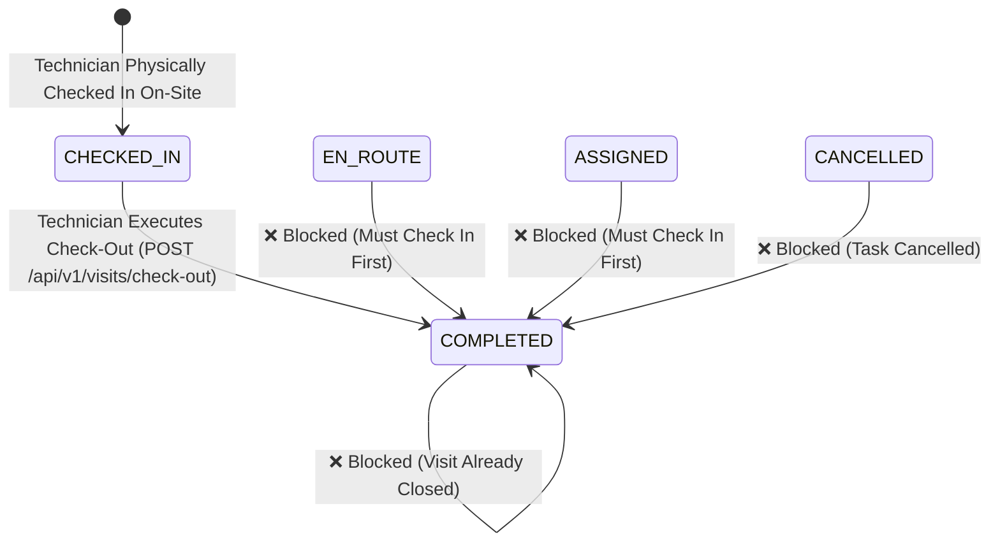
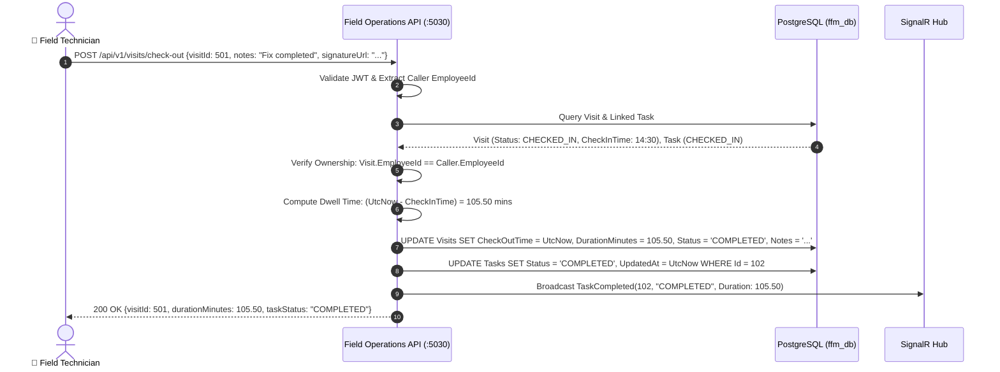

# On-Site Visit Check-Out Module Specification

## 1. Document Metadata

| Attribute | Detail |
| :--- | :--- |
| **Document Reference** | `FFM-SPEC-FLD-VISIT-CHECKOUT-V1.0` |
| **System** | Field Force Management (FFM) Platform |
| **Service** | Field Operations Service (`FFM.FieldOperations`) |
| **Module** | Module 3: Field Visit Execution — Feature: On-Site Visit Check-Out |
| **Default Port** | `5030` |
| **Method & Route** | `POST /api/v1/visits/check-out` |
| **Compliance** | ISO/IEC/IEEE 29148, OpenAPI 3.1, RFC 7807 (ProblemDetails), WGS-84 Standard |
| **Authentication** | Bearer JWT RS256 (issued by Identity & Access Service) |
| **Classification** | Tier‑1 Core Revenue, SLA & Work Completion Engine |
| **Status** | Approved Formal Specification |
| **Target Clients** | FFM Mobile App (Field Technicians) & FFM Web Portal (Supervisors/Managers) |
| **Parent Document** | `FFM_Field_Operations_Service_Spec.md`, Sections 4, 6.3, 7.6 & 8.1 |

---

## 2. Objective & Functional Scope

The **On-Site Visit Check-Out** module closes out active field operations by recording task resolution, capturing customer proof-of-service (digital signature and customer satisfaction rating), calculating server-authoritative billable on-site dwell time, and transitioning the work order to its final **`COMPLETED`** state.

```
       [Active On-Site Work] (CHECKED_IN)
                │
                ▼
┌────────────────────────────────────────────────────────┐
│  ON-SITE VISIT CHECK-OUT (POST /api/v1/visits/check-out│
│  - Captures Departure Telemetry (Lat/Long)             │
│  - Captures Mandatory Resolution Remarks (5-1000 chars)│
│  - Captures Customer Name & Digital Signature URL      │
│  - Captures Customer Satisfaction Rating (1 to 5)      │
│  - Computes Precise On-Site Dwell Time (Minutes)       │
│  - Transitions Task State: CHECKED_IN ➔ COMPLETED      │
│  - Closes Visit: Sets CheckOutTime & Status=COMPLETED  │
└────────────────────────────────────────────────────────┘
                │
                ▼
   [Work Order Closed & Audit-Ready for Invoicing]
```

### Key Business Goals:
1. **Accurate Billable Dwell Time:** Server-side calculation of exact on-site duration (`CheckOutTime - CheckInTime`) eliminating manual timesheet inflation.
2. **Tamper-Resistant Sign-Off:** Captures digital signature URL and customer contact name verifying work satisfaction.
3. **Task Completion State Guard:** Formally transitions work orders to `COMPLETED`, locking them against further modifications or reassignments.
4. **BOLA Ownership Defense:** Restricts checkout to the technician who owns the active visit or authorized dispatch supervisors.
5. **Zero Path Parameters Standard:** All payload inputs (`visitId`, `latitude`, `longitude`, `completionNotes`, `customerName`, `customerSignatureUrl`, `customerRating`) are passed in the **JSON request body**.

---

## 3. Authorization & RBAC Policy

| Role | Allowed? | Enforcement & BOLA Policy |
| :--- | :---: | :--- |
| `EMPLOYEE` | ✅ Yes (Self-Only) | Technicians can check out **only** visits where `visit.EmployeeId == Caller.EmployeeId`. Attempts to checkout another technician's visit return `HTTP 403 Forbidden` (`TASK_ACCESS_DENIED`). |
| `SUPERVISOR` | ✅ Yes | Authorized to check out visits on behalf of supervised technicians (e.g., technician dispatched to next emergency without phone access). |
| `MANAGER` | ✅ Yes | Authorized across all visits in their organizational branch. |
| `ADMIN` | ✅ Yes | Global checkout authority across the organization. |
| `SYSTEM_ADMIN` | ✅ Yes | Platform-wide administrative authority. |

* **Unauthenticated Requests:** Returns `HTTP 401 Unauthorized` (`MISSING_TOKEN` or `INVALID_TOKEN`).
* **BOLA Access Rejection:** Returns `HTTP 403 Forbidden` (`TASK_ACCESS_DENIED`).
* **Audit Trail:** Stores `CheckOutTime` (UTC), `DurationMinutes`, `CompletionNotes`, `CustomerName`, `CustomerSignatureUrl`, and `CustomerRating`.

---

## 4. State Transition Matrix & Lifecycle Rules

The Field Operations state machine enforces strict, non-reversible lifecycle progression:



### Lifecycle Progression Rules:
* **`CHECKED_IN` ➔ `COMPLETED`:** Standard completion transition upon valid checkout request.
* **`COMPLETED` ➔ `COMPLETED`:** **Rejected (`HTTP 400 Bad Request`)**. An already closed visit cannot be checked out again.
* **`EN_ROUTE` ➔ `COMPLETED`:** **Rejected (`HTTP 400 Bad Request`)**. Cannot complete work without on-site check-in verification.
* **`ASSIGNED` ➔ `COMPLETED`:** **Rejected (`HTTP 400 Bad Request`)**. Direct completion without on-site presence is strictly blocked.
* **`CANCELLED` ➔ `COMPLETED`:** **Rejected (`HTTP 400 Bad Request`)**. Cancelled work orders cannot be checked out.

---

## 5. Dwell Time Calculation Algorithm

The duration of the on-site visit is calculated exclusively on the server using authoritative UTC timestamps:

### Mathematical Definition:
$$\Delta t_{\text{seconds}} = \text{CheckOutTime}_{\text{UTC}} - \text{CheckInTime}_{\text{UTC}}$$

$$\text{DurationMinutes} = \text{Round}\left(\frac{\Delta t_{\text{seconds}}}{60}, 2\right)$$

### Clock Skew Defense:
* Client device clocks are ignored. Both `CheckInTime` and `CheckOutTime` are generated via `DateTime.UtcNow` on the database server.
* If $\Delta t_{\text{seconds}} < 0$ (theoretical anomaly), the transaction aborts with `HTTP 400 Bad Request` (`INVALID_DURATION`).

---

## 6. Business Rules & Validation Policies

| Rule ID | Title | Rule Description | Error Code | HTTP Status |
| :--- | :--- | :--- | :--- | :---: |
| **BR-CO-01** | Visit Existence | The target `visitId` must exist in the database. | `VISIT_NOT_FOUND` | `404 Not Found` |
| **BR-CO-02** | Visit State Guard | Check-out can only be executed on visits in `CHECKED_IN` status (`CheckOutTime IS NULL`). | `VISIT_ALREADY_CLOSED` | `400 Bad Request` |
| **BR-CO-03** | Task State Guard | The associated task must currently be in `CHECKED_IN` status. | `INVALID_TASK_STATE` | `400 Bad Request` |
| **BR-CO-04** | Ownership Guard (BOLA) | If caller has role `EMPLOYEE`, `visit.EmployeeId` must equal caller's employee profile ID. | `TASK_ACCESS_DENIED` | `403 Forbidden` |
| **BR-CO-05** | Mandatory Resolution Notes | Field resolution notes must be provided (`5` to `1000` characters, non-whitespace). | `COMPLETION_NOTES_REQUIRED` | `400 Bad Request` |
| **BR-CO-06** | Customer Name Length | If provided, `customerName` cannot exceed 100 characters. | `VALIDATION_ERROR` | `400 Bad Request` |
| **BR-CO-07** | Signature URL Bounds | If provided, `customerSignatureUrl` must be a valid URL and not exceed 500 characters. | `VALIDATION_ERROR` | `400 Bad Request` |
| **BR-CO-08** | Customer Rating Bounds | If provided, `customerRating` must be an integer between `1` and `5` inclusive. | `VALIDATION_ERROR` | `400 Bad Request` |
| **BR-CO-09** | Departure Coordinates | Latitude must be in $[-90.0, +90.0]$ and Longitude in $[-180.0, +180.0]$. | `INVALID_COORDINATES` | `400 Bad Request` |
| **BR-CO-10** | Zero Path Parameters | All checkout payload data must be passed in the JSON body (`POST /api/v1/visits/check-out`). | `ROUTING_MISMATCH` | `404 Not Found` |

---

## 7. API Contract & Interface Specification

* **Route:** `POST /api/v1/visits/check-out`
* **Method:** `POST`
* **Authorized Roles:** `EMPLOYEE` (Assigned technician), `SUPERVISOR`, `MANAGER`, `ADMIN`, `SYSTEM_ADMIN`
* **Headers:**
  - `Authorization: Bearer <jwt_token>`
  - `Content-Type: application/json`

### 7.1 Request Payload (`VisitCheckOutRequest`):
```json
{
  "visitId": 501,
  "latitude": 12.9716050,
  "longitude": 77.5945650,
  "completionNotes": "Replaced faulty biometric scanner module and tested terminal connectivity with central switch. All diagnostics passed green.",
  "customerName": "Ramesh Kumar",
  "customerSignatureUrl": "https://storage.ffm.example.com/signatures/sig_501.png",
  "customerRating": 5
}
```

### 7.2 Request Field Specifications:
| Field | Type | Mandatory? | Validation Bounds | Description |
|---|:---:|:---:|---|---|
| `visitId` | Integer | **Yes** | `> 0` | ID of the active visit record |
| `latitude` | Decimal | **Yes** | `-90.0000000` to `+90.0000000` | Device current WGS-84 latitude at departure |
| `longitude` | Decimal | **Yes** | `-180.0000000` to `+180.0000000` | Device current WGS-84 longitude at departure |
| `completionNotes` | String | **Yes** | `5` to `1000` chars | Work resolution and technical remarks |
| `customerName` | String | No | Max `100` chars | On-site client representative sign-off name |
| `customerSignatureUrl` | String | No | Max `500` chars, URL | Cloud storage URL of digital signature capture |
| `customerRating` | Integer | No | `1` to `5` | Optional on-site customer satisfaction rating |

---

### 7.3 Success Response (`HTTP 200 OK`):
```json
{
  "success": true,
  "message": "Visit checked out successfully. Task marked COMPLETED.",
  "data": {
    "visitId": 501,
    "taskId": 102,
    "taskNumber": "TSK-TEST-0102",
    "checkInTime": "2026-10-28T14:30:00Z",
    "checkOutTime": "2026-10-28T16:15:30Z",
    "durationMinutes": 105.50,
    "taskStatus": "COMPLETED",
    "completionNotes": "Replaced faulty biometric scanner module and tested terminal connectivity with central switch. All diagnostics passed green.",
    "customerName": "Ramesh Kumar",
    "customerSignatureUrl": "https://storage.ffm.example.com/signatures/sig_501.png",
    "customerRating": 5,
    "updatedAt": "2026-10-28T16:15:30Z"
  }
}
```

---

### 7.4 Error Responses

#### A. Visit Already Checked Out (`HTTP 400 Bad Request`):
```json
{
  "success": false,
  "error": {
    "code": "VISIT_ALREADY_CLOSED",
    "message": "This visit has already been checked out at 2026-10-28T16:15:30Z. Duplicate checkout is not permitted."
  }
}
```

#### B. Broken Object Level Authorization (`HTTP 403 Forbidden`):
```json
{
  "success": false,
  "error": {
    "code": "TASK_ACCESS_DENIED",
    "message": "You are not authorized to check out this visit. The visit is assigned to another technician."
  }
}
```

#### C. Validation Error — Notes Too Short (`HTTP 400 Bad Request`):
```json
{
  "type": "https://tools.ietf.org/html/rfc9110#section-15.5.1",
  "title": "One or more validation errors occurred.",
  "status": 400,
  "errors": {
    "CompletionNotes": ["Completion notes must be at least 5 characters long."]
  }
}
```

#### D. Non-Existent Visit (`HTTP 404 Not Found`):
```json
{
  "success": false,
  "error": {
    "code": "VISIT_NOT_FOUND",
    "message": "Visit with ID 999999 was not found."
  }
}
```

---

## 8. Database Schema & Migration Script

```sql
-- Migration: Ensure Visits Table Supports Check-Out Fields
CREATE TABLE IF NOT EXISTS "Visits" (
    "Id" SERIAL PRIMARY KEY,
    "TaskId" INT NOT NULL REFERENCES "Tasks" ("Id") ON DELETE RESTRICT,
    "EmployeeId" INT NOT NULL,
    "CheckInTime" TIMESTAMP WITH TIME ZONE NOT NULL DEFAULT NOW(),
    "CheckInLatitude" DECIMAL(10, 7) NOT NULL,
    "CheckInLongitude" DECIMAL(10, 7) NOT NULL,
    "CheckInDistanceMeters" DECIMAL(10, 2) NOT NULL,
    "IsWithinGeofence" BOOLEAN NOT NULL DEFAULT TRUE,
    "CheckOutTime" TIMESTAMP WITH TIME ZONE NULL,
    "CheckOutLatitude" DECIMAL(10, 7) NULL,
    "CheckOutLongitude" DECIMAL(10, 7) NULL,
    "DurationMinutes" DECIMAL(8, 2) NULL,
    "CompletionNotes" TEXT NULL,
    "CustomerName" VARCHAR(100) NULL,
    "CustomerSignatureUrl" VARCHAR(500) NULL,
    "CustomerRating" INT NULL CHECK ("CustomerRating" BETWEEN 1 AND 5),
    "Status" VARCHAR(30) NOT NULL DEFAULT 'CHECKED_IN',
    "CreatedByUserId" INT NOT NULL,
    "CreatedAt" TIMESTAMP WITH TIME ZONE NOT NULL DEFAULT NOW(),
    "UpdatedAt" TIMESTAMP WITH TIME ZONE NOT NULL DEFAULT NOW()
);

-- Indexing for checkout status and duration queries
CREATE INDEX IF NOT EXISTS "IX_Visits_CheckOutTime" ON "Visits" ("CheckOutTime");
CREATE INDEX IF NOT EXISTS "IX_Visits_Status" ON "Visits" ("Status");
```

---

## 9. Sequence Diagram: On-Site Check-Out



---

## 10. Key Test Scenarios Matrix

| Test ID | Category | Scenario | Expected Result |
|:---:|---|---|:---:|
| **TC-COT-001** | Positive | Technician checks out with 150-char detailed notes | 200 OK, Task `COMPLETED` |
| **TC-COT-002** | Positive | Check-out with customer signature URL and name | 200 OK, signature saved |
| **TC-COT-003** | Positive | Check-out with customer rating (5 stars) | 200 OK, rating recorded |
| **TC-COT-004** | Positive | Supervisor executes check-out on behalf of technician | 200 OK, supervisor audit recorded |
| **TC-COT-005** | State Guard | Check-out attempt on visit already closed (`CheckOutTime != null`) | 400 Bad Request (`VISIT_ALREADY_CLOSED`) |
| **TC-COT-006** | State Guard | Check-out attempt on task currently in `EN_ROUTE` | 400 Bad Request (`INVALID_TASK_STATE`) |
| **TC-COT-007** | BOLA | Technician A attempts to check out Technician B's visit | 403 Forbidden (`TASK_ACCESS_DENIED`) |
| **TC-COT-008** | Validation | Check-out with empty resolution notes (`""`) | 400 Bad Request (`COMPLETION_NOTES_REQUIRED`) |
| **TC-COT-009** | Validation | Check-out with notes < 5 characters (`"Fix"`) | 400 Bad Request (`COMPLETION_NOTES_REQUIRED`) |
| **TC-COT-010** | Validation | Check-out with notes > 1000 characters | 400 Bad Request (`VALIDATION_ERROR`) |
| **TC-COT-011** | Validation | Customer rating outside 1..5 range (`6`) | 400 Bad Request (`VALIDATION_ERROR`) |
| **TC-COT-012** | Routing | Invocations with path params (`POST /api/v1/visits/501/check-out`) | 404 Not Found (Zero Path Param standard) |
