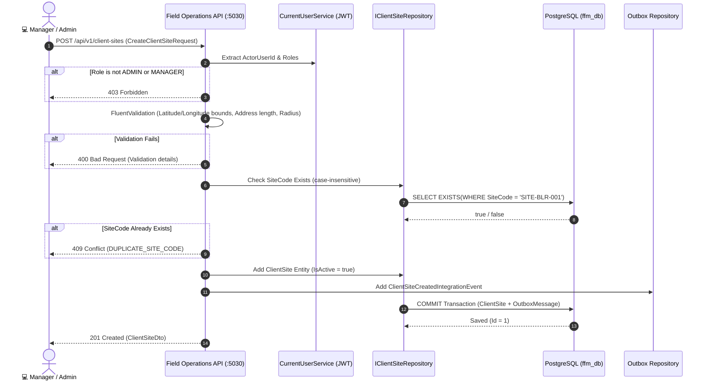

# Register Client Site Module Specification

## 1. Document Metadata

| Attribute | Detail |
| :--- | :--- |
| **Document Reference** | `FFM-SPEC-FLD-REGISTER-SITE-V1.0` |
| **System** | Field Force Management (FFM) Platform |
| **Service** | Field Operations Service (`FFM.FieldOperations`) |
| **Module** | Client Site & Geofence Directory — Register Client Site |
| **Compliance** | ISO/IEC/IEEE 29148, OpenAPI 3.1, RFC 7807 (ProblemDetails) |
| **Authentication** | Bearer JWT RS256 (issued by Identity & Access Service) |
| **Classification** | Tier‑1 Core Operational Setup |
| **Status** | Approved Formal Specification |

---

## 2. Objective & Functional Scope

The **Register Client Site** module enables managers, dispatchers, and administrators to register physical client destinations, customer premises, branch offices, service centers, and project sites where field tasks and technician visits take place.

Every registered client site defines an authoritative **geofence boundary** (Latitude, Longitude, and Radius in meters). When field personnel later visit this site, the system verifies their live mobile GPS against these registered coordinates before permitting task check-in.

### Key Capabilities:
1. **Site Profile Registration:** Captures customer/site identity (`SiteCode`, `Name`, `Address`, contact details).
2. **Geofence Boundary Configuration:** Stores validated GPS coordinates (`Latitude`, `Longitude`) and an allowable on-site proximity radius (`RadiusMeters`, default 150m).
3. **Uniqueness Enforcement:** Guaranteed unique `SiteCode` per site to prevent duplication.
4. **Geographic Coordinate Validation:** Rejects invalid, out-of-range, or default null coordinates (e.g. `(0.0, 0.0)`).
5. **Event Emission:** Produces a `ClientSiteCreatedIntegrationEvent` via the Outbox pattern for downstream consumers (e.g., GPS Service, Dispatcher Map, Reporting).

---

## 3. Authorization & RBAC Policy

| Role | Allowed? | Enforcement |
| :--- | :---: | :--- |
| `SYSTEM_ADMIN` |  Yes | Full site creation and configuration privileges. |
| `ADMIN` |  Yes | Full site creation within the tenant. |
| `MANAGER` |  Yes | Permitted to register customer sites for their assigned zones/teams. |
| `SUPERVISOR` |  No | View-only; prohibited from registering new customer sites (HTTP 403 Forbidden). |
| `EMPLOYEE` |  No | Prohibited; field technicians do not register sites (HTTP 403 Forbidden). |

* **Unauthenticated Requests:** Returns `401 Unauthorized`.
* **Insufficient Role:** Returns `403 Forbidden`.
* **CreatedBy Audit Trail:** The `CreatedByUserId` is derived securely from the authenticated JWT claims (`sub` or `userId`), never trusted from the client payload.

---

## 4. Business Rules & Validation Policies

| Rule ID | Title | Rule Description | Error Code |
| :--- | :--- | :--- | :--- |
| **BR-SITE-01** | Unique Site Code | `SiteCode` must be unique across all sites (case-insensitive). Duplicate codes are rejected. | `DUPLICATE_SITE_CODE` (HTTP 409) |
| **BR-SITE-02** | Valid GPS Latitude Range | `Latitude` must be a valid decimal number between `-90.0` and `+90.0` inclusive. | `INVALID_LATITUDE` (HTTP 400) |
| **BR-SITE-03** | Valid GPS Longitude Range | `Longitude` must be a valid decimal number between `-180.0` and `+180.0` inclusive. | `INVALID_LONGITUDE` (HTTP 400) |
| **BR-SITE-04** | Null Island Defense | Latitude and Longitude cannot both be `0.0000000` (Null Island placeholder protection). | `INVALID_COORDINATES` (HTTP 400) |
| **BR-SITE-05** | Geofence Radius Bounds | `RadiusMeters` must be an integer between `20` and `1,000` meters. Default is `150m` if omitted. | `INVALID_GEOFENCE_RADIUS` (HTTP 400) |
| **BR-SITE-06** | Mandatory Contact Info | `ContactPhone` must conform to standard international E.164 or national 10-15 digit formats. | `INVALID_PHONE_NUMBER` (HTTP 400) |
| **BR-SITE-07** | Address Completeness | `Address` must not be blank and must contain at least 10 characters (street, building, landmark). | `ADDRESS_TOO_SHORT` (HTTP 400) |
| **BR-SITE-08** | Initial Status | All newly registered client sites default to `IsActive = true`. | Automated on creation. |

---

## 5. Domain Model & Database Schema

### 5.1 Domain Entity: `ClientSite`
```csharp
public class ClientSite
{
    public int Id { get; private set; }
    public string SiteCode { get; private set; } = default!;
    public string Name { get; private set; } = default!;
    public string? ContactPerson { get; private set; }
    public string? ContactPhone { get; private set; }
    public string? ContactEmail { get; private set; }
    public decimal Latitude { get; private set; }
    public decimal Longitude { get; private set; }
    public int RadiusMeters { get; private set; }
    public string Address { get; private set; } = default!;
    public string? City { get; private set; }
    public string? State { get; private set; }
    public string? PostalCode { get; private set; }
    public bool IsActive { get; private set; }
    public int CreatedByUserId { get; private set; }
    public DateTime CreatedAt { get; private set; }
    public DateTime UpdatedAt { get; private set; }
}
```

### 5.2 PostgreSQL Table Definition (`ClientSites`)
```sql
CREATE TABLE "ClientSites" (
    "Id" SERIAL PRIMARY KEY,
    "SiteCode" VARCHAR(50) NOT NULL,
    "Name" VARCHAR(150) NOT NULL,
    "ContactPerson" VARCHAR(100) NULL,
    "ContactPhone" VARCHAR(30) NULL,
    "ContactEmail" VARCHAR(150) NULL,
    "Latitude" DECIMAL(10, 7) NOT NULL,
    "Longitude" DECIMAL(10, 7) NOT NULL,
    "RadiusMeters" INT NOT NULL DEFAULT 150,
    "Address" VARCHAR(300) NOT NULL,
    "City" VARCHAR(100) NULL,
    "State" VARCHAR(100) NULL,
    "PostalCode" VARCHAR(20) NULL,
    "IsActive" BOOLEAN NOT NULL DEFAULT TRUE,
    "CreatedByUserId" INT NOT NULL,
    "CreatedAt" TIMESTAMP WITH TIME ZONE NOT NULL DEFAULT NOW(),
    "UpdatedAt" TIMESTAMP WITH TIME ZONE NOT NULL DEFAULT NOW()
);

-- Unique index for SiteCode (case-insensitive)
CREATE UNIQUE INDEX "IX_ClientSites_SiteCode_Upper" ON "ClientSites" (UPPER("SiteCode"));

-- Spatial/coordinate index for location search
CREATE INDEX "IX_ClientSites_Coordinates" ON "ClientSites" ("Latitude", "Longitude");

-- Active status index for filtering
CREATE INDEX "IX_ClientSites_IsActive" ON "ClientSites" ("IsActive");
```

---

## 6. API Contract: Register Client Site

### 6.1 Endpoint Specification
* **HTTP Method:** `POST`
* **Route:** `/api/v1/client-sites`
* **Content-Type:** `application/json`
* **Authorization:** `Bearer <JWT>` (Required Roles: `ADMIN`, `SYSTEM_ADMIN`, `MANAGER`)

### 6.2 Request Payload (`CreateClientSiteRequest`)
```json
{
  "siteCode": "SITE-BLR-001",
  "name": "HDFC Bank Regional Office",
  "contactPerson": "Ramesh Kumar",
  "contactPhone": "+919876543210",
  "contactEmail": "ramesh.kumar@hdfcbank.com",
  "latitude": 12.9715987,
  "longitude": 77.5945627,
  "radiusMeters": 150,
  "address": "42 MG Road, Ashok Nagar",
  "city": "Bengaluru",
  "state": "Karnataka",
  "postalCode": "560001"
}
```

#### Field Specifications:
| Field | Type | Required | Default | Validation Rules |
| :--- | :---: | :---: | :---: | :--- |
| `siteCode` | `string` |  Yes | - | 3–50 chars, alphanumeric + hyphens/underscores. Must be unique. |
| `name` | `string` |  Yes | - | 2–150 chars. Descriptive name of customer or facility. |
| `contactPerson` | `string` | No | `null` | Max 100 chars. Name of on-site manager or contact. |
| `contactPhone` | `string` | No | `null` | 10–30 chars. Valid international or national phone format. |
| `contactEmail` | `string` | No | `null` | Valid email syntax if provided. |
| `latitude` | `decimal` |  Yes | - | `-90.0000000` to `+90.0000000`. |
| `longitude` | `decimal` |  Yes | - | `-180.0000000` to `+180.0000000`. |
| `radiusMeters` | `int` | No | `150` | `20` to `1000` meters. Geofence boundary radius. |
| `address` | `string` |  Yes | - | 10–300 chars. Full physical address. |
| `city` | `string` | No | `null` | Max 100 chars. |
| `state` | `string` | No | `null` | Max 100 chars. |
| `postalCode` | `string` | No | `null` | Max 20 chars. |

---

### 6.3 Success Response (HTTP 201 Created)
```json
{
  "success": true,
  "message": "Client site registered successfully.",
  "data": {
    "id": 1,
    "siteCode": "SITE-BLR-001",
    "name": "HDFC Bank Regional Office",
    "contactPerson": "Ramesh Kumar",
    "contactPhone": "+919876543210",
    "contactEmail": "ramesh.kumar@hdfcbank.com",
    "latitude": 12.9715987,
    "longitude": 77.5945627,
    "radiusMeters": 150,
    "address": "42 MG Road, Ashok Nagar",
    "city": "Bengaluru",
    "state": "Karnataka",
    "postalCode": "560001",
    "isActive": true,
    "createdAt": "2026-10-21T15:50:00Z"
  },
  "error": null,
  "timestamp": "2026-10-21T15:50:00.125Z"
}
```

---

### 6.4 Error Responses

#### A. HTTP 409 Conflict (Duplicate Site Code)
```json
{
  "success": false,
  "message": "A client site with code 'SITE-BLR-001' already exists.",
  "data": null,
  "error": {
    "code": "DUPLICATE_SITE_CODE",
    "details": "Client site code must be unique."
  },
  "timestamp": "2026-10-21T15:50:00.150Z"
}
```

#### B. HTTP 400 Bad Request (Invalid Coordinates)
```json
{
  "success": false,
  "message": "Validation failed.",
  "data": null,
  "error": {
    "code": "INVALID_COORDINATES",
    "details": "Latitude must be between -90.0 and +90.0, and Longitude must be between -180.0 and +180.0."
  },
  "timestamp": "2026-10-21T15:50:00.150Z"
}
```

#### C. HTTP 403 Forbidden (Insufficient Role)
```json
{
  "success": false,
  "message": "You do not have permission to register client sites.",
  "data": null,
  "error": {
    "code": "FORBIDDEN",
    "details": "Only Admins and Managers are authorized to register client sites."
  },
  "timestamp": "2026-10-21T15:50:00.150Z"
}
```

---

## 7. Sequence Diagram



---

## 8. Test Cases & Verification Scenarios

| Test ID | Scenario | Input | Expected Output |
| :--- | :--- | :--- | :--- |
| **TC-SITE-01** | Successful Registration | Valid payload with coordinates `(12.9715987, 77.5945627)` and radius `150` | `201 Created`, returns generated `id` and `isActive: true`. |
| **TC-SITE-02** | Duplicate Code Prevention | Attempt registering existing `SiteCode = "SITE-BLR-001"` | `409 Conflict` (`DUPLICATE_SITE_CODE`). |
| **TC-SITE-03** | Invalid Latitude (> 90.0) | `latitude = 95.12345` | `400 Bad Request` (`INVALID_LATITUDE`). |
| **TC-SITE-04** | Invalid Longitude (< -180.0) | `longitude = -185.00` | `400 Bad Request` (`INVALID_LONGITUDE`). |
| **TC-SITE-05** | Null Island Defense | `latitude = 0.0, longitude = 0.0` | `400 Bad Request` (`INVALID_COORDINATES`). |
| **TC-SITE-06** | Radius Boundary Check | `radiusMeters = 10` (below minimum 20m) | `400 Bad Request` (`INVALID_GEOFENCE_RADIUS`). |
| **TC-SITE-07** | Non-Admin/Manager Call | Caller with role `EMPLOYEE` | `403 Forbidden`. |
