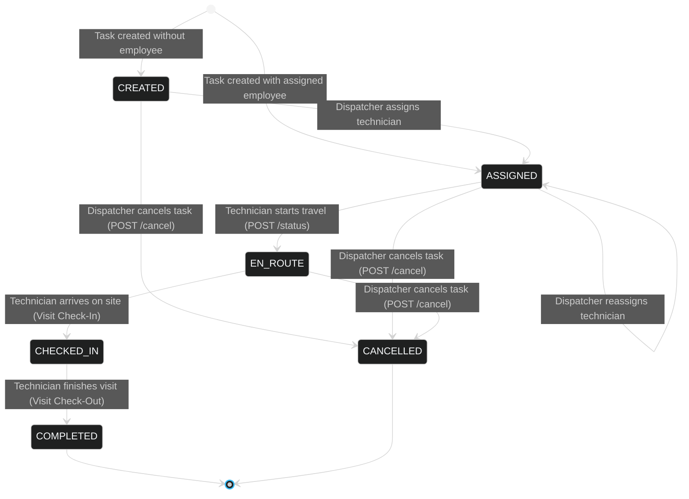
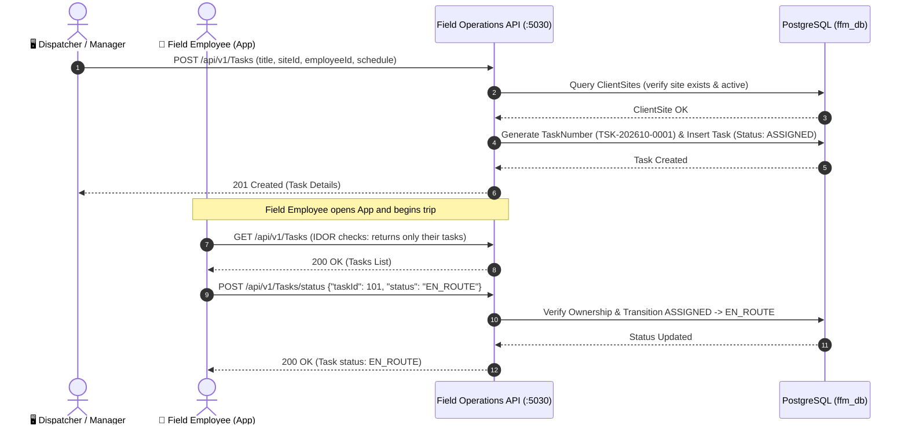

# Task Dispatch & Work Order Management Module Specification

## 1. Document Metadata

| Attribute | Detail |
| :--- | :--- |
| **Document Reference** | `FFM-SPEC-FLD-TASK-DISPATCH-V1.0` |
| **System** | Field Force Management (FFM) Platform |
| **Service** | Field Operations Service (`FFM.FieldOperations`) |
| **Module** | Module 2: Task Dispatch & Work Order Management |
| **Default Port** | `5030` |
| **Compliance** | ISO/IEC/IEEE 29148, OpenAPI 3.1, RFC 7807 (ProblemDetails) |
| **Authentication** | Bearer JWT RS256 (Asymmetric key issued by Identity & Access Service) |
| **Classification** | Tier‑1 Core Operational & Dispatch Engine |
| **Status** | Approved Formal Specification |
| **Parent Document** | `FFM_Field_Operations_Service_Spec.md`, Sections 4, 6.2, 7.2–7.4, 7.8 |

---

## 2. Objective & Functional Scope

The **Task Dispatch & Work Order Management** module orchestrates the core operational lifecycle of field work orders. It bridges task planning, job scheduling, technician dispatching, transit tracking (`EN_ROUTE`), and task cancellation.

Every task represents an actionable job order (e.g., equipment repair, maintenance check, meter inspection, client delivery) anchored to a verified **Client Site** (from Module 1) and scheduled within a specific time window.

### Key Capabilities:
1. **Task Scheduling & Work Order Generation:** Creates tasks with an auto-generated unique business identifier (`TaskNumber`, e.g., `TSK-202610-0001`), linking them to a target Client Site, description, priority, and scheduled time window (`ScheduledStart` to `ScheduledEnd`).
2. **Technician Allocation & Dispatching:** Enables dispatchers to assign tasks immediately upon creation or defer assignment. Supports reassignment of unstarted jobs with automated audit trails.
3. **Task Lifecycle State Machine:** Governs strict unidirectional status progressions:
   $$\text{CREATED} \longrightarrow \text{ASSIGNED} \longrightarrow \text{EN_ROUTE} \longrightarrow \text{CHECKED\_IN} \longrightarrow \text{COMPLETED}$$
   $$\text{or } \text{CANCELLED (from CREATED, ASSIGNED, or EN\_ROUTE)}$$
4. **Transit Tracking (`EN_ROUTE`):** Allows field employees to signal departure from their mobile device, alerting supervisors that the technician is actively traveling toward the client site.
5. **Role-Scoped Querying & IDOR Protection:** Empowers supervisors/dispatchers to view all team tasks across zones, while field employees are strictly constrained to view only work orders assigned to their authenticated user ID.
6. **Cancellation Guard:** Permits aborting scheduled tasks with mandatory business reason logging, preventing cancellation once a technician has physically checked in on-site.
7. **Zero Path Parameter Standard:** Strictly complies with platform architectural conventions—all action and mutation requests pass record identifiers (`taskId`) exclusively via the **JSON request body** (`POST` / `PUT`).

---

## 3. Authorization & RBAC Policy

| Endpoint | Role: `ADMIN` / `SYSTEM_ADMIN` | Role: `MANAGER` | Role: `SUPERVISOR` | Role: `EMPLOYEE` |
| :--- | :---: | :---: | :---: | :---: |
| `POST /api/v1/tasks` (Create Task) | ✅ Allowed | ✅ Allowed | ✅ Allowed | ❌ Forbidden (403) |
| `GET /api/v1/tasks` (Query Tasks) | ✅ Full Access | ✅ Team / All | ✅ Team / All | 🔒 Own Tasks Only (IDOR Scoped) |
| `POST /api/v1/tasks/assign` (Assign / Reassign) | ✅ Allowed | ✅ Allowed | ✅ Allowed | ❌ Forbidden (403) |
| `POST /api/v1/tasks/status` (Update Status) | ✅ Allowed | ✅ Allowed | ✅ Allowed | ✅ Allowed (Assigned Task Only) |
| `POST /api/v1/tasks/cancel` (Cancel Task) | ✅ Allowed | ✅ Allowed | ✅ Allowed | ❌ Forbidden (403) |

* **Unauthenticated Requests:** Returns `401 Unauthorized`.
* **Insufficient Role:** Returns `403 Forbidden`.
* **IDOR Protection:** When an authenticated user has role `EMPLOYEE`, the system ignores any client-supplied `employeeId` query parameter and overrides it with the caller's JWT `sub` / `userId`. Querying another employee's tasks returns `403 Forbidden`.

---

## 4. Business Rules & Validation Policies

| Rule ID | Title | Rule Description | Error Code | HTTP |
| :--- | :--- | :--- | :--- | :---: |
| **BR-TSK-01** | Client Site Verification | `ClientSiteId` must reference an existing and active (`IsActive = true`) record in `ClientSites`. | `CLIENT_SITE_NOT_FOUND` | `404` |
| **BR-TSK-02** | Schedule Chronology | `ScheduledEnd` must be strictly later than `ScheduledStart`. | `INVALID_SCHEDULE_RANGE` | `400` |
| **BR-TSK-03** | Schedule Non-Retrospective | `ScheduledStart` cannot be set more than 24 hours in the past. | `SCHEDULE_CANNOT_BE_PAST` | `400` |
| **BR-TSK-04** | Title Completeness | `Title` must be between `5` and `200` characters, non-blank. | `INVALID_TITLE` | `400` |
| **BR-TSK-05** | Priority Bounds | `Priority` must be one of: `LOW`, `MEDIUM`, `HIGH`, `URGENT` (case-insensitive). Defaults to `MEDIUM`. | `INVALID_PRIORITY` | `400` |
| **BR-TSK-06** | Initial Status | If `assignedEmployeeId` is provided on creation, initial status is `ASSIGNED`. If null, initial status is `CREATED`. | Automated | `201` |
| **BR-TSK-07** | Unique Task Number | `TaskNumber` must be unique across all tenants. Format: `TSK-YYYYMM-XXXX` (sequentially generated). | `DUPLICATE_TASK_NUMBER` | `409` |
| **BR-TSK-08** | Task Ownership Guard | An `EMPLOYEE` can only update the status of a task where `AssignedEmployeeId == CurrentUser.UserId`. | `FORBIDDEN_TASK_ACCESS` | `403` |
| **BR-TSK-09** | Valid State Transitions | Status transitions must follow strict lifecycle order. Illegal transitions (e.g. `CREATED ➔ COMPLETED` or `COMPLETED ➔ EN_ROUTE`) are rejected. | `INVALID_STATUS_TRANSITION` | `400` |
| **BR-TSK-10** | Reassignment Lock | Cannot reassign a task that has already reached `CHECKED_IN`, `COMPLETED`, or `CANCELLED` status. | `TASK_CANNOT_BE_REASSIGNED` | `409` |
| **BR-TSK-11** | Cancellation Precondition | A task can only be cancelled if status is `CREATED`, `ASSIGNED`, or `EN_ROUTE`. Once `CHECKED_IN`, cancellation is forbidden (must use visit abort flow). | `CANNOT_CANCEL_ACTIVE_VISIT` | `409` |
| **BR-TSK-12** | Mandatory Cancellation Reason | `Reason` for cancellation must be supplied with a minimum length of 5 characters. | `CANCELLATION_REASON_REQUIRED` | `400` |
| **BR-TSK-13** | Zero Path Parameters | All action routes (`status`, `assign`, `cancel`) must accept `taskId` in the JSON request body. No URI path parameters allowed. | Contract Policy | `400` |

---

## 5. Task State Machine & Lifecycle Transitions



### Transition Validation Rules:
* `CREATED` $\longrightarrow$ `ASSIGNED`: Valid via `POST /api/v1/tasks/assign`.
* `ASSIGNED` $\longrightarrow$ `ASSIGNED`: Reassignment permitted via `POST /api/v1/tasks/assign`.
* `ASSIGNED` $\longrightarrow$ `EN_ROUTE`: Permitted via `POST /api/v1/tasks/status`.
* `EN_ROUTE` $\longrightarrow$ `CHECKED_IN`: Triggered by on-site visit check-in (Module 3).
* `CHECKED_IN` $\longrightarrow$ `COMPLETED`: Triggered by visit check-out with evidence (Module 3).
* `ANY (except CHECKED_IN, COMPLETED)` $\longrightarrow$ `CANCELLED`: Permitted via `POST /api/v1/tasks/cancel`.

---

## 6. Domain Model & Database Architecture

### 6.1 Domain Entity: `Task`

```csharp
namespace FFM.FieldOperations.Domain.Entities
{
    public class TaskItem
    {
        public int Id { get; private set; }
        public string TaskNumber { get; private set; } = string.Empty;
        public string Title { get; private set; } = string.Empty;
        public string? Description { get; private set; }
        public string Priority { get; private set; } = "MEDIUM"; // LOW, MEDIUM, HIGH, URGENT
        public string Status { get; private set; } = "CREATED"; // CREATED, ASSIGNED, EN_ROUTE, CHECKED_IN, COMPLETED, CANCELLED
        public int ClientSiteId { get; private set; }
        public int? AssignedEmployeeId { get; private set; }
        public DateTime ScheduledStart { get; private set; }
        public DateTime ScheduledEnd { get; private set; }
        public int CreatedByUserId { get; private set; }
        public string? CancellationReason { get; private set; }
        public DateTime? CancelledAt { get; private set; }
        public DateTime CreatedAt { get; private set; }
        public DateTime UpdatedAt { get; private set; }

        public ClientSite? ClientSite { get; private set; }

        // Domain Guard Methods:
        // Assign(int employeeId)
        // UpdateStatus(string newStatus)
        // Cancel(string reason, int cancelledByUserId)
    }
}
```

### 6.2 PostgreSQL Schema Definition (`Tasks` Table)

```sql
CREATE TABLE IF NOT EXISTS public."Tasks" (
    "Id" SERIAL PRIMARY KEY,
    "TaskNumber" VARCHAR(50) NOT NULL,
    "Title" VARCHAR(200) NOT NULL,
    "Description" TEXT NULL,
    "Priority" VARCHAR(20) NOT NULL DEFAULT 'MEDIUM',
    "Status" VARCHAR(30) NOT NULL DEFAULT 'CREATED',
    "ClientSiteId" INT NOT NULL REFERENCES public."ClientSites" ("Id") ON DELETE RESTRICT,
    "AssignedEmployeeId" INT NULL,
    "ScheduledStart" TIMESTAMPTZ NOT NULL,
    "ScheduledEnd" TIMESTAMPTZ NOT NULL,
    "CreatedByUserId" INT NOT NULL,
    "CancellationReason" VARCHAR(500) NULL,
    "CancelledAt" TIMESTAMPTZ NULL,
    "CreatedAt" TIMESTAMPTZ NOT NULL DEFAULT NOW(),
    "UpdatedAt" TIMESTAMPTZ NOT NULL DEFAULT NOW()
);

-- Indices for performance
CREATE UNIQUE INDEX IF NOT EXISTS "IX_Tasks_TaskNumber" ON public."Tasks" ("TaskNumber");
CREATE INDEX IF NOT EXISTS "IX_Tasks_AssignedEmployeeId_Status" ON public."Tasks" ("AssignedEmployeeId", "Status");
CREATE INDEX IF NOT EXISTS "IX_Tasks_ClientSiteId" ON public."Tasks" ("ClientSiteId");
CREATE INDEX IF NOT EXISTS "IX_Tasks_Schedule" ON public."Tasks" ("ScheduledStart", "ScheduledEnd");
CREATE INDEX IF NOT EXISTS "IX_Tasks_Status" ON public."Tasks" ("Status");
```

---

## 7. API Contracts & Endpoint Specifications

### 7.1 Create & Schedule Task

Creates a work order linked to an active client site and optionally dispatches it to a field employee.

* **Method:** `POST`
* **Route:** `/api/v1/Tasks`
* **Authorization:** `SYSTEM_ADMIN`, `ADMIN`, `MANAGER`, `SUPERVISOR`

#### Request Payload (`CreateTaskRequest`):
```json
{
  "title": "Quarterly POS Hardware Maintenance",
  "description": "Inspect terminal, replace battery backup, run diagnostic pass.",
  "priority": "HIGH",
  "clientSiteId": 1,
  "assignedEmployeeId": 519,
  "scheduledStart": "2026-11-25T09:30:00Z",
  "scheduledEnd": "2026-11-25T12:00:00Z"
}
```

#### Request Schema Attributes:
| Field | Type | Required | Constraints | Description |
| :--- | :--- | :---: | :--- | :--- |
| `title` | `string` | **Yes** | 5 – 200 characters | Name of the task or service assignment |
| `description` | `string` | No | Max 2000 characters | Detailed scope of work instructions |
| `priority` | `string` | No | `LOW`, `MEDIUM`, `HIGH`, `URGENT` (Default: `MEDIUM`) | Urgency level |
| `clientSiteId` | `int` | **Yes** | Must exist in `ClientSites` | Target location of the visit |
| `assignedEmployeeId` | `int` | No | $> 0$ if provided | Target field technician ID |
| `scheduledStart` | `DateTime` | **Yes** | ISO-8601 UTC; cannot be $>24$h in past | Scheduled arrival window start |
| `scheduledEnd` | `DateTime` | **Yes** | ISO-8601 UTC; must be $> scheduledStart$ | Scheduled arrival window end |

#### Success Response (`HTTP 201 Created`):
```json
{
  "success": true,
  "message": "Task created and scheduled successfully.",
  "data": {
    "id": 101,
    "taskNumber": "TSK-202610-0001",
    "title": "Quarterly POS Hardware Maintenance",
    "description": "Inspect terminal, replace battery backup, run diagnostic pass.",
    "priority": "HIGH",
    "status": "ASSIGNED",
    "clientSiteId": 1,
    "clientSiteName": "Acme Corp Headquarters",
    "clientSiteCode": "SITE-BLR-01",
    "address": "42 MG Road, Bengaluru, Karnataka 560001",
    "latitude": 12.9715987,
    "longitude": 77.5945627,
    "radiusMeters": 150,
    "assignedEmployeeId": 519,
    "scheduledStart": "2026-11-25T09:30:00Z",
    "scheduledEnd": "2026-11-25T12:00:00Z",
    "createdByUserId": 1,
    "createdAt": "2026-10-22T10:45:00Z"
  },
  "error": null,
  "timestamp": "2026-10-22T10:45:00.1234567Z"
}
```

---

### 7.2 Query Tasks (Filtered & Paginated)

Retrieves tasks filtered by status, priority, employee assignment, or schedule window with pagination.

* **Method:** `GET`
* **Route:** `/api/v1/Tasks`
* **Authorization:** `EMPLOYEE`, `SUPERVISOR`, `MANAGER`, `ADMIN`, `SYSTEM_ADMIN`
* **Query Parameters:**
  * `employeeId` (`int`, optional) — Filter by technician. *(Overridden if caller is `EMPLOYEE`).*
  * `clientSiteId` (`int`, optional) — Filter by customer site.
  * `status` (`string`, optional) — Filter by status (`CREATED`, `ASSIGNED`, `EN_ROUTE`, `CHECKED_IN`, `COMPLETED`, `CANCELLED`).
  * `priority` (`string`, optional) — Filter by priority (`LOW`, `MEDIUM`, `HIGH`, `URGENT`).
  * `fromDate` (`DateTime`, optional) — Schedule range lower bound.
  * `toDate` (`DateTime`, optional) — Schedule range upper bound.
  * `page` (`int`, default `1`, min `1`) — Page number.
  * `pageSize` (`int`, default `20`, clamp `1–100`) — Page size.

#### Success Response (`HTTP 200 OK`):
```json
{
  "success": true,
  "message": "Tasks retrieved successfully.",
  "data": {
    "totalCount": 1,
    "page": 1,
    "pageSize": 20,
    "totalPages": 1,
    "items": [
      {
        "id": 101,
        "taskNumber": "TSK-202610-0001",
        "title": "Quarterly POS Hardware Maintenance",
        "priority": "HIGH",
        "status": "ASSIGNED",
        "clientSiteId": 1,
        "clientSiteName": "Acme Corp Headquarters",
        "clientSiteCode": "SITE-BLR-01",
        "address": "42 MG Road, Bengaluru",
        "latitude": 12.9715987,
        "longitude": 77.5945627,
        "radiusMeters": 150,
        "assignedEmployeeId": 519,
        "scheduledStart": "2026-11-25T09:30:00Z",
        "scheduledEnd": "2026-11-25T12:00:00Z",
        "createdAt": "2026-10-22T10:45:00Z"
      }
    ]
  },
  "error": null,
  "timestamp": "2026-10-22T10:46:00.0000000Z"
}
```

---

### 7.3 Assign / Reassign Task (Zero Path Parameters)

Assigns an unassigned task or reassigns an existing task to another field technician.

* **Method:** `POST`
* **Route:** `/api/v1/Tasks/assign`
* **Authorization:** `SYSTEM_ADMIN`, `ADMIN`, `MANAGER`, `SUPERVISOR`

#### Request Payload (`AssignTaskRequest`):
```json
{
  "taskId": 101,
  "assignedEmployeeId": 520
}
```

#### Success Response (`HTTP 200 OK`):
```json
{
  "success": true,
  "message": "Task assigned to technician successfully.",
  "data": {
    "taskId": 101,
    "taskNumber": "TSK-202610-0001",
    "assignedEmployeeId": 520,
    "status": "ASSIGNED",
    "updatedAt": "2026-10-22T11:00:00Z"
  },
  "error": null,
  "timestamp": "2026-10-22T11:00:00.1234567Z"
}
```

---

### 7.4 Update Task Status (Zero Path Parameters)

Transitions a task’s lifecycle state (specifically `EN_ROUTE` when technician departs).

* **Method:** `POST`
* **Route:** `/api/v1/Tasks/status`
* **Authorization:** `EMPLOYEE`, `SUPERVISOR`, `MANAGER`, `ADMIN`

#### Request Payload (`UpdateTaskStatusRequest`):
```json
{
  "taskId": 101,
  "status": "EN_ROUTE"
}
```

#### Success Response (`HTTP 200 OK`):
```json
{
  "success": true,
  "message": "Task status updated to EN_ROUTE.",
  "data": {
    "taskId": 101,
    "taskNumber": "TSK-202610-0001",
    "status": "EN_ROUTE",
    "updatedAt": "2026-10-22T11:15:00Z"
  },
  "error": null,
  "timestamp": "2026-10-22T11:15:00.1234567Z"
}
```

---

### 7.5 Cancel Task (Zero Path Parameters)

Aborts a scheduled work order before field check-in.

* **Method:** `POST`
* **Route:** `/api/v1/Tasks/cancel`
* **Authorization:** `SYSTEM_ADMIN`, `ADMIN`, `MANAGER`, `SUPERVISOR`

#### Request Payload (`CancelTaskRequest`):
```json
{
  "taskId": 101,
  "reason": "Client contacted office requesting rescheduling due to site power outage."
}
```

#### Success Response (`HTTP 200 OK`):
```json
{
  "success": true,
  "message": "Task cancelled successfully.",
  "data": {
    "taskId": 101,
    "taskNumber": "TSK-202610-0001",
    "status": "CANCELLED",
    "cancellationReason": "Client contacted office requesting rescheduling due to site power outage.",
    "cancelledAt": "2026-10-22T11:30:00Z"
  },
  "error": null,
  "timestamp": "2026-10-22T11:30:00.1234567Z"
}
```

---

## 8. Error Codes & Problem Details Mapping

All non-2xx responses follow RFC 7807 with standard platform format:

```json
{
  "success": false,
  "message": "Validation or business rule failure",
  "data": null,
  "error": {
    "code": "TASK_CANNOT_BE_CANCELLED",
    "details": "A task that is already CHECKED_IN cannot be cancelled. Use visit checkout instead."
  },
  "timestamp": "2026-10-22T11:35:00.0000000Z"
}
```

| HTTP Status | Error Code | Trigger Condition |
| :---: | :--- | :--- |
| `400 Bad Request` | `VALIDATION_ERROR` | Missing or invalid parameters in request body. |
| `400 Bad Request` | `INVALID_SCHEDULE_RANGE` | `ScheduledEnd` is earlier than or equal to `ScheduledStart`. |
| `400 Bad Request` | `SCHEDULE_CANNOT_BE_PAST` | `ScheduledStart` is more than 24 hours in the past. |
| `400 Bad Request` | `INVALID_PRIORITY` | `Priority` is not one of `LOW`, `MEDIUM`, `HIGH`, `URGENT`. |
| `400 Bad Request` | `INVALID_STATUS_TRANSITION` | Attempted illegal state transition (e.g. `CREATED ➔ EN_ROUTE`). |
| `400 Bad Request` | `CANCELLATION_REASON_REQUIRED` | `reason` is omitted or shorter than 5 characters. |
| `401 Unauthorized` | `UNAUTHORIZED` | Bearer token is missing, expired, or cryptographically invalid. |
| `403 Forbidden` | `FORBIDDEN` | Caller role lacks required privilege. |
| `403 Forbidden` | `FORBIDDEN_TASK_ACCESS` | Employee attempting to update status or view another technician’s task. |
| `404 Not Found` | `CLIENT_SITE_NOT_FOUND` | Specified `clientSiteId` does not exist or is inactive. |
| `404 Not Found` | `TASK_NOT_FOUND` | Specified `taskId` does not exist. |
| `409 Conflict` | `TASK_CANNOT_BE_REASSIGNED` | Attempting to reassign a task that is `CHECKED_IN`, `COMPLETED`, or `CANCELLED`. |
| `409 Conflict` | `TASK_CANNOT_BE_CANCELLED` | Attempting to cancel a task that is already `CHECKED_IN` or `COMPLETED`. |

---

## 9. Sequence Diagrams

### 9.1 Task Creation & Field Dispatch Lifecycle



---

## 10. Test Scenarios & Acceptance Criteria

| Test ID | Test Scenario | Expected Result |
| :--- | :--- | :--- |
| **TC-TSK-01** | Create task with valid parameters and assigned employee | Returns `201 Created`, status `ASSIGNED`, sequential `TaskNumber` generated. |
| **TC-TSK-02** | Create task without assigned employee | Returns `201 Created`, status `CREATED`, `assignedEmployeeId` is `null`. |
| **TC-TSK-03** | Create task with invalid/inactive `clientSiteId` | Returns `404 Not Found` with `CLIENT_SITE_NOT_FOUND`. |
| **TC-TSK-04** | Create task with `scheduledEnd <= scheduledStart` | Returns `400 Bad Request` with `INVALID_SCHEDULE_RANGE`. |
| **TC-TSK-05** | Assign unassigned task to technician | Returns `200 OK`, transitions status from `CREATED` to `ASSIGNED`. |
| **TC-TSK-06** | Reassign task in `ASSIGNED` status to another technician | Returns `200 OK`, updates `assignedEmployeeId`. |
| **TC-TSK-07** | Reassign task in `CHECKED_IN` or `COMPLETED` status | Returns `409 Conflict` with `TASK_CANNOT_BE_REASSIGNED`. |
| **TC-TSK-08** | Employee marks own task as `EN_ROUTE` | Returns `200 OK`, status updated to `EN_ROUTE`. |
| **TC-TSK-09** | Employee attempts to mark another employee's task `EN_ROUTE` | Returns `403 Forbidden` with `FORBIDDEN_TASK_ACCESS`. |
| **TC-TSK-10** | Illegal transition: Employee attempts to mark `ASSIGNED ➔ COMPLETED` | Returns `400 Bad Request` with `INVALID_STATUS_TRANSITION`. |
| **TC-TSK-11** | Cancel task in `ASSIGNED` status with valid reason | Returns `200 OK`, status updated to `CANCELLED`, `cancellationReason` saved. |
| **TC-TSK-12** | Cancel task without reason or reason $<5$ chars | Returns `400 Bad Request` with `CANCELLATION_REASON_REQUIRED`. |
| **TC-TSK-13** | Cancel task that is already `CHECKED_IN` | Returns `409 Conflict` with `TASK_CANNOT_BE_CANCELLED`. |
| **TC-TSK-14** | Employee queries `GET /api/v1/Tasks` with `employeeId=999` | System enforces IDOR: overrides parameter and returns only caller's tasks. |
| **TC-TSK-15** | Manager queries `GET /api/v1/Tasks` with pagination | Returns `200 OK` with paginated task list across all team members. |
