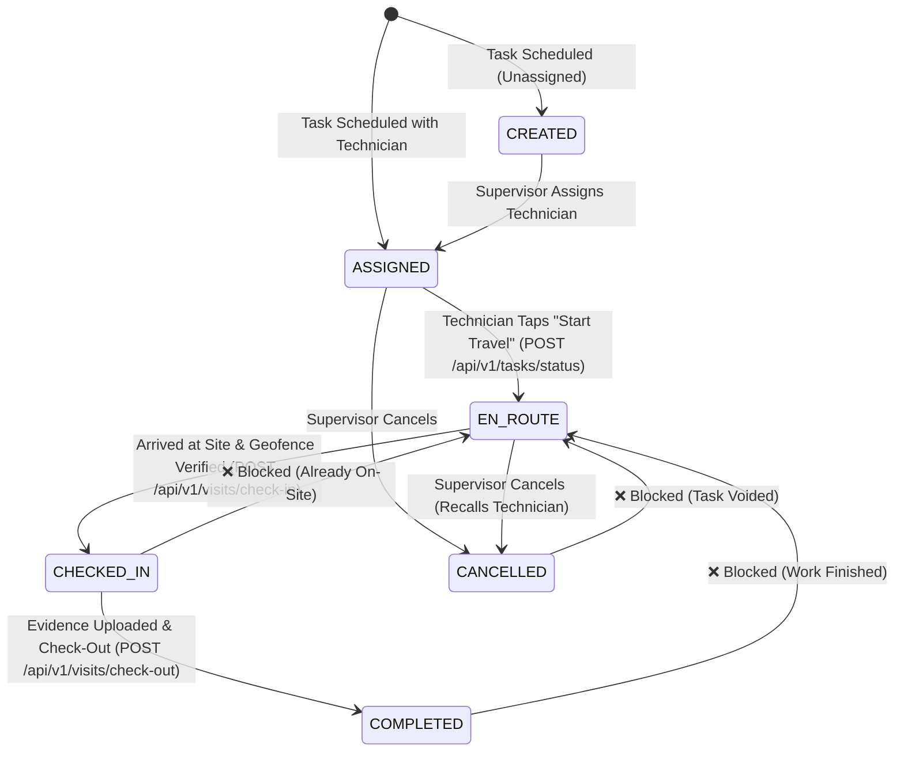

# Update Task Status Module Specification

## 1. Document Metadata

| Attribute | Detail |
| :--- | :--- |
| **Document Reference** | `FFM-SPEC-FLD-TASK-STATUS-V1.0` |
| **System** | Field Force Management (FFM) Platform |
| **Service** | Field Operations Service (`FFM.FieldOperations`) |
| **Module** | Module 2: Task Dispatch & Lifecycle — Feature: Update Task Status (`EN_ROUTE`) |
| **Default Port** | `5030` |
| **Method & Route** | `POST /api/v1/tasks/status` |
| **Compliance** | ISO/IEC/IEEE 29148, OpenAPI 3.1, RFC 7807 (ProblemDetails) |
| **Authentication** | Bearer JWT RS256 (issued by Identity & Access Service) |
| **Classification** | Tier‑1 Core Dispatch & Operational Lifecycle |
| **Status** | Approved Formal Specification |
| **Target Clients** | FFM Mobile App (Technicians) & FFM Web Portal (Supervisors/Managers) |
| **Parent Document** | `FFM_Field_Operations_Service_Spec.md`, Sections 4, 7 & 12 |

---

## 2. Objective & Functional Scope

The **Update Task Status** module enables field technicians to record operational lifecycle progression as they execute scheduled jobs, primarily transitioning a task to **`EN_ROUTE`** when departing for a customer site.

### Key Capabilities:
1. **Departure & Travel Tracking:** Transitions assigned work orders from **`ASSIGNED`** to **`EN_ROUTE`**, signaling that travel has begun.
2. **Real-Time Dispatch Board Sync:** Emits real-time state changes via SignalR / Event Bus so office dispatchers and supervisors see immediate travel updates on the live map.
3. **Strict State Machine Enforcement:** Enforces valid lifecycle progression (`ASSIGNED` ➔ `EN_ROUTE`) and blocks unauthorized or retrograde transitions.
4. **Ownership & BOLA Defense:** Restricts technicians (`EMPLOYEE`) to updating **only** tasks assigned to their authenticated identity, preventing tampering with peer workloads.
5. **Zero Path Parameters Standard:** Conforms to platform architecture standards by delivering `taskId`, `status`, and optional notes exclusively within the **JSON request body** (`POST /api/v1/tasks/status`).

---

## 3. Authorization & RBAC Policy

| Role | Allowed? | Enforcement & BOLA Policy |
| :--- | :---: | :--- |
| `EMPLOYEE` | ✅ Yes (Self-Only) | Technicians can update tasks **only** if `task.AssignedEmployeeId` matches their authenticated employee profile. Attempts to update another employee's task are rejected with `HTTP 403 Forbidden`. |
| `SUPERVISOR` | ✅ Yes | Can update status for tasks assigned to technicians within their supervised teams. |
| `MANAGER` | ✅ Yes | Can update status for any task within their organizational branch/zone. |
| `ADMIN` | ✅ Yes | Global authority to update task status across all organization tasks. |
| `SYSTEM_ADMIN` | ✅ Yes | Platform-wide override and administrative authority. |

* **Unauthenticated Requests:** Returns `401 Unauthorized`.
* **Cross-Technician Tampering (BOLA):** Returns `403 Forbidden` (`TASK_ACCESS_DENIED`).
* **Actor Audit:** The system records `UpdatedByUserId` and `UpdatedAt` (UTC) on every status change.

---

## 4. State Transition Matrix & Lifecycle Rules

The Field Operations state machine governs task execution from creation through completion:



### State Progression Evaluation:
* **`ASSIGNED` ➔ `EN_ROUTE`:** **Allowed (`HTTP 200 OK`)**. The standard departure transition.
* **`CREATED` ➔ `EN_ROUTE`:** **Rejected (`HTTP 400 Bad Request`)**. An unassigned task cannot be en route without an assigned technician.
* **`EN_ROUTE` ➔ `EN_ROUTE`:** **Allowed (`HTTP 200 OK` - Idempotent)**. Returns current task state without error if redundant request occurs due to mobile retry.
* **`CHECKED_IN` ➔ `EN_ROUTE`:** **Rejected (`HTTP 400 Bad Request`)**. Technician is already on-site; cannot revert to traveling.
* **`COMPLETED` ➔ `EN_ROUTE`:** **Rejected (`HTTP 400 Bad Request`)**. Completed work cannot re-enter travel status.
* **`CANCELLED` ➔ `EN_ROUTE`:** **Rejected (`HTTP 400 Bad Request`)**. Cancelled work orders cannot be resumed.

---

## 5. Business Rules & Validation Policies

| Rule ID | Title | Rule Description | Error Code | HTTP Status |
| :--- | :--- | :--- | :--- | :---: |
| **BR-STS-01** | Task Existence | The referenced `taskId` must exist in the database. | `TASK_NOT_FOUND` | `404 Not Found` |
| **BR-STS-02** | Valid Target Status | The `status` field must be an authorized progression status (`EN_ROUTE`). Unrecognized statuses are rejected. | `INVALID_STATUS_VALUE` | `400 Bad Request` |
| **BR-STS-03** | Ownership Guard (BOLA) | If caller has role `EMPLOYEE`, `task.AssignedEmployeeId` must equal caller's employee profile ID. | `TASK_ACCESS_DENIED` | `403 Forbidden` |
| **BR-STS-04** | State Machine Guard | Status update to `EN_ROUTE` is only allowed from `ASSIGNED` (or idempotent `EN_ROUTE`). | `INVALID_TASK_STATE` | `400 Bad Request` |
| **BR-STS-05** | Active Technician Check | The assigned technician must be in an `ACTIVE` employment status and not suspended/deactivated. | `INACTIVE_EMPLOYEE` | `400 Bad Request` |
| **BR-STS-06** | Zero Path Parameter | Mutation payload must be passed in JSON body (`POST /api/v1/tasks/status`). Path parameters are prohibited. | `ROUTING_MISMATCH` | `404 Not Found` |
| **BR-STS-07** | Travel Notes Length | Optional `notes` field cannot exceed 500 characters. | `VALIDATION_ERROR` | `400 Bad Request` |
| **BR-STS-08** | Real-Time Sync Event | Emits `TaskStatusUpdatedIntegrationEvent` to notify dispatch boards and tracking services. | Automated Domain Event | `200 OK` |

---

## 6. API Contract & Interface Specification

### 6.1 Request Details
* **HTTP Method:** `POST`
* **Route:** `/api/v1/tasks/status`
* **Headers:**
  - `Authorization: Bearer <JWT_TOKEN>` (Mandatory)
  - `Content-Type: application/json`

### 6.2 Request Payload (`UpdateTaskStatusRequest`)

```json
{
  "taskId": 105,
  "status": "EN_ROUTE",
  "notes": "Departed central hub with required ATM optical sensor replacement parts."
}
```

#### Field Specifications:

| Field Name | Type | Mandatory? | Constraints | Description |
| :--- | :---: | :---: | :--- | :--- |
| `taskId` | `integer` | Yes | Positive integer `> 0`. | Unique database identifier of the task. |
| `status` | `string` | Yes | Must be `"EN_ROUTE"`. Case-insensitive normalized. | Target lifecycle status. |
| `notes` | `string` | No | Max `500` characters. Leading/trailing whitespace trimmed. | Optional operational remark or travel update from the technician. |

---

### 6.3 Response Contracts

#### Success Response (HTTP 200 OK):
```json
{
  "success": true,
  "message": "Task status updated to EN_ROUTE successfully.",
  "data": {
    "id": 105,
    "taskNumber": "TSK-202611-0015",
    "title": "Emergency ATM Cash Dispenser Sensor Fix",
    "status": "EN_ROUTE",
    "priority": "URGENT",
    "clientSiteId": 4,
    "clientSiteName": "HDFC Bank - Anna Nagar West",
    "assignedEmployeeId": 12,
    "assignedEmployeeName": "Suresh Kumar",
    "scheduledStart": "2026-11-02T10:00:00Z",
    "scheduledEnd": "2026-11-02T12:00:00Z",
    "updatedAt": "2026-11-02T09:42:15Z"
  },
  "errorCode": null,
  "errors": null
}
```

#### Task Not Found (HTTP 404 Not Found):
```json
{
  "success": false,
  "message": "Task with ID 999999 not found.",
  "data": null,
  "errorCode": "TASK_NOT_FOUND",
  "errors": [
    "Task with ID 999999 not found."
  ]
}
```

#### Forbidden — Technician Attempting to Update Peer's Task (HTTP 403 Forbidden):
```json
{
  "success": false,
  "message": "Access denied: You are not authorized to update tasks assigned to another employee.",
  "data": null,
  "errorCode": "TASK_ACCESS_DENIED",
  "errors": [
    "Caller employee ID 15 does not match assigned technician ID 12."
  ]
}
```

#### Invalid Lifecycle Transition (HTTP 400 Bad Request):
```json
{
  "success": false,
  "message": "Cannot transition task to EN_ROUTE from current status CHECKED_IN.",
  "data": null,
  "errorCode": "INVALID_TASK_STATE",
  "errors": [
    "Task is currently in CHECKED_IN status. Valid transitions to EN_ROUTE are only permitted from ASSIGNED status."
  ]
}
```

#### Validation Error — Unassigned Task (HTTP 400 Bad Request):
```json
{
  "success": false,
  "message": "Cannot start travel on an unassigned task.",
  "data": null,
  "errorCode": "INVALID_TASK_STATE",
  "errors": [
    "Task status is CREATED with no assigned technician. Task must be assigned prior to departure."
  ]
}
```

#### Validation Error — Unrecognized Status (HTTP 400 Bad Request):
```json
{
  "success": false,
  "message": "Validation failed for UpdateTaskStatusRequest.",
  "data": null,
  "errorCode": "VALIDATION_ERROR",
  "errors": [
    "Status 'DRIVING' is invalid. Permitted status for this endpoint is 'EN_ROUTE'."
  ]
}
```

---

## 7. Security & Enterprise Hardening Controls

1. **Broken Object Level Authorization (BOLA) Defense:**  
   The application layer validates caller claims against `task.AssignedEmployeeId`. Technicians cannot view or update other technicians' active tasks.
2. **Server-Authoritative Clock:**  
   Status change timestamps (`UpdatedAt`) are generated exclusively on the server (`DateTime.UtcNow`). Client device system clock tampering cannot distort operational departure logs.
3. **Idempotent Mobile Retries:**  
   If intermittent network conditions cause the mobile client to retry the `EN_ROUTE` request after a successful update, the server responds with `HTTP 200 OK` rather than failing, avoiding mobile UI freezing.
4. **Audit Log & Real-Time Telemetry:**  
   Every status change produces an immutable audit log entry capturing `ActorUserId`, `OldStatus`, `NewStatus`, `ClientIP`, and `Timestamp`.
