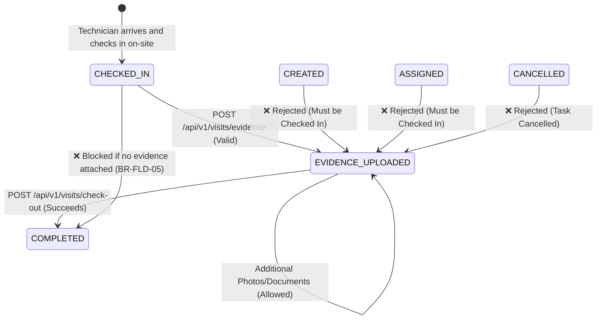

# Visit Evidence & Proof of Work Module Specification

## 1. Document Metadata

| Attribute | Detail |
| :--- | :--- |
| **Document Reference** | `FFM-SPEC-FLD-VISIT-EVIDENCE-V1.0` |
| **System** | Field Force Management (FFM) Platform |
| **Service** | Field Operations Service (`FFM.FieldOperations`) |
| **Module** | Module 3: Field Visit Execution — Feature: Evidence & Proof of Visit Capture |
| **Default Port** | `5030` |
| **Method & Routes** | `POST /api/v1/visits/evidence` (Upload/Record Evidence)<br>`GET /api/v1/visits/evidence` (List/Retrieve Visit Evidences) |
| **Compliance** | ISO/IEC/IEEE 29148, OpenAPI 3.1, RFC 7807 (ProblemDetails), WGS-84 Standard |
| **Authentication** | Bearer JWT RS256 (issued by Identity & Access Service) |
| **Classification** | Tier‑1 Core Verification, SLA Compliance & Billing Audit Engine |
| **Status** | Approved Formal Specification |
| **Target Clients** | FFM Mobile App (Field Technicians) & FFM Web Portal (Supervisors/Managers/Auditors) |
| **Parent Document** | `FFM_Field_Operations_Service_Spec.md`, Sections 4, 6.4, 7.7 & 11 |

---

## 2. Executive Purpose & Business Scope

The **Visit Evidence & Proof of Work Module** provides an immutable, audit-ready evidentiary record of physical field work completed at customer sites. It ensures that service tickets, preventive maintenance, repair tasks, and customer handovers cannot be closed without cryptographic and multimedia verification.

```
       [Field Technician Checked In On-Site (CHECKED_IN)]
                              │
                              ▼
┌──────────────────────────────────────────────────────────────┐
│  UPLOAD / ATTACH EVIDENCE (POST /api/v1/visits/evidence)    │
│  - Associates Evidence with Active or Completed Visit        │
│  - Captures Evidence Classification:                         │
│      PHOTO | SIGNATURE | DOCUMENT | METER_READING | INVOICE  │
│  - Captures Geolocation Telemetry (Latitude, Longitude)      │
│  - Captures High-Res File URL and Thumbnail URL              │
│  - Captures Detailed Technician Remarks (up to 500 chars)    │
│  - Enforces BOLA Ownership & State Machine Integrity         │
└──────────────────────────────────────────────────────────────┘
                              │
                              ▼
┌──────────────────────────────────────────────────────────────┐
│  VERIFY & QUERY EVIDENCES (GET /api/v1/visits/evidence)      │
│  - Filter by visitId or taskId                               │
│  - Serves Audit Trail for Customer Invoicing & SLA Claims    │
└──────────────────────────────────────────────────────────────┘
```

### Key Business Goals:
1. **Definitive Proof of Service Delivery:** Eliminates disputes over whether a technician performed work, replaced parts, or inspected equipment by binding timestamped, geotagged multimedia artifacts to the work order.
2. **Mandatory Billing Prerequisite (BR-FLD-05):** Enforces platform policy that a task cannot transition to `COMPLETED` without at least one verified piece of evidence (e.g., equipment photo, customer digital signature, or diagnostic report).
3. **Broken Object Level Authorization (BOLA) Defense:** Ensures that field technicians can upload evidence **only** to visits and tasks assigned directly to them, while dispatchers and auditors maintain read/review access.
4. **Zero Path Parameter Standard:** Strictly complies with platform architectural conventions—all identifiers (`visitId`, `taskId`, `evidenceId`) are transmitted exclusively via the **JSON request body** for mutations, and query parameters for retrieval.
5. **Storage Decoupling & Cloud Agnostic URL Reference:** Decouples binary storage (AWS S3, Azure Blob, MinIO) from relational transaction records by securely ingesting verified storage URLs and metadata.

---

## 3. Authorization & RBAC Policy

| Endpoint | Role: `EMPLOYEE` (Technician) | Role: `SUPERVISOR` | Role: `MANAGER` | Role: `ADMIN` / `SYSTEM_ADMIN` |
| :--- | :---: | :---: | :---: | :---: |
| `POST /api/v1/visits/evidence` | ✅ Allowed (Assigned Self-Only) | ✅ Allowed (Team Override) | ✅ Allowed (Branch Override) | ✅ Full Platform Access |
| `GET /api/v1/visits/evidence` | ✅ Own Visit Evidences Only | ✅ Team Visit Evidences | ✅ Branch Visit Evidences | ✅ Full Platform Access |

### Authorization & Security Policies:
* **Unauthenticated Calls:** Returns `HTTP 401 Unauthorized` with error code `MISSING_TOKEN` or `INVALID_TOKEN`.
* **BOLA Enforcement (`EMPLOYEE` Role):** When a technician submits an evidence record, the system cross-references the parent visit and task:
  ```csharp
  if (caller.IsRole("EMPLOYEE") && visit.EmployeeId != caller.EmployeeId)
  {
      throw new UnauthorizedAccessException("You are not authorized to upload evidence for this visit.");
  }
  ```
  Violation returns `HTTP 403 Forbidden` (`TASK_ACCESS_DENIED`).
* **Supervisory & Manager Authority:** Users with `SUPERVISOR`, `MANAGER`, `ADMIN`, or `SYSTEM_ADMIN` roles may upload supporting documentation (e.g., third-party supplier parts receipts or supervisor audit inspections) to any visit within their jurisdiction.

---

## 4. Evidence Classification & Data Contracts

### 4.1 Evidence Taxonomy (`EvidenceType`)

Every uploaded evidence artifact must declare a recognized, strongly typed classification:

| Evidence Type Code | Category | Typical Business Use Case | Required Meta Attributes |
| :--- | :--- | :--- | :--- |
| `PHOTO` | Visual Artifact | Pre-service condition, post-repair completion, damaged parts, installed machinery, equipment serial number plate. | `fileUrl`, `thumbnailUrl` (optional), `capturedLatitude`, `capturedLongitude` |
| `SIGNATURE` | Customer Sign-off | Digital hand-drawn customer signature confirming work completion and satisfaction. | `fileUrl`, `remarks` (customer name/phone) |
| `DOCUMENT` | PDF / Technical Sheet | Signed job sheet, safety checklist, warranty certificate, delivery challan. | `fileUrl`, `remarks` (document title) |
| `METER_READING` | Numeric / Diagnostic | Photo of utility meter, pressure gauge, voltage diagnostic reading, or odometer. | `fileUrl`, `remarks` (meter value read) |
| `INVOICE` | Commercial Proof | Vendor invoice, spare parts purchase receipt, on-site cash payment voucher. | `fileUrl`, `remarks` (invoice number / amount) |

---

## 5. State Machine & Execution Rules



### Lifecycle Progression Rules:
1. **Visit Existence Check:** The referenced `visitId` must exist in the database. If missing, returns `HTTP 404 Not Found` (`VISIT_NOT_FOUND`).
2. **Permitted Visit States:**
   * **`CHECKED_IN`:** Standard operational state. Field technician uploads photos and proof while actively performing work on customer premises.
   * **`COMPLETED`:** Permitted for retroactive document attachment (e.g., supervisor uploading third-party lab inspection report within 24 hours of task closure).
   * **`CREATED`, `ASSIGNED`, `EN_ROUTE`:** **Rejected (`HTTP 400 Bad Request` — `INVALID_VISIT_STATE`)**. Work has not yet begun on-site; technicians cannot upload completion proof before physically arriving.
   * **`CANCELLED`, `ABORTED`:** **Rejected (`HTTP 400 Bad Request` — `INVALID_VISIT_STATE`)**. Aborted or cancelled visits cannot receive new proof.
3. **Mandatory Evidence Rule (BR-FLD-05):** During the execution of `POST /api/v1/visits/check-out`, the system verifies `COUNT(VisitEvidences WHERE VisitId = @visitId) >= 1`. If zero evidences exist, checkout is blocked with `HTTP 400 Bad Request` (`EVIDENCE_REQUIRED_FOR_COMPLETION`).

---

## 6. API Contracts & Endpoint Specifications

### 6.1 Upload / Attach Visit Evidence

* **Method & Route:** `POST /api/v1/visits/evidence`
* **Authorization:** `EMPLOYEE`, `SUPERVISOR`, `MANAGER`, `ADMIN`, `SYSTEM_ADMIN`
* **Headers:**
  ```http
  Authorization: Bearer <jwt-token>
  Content-Type: application/json
  Accept: application/json
  ```

#### Request Payload (`AddVisitEvidenceRequest`):
```json
{
  "visitId": 501,
  "evidenceType": "PHOTO",
  "fileUrl": "https://storage.ffm.example.com/evidence/2026/10/pos_terminal_photo_501.jpg",
  "thumbnailUrl": "https://storage.ffm.example.com/evidence/2026/10/thumb_pos_501.jpg",
  "remarks": "Replaced faulty motherboard & power supply unit. Terminal operational.",
  "capturedLatitude": 12.9716100,
  "capturedLongitude": 77.5945700
}
```

#### Field Validation Rules:
| Field | Type | Required? | Constraints & Validation Rules |
| :--- | :--- | :---: | :--- |
| `visitId` | Integer | Yes | Must be a positive integer (`> 0`). Must reference an existing `Visits` record. |
| `evidenceType` | String | Yes | Must be one of: `PHOTO`, `SIGNATURE`, `DOCUMENT`, `METER_READING`, `INVOICE`. Case-insensitive normalization to uppercase. |
| `fileUrl` | String | Yes | Must be a valid absolute URI (HTTP/HTTPS). Length: 10 to 500 characters. Must not contain script tags or local path traversal (`file://`). |
| `thumbnailUrl` | String | No | Optional. If provided, must be a valid absolute URI (HTTP/HTTPS) up to 500 characters. |
| `remarks` | String | No | Optional notes. Maximum length: 500 characters. Sanitized against XSS and control characters. |
| `capturedLatitude` | Decimal | No | If provided, must be between `-90.0` and `+90.0`. |
| `capturedLongitude` | Decimal | No | If provided, must be between `-180.0` and `+180.0`. |

#### Success Response (`HTTP 201 Created`):
```json
{
  "success": true,
  "message": "Visit evidence recorded successfully.",
  "data": {
    "id": 1001,
    "visitId": 501,
    "evidenceType": "PHOTO",
    "fileUrl": "https://storage.ffm.example.com/evidence/2026/10/pos_terminal_photo_501.jpg",
    "thumbnailUrl": "https://storage.ffm.example.com/evidence/2026/10/thumb_pos_501.jpg",
    "remarks": "Replaced faulty motherboard & power supply unit. Terminal operational.",
    "capturedLatitude": 12.9716100,
    "capturedLongitude": 77.5945700,
    "capturedAt": "2026-10-29T10:45:00Z"
  }
}
```

#### Error Responses:
* **HTTP 400 Bad Request — Invalid Payload / Format:**
  ```json
  {
    "success": false,
    "error": {
      "code": "VALIDATION_ERROR",
      "details": "The fileUrl field must be a valid absolute HTTPS URL."
    }
  }
  ```
* **HTTP 400 Bad Request — Unrecognized Evidence Type:**
  ```json
  {
    "success": false,
    "error": {
      "code": "INVALID_EVIDENCE_TYPE",
      "details": "Evidence type 'AUDIO_CLIP' is invalid. Allowed: PHOTO, SIGNATURE, DOCUMENT, METER_READING, INVOICE."
    }
  }
  ```
* **HTTP 400 Bad Request — Incompatible Visit State:**
  ```json
  {
    "success": false,
    "error": {
      "code": "INVALID_VISIT_STATE",
      "details": "Cannot attach evidence to a visit that is currently in 'ABORTED' status."
    }
  }
  ```
* **HTTP 403 Forbidden — BOLA Violation:**
  ```json
  {
    "success": false,
    "error": {
      "code": "TASK_ACCESS_DENIED",
      "details": "You are not authorized to upload evidence for this visit."
    }
  }
  ```
* **HTTP 404 Not Found — Visit Non-Existent:**
  ```json
  {
    "success": false,
    "error": {
      "code": "VISIT_NOT_FOUND",
      "details": "Visit with ID 999 does not exist."
    }
  }
  ```

---

### 6.2 Get Evidences for Visit / Task

* **Method & Route:** `GET /api/v1/visits/evidence?visitId=501`
* **Alternate Query:** `GET /api/v1/visits/evidence?taskId=101`
* **Authorization:** `EMPLOYEE` (self-only), `SUPERVISOR`, `MANAGER`, `ADMIN`, `SYSTEM_ADMIN`
* **Headers:**
  ```http
  Authorization: Bearer <jwt-token>
  Accept: application/json
  ```

#### Query Parameters:
| Parameter | Type | Required? | Description |
| :--- | :--- | :---: | :--- |
| `visitId` | Integer | Optional* | Unique identifier of the visit record. (*Either `visitId` or `taskId` must be provided). |
| `taskId` | Integer | Optional* | Unique identifier of the parent work order. |
| `evidenceType` | String | Optional | Filter by specific type (`PHOTO`, `SIGNATURE`, etc.). |

#### Success Response (`HTTP 200 OK`):
```json
{
  "success": true,
  "message": "Visit evidences retrieved successfully.",
  "data": [
    {
      "id": 1001,
      "visitId": 501,
      "evidenceType": "PHOTO",
      "fileUrl": "https://storage.ffm.example.com/evidence/2026/10/pos_terminal_photo_501.jpg",
      "thumbnailUrl": "https://storage.ffm.example.com/evidence/2026/10/thumb_pos_501.jpg",
      "remarks": "Replaced faulty motherboard & power supply unit. Terminal operational.",
      "capturedLatitude": 12.9716100,
      "capturedLongitude": 77.5945700,
      "capturedAt": "2026-10-29T10:45:00Z"
    },
    {
      "id": 1002,
      "visitId": 501,
      "evidenceType": "SIGNATURE",
      "fileUrl": "https://storage.ffm.example.com/signatures/2026/10/sig_501.png",
      "thumbnailUrl": null,
      "remarks": "Customer representative: Ramesh Kumar (Store Manager)",
      "capturedLatitude": 12.9716120,
      "capturedLongitude": 77.5945680,
      "capturedAt": "2026-10-29T11:42:10Z"
    }
  ]
}
```

---

## 7. Database Schema & Index Definitions (PostgreSQL)

```sql
-- ============================================================================
-- Table: VisitEvidences
-- Purpose: Stores tamper-proof evidentiary proof of completed field visits
-- ============================================================================
CREATE TABLE "VisitEvidences" (
    "Id" SERIAL PRIMARY KEY,
    "VisitId" INT NOT NULL REFERENCES "Visits" ("Id") ON DELETE CASCADE,
    "EvidenceType" VARCHAR(30) NOT NULL,
    "FileUrl" VARCHAR(500) NOT NULL,
    "ThumbnailUrl" VARCHAR(500) NULL,
    "Remarks" VARCHAR(500) NULL,
    "CapturedLatitude" DECIMAL(10, 7) NULL,
    "CapturedLongitude" DECIMAL(10, 7) NULL,
    "CapturedAt" TIMESTAMP WITH TIME ZONE NOT NULL DEFAULT NOW()
);

-- Indexes for performance & rapid query execution
CREATE INDEX "IX_VisitEvidences_VisitId" ON "VisitEvidences" ("VisitId");
CREATE INDEX "IX_VisitEvidences_Type" ON "VisitEvidences" ("EvidenceType");
CREATE INDEX "IX_VisitEvidences_CapturedAt" ON "VisitEvidences" ("CapturedAt" DESC);

-- Constraint: Supported Evidence Types
ALTER TABLE "VisitEvidences"
    ADD CONSTRAINT "CK_VisitEvidences_EvidenceType"
    CHECK ("EvidenceType" IN ('PHOTO', 'SIGNATURE', 'DOCUMENT', 'METER_READING', 'INVOICE'));

-- Constraint: Coordinates boundary check
ALTER TABLE "VisitEvidences"
    ADD CONSTRAINT "CK_VisitEvidences_Latitude"
    CHECK ("CapturedLatitude" IS NULL OR ("CapturedLatitude" >= -90.0 AND "CapturedLatitude" <= 90.0));

ALTER TABLE "VisitEvidences"
    ADD CONSTRAINT "CK_VisitEvidences_Longitude"
    CHECK ("CapturedLongitude" IS NULL OR ("CapturedLongitude" >= -180.0 AND "CapturedLongitude" <= 180.0));
```

---

## 8. Sequence Diagram: Evidence Capture Workflow

```mermaid
sequenceDiagram
    autonumber
    actor Technician as 📱 Field Technician (Mobile App)
    participant Storage as ☁️ Cloud Object Storage (S3 / Blob)
    participant API as 🌐 Field Operations API (:5030)
    participant DB as 🗄️ PostgreSQL (Visits & Evidences)
    actor Supervisor as 💻 Supervisor / Auditor (Web Portal)

    Note over Technician: Technician is Checked-In on Site
    Technician->>Storage: 1. Direct Upload photo/signature binary (Presigned URL)
    Storage-->>Technician: 2. Return File CDN URL (https://storage.../photo.jpg)

    Technician->>API: 3. POST /api/v1/visits/evidence {visitId: 501, type: "PHOTO", fileUrl, GPS, remarks}
    API->>DB: 4. Query Visit & Task (Validate ownership & CHECKED_IN status)
    DB-->>API: 5. Visit 501 Valid (Assigned to caller)
    
    API->>DB: 6. INSERT into "VisitEvidences" (Type, FileUrl, GPS, Remarks, NOW())
    DB-->>API: 7. Record inserted with Id: 1001
    API-->>Technician: 8. HTTP 201 Created {evidenceId: 1001, capturedAt}

    Note over Technician: Work completed; Ready for Check-out
    Technician->>API: 9. POST /api/v1/visits/check-out {visitId: 501, ...}
    API->>DB: 10. Verify COUNT(Evidences) >= 1 (BR-FLD-05 passed)
    API-->>Technician: 11. Check-Out Successful (Task COMPLETED)

    Supervisor->>API: 12. GET /api/v1/visits/evidence?visitId=501
    API->>DB: 13. SELECT * FROM "VisitEvidences" WHERE VisitId = 501
    DB-->>API: 14. Return Evidence Array
    API-->>Supervisor: 15. HTTP 200 OK (Photos & Signatures verified)
```

---

## 9. Security & Anti-Tampering Hardening

1. **Content-Type & URL Protocol Whitelist:**
   * Only secure web protocols (`https://`) are accepted for `fileUrl` and `thumbnailUrl`. Insecure schemes (`http://`, `ftp://`, `file://`, `data://`) are strictly rejected with `HTTP 400 Bad Request`.
2. **Anti-XSS Sanitization:**
   * The `remarks` text field is scrubbed of HTML tags, SQL keywords, and script injection vectors (`<script>`, `javascript:`, `onerror`).
3. **Decoupled Presigned URL Upload:**
   * Heavy binary multipart file uploads do not traverse the .NET Field Operations API gateway. Instead, the mobile client uploads the binary directly to Cloud Storage (AWS S3 or Azure Blob) via short-lived presigned URLs, and passes only the verified file URL and metadata to `POST /api/v1/visits/evidence`. This protects API worker threads from bandwidth exhaustion.
4. **Server-Authoritative Capture Timestamp:**
   * The client device clock is strictly ignored. The audit timestamp `CapturedAt` is populated exclusively by the server using `DateTime.UtcNow`.
5. **Horizontal Tenant & User Isolation:**
   * Field technicians can only query or view evidences associated with their own tasks. Querying another technician's evidence records returns `HTTP 403 Forbidden` (`FORBIDDEN_RESOURCE_ACCESS`).

---

## 10. Acceptance Criteria & Test Scenarios

1. **Successful Photo Attachment:**
   * Given a technician checked into visit `501`.
   * When submitting a valid `POST /api/v1/visits/evidence` with `evidenceType = "PHOTO"`, valid HTTPS `fileUrl`, and GPS telemetry.
   * Then response MUST be `201 Created` and record persisted in `VisitEvidences`.
2. **Invalid Evidence Type Rejection:**
   * Given an invalid type string e.g. `"VOICE_MEMO"`.
   * When submitted, API MUST return `400 Bad Request` with code `INVALID_EVIDENCE_TYPE`.
3. **BOLA Ownership Violation:**
   * Given Technician A (Employee ID 10) attempts to upload evidence for Visit 502 (assigned to Employee ID 20).
   * Then API MUST return `403 Forbidden` with code `TASK_ACCESS_DENIED`.
4. **Invalid Visit State:**
   * Given Visit 503 is currently in `ABORTED` or `CANCELLED` status.
   * When technician submits evidence, API MUST return `400 Bad Request` with code `INVALID_VISIT_STATE`.
5. **Retrieval by Visit and Task:**
   * Given multiple evidences attached to visit `501`.
   * When querying `GET /api/v1/visits/evidence?visitId=501`, API MUST return all associated records sorted chronologically.

